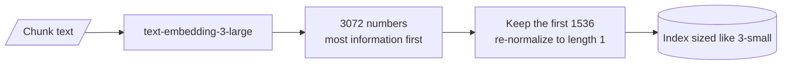

# M13.2 Theory: Hosted embeddings: OpenAI models and dimensions

*[M13 theory](../README.md) · Lesson 13.2 · Notebooks: [`02a_openai_embeddings.ipynb`](../../notebook/02a_openai_embeddings.ipynb), [`02b_openai_embeddings_tutorial.ipynb`](../../../optional/notebook/02b_openai_embeddings_tutorial.ipynb) (optional) · [All theory pages](../../../../../THEORY.md)*
<!-- subtitle: Embedding the corpus is a one-off bill, and dimensions cost memory and compute on every query -->
<!-- format: approved -->

## Vector dimensionality

> **What you'll learn**
>
> - **Explain** what an embedding's dimensionality is, and why every vector in one index must share it.
> - **Compare** the one-off cost of embedding a corpus with the running cost of storing and searching it.
> - **Measure** a dimension cut by its margin, not only by recall@1.
> - **Choose** a model and dimension count, knowing that changing either means re-embedding.

Lesson 13.1 showed how vectors are compared. This lesson looks at the hosted models that produce them, and at the one number that sets most of an index's running cost.

A teammate moves the Larkspur index from `text-embedding-3-small` to `text-embedding-3-large` because "bigger is better". The embedding bill barely moves. The vector store's memory doubles, every search does twice the arithmetic, and nobody measured whether the handbook's questions retrieve any better.

An embedding's **dimensionality** is how many numbers the model returns per text. It is fixed by the model, or by the dimensions setting described below, and every stored vector and every query vector in one index must have the same count. The notebooks use three hosted OpenAI models:

| Model | Default dimensions | Max input tokens | Listed price per 1M tokens | 1,000 chunks of 500 characters |
|---|---|---|---|---|
| `text-embedding-3-small` | 1536 | 8191 | $0.02 | $0.0025 |
| `text-embedding-3-large` | 3072 | 8191 | $0.13 | $0.016 |
| `text-embedding-ada-002` (previous generation) | 1536 | 8191 | $0.10 | $0.0125 |

*Table 1: The three hosted models in the notebooks, with the cost of embedding 1,000 short chunks.*

Dimensions, token limits and prices are as the lesson 13.2 notebooks list them. Check the provider's current price list before you budget. The last column is arithmetic: 500 characters is about 125 tokens at four characters per token, the rule of thumb the M10 lab uses, so 1,000 such chunks are about 125,000 tokens.

Embedding the corpus is a one-off bill, and small. The dimensions are paid again on every query, for as long as the index exists. The store keeps every number, holds them in memory to search fast, and multiplies through them for each similarity. Stored as 32-bit floats, before any index overhead or compression:

| Dimensions | Bytes per vector | 1 million chunks |
|---|---|---|
| 384 (`all-MiniLM-L6-v2`, lesson 13.3) | 1,536 | 1.5 GB |
| 1024 (`BAAI/bge-large-en`, lesson 13.3) | 4,096 | 4.1 GB |
| 1536 (`3-small`) | 6,144 | 6.1 GB |
| 3072 (`3-large`) | 12,288 | 12.3 GB |

*Table 2: Memory for one million vectors at four dimension counts (4 bytes per number).*

Notebook 13.1 puts it as a rule: a 3072-dimension index is twice the size of a 1536-dimension one and costs roughly twice as much per search. Some vector stores can compress vectors into fewer bytes per number, which lowers these figures at some cost in accuracy.

## Shortening a vector with dimensions

The `text-embedding-3` models are trained with **Matryoshka representation learning**, which puts the most useful information in the first numbers. The API can therefore cut a vector short and re-normalise it, and the shorter vector still works for search. Two settings the notebooks use:

| Model and dimensions setting | What you get |
|---|---|
| `3-small` at 512 | 512 numbers instead of 1536, a third of the index |
| `3-large` at 1536 | The large model at the small model's index size |

*Table 3: Two uses of the dimensions setting.*

The cut happens inside the API, before the vector reaches the store:

*Figure 1: Truncating a `3-large` vector to 1536 dimensions.*

Shorter vectors are worse. The open question is how much worse on your data for what you save. Notebook 13.1 measures it on six labelled queries at 1536, 512, 256, 128, 64 and 32 dimensions and reports two numbers per setting:

- **Recall@1**, which saturates on an easy set: six well-separated documents score perfectly at almost any size, and then the metric says nothing more. We call that **saturated recall**.
- **Margin**, the correct document's similarity minus the best wrong document's. It keeps shrinking as dimensions fall, and a shrinking margin is where recall will break on a large corpus with near-duplicates, such as Larkspur's `refund-window` and `refund-timing` chunks.

The notebook's most useful row is `3-large` truncated to 1536: a stronger model at the same index cost as `3-small`. Run the same comparison on the M10 golden set before you pick a size. Treat the choice as permanent, because changing dimensions means re-embedding every chunk and querying with the new setting.

The two bills move independently, and the switcher puts them side by side for one million handbook-sized chunks. The embedding bill is Table 1's price times 125 million tokens, paid once. The index size is Table 2's arithmetic, held for as long as the index serves queries.

Choose a model and dimensions setting for one million chunks of 500 characters, and compare the one-off bill with the running one.

<button type="button" data-mode="small" aria-pressed="false" aria-controls="dims-small">3-small at 1536</button>
<button type="button" data-mode="large" aria-pressed="false" aria-controls="dims-large">3-large at 3072</button>
<button type="button" data-mode="large-cut" aria-pressed="false" aria-controls="dims-large-cut">3-large at 1536</button>
<button type="button" data-mode="small-cut" aria-pressed="false" aria-controls="dims-small-cut">3-small at 512</button>

<section id="dims-small" class="mode-panel" data-announcement="3-small at 1536. 2.50 dollars once, 6.1 gigabytes held."><h4>3-small at 1536 (the baseline)</h4><dl><dt>Embedding bill, once</dt><dd>$2.50</dd><dt>Index memory, every day</dt><dd>6.1 GB</dd><dt>What to measure</dt><dd>this is the reference row for recall and margin</dd></dl></section>
<section id="dims-large" class="mode-panel" data-announcement="3-large at 3072. 16.25 dollars once, 12.3 gigabytes held."><h4>3-large at 3072 (the "bigger is better" move)</h4><dl><dt>Embedding bill, once</dt><dd>$16.25</dd><dt>Index memory, every day</dt><dd>12.3 GB, twice the baseline, and twice the arithmetic per search</dd><dt>What to measure</dt><dd>whether the margin gain on the golden set pays for a doubled index</dd></dl></section>
<section id="dims-large-cut" class="mode-panel" data-announcement="3-large at 1536. 16.25 dollars once, 6.1 gigabytes held."><h4>3-large truncated to 1536</h4><dl><dt>Embedding bill, once</dt><dd>$16.25: the price is per token, and truncation does not change it</dd><dt>Index memory, every day</dt><dd>6.1 GB, the same as the baseline</dd><dt>What to measure</dt><dd>its margin against 3-small at 1536, at equal running cost</dd></dl></section>
<section id="dims-small-cut" class="mode-panel" data-announcement="3-small at 512. 2.50 dollars once, 2.0 gigabytes held."><h4>3-small truncated to 512</h4><dl><dt>Embedding bill, once</dt><dd>$2.50</dd><dt>Index memory, every day</dt><dd>2.0 GB, a third of the baseline</dd><dt>What to measure</dt><dd>whether the margin between <code>refund-window</code> and <code>refund-timing</code> holds</dd></dl></section>

The one-off bills differ by about $14. The running costs differ by a factor of six between the smallest and largest index, and that difference is paid every day the index is up.

## In practice: sizing the Larkspur index

For the handbook, the model and dimension choice takes four steps:

1. **Shortlist** `3-small` at 1536 and `3-large` truncated to 1536, which cost the same to store and search.
2. **Score both on the M10 golden set** by recall and margin, paying attention to the near-duplicate refund chunks.
3. **Try a shorter setting**, such as 512, only if memory is the constraint, and keep it only if the margin holds.
4. **Record the model and dimensions** in the index metadata (lesson 13.1), since every query must use the same pair.

Lesson 13.3 compares these hosted models with open models that run on your own machines.

## Limits of this evidence

- **Prices are the notebooks' figures.** Table 1 and the switcher use the per-token prices written into the lesson 13.2 notebooks. Providers change prices, so budget from the current price list.
- **Memory is raw vector storage.** Table 2 counts 4 bytes per number and nothing else. A real index adds its graph or list structures, and compression lowers the total.
- **"Twice the cost per search" is a rule of thumb.** Similarity arithmetic grows with dimensions, but an approximate index visits only part of the corpus, and its own settings matter as much ([M14](../../../../m14_vector_stores/mandatory/theory/README.md)).
- **The sweep has six queries.** The notebook ships without outputs, and its six well-separated documents saturate recall@1. Its table shows the method; your golden set gives the numbers.

## References

1. OpenAI, [New embedding models and API updates](https://openai.com/index/new-embedding-models-and-api-updates/), 2024, introducing the `text-embedding-3` models and the dimensions setting.
2. Kusupati and others, [Matryoshka representation learning](https://arxiv.org/abs/2205.13147), 2022, the training method that front-loads information.
3. OpenAI, [Vector embeddings guide](https://developers.openai.com/api/docs/guides/embeddings), on reducing dimensions.

## Key Takeaways

- Embedding the corpus is a small one-off bill; dimensions are paid on every query in memory and compute. One million 1536-dimension vectors take about 6.1 GB as 32-bit floats.
- The `text-embedding-3` models can be shortened with the dimensions setting. `3-large` at 1536 gives a stronger model at the same index cost as `3-small`.
- Judge a dimension cut by the margin, not only recall@1, which saturates on easy sets. Treat the choice as permanent, because changing it means re-embedding every chunk.

## Check yourself

1. Embedding the corpus is a small one-off bill. Why do the dimensions keep costing you for as long as the index exists?

The store keeps every number of every vector, holds them in memory to search fast, and multiplies through them for each similarity. A 3072-dimension index is twice the size of a 1536-dimension one and costs roughly twice as much per search.

2. How much memory do one million chunks need at 3072 dimensions compared with 1536, stored as 32-bit floats?

12,288 bytes per vector gives 12.3 GB at 3072 dimensions, against 6,144 bytes and 6.1 GB at 1536, before any index overhead or compression. Truncating `text-embedding-3-large` to 1536 with the dimensions setting gives a stronger model at the smaller index's size.

3. A dimension sweep on six labelled queries shows perfect recall at 1 even at 64 dimensions. Should you ship 64?

No. Recall@1 saturates on an easy set of well-separated documents and then says nothing more. The margin keeps shrinking as dimensions fall, and a shrinking margin is where recall breaks on a large corpus with near-duplicates such as `refund-window` and `refund-timing`. Run the comparison on the M10 golden set, and treat the choice as permanent, since changing it means re-embedding every chunk.

---
*Previous: [13.1 Embedding fundamentals, similarity metrics and model selection](../01_embedding_fundamentals_similarity_metrics_and_model_selection/README.md). Next: [13.3 Open-source embeddings with Hugging Face](../03_open_source_embeddings_with_hugging_face/README.md).*
