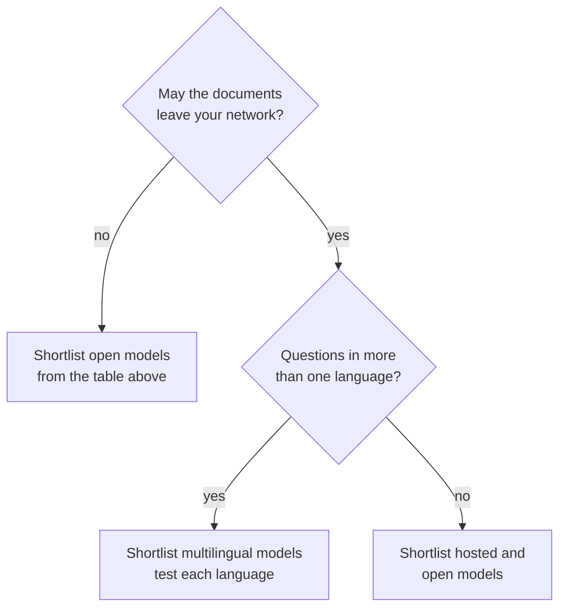

# M13.3 Theory: Open-source embeddings with Hugging Face

*[M13 theory](../README.md) · Lesson 13.3 · Notebooks: [`03a_huggingface_embeddings.ipynb`](../../notebook/03a_huggingface_embeddings.ipynb), [`03b_huggingface_embeddings_tutorial.ipynb`](../../../optional/notebook/03b_huggingface_embeddings_tutorial.ipynb) (optional), [`03c_embedding_models.ipynb`](../../../optional/notebook/03c_embedding_models.ipynb) (optional) · [All theory pages](../../../../../THEORY.md)*
<!-- subtitle: A model fits your domain when your near-duplicates land apart, and only your own golden set shows it -->

## Domain fit

> **What you'll learn**
>
> - **Explain** what domain fit means for an embedding model, and how a poor fit shows up.
> - **Compare** open models run locally with hosted ones by cost, data, latency and operations.
> - **Diagnose** an open model that ranks badly because its vectors are not normalised.
> - **Design** a golden set with hard negatives that can separate candidate models.

Lesson 13.2 sized the hosted OpenAI models. Open models run on your own machines, which widens the choice, and makes the question of which one fits your documents harder to skip.

A Larkspur customer asks *How much bandwidth does the Business plan include?* The handbook never says "bandwidth". It says "outbound traffic". If the embedding model does not place those two phrases close together, the plans page loses to whatever chunk happens to mention networks, and the answer comes from the wrong page. Nothing raises an error.

A model has **domain fit** when texts that mean the same thing in *your* documents land close together and texts that differ land apart. General-purpose models are trained on broad web text. They can place two Larkspur chunks that differ by one condition (a full refund within 30 days, a prorated one after) almost on top of each other, miss a customer's synonym for a handbook term, or fail on a language they were not trained on. We call any of these a **domain miss**: it shows up only as the wrong chunk ranked first.

The Hugging Face wrapper runs sentence-transformers models on your own machine, with no API key. The models the lesson's notebooks load:

| Model | Dimensions | What the notebooks say it is for |
|---|---|---|
| `sentence-transformers/all-MiniLM-L6-v2` | 384 | Fast, general purpose; the default in the notebooks |
| `sentence-transformers/all-MiniLM-L12-v2` | 384 | A little better than L6, a little slower |
| `sentence-transformers/all-mpnet-base-v2` | 768 | Higher quality, slower than MiniLM |
| `sentence-transformers/multi-qa-MiniLM-L6-cos-v1` | 384 | Tuned for question answering and semantic search |
| `sentence-transformers/paraphrase-multilingual-MiniLM-L12-v2` | 384 | More than 50 languages |
| `BAAI/bge-large-en` | 1024 | High-accuracy applications; the slowest in 03b's table |
| `mixedbread-ai/mxbai-embed-large-v1` | Not printed in the notebook | Loaded in 03c as a second open model to compare with OpenAI |

*Table 1: Open embedding models used in the lesson's notebooks.*

Two settings decide whether a local model behaves like the hosted ones in lessons 13.1 and 13.2:

- **Normalisation is off by default.** Turn it on in the wrapper's encode settings, or score with cosine. Otherwise dot product rewards longer vectors, as the [lesson 13.1 lab](../01_embedding_fundamentals_similarity_metrics_and_model_selection/interactive/similarity-metrics-lab.html) shows. We call a local model left this way an **unnormalised local model**.
- **Some models are asymmetric.** They are trained so that short questions and long passages meet, and they treat the two sides differently: `embed_query` and `embed_documents` can return different vectors for the same text. Keep the two calls separate in your code even when today's model is symmetric.

Hosted or self-hosted is part of the fit, because some corpora may not leave your network. The trade, from notebook 13.1:

| | Hosted API | Self-hosted |
|---|---|---|
| Cost | Per token, for as long as you use it | Hardware and operations |
| Data | Leaves your network | Stays on your machines |
| Latency | A network round trip | Local compute; a GPU helps a lot |
| Ops burden | None | Versioning, serving, scaling, capacity |
| Deprecation | The provider can retire the model, forcing a re-index | You decide when it changes |

*Table 2: Hosted against self-hosted embeddings.*

## Measuring fit

Leaderboards such as MTEB (the Massive Text Embedding Benchmark) average many public datasets. They are good for a shortlist. The decision comes from scoring the shortlist on your own documents and questions, and a short decision chain narrows where to start:

*Figure 1: Building a shortlist. Every branch ends in the same scoring on your golden set.*

Every shortlist then goes through the same scoring on the golden set: recall@k, margin, cost and latency. A useful golden set for Larkspur holds the M10 questions plus **hard negatives**: chunks on the same topic that do not answer the question, such as `cancel` for *Can I export my data after I cancel my plan?* Notebook 13.1's exercise asks for exactly this, because a six-document toy set separates no models. We call a set without them an **easy golden set**: every candidate scores well, and the comparison decides nothing.

Score more than one thing, too. Lesson 13.5 runs three open models through two automatic judges on Databricks, and the two judges disagree about which model is best.

## In practice: an open-model shortlist for Larkspur

For the handbook, choosing an open model takes four steps:

1. **Shortlist** `all-MiniLM-L6-v2`, `all-mpnet-base-v2` and `bge-large-en` from Table 1, plus the hosted model from lesson 13.2 as the baseline.
2. **Turn on normalisation** for every open model, so the metric from lesson 13.1 behaves.
3. **Add hard negatives** to the golden set: `cancel` for the export question, `refund-window` for the refund-timing question, and a "bandwidth" paraphrase for the plans page.
4. **Score recall, margin, latency and cost** for each, and keep the documents on Larkspur's machines if policy requires it.

> **Next:** lesson 13.4 turns to running embeddings in production: batching the calls and caching the results.

## Key Takeaways

- Poor domain fit raises no error; it shows up as the wrong chunk ranked first. Use leaderboards for a shortlist and your own golden set, with hard negatives, for the decision.
- The Hugging Face wrapper does not normalise by default. Turn normalisation on or score with cosine, and keep `embed_query` and `embed_documents` separate for asymmetric models.
- Hosted models cost per token and send data off your network; self-hosted ones cost hardware and operations. Decide which metric matters before you compare results.

## Check yourself

1. How does a poor domain fit show up, given that it raises no error?

As the wrong chunk ranked first. A general-purpose model can place two Larkspur chunks that differ by one condition almost on top of each other, or miss that a customer's "bandwidth" is the handbook's "outbound traffic". Leaderboards such as MTEB give a shortlist; the decision comes from scoring that shortlist on your own documents and questions.

2. You are building a golden set for the question about exporting data after cancelling a plan. What kind of chunk should it include besides the answer, and why?

A hard negative: a chunk on the same topic that does not answer the question, such as `cancel`. Hard negatives are what separate models. A six-document toy set separates none.

3. You swap a hosted OpenAI model for all-MiniLM-L6-v2 with default settings and keep scoring by dot product. What goes wrong?

Normalisation is off by default in the Hugging Face wrapper, so the vectors do not have length 1 and dot product rewards longer vectors. Turn normalisation on in the encode settings, or score with cosine.

---
*Previous: [13.2 Hosted embeddings: OpenAI models and dimensions](../02_hosted_embeddings_openai_models_and_dimensions/README.md). Next: [13.4 Production concerns: batching, caching and similarity behaviour](../04_production_concerns_batching_caching_and_similarity_behaviour/README.md).*
