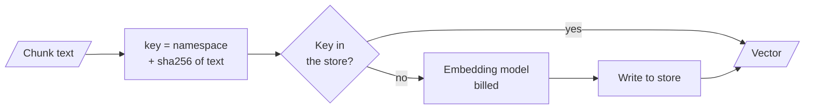

# M13.4 Theory: Production concerns: batching, caching and similarity behaviour

*[M13 theory](../README.md) · Lesson 13.4 · Notebooks: [`04a_embeddings_deep_dive.ipynb`](../../notebook/04a_embeddings_deep_dive.ipynb) · [All theory pages](../../../../../THEORY.md)*
<!-- subtitle: A cache makes re-indexing cost only the edit, and its namespace keeps two models' vectors apart -->

## Embedding cache

> **What you'll learn**
>
> - **Explain** how an embedding cache decides whether a text has been embedded before.
> - **Trace** five indexing runs through the cache: what reaches the model and what the store holds.
> - **Diagnose** a model swap that re-embeds nothing and breaks retrieval.
> - **Choose** batched calls over per-chunk calls for indexing.

Lessons 13.1 to 13.3 chose a metric, a model and its dimensions. This lesson is about running that choice every day: re-indexing as the handbook changes, without paying for the same vectors twice or mixing two models' vectors in one index.

The Larkspur team swaps embedding models and re-indexes the handbook. The job finishes in seconds, having sent none of the 12 chunks to the new model, and retrieval quality collapses. The cache answered every request with the old model's vectors, because both models wrote to the same cache keys.

Every re-run of an indexing notebook, and every re-ingest after a change elsewhere in the pipeline, embeds the whole corpus again and pays for it again, for vectors identical to the ones you already had. An **embedding cache** wraps an embedding model with a key-value store: text it has seen comes back from the store, and only new text reaches the model. LangChain's cache-backed embeddings work this way, and the notebook sets them up with five choices:

| Setting | In the notebook | Why it matters |
|---|---|---|
| Underlying model | `text-embedding-3-small` | The model that is called, and billed, on a miss |
| Store | A local file store in a folder | One file per vector; any other byte store, such as Redis, can serve a cache shared between workers |
| Namespace | The model name and its dimensions | Keeps two models' vectors under different keys |
| Key encoder | SHA-256 | The default, SHA-1, raises a warning |
| Query caching | Off, the default | Few questions repeat word for word |

*Table 1: The cache settings, as notebook 13.4 sets them.*

Each lookup builds a key from the namespace and a hash of the text:

<!-- animated: diagrams/cache.anim.html -->

*Figure 1: One cache lookup. Only a miss reaches the billed model.*

A cache entry therefore matches only the exact text under the exact namespace. To see what that means for the Larkspur handbook, the 12 chunks of the M10 lab were run through the real cache-backed embeddings with a counting stand-in for the API (LangChain's deterministic fake embedding, so the counts are exact and free):

| Run | Texts sent to the model | Keys in the store |
|---|---|---|
| 1. Index the 12 chunks | 12 of 12 | 12 |
| 2. Index the same 12 again | 0 of 12, identical vectors | 12 |
| 3. Edit one chunk ("100 GB" to "200 GB"), index again | 1 of 12 | 13 |
| 4. A second model under its own namespace | 12 of 12 | 25 |
| 5. A second model, both with no namespace | 0 of 12: every vector is the first model's | 12, shared by both |

*Table 2: Five indexing runs through the cache on the 12 handbook chunks.*

Each run shows one property of the cache:

- **Re-indexing after an edit costs the edit.** When M12's chunking changes only some chunks, only those are embedded again. Chunks whose text is unchanged hit the cache.
- **Old entries stay.** Run 3 leaves the pre-edit vector in the store. A file store grows until you clear it. Give it a home you can delete or expire. We call these **stale entries**.
- **The namespace is part of correctness.** The cache defaults to an empty namespace. Run 5 swaps the model and gets the old model's vectors back with no error: an index mixing two vector spaces, the mismatch from [lesson 13.1](../01_embedding_fundamentals_similarity_metrics_and_model_selection/README.md#the-same-model-on-both-sides). We call this a **shared namespace**, and it is the opening failure.

Notebook 13.4 writes its cache to a temporary folder, and the cache is discarded when the cell ends.

## Batching

The document method sends many texts in one request, and the query method sends one. Looping the query method over a corpus pays one network round trip per chunk, and on a real corpus that is the difference between minutes and hours. We call this **per-chunk round trips**. Use `embed_documents` for the index and `embed_query` for questions.

Notebook 13.1 runs both paths on the same six texts and compares the vectors:

| Comparison | Result |
|---|---|
| Cosine between the two vectors for the same text | About 1.0: semantically identical |
| Exact equality | Not bit-identical: a batched request and a single request take different paths through the server |

*Table 3: Batched and single embeddings of the same text.*

The difference is numerical noise. Never use exact equality to decide whether two vectors came from the same text. The cache's hash of the text does that job. For an asymmetric model the two methods differ on purpose, which is one more reason to keep the two calls separate (lesson 13.3).

## In practice: the Larkspur nightly re-index

For the handbook's nightly re-index, the cache and batching settings come down to five decisions:

1. **Namespace the cache by model and dimensions**, such as `text-embedding-3-small` at 1536. A model swap then starts a fresh set of keys.
2. **Embed in batches** with the document method, never a loop of single calls.
3. **Expect only edited chunks to reach the model.** After a one-chunk edit, 1 of 12 texts is billed.
4. **Expire the store** on a schedule, or delete a namespace when its model is retired, to clear stale entries.
5. **Use a shared byte store**, such as Redis, once more than one worker indexes.

> **Next:** lesson 13.5 compares embedding models on Databricks with automatic judges, and shows why one metric is not enough.

## Key Takeaways

- An embedding cache keys each vector on namespace plus a hash of the text, so re-indexing after an edit pays only for the changed chunks. Old entries stay until you clear them.
- Put the model name and dimensions in the cache namespace. The default empty namespace silently returns the old model's vectors after a model swap.
- Embed the corpus with batched `embed_documents`, not a loop of `embed_query`. The two paths differ by numerical noise, so never compare vectors for exact equality.

## Check yourself

1. Why should an indexing job call embed documents on a batch instead of looping embed query, and why not compare the two outputs for exact equality?

`embed_documents` sends many texts in one request, while looping `embed_query` pays one network round trip per chunk, the difference between minutes and hours on a real corpus. The two paths return vectors that are semantically identical (cosine about 1.0) but not bit-identical, because they take different paths through the server. Never use exact equality to decide whether two vectors came from the same text; that is the cache's job.

2. You edit one of the 12 Larkspur chunks from 100 GB to 200 GB and re-index through the cache. How many texts reach the model, and how many keys are stored?

One of 12 texts reaches the model, and the store holds 13 keys. The edited text hashes to a new key, and the pre-edit vector stays in the store, which grows until you clear it.

3. After you swap embedding models, re-indexing sends zero texts to the model and retrieval quality collapses. What is wrong?

Both models share the cache's default empty namespace, so the cache returns the first model's vectors for the second model's requests. The index now mixes two vector spaces, with no error. Put the model name and its dimensions setting in the namespace.

---
*Previous: [13.3 Open-source embeddings with Hugging Face](../03_open_source_embeddings_with_hugging_face/README.md). Next: [13.5 Benchmarking embedding models with MLflow (Databricks)](../../../optional/theory/05_benchmarking_embedding_models_with_mlflow_databricks/README.md).*
