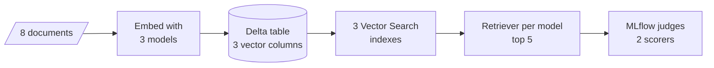

# M13.5 Theory: Benchmarking embedding models with MLflow (Databricks)

*[M13 theory](../../../mandatory/theory/README.md) · Lesson 13.5 · Notebooks: [`05a_compare_embedding_models_databricks.ipynb`](../../notebook/05a_compare_embedding_models_databricks.ipynb) (optional) · [All theory pages](../../../../../THEORY.md)*
<!-- subtitle: Score candidate embedding models with automatic retrieval judges, and decide which metric you need first -->
<!-- format: approved -->

## The project: an embedding model bake-off on Databricks

> **What you'll build**
>
> - Embeddings of one small corpus from three open models, stored side by side in one table.
> - One vector search index per model: each model is searched on its own vectors.
> - A retriever per model that embeds the question with that same model and returns the top 5.
> - An MLflow evaluation that grades every model's retrieval with two automatic judges.

Lesson 13.3 ended with a rule: shortlist models, then score them on your own questions. This project runs that scoring on a managed platform. Three open models from lesson 13.3's family embed the same eight documents, Databricks Vector Search serves each model's vectors, and MLflow's judges grade what each model retrieves for 15 queries.

Out of the notebook, the change is scale and bookkeeping. Each model gets its own index and its own MLflow run. The comparison sits in one experiment that anyone on the team can reopen, and a new candidate model is one more run.

## Architecture

The pieces connect in one line, from documents to judged runs:

*Figure 1: The bake-off pipeline. The 15 evaluation queries enter at the retrievers.*

Each piece reuses an idea from an earlier lesson:

| Piece | What it does | Built on |
|---|---|---|
| Three embedding models | `thenlper/gte-large`, `BAAI/bge-large-en-v1.5` and `all-MiniLM-L6-v2`, all with normalisation on | Lesson 13.3, domain fit; lesson 13.1, length bias |
| One table | One row per document, with one embedding column per model | M11's Document and metadata |
| Three indexes | One vector search index per embedding column, created in the workspace UI | M14, vector stores |
| Retriever per model | Embeds the question with its own index's model and returns the top 5 | Lesson 13.1, the same model on both sides |
| Evaluation run per model | Grades every query's retrieval with a relevance judge and a groundedness judge | M10, baseline-first measurement |

*Table 1: The project's pieces and the lessons they come from.*

## Following one query through the bake-off

Take the query *Converting words into numbers* through the MiniLM branch:

| Step | What happens |
|---|---|
| 1. Embed | The MiniLM model embeds the query, normalised to length 1 |
| 2. Search | The MiniLM index returns its 5 nearest documents with their ids and text |
| 3. Respond | The app joins the retrieved text and returns its first 300 characters as the "response" |
| 4. Judge relevance | An LLM judge rates whether each retrieved document is relevant to the query |
| 5. Judge groundedness | An LLM judge rates whether the response is supported by the retrieved documents |
| 6. Log | The scores land in the MiniLM run, with the model name logged as a parameter |

*Table 2: One query through one model's branch. The GTE and BGE branches repeat the same steps on their own indexes.*

The notebook recorded this result across the 15 queries:

| Model | Retrieval relevance | Retrieval groundedness |
|---|---|---|
| `all-MiniLM-L6-v2` | 0.36 (tied best) | 0.8 |
| `thenlper/gte-large` | 0.36 (tied best) | 0.8 |
| `BAAI/bge-large-en-v1.5` | Below 0.36 (value not given) | 0.8667 (best) |

*Table 3: The recorded comparison. LLM judges can score differently on a rerun.*

The smallest model tied for best relevance, and the ranking reversed on the second metric. Decide which metric your product needs before you look at results like these.

## Design choices worth copying

| Choice | Why |
|---|---|
| Each retriever embeds the question with its own index's model | It rules out the silent model mismatch from lesson 13.1 |
| Normalisation on for every model | Scores compare by angle, without the length bias from lesson 13.1 |
| One run per model, with the model logged as a parameter | Runs line up side by side, one change at a time, as M10's baseline loop requires |
| Two judges instead of one | The ranking reversed between them, which one metric would have hidden |
| The retriever traced as its own span | The judges read the retrieved documents from the trace, not from the response text |

*Table 4: Choices in the build that carry over to any model comparison.*

## Limits

- **Eight documents and 15 queries cannot settle a model choice.** They show the method. The corpus is generic machine-learning sentences, not the Larkspur handbook, and it has no hard negatives (lesson 13.3).
- **Groundedness grades retrieved text here.** The app returns the retrieved text itself as its response, so groundedness measures how well that excerpt matches its own sources, not an LLM's answer.
- **No labelled evidence.** Both scores come from LLM judges, and there is no recall@k against known evidence chunks. Run the M10 golden set beside the judges.
- **Top 5 of 8 caps relevance for every model.** Each query retrieves five of the eight documents, and most queries match only one or two of them by topic. Most retrieved documents therefore cannot be relevant, which keeps every model's relevance score far below 1.
- **The rankings read the whole experiment.** The notebook's summary and ranking tables take every run logged to the experiment. An earlier run of the same notebook counts too. Check the run names before quoting a winner.
- **What it needs to run:** a Databricks workspace with Vector Search and MLflow's GenAI evaluation. The catalog and schema names are hard-coded to one user's workspace and must be changed, and the three indexes are created by hand in the UI before the evaluation cell runs.

## References

1. MLflow, [Predefined LLM judges](https://mlflow.org/docs/latest/genai/eval-monitor/scorers/llm-judge/predefined/), covering the retrieval relevance and retrieval groundedness scorers.
2. Li and others, [Towards general text embeddings with multi-stage contrastive learning](https://arxiv.org/abs/2308.03281), 2023, the GTE models.
3. Xiao and others, [C-Pack: packed resources for general Chinese embeddings](https://arxiv.org/abs/2309.07597), 2023, which introduced the BGE models.

## Key Takeaways

- Give each candidate model its own index and its own evaluation run, and embed every question with the same model as its index.
- Use more than one judge: on this run the smallest model tied for best relevance while another model scored best on groundedness.
- Treat a small, unlabelled bake-off as a method check. The decision needs your own golden set, with hard negatives and labelled evidence.

## Check yourself

1. Why does each retriever in the bake-off embed the question with its own index's model?

Each index holds vectors from one model, and vectors from different models live in unrelated spaces. Embedding the question with any other model would give scores without meaning and no error, the silent model mismatch from lesson 13.1.

2. MiniLM and GTE tie for best retrieval relevance at 0.36, while BGE scores best on groundedness at 0.8667. Which model do you choose?

It depends on which metric the product needs, which you should decide before reading the results. Eight documents and 15 queries also cannot settle the choice. Rerun the comparison on your own golden set before committing.

3. A colleague cites the groundedness scores as proof that BGE gives more trustworthy answers. What is wrong with that reading?

The app returns the retrieved text itself as its response, so groundedness here grades that excerpt against its own sources, not an LLM's answer. The scores say nothing about answer quality. Measure that with a real generation step and the golden set.

---
*Previous: [13.4 Production concerns: batching, caching and similarity behaviour](../../../mandatory/theory/04_production_concerns_batching_caching_and_similarity_behaviour/README.md). Next: [M13 interview questions](../../../mandatory/theory/README.md#interview-spotlight-5-questions-you-might-get-asked).*
