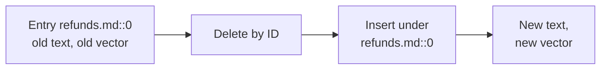

# M14.1 Theory: Index operations: create, query, update, delete, persist

*[M14 theory](../README.md) · Lesson 14.1 · Notebooks: [`01a_vector_stores_and_index_operations.ipynb`](../../notebook/01a_vector_stores_and_index_operations.ipynb), [`01b_vector_database_operations.ipynb`](../../../optional/notebook/01b_vector_database_operations.ipynb) (optional), [`01c_other_vector_stores.ipynb`](../../../optional/notebook/01c_other_vector_stores.ipynb) (optional) · [All theory pages](../../../../../THEORY.md)*
<!-- subtitle: IDs taken from the document make updates possible, and IDs minted per run make duplicates -->
<!-- format: approved -->

## Stable IDs and the missing update

> **What you'll learn**
>
> - **Explain** the five operations every vector store supports, and why an update is a delete plus an insert.
> - **Design** chunk IDs that make re-ingestion overwrite instead of duplicate.
> - **Diagnose** a threshold that rejects everything, and a reopened store that silently returns nothing.
> - **Apply** startup checks that turn silent store failures into errors.

M13 chose the embedding model and its dimensions. This module stores the vectors, and a store has more jobs than search: it must add, update and delete entries without leaving copies behind.

Larkspur's nightly job re-reads the handbook folder and adds every chunk under a fresh random ID. Each night adds another copy of every chunk. Soon the refund question's top `k` holds several copies of `refund-timing`, and the chunk with the other half of the answer no longer fits.

Every LangChain vector store implements the same small interface. The notebook runs one corpus through `InMemoryVectorStore`, FAISS and Chroma with the same calls:

| Operation | LangChain call | What it does |
|---|---|---|
| Add | `add_documents(docs, ids=ids)`, `from_documents(...)` | Embeds the text and stores vector, text and metadata under an ID |
| Read | `get(ids=[...])` (Chroma) | Fetches entries by ID with no similarity search; the first check when retrieval misbehaves |
| Search | `similarity_search(query, k=k, filter=...)` | Embeds the query and returns the `k` nearest entries |
| Delete | `delete(ids=[...])` | Removes entries by ID |
| Update | `update_document(document_id=..., document=...)` (Chroma) | Delete, then insert under the same ID |

*Table 1: The five index operations, through LangChain's common interface.*

No store edits a vector in place. Changing a chunk's text changes its embedding, and the embedding is what the index is built on. An update has to replace the entry. Chroma's `update_document` deletes the old entry and inserts a new one under the same ID, and the notebook shows the entry count unchanged afterwards:

*Figure 1: An update replaces the entry under the same ID. The count stays the same.*

That only works when you know the ID. Re-adding the same text under a new ID stores it twice: on a six-document Chroma store, adding a document again under its existing ID leaves 6 entries, and adding it under a new ID makes 7. The copy then takes a top-`k` slot that a different chunk needed. Ingestion pipelines that mint a fresh UUID on every run create a duplicate for every chunk on every run. We call these **run-minted IDs**, and they are the failure in the opening example.

So derive IDs from the document, never from the run:

- `f"{source}::{page}::{chunk_index}"`: readable, and says where the chunk came from.
- A hash of the content: re-ingesting unchanged text becomes a no-op. The Indexing API in lesson 14.5 uses this, with the metadata included in the hash.
- A business key (`ticket_id`, `article_id`) when the source has one.

For Larkspur, `refunds.md::0` names the refund-window chunk no matter how often the folder is re-read. When the policy changes, the pipeline can delete or overwrite exactly that entry.

The three ID schemes behave differently over three nightly runs of the ten-chunk handbook, with the refund window cut from 30 days to 14 before the third run. The counts below are arithmetic on the rules above, not a measured run.

Choose an ID scheme and see what the store holds after three nightly runs, the last one after the refund edit.

<button type="button" data-mode="minted" aria-pressed="false" aria-controls="ids-minted">Run-minted UUID</button>
<button type="button" data-mode="location" aria-pressed="false" aria-controls="ids-location">Source and position</button>
<button type="button" data-mode="hash" aria-pressed="false" aria-controls="ids-hash">Content hash</button>

<section id="ids-minted" class="mode-panel" data-announcement="Run-minted IDs. Thirty entries after three runs."><h4>Run-minted UUID</h4><dl><dt>Entries after each run</dt><dd>10, then 20, then 30</dd><dt>Refund window</dt><dd>two copies of the 30-day rule and one of the 14-day rule</dd><dt>Outcome</dt><dd>the copies fill the top-k slots, and no ID names the old chunk for deletion</dd></dl></section>
<section id="ids-location" class="mode-panel" data-announcement="Source and position IDs. Ten entries, the edit overwrites."><h4>Source and position (<code>refunds.md::0</code>)</h4><dl><dt>Entries after each run</dt><dd>10, 10, 10</dd><dt>Refund window</dt><dd>the third run writes the 14-day text under the same ID and replaces the 30-day entry</dd><dt>Outcome</dt><dd>correct, as long as the chunk keeps its position in the file</dd></dl></section>
<section id="ids-hash" class="mode-panel" data-announcement="Content-hash IDs. Eleven entries, the old rule stays."><h4>Content hash, no cleanup</h4><dl><dt>Entries after each run</dt><dd>10, 10, 11</dd><dt>Refund window</dt><dd>the edited text has a new hash and is added; the 30-day entry keeps its old hash and stays</dd><dt>Outcome</dt><dd>re-runs are free, but an edit leaves a stale chunk until something deletes it (lesson 14.5)</dd></dl></section>

The content-hash row is why lesson 14.5 pairs hash IDs with a record manager: the hash makes unchanged chunks free, and the record manager remembers which hashes a source used to have.

## What a score means

`similarity_search_with_score` returns a number per result, and its meaning depends on the backend:

| Backend | Returned by `similarity_search_with_score` | Closer means |
|---|---|---|
| Chroma | Distance in the collection's space; Chroma 1.5.9 defaults to `l2` | Lower |
| FAISS (`IndexFlatL2`) | Squared L2 distance | Lower |
| Pinecone index with `metric="cosine"` | Cosine similarity | Higher |
| Any store, `similarity_search_with_relevance_scores` | A relevance score normalised to 0 to 1 | Higher |

*Table 2: What the score means on four backends.*

The notebook runs the same query against Chroma and FAISS and gets the same ranking with different numbers. Three rules follow. Never hard-code a threshold without checking what your backend returns, because `score > 0.8` can reject everything on a distance scale. We call that a **scale-blind threshold**. Never compare scores across backends or embedding models. Use scores to rank and to compare results of one query, and set any cut-off from known-good and known-bad queries run on the store you ship.

`as_retriever()` hides the scores. It wraps the store in the `Retriever` interface (one method, `invoke(query)`) so chains can swap backends, and it returns documents only. When retrieval looks wrong, go back to the store and read the scores and the result count.

## Persisting and reopening

Chroma with a `persist_directory` writes as it goes. FAISS is explicit: `save_local(dir)` writes the index and a pickled docstore, and `FAISS.load_local(dir, embeddings, allow_dangerous_deserialization=True)` reads them back. The flag exists because unpickling can execute code, so load only indexes you built.

Reopening a store fails silently in two ways:

- **Silent empty collection.** A wrong collection name does it. `Chroma(collection_name="typo", persist_directory=...)` creates a new, empty collection. Its count is 0, every search returns nothing, and no error is raised.
- **Model swap on reopen.** A wrong embedding model does it. The store opens and searches return results, but the query vector and the stored vectors come from different models. The ranking means nothing.

The notebook turns both into startup errors with an `open_store()` check: refuse an empty collection, and compare the stored vector's dimension with the live model's. The dimension check misses a model swap with equal dimensions (`text-embedding-3-large` truncated to 1,536 against `text-embedding-3-small`), so also store the model name in the collection's metadata and assert it.

## In practice: a Larkspur index that survives re-runs

For the handbook store, each rule on this page becomes one decision:

1. **Derive every ID from the document**, such as `refunds.md::0` for the refund-window chunk. A re-read then overwrites it.
2. **Update by ID** when a policy changes: delete and insert under the same ID.
3. **Read the scores from the store** before setting any threshold, and set it from Larkspur's own known-good and known-bad queries.
4. **Check at startup** that the collection is not empty, that the vector dimension matches the live model, and that the stored model name matches.

> **Next:** lesson 14.2 opens the index itself: how embedded stores find nearest neighbours without comparing every vector.

## Limits of this evidence

- **A toy corpus.** The 6 and 7 entry counts come from the notebook's six company-policy documents. The ID-scheme counts above are arithmetic on the same rules, not a measured nightly run.
- **Backends move.** The `l2` default and the score directions in Table 2 are those of Chroma 1.5.9 and LangChain's FAISS wrapper in the course environment. Check them again after an upgrade.
- **Position-based IDs have their own failure.** `refunds.md::0` survives a re-read, but inserting a paragraph above it shifts every later index. Lesson 14.5's content hashes avoid that, at the price of needing cleanup.
- **The startup check is partial.** Dimension and model-name checks catch a swapped model. They cannot catch a collection that was loaded from the wrong folder with the right model.

## References

1. Chroma, [Configure collections](https://docs.trychroma.com/docs/collections/configure), on a collection's distance space and index settings.
2. LangChain, [Chroma integration](https://docs.langchain.com/oss/python/integrations/vectorstores/chroma), covering add, update, delete and search by ID.
3. Python documentation, [the pickle module](https://docs.python.org/3/library/pickle.html), whose warning explains why loading an untrusted FAISS docstore is unsafe.

## Key Takeaways

- No store edits a vector in place; an update deletes and re-inserts under the same ID. Derive IDs from the document, such as `source::page::chunk_index` or a content hash, never from the run.
- Score meaning depends on the backend: Chroma and FAISS return distances, Pinecone cosine similarity. Set thresholds from known queries on the store you ship.
- Reopening a store with a wrong collection name or embedding model fails silently. Refuse empty collections at startup and assert the stored dimension and model name.

## Check yourself

1. Why does an ingestion pipeline that mints a fresh UUID on every run make retrieval worse over time?

Re-adding the same text under a new ID stores it twice: a six-document Chroma store becomes 7 entries. Each copy takes a top-k slot that a different chunk needed, and every run duplicates every chunk again. Derive IDs from the document instead, such as `refunds.md::0`, a content hash or a business key.

2. Code written for a Pinecone cosine index keeps results scoring above 0.8. You move it to Chroma with default settings. What goes wrong?

Chroma 1.5.9 returns a distance in `l2` space by default, where lower is closer, so `score > 0.8` keeps the wrong end and can reject everything. Never compare scores across backends or hard-code a threshold without checking what the backend returns. Set any cut-off from known-good and known-bad queries run on the store you ship.

3. After a restart, every search returns nothing and no error is raised. What is the likely cause, and what check turns it into an error?

A wrong collection name: `Chroma(collection_name="typo", ...)` creates a new, empty collection. The notebook's `open_store()` check refuses an empty collection and compares the stored vector's dimension with the live model's. Also store the model name in the collection's metadata and assert it, because a swap with equal dimensions passes the dimension check.

---
*Previous: [M14 overview](../README.md). Next: [14.2 Embedded stores: Chroma and FAISS](../02_embedded_stores_chroma_and_faiss/README.md).*
