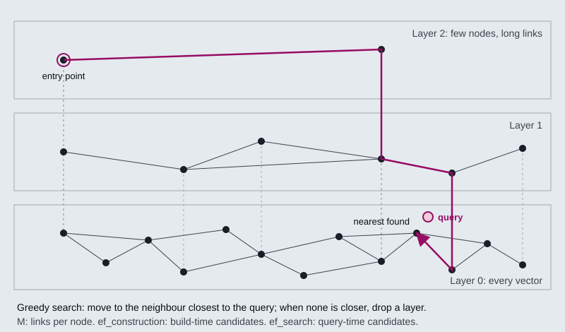
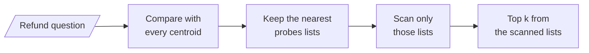
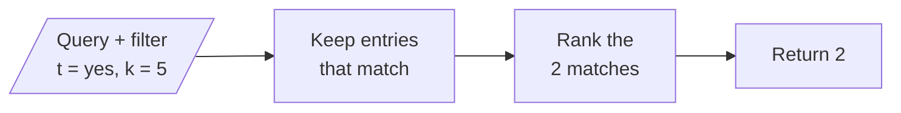
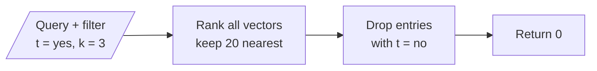

# M14.2 Theory: Embedded stores: Chroma and FAISS

*[M14 theory](../README.md) · Lesson 14.2 · Notebooks: [`02a_chromadb.ipynb`](../../notebook/02a_chromadb.ipynb), [`02b_faiss.ipynb`](../../notebook/02b_faiss.ipynb), [`02c_vector_stores_in_practice.ipynb`](../../../optional/notebook/02c_vector_stores_in_practice.ipynb) (optional) · [All theory pages](../../../../../THEORY.md)*
<!-- subtitle: Approximate search gives up a recall guarantee for speed, and its misses look like normal results -->
<!-- format: approved -->

## ANN search

> **What you'll learn**
>
> - **Explain** how exact search, HNSW and IVF find nearest neighbours, and what each gives up.
> - **Tune** the HNSW and IVF settings that trade recall against speed and memory.
> - **Diagnose** a filtered search that returns nothing although matching entries exist.
> - **Choose** between Chroma and FAISS for an index you run in-process.

Lesson 14.1 treated the store as a box that returns the nearest `k`. This lesson opens the box.

Larkspur's index grows from the 12-chunk handbook to years of tickets and runbooks, and the team switches to an approximate index to keep search fast. An approximate index can hand the refund question the next-best chunk instead of `refund-timing`, with a normal-looking score and no error.

Exact nearest-neighbour search compares the query with every stored vector. `FAISS.from_documents` builds exactly that, an `IndexFlatL2`: the answer is always the true top `k`, and the cost grows with every vector you add. At the size of the M14 notebooks (a handful of chunks) exact search is instant, which is why none of them shows a difference between exact and approximate results.

Approximate nearest-neighbour (ANN) indexes give up the guarantee to visit only a small part of the collection. The two families you meet in practice:

- **HNSW** (hierarchical navigable small world) links each vector to its near neighbours in a graph, and keeps sparser copies of the graph in layers above it. A search enters at the top, walks greedily towards the query, and drops a layer each time no neighbour is closer. Chroma's local collections are HNSW indexes, and pgvector offers it as an index type.
- **IVF** (inverted file) clusters the vectors into lists around centroids, then searches only the lists whose centroids are nearest the query. pgvector calls the cluster count `lists` and the number searched `probes`; FAISS calls them `nlist` and `nprobe`.

*Figure 1: An HNSW search enters at the top layer, walks greedily towards the query and ends at layer 0 (schematic).*

IVF works from a coarser map. It assigns every vector to its nearest centroid when the index is built, then a query compares itself with the centroids and scans only the closest lists:

*Figure 2: An IVF search. A neighbour that sits in an unprobed list is never seen (schematic).*

The two failure points differ. HNSW can stop its greedy walk in a local neighbourhood that does not hold the true nearest chunk. IVF can leave the true nearest chunk in a list it did not probe, which is likely when the chunk sits near the border between two clusters.

Each knob moves recall against speed or memory:

| Knob | What it controls | Chroma 1.5.9 default | pgvector default |
|---|---|---|---|
| `M` (Chroma: `max_neighbors`) | Links per node; more links, better recall, more memory | 16 | 16 |
| `ef_construction` | Candidates kept while building the graph; higher builds slower and better | 100 | 64 |
| `ef_search` | Candidates kept while answering a query; higher answers slower and better | 100 | 40 |
| IVF `probes` | Lists searched per query | none (HNSW only) | 1 |

*Table 1: The HNSW and IVF settings, with Chroma's and pgvector's defaults.*

The Chroma values are what `collection.configuration_json` reports for a new collection in the course environment, and the pgvector values are from the [pgvector README](https://github.com/pgvector/pgvector). Defaults are a starting point. To tune them, measure recall@k of the ANN index against an exact search on your own queries, and raise `ef_search` until the misses stop mattering for the golden set.

An ANN miss raises no error, and we call it a **silent ANN miss**. An index that skips the refund chunk returns the next-best chunk with a normal-looking score. A recall drop after the corpus grows shows up only as worse answers.

## Chroma or FAISS

Both run inside your Python process with no server. They differ in what they do beyond the search:

| | Chroma | FAISS (LangChain wrapper) |
|---|---|---|
| Index | HNSW, `l2` space by default | Exact `IndexFlatL2` from `from_documents`; FAISS itself also has HNSW and IVF indexes |
| Persistence | Writes to `persist_directory` as it goes | `save_local` / `load_local`, metadata in a pickle |
| Metadata filter | Runs inside the store, before ranking; returns every match up to `k` | Runs in Python on `fetch_k=20` candidates after ranking |
| Filter syntax | One key per dict; combine with `$and` / `$or`. `{"dept": "HR", "year": 2026}` raises `ValueError` | A dict of values or operators (`$eq`, `$gt`, `$in`, …), or a callable on the metadata |
| Read by ID | `get(ids=...)` | Through the docstore only |
| Good for | Local development and small production indexes you update | Static, read-heavy corpora where search speed matters |

*Table 2: Chroma and FAISS compared.*

The filter difference comes from where each store applies it. Chroma narrows the candidates first:

*Figure 3: Chroma applies the filter inside the store, before ranking.*

The FAISS wrapper ranks first and filters what it fetched:

*Figure 4: The FAISS wrapper filters in Python after ranking `fetch_k=20` candidates.*

The difference shows up as missing results. In a check run for this page, a FAISS store held 25 chunks tagged `t="no"` that sat close to the query and 3 tagged `t="yes"` further away. `similarity_search(q, k=3, filter={"t": "yes"})` returned 0 results, because none of the 3 was among the 20 nearest candidates; with `fetch_k=28` it returned all 3. Chroma, asked for `k=5` with a filter only 2 entries match, returned those 2. We call the FAISS case a **starved post-filter**: the filter runs on too few candidates. The same check in table form:

| Store and query | Matching entries | Returned |
|---|---|---|
| FAISS, filter `t="yes"`, `k=3`, default `fetch_k=20` | 3, none among the 20 nearest | 0 |
| FAISS, same filter, `fetch_k=28` | 3 | 3 |
| Chroma, a filter matching 2 entries, `k=5` | 2 | 2 |

*Table 3: A planted selective filter against both stores, from a check run for this page.*

The notebooks' guidance: start with Chroma for anything you might keep, choose FAISS for a static corpus you search often, and move to a hosted store (lesson 14.3) when you need concurrent writers or more than one machine.

## In practice: Larkspur's embedded store

For the handbook on one machine, the choices follow from Tables 1 to 3:

1. **Use Chroma for the handbook index**, because it is updated nightly and filters inside the store.
2. **Measure recall@k of the HNSW index against an exact search** on the golden set once the corpus grows, and raise `ef_search` until the misses stop mattering.
3. **Raise `fetch_k`, or filter elsewhere**, for any selective filter on a FAISS archive.
4. **Move to a hosted store only when a second writer or machine arrives** (lesson 14.3).

> **Next:** lesson 14.3 moves the index off your machine, to managed stores, and looks at what decides which entries one query can see.

## Limits of this evidence

- **No recall measurement here.** The notebooks index a handful of chunks, where exact and approximate search agree. The page states the recall trade-off from the algorithms; it shows no measured recall@k.
- **A planted case.** Table 3 uses hand-made two-dimensional vectors placed to starve the filter, not real embeddings. It shows the mechanism; how often it bites depends on how selective your filters are.
- **Defaults are versioned.** Table 1's Chroma values come from Chroma 1.5.9 in the course environment and the pgvector values from its README. Both can change between releases.
- **The figures are schematic.** Figures 1 and 2 show the search shape, not a real index's layer counts or cluster sizes.

## References

1. Malkov and Yashunin, [the HNSW paper on approximate nearest-neighbour search with layered small-world graphs](https://arxiv.org/abs/1603.09320) (2016).
2. Johnson, Douze and Jégou, [Billion-scale similarity search with GPUs](https://arxiv.org/abs/1702.08734), the paper behind the FAISS library and its IVF indexes.
3. FAISS wiki, [Faiss indexes](https://github.com/facebookresearch/faiss/wiki/Faiss-indexes), listing the flat, HNSW and IVF index types.
4. Chroma, [Configure collections](https://docs.trychroma.com/docs/collections/configure), on the HNSW settings and distance space.
5. pgvector, [README](https://github.com/pgvector/pgvector), for its HNSW and IVF defaults and query settings.

## Key Takeaways

- ANN indexes such as HNSW and IVF trade the guaranteed top `k` for speed, and a miss raises no error. Measure recall@k against exact search and raise `ef_search` until misses stop mattering.
- Chroma filters inside the store before ranking; the FAISS wrapper filters after ranking `fetch_k=20` candidates. A selective filter can then return nothing.
- Start with Chroma for anything you will update, use FAISS for a static read-heavy corpus, and move to a hosted store for concurrent writers or several machines.

## Check yourself

1. Why can an approximate nearest-neighbour index miss the right chunk without anyone noticing?

An ANN index visits only a small part of the collection and gives up the guarantee of the true top k. A miss raises no error: the index returns the next-best chunk with a normal-looking score, so a recall drop shows up as worse answers. Measure recall@k against an exact search on your own queries, and raise `ef_search` until the misses stop mattering for the golden set.

2. A FAISS store holds 25 chunks tagged no near the query and 3 tagged yes further away. A search filtered to yes with k of 3 returns nothing. Why?

The FAISS wrapper filters in Python after ranking, on the `fetch_k=20` nearest candidates, and none of the 3 matching chunks was among them. With `fetch_k=28` it returns all 3. Chroma filters inside the store before ranking, so it returns every match up to `k`.

3. Your index needs several writers at once across more than one machine. Is Chroma or FAISS the right choice?

Neither. Both run inside your Python process with no server, so the notebooks' guidance is to move to a hosted store (lesson 14.3) when you need concurrent writers or more than one machine. On one machine, choose Chroma for anything you might keep and update, and FAISS for a static corpus you search often.

---
*Previous: [14.1 Index operations: create, query, update, delete, persist](../01_index_operations_create_query_update_delete_persist/README.md). Next: [14.3 Managed stores: Astra DB and Pinecone](../03_managed_stores_astra_db_and_pinecone/README.md).*
