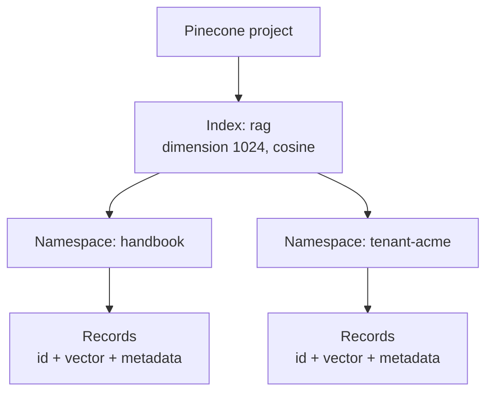
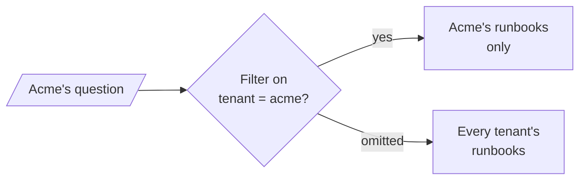

# M14.3 Theory: Managed stores: Astra DB and Pinecone

*[M14 theory](../README.md) · Lesson 14.3 · Notebooks: [`03b_pinecone.ipynb`](../../notebook/03b_pinecone.ipynb), [`03a_astra_db.ipynb`](../../../optional/notebook/03a_astra_db.ipynb) (optional) · [All theory pages](../../../../../THEORY.md)*
<!-- subtitle: The container decides what one query can see, and its dimension and metric are fixed at creation -->
<!-- format: approved -->

## Collections and namespaces

> **What you'll learn**
>
> - **Explain** collections, indexes and namespaces across four stores, and what each fixes at creation.
> - **Compare** a namespace boundary with a metadata filter as a way to isolate tenants.
> - **Diagnose** a cleanup run that deletes another collection's keys.
> - **Choose** when a managed store earns its cost over an embedded one.

Lesson 14.2 kept the index on one machine. Managed stores run it as a service, and they make you decide up front how entries are grouped.

Larkspur adds customer-specific runbooks to the same collection as the public handbook, tagged with a tenant field. One support tool builds its query without the tenant filter, and a customer's question can now retrieve another customer's runbook. Nothing raises an error. We call this a **leaky filter boundary**.

Every store groups its entries, and the grouping decides what one query can see. The names differ:

| Store | Container you create | Partition inside it | What is fixed when you create it |
|---|---|---|---|
| Chroma | Collection (`collection_name`) | none | Distance space and HNSW settings |
| PGVector | A row in `langchain_pg_collection` (`collection_name`) | none; entries in `langchain_pg_embedding` carry its `collection_id` | Nothing, unless you pass `embedding_length`, which fixes the vector column's dimension |
| Pinecone | Index (`pc.create_index(name, dimension, metric, spec)`) | Namespace | Dimension and metric |
| Astra DB | Collection (`collection_name`) inside a namespace, also called a keyspace | none | Vector dimension and metric |

*Table 1: Containers and partitions in four stores.*

In Pinecone, namespaces sit inside an index:

*Figure 1: A Pinecone index with two namespaces. Every read and write targets one namespace.*

The Pinecone notebook creates a serverless index named `rag` with `dimension=1024` and `metric="cosine"`, and asks OpenAI's `text-embedding-3-small` for 1,024 dimensions to match. The index's dimension cannot change, so the embedding model and its output size are part of the index's identity. The Astra DB notebook does the same with `dimensions=1024` and passes `namespace=None`. The store then falls back to the `ASTRA_DB_KEYSPACE` environment variable or the database's default namespace.

Pinecone's [indexing overview](https://docs.pinecone.io/guides/index-data/indexing-overview) says reads and writes "always target one namespace", that namespaces are created automatically on upsert or ahead of time, and that you can isolate customers with "one namespace per customer". A query in one namespace cannot return another namespace's records. In LangChain, `PineconeVectorStore` takes the namespace as an argument.

The alternative keeps every tenant in one container and tells them apart by a metadata field:

*Figure 2: One shared collection with a tenant field. The boundary holds only when every caller sends the filter.*

Both layouts answer Acme's question correctly when the code is right. They differ in what a mistake costs:

Choose a layout and a caller, and see which entries Acme's question can reach.

<button type="button" data-mode="filter-ok" aria-pressed="false" aria-controls="tenant-filter-ok">Shared, filter sent</button>
<button type="button" data-mode="filter-missing" aria-pressed="false" aria-controls="tenant-filter-missing">Shared, filter omitted</button>
<button type="button" data-mode="namespace" aria-pressed="false" aria-controls="tenant-namespace">Namespace per tenant</button>

<section id="tenant-filter-ok" class="mode-panel" data-announcement="Shared collection with the filter. Acme sees only its own entries."><h4>Shared collection, filter sent</h4><dl><dt>Searched</dt><dd>entries whose tenant field is <code>acme</code></dd><dt>Can reach</dt><dd>Acme's runbooks only</dd><dt>Depends on</dt><dd>every code path adding the filter</dd></dl></section>
<section id="tenant-filter-missing" class="mode-panel" data-announcement="Shared collection without the filter. Every tenant's runbooks are reachable."><h4>Shared collection, filter omitted (leaky filter boundary)</h4><dl><dt>Searched</dt><dd>the whole collection</dd><dt>Can reach</dt><dd>every customer's runbooks, ranked only by similarity</dd><dt>Depends on</dt><dd>nothing: no error is raised</dd></dl></section>
<section id="tenant-namespace" class="mode-panel" data-announcement="Namespace per tenant. Other tenants are unreachable."><h4>Namespace per tenant</h4><dl><dt>Searched</dt><dd>the <code>tenant-acme</code> namespace</dd><dt>Can reach</dt><dd>Acme's runbooks only; another namespace cannot appear in the results</dd><dt>Depends on</dt><dd>the service choosing the namespace, never the caller</dd></dl></section>

The namespace is the stronger boundary. A query that names no namespace searches the default one: a missing argument narrows the search instead of widening it.

The record manager in lesson 14.5 has a namespace too: `SQLRecordManager("pgvector/vectordb", db_url=...)`. It scopes the record manager's keys, not the vectors. Keep one record-manager namespace per collection. If two collections share one, a `full` cleanup run on either deletes the other's keys. We call that a **shared record-manager namespace**.

For Larkspur, the public handbook goes in one collection or namespace. Customer-specific runbooks, if they arrive, go in their own namespaces. Re-indexing the handbook then never touches customer data, and a customer's query cannot reach another customer's text.

## When a managed store earns its cost

The managed stores take the same LangChain calls as Chroma: `add_documents`, `similarity_search(query, k, filter=...)`, `as_retriever(...)`. The Pinecone notebook filters with `{"source": "tweet"}` and runs a retriever with `search_type="similarity_score_threshold"` and `score_threshold=0.4`, a threshold that only means something on that index's cosine scale. Switching stores changes the setup and the bill; the calls stay the same.

Lesson 14.1's notebook gives the rule: move to a hosted store when you need concurrent writers, horizontal scale or managed availability, and not before. The move is a re-index. The embedding model goes with you, and the IDs you derived in lesson 14.1 make the second load as idempotent as the first. Until then an embedded store, or pgvector in a Postgres you already run (lesson 14.4), has no API key to manage, no network hop and no bill per query.

## In practice: separating the handbook from customer data

For Larkspur, the containers follow the boundaries the business needs:

1. **Keep the public handbook in its own collection or namespace.** Re-indexing it then never touches customer data.
2. **Give each customer's runbooks their own namespace**, chosen by the service that builds the query, never by the caller.
3. **Use one record-manager namespace per collection** (lesson 14.5). A cleanup run then cannot reach another collection's keys.
4. **Stay on an embedded store or pgvector** until concurrent writers, horizontal scale or managed availability are needed.

> **Next:** lesson 14.4 filters inside one container, with Postgres and pgvector.

## Limits of this evidence

- **Not run here.** Both managed-store notebooks need an account and an API key, and this page quotes their settings, not their output.
- **Managed services move.** The namespace rules quoted from Pinecone's documentation were checked in November 2026; plans, limits and defaults change without a library upgrade.
- **The switcher is illustrative.** No tenant runbooks exist in the course data. The three panels apply the stated rules to a hypothetical Acme tenant.
- **A namespace is not the whole of access control.** It stops one query reaching another tenant's records. Who may call the service, and with which namespace, is still the application's job.

## References

1. Pinecone, [Indexing overview](https://docs.pinecone.io/guides/index-data/indexing-overview), on indexes, namespaces and multitenancy.
2. LangChain, [Pinecone integration](https://docs.langchain.com/oss/python/integrations/vectorstores/pinecone), on `PineconeVectorStore` and its namespace argument.
3. LangChain, [PGVector integration](https://docs.langchain.com/oss/python/integrations/vectorstores/pgvector), on collections stored as rows.

## Key Takeaways

- A Pinecone index fixes its dimension and metric at creation, so the embedding model and output size are part of its identity. Changing either means a new index.
- A namespace per customer is a stronger boundary than a metadata filter, because a query cannot reach another namespace. Keep one record-manager namespace per collection.
- Move to a managed store for concurrent writers, horizontal scale or managed availability, and not before. The LangChain calls stay the same; the move is a re-index.

## Check yourself

1. Why is one Pinecone namespace per customer a stronger boundary than a metadata filter on the customer id?

Pinecone reads and writes always target one namespace, so a query in one namespace cannot return another namespace's records. A metadata filter is something a caller can leave out. For Larkspur, this also means re-indexing the handbook never touches customer data.

2. The Pinecone notebook asks text-embedding-3-small for 1,024 dimensions. Why, and what happens if you later want 1,536?

The index was created with `dimension=1024` and `metric="cosine"`, and the embedding output must match it. An index's dimension cannot change, so the embedding model and its output size are part of the index's identity. Moving to 1,536 means a new index and a re-index into it.

3. Your Larkspur index runs fine on Chroma with one writer. When should you move it to a managed store?

When you need concurrent writers, horizontal scale or managed availability, and not before. Until then an embedded store, or pgvector in a Postgres you already run, has no API key to manage, no network hop and no bill per query. The move is a re-index, and the stable IDs from lesson 14.1 keep the second load idempotent.

---
*Previous: [14.2 Embedded stores: Chroma and FAISS](../02_embedded_stores_chroma_and_faiss/README.md). Next: [14.4 Postgres + pgvector with metadata-filtered search](../04_postgres_pgvector_with_metadata_filtered_search/README.md).*
