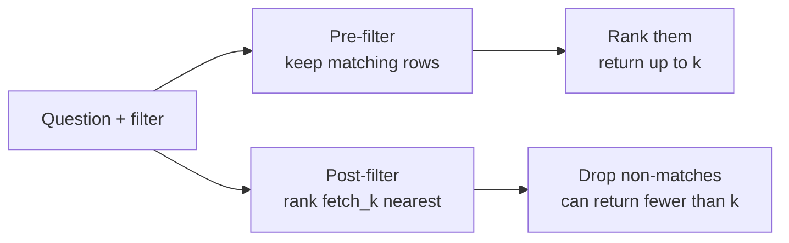
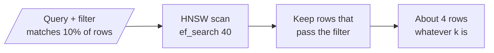

# M14.4 Theory: Postgres + pgvector with metadata-filtered search

*[M14 theory](../README.md) · Lesson 14.4 · Notebooks: [`04a_filtered_search_pgvector.ipynb`](../../notebook/04a_filtered_search_pgvector.ipynb) · [All theory pages](../../../../../THEORY.md)*
<!-- subtitle: A filter narrows the search, and where it runs decides whether you still get k results -->
<!-- format: approved -->

## Metadata filters

> **What you'll learn**
>
> - **Explain** how a metadata filter becomes a `WHERE` clause in pgvector.
> - **Write** filters that work across stores, and spot the syntax that breaks when code moves.
> - **Compare** pre-filtering with post-filtering by how many results each returns.
> - **Diagnose** a filtered query that returns fewer than `k` results after an index is added.

Lesson 14.3 separated tenants with containers. Inside one container, filters do the narrowing.

Larkspur adds an HNSW index to its pgvector table to speed up search. A support query filtered to the refunds page asks for `k = 5` and gets 2 back, with no error.

A metadata filter restricts a similarity search to entries whose metadata matches a predicate. It is how one index serves many scopes: one customer, one product, one section of the handbook, documents newer than a date. The notebook indexes two restaurants' FAQs and reviews into one PGVector collection and narrows each query with a filter on `restaurant`, `category` or `cuisine`.

LangChain's `PGVector` (from `langchain_postgres`) keeps everything in two tables. `langchain_pg_collection` has one row per collection. `langchain_pg_embedding` has one row per chunk: the `embedding` vector, the `document` text, a `collection_id`, and the metadata as a JSONB column, `cmetadata`, with a GIN index on it. A filter becomes a `WHERE` clause on `cmetadata`.

| Filter | Meaning |
|---|---|
| `{"source": "refunds.md"}` | Equality on one key |
| `{"source": "refunds.md", "category": "policy"}` | Two keys: PGVector treats it as AND |
| `{"source": {"$in": ["refunds.md", "billing.md"]}}` | Operator form |
| `{"$and": [{...}, {...}]}`, `{"$or": [...]}` | Explicit logic; the portable form |

*Table 1: Filter forms PGVector accepts.*

PGVector accepts `$eq`, `$ne`, `$lt`, `$lte`, `$gt`, `$gte`, `$in`, `$nin`, `$between`, `$exists`, `$like`, `$ilike`, `$and`, `$or` and `$not`. Stores share most of this syntax but differ at the edges. The two-key dict that PGVector reads as AND makes Chroma raise `ValueError: Expected where to have exactly one operator`. Write `$and` when code may move between stores.

Filters are exact. `"Engineering"` does not match `"engineering"`, the **case-split filter** from lesson 11.1, and a field that was never written matches nothing. Normalise metadata at ingestion (M11) so the filter has something consistent to match.

A filter is not access control, and relying on one as a boundary is the **filter-as-access-control** mistake. Lesson 14.1's notebook makes the point: a caller who omits the filter sees everything. For tenant isolation, enforce the filter in the service that builds the query, or use a namespace or a separate collection per tenant (lesson 14.3).

## Filtering before or after the search

There are two ways to combine a filter with a top-`k` search, and they return different results:

*Figure 1: Pre-filtering and post-filtering on the same question.*

**Pre-filtering** restricts the candidates, then ranks them. If at least `k` entries match, you get `k`. LangChain's PGVector builds one SQL query, `WHERE collection_id = … AND <filter>` then `ORDER BY distance`, and it creates no vector index of its own. Postgres therefore compares the query with every matching row: an exact, pre-filtered search.

**Post-filtering** ranks first, then drops what fails the filter. LangChain's FAISS wrapper does this on `fetch_k=20` candidates (lesson 14.2). A selective filter can return fewer than `k` results or none.

Adding an ANN index to pgvector moves it towards post-filtering. The [pgvector README](https://github.com/pgvector/pgvector) says: "With approximate indexes, filtering is applied *after* the index is scanned." Its example: if a condition matches 10% of rows, an HNSW scan with the default `hnsw.ef_search` of 40 leaves "only 4 rows" on average. From version 0.8.0, iterative index scans (`SET hnsw.iterative_scan = strict_order` or `relaxed_order`) keep scanning until enough rows pass the filter.

With an HNSW index, the filter moves to after the scan:

*Figure 2: pgvector with an HNSW index, using the README's 10% example.*

The same filtered query takes three paths in pgvector, depending on the index and one setting:

Choose how the table is indexed and see how many rows a filter matching 10% of rows can return when the query asks for k of 5.

<button type="button" data-mode="exact" aria-pressed="false" aria-controls="pg-exact">No vector index</button>
<button type="button" data-mode="hnsw" aria-pressed="false" aria-controls="pg-hnsw">HNSW, default scan</button>
<button type="button" data-mode="iterative" aria-pressed="false" aria-controls="pg-iterative">HNSW, iterative scan</button>

<section id="pg-exact" class="mode-panel" data-announcement="No vector index. Pre-filtering returns 5."><h4>No vector index (LangChain's PGVector as created)</h4><dl><dt>Order of work</dt><dd>filter every row, then rank the matches exactly</dd><dt>Rows returned</dt><dd>5, as long as at least 5 rows match</dd><dt>Cost</dt><dd>one distance per matching row, which grows with the table</dd></dl></section>
<section id="pg-hnsw" class="mode-panel" data-announcement="HNSW with the default scan. About 4 rows on average."><h4>HNSW index, default scan</h4><dl><dt>Order of work</dt><dd>scan about 40 candidates, then filter them</dd><dt>Rows returned</dt><dd>about 4 on average, and fewer for a rarer filter: a short result set</dd><dt>Cost</dt><dd>fast, and flat as the table grows</dd></dl></section>
<section id="pg-iterative" class="mode-panel" data-announcement="HNSW with iterative scans. Scans more until 5 rows pass."><h4>HNSW index, iterative scan (pgvector 0.8.0 or later)</h4><dl><dt>Order of work</dt><dd>scan, filter, and scan more of the index while too few rows pass</dd><dt>Rows returned</dt><dd>5, unless the scan reaches its limit first</dd><dt>Cost</dt><dd>more work for rare filters, bounded by a maximum number of scanned rows</dd></dl></section>

The symptom of post-filtering is a query that asks for `k = 5` and gets 2, a **short result set**, as in the opening example. Log `len(results)` beside `k` on every filtered query; raising `k` hides the problem without fixing it.

## In practice: filtered search over the Larkspur handbook

For the handbook in pgvector, filters follow four rules:

1. **Normalise metadata at ingestion** (M11), so `section = "Refunds"` matches every refund chunk.
2. **Write filters with explicit `$and` and `$or`.** The code then still runs if the store changes.
3. **Enforce the tenant filter in the service**, or use a namespace per tenant (lesson 14.3).
4. **After adding an HNSW index, turn on iterative scans** and log the result count beside `k` on every filtered query.

> **Next:** lesson 14.5 keeps the store itself correct as the handbook changes, with the Indexing API.

## Limits of this evidence

- **The opening numbers are illustrative.** The 2-of-5 result is a worked example of a short result set, not a measured run. The 10% and 4-row figures are the pgvector README's own example.
- **The notebook runs without a vector index.** Its restaurant collection is searched exactly and never shows the post-filter case; that part rests on the pgvector README.
- **Operator lists drift.** The operator set above is that of `langchain_postgres` 0.0.19 in the course environment.
- **A filter is only as good as its metadata.** None of the guards here helps when the field was never written or written inconsistently.

## References

1. pgvector, [README](https://github.com/pgvector/pgvector), on filtering with approximate indexes and iterative index scans.
2. LangChain, [PGVector integration](https://docs.langchain.com/oss/python/integrations/vectorstores/pgvector), on metadata filters and their operators.
3. PostgreSQL documentation, [GIN indexes](https://www.postgresql.org/docs/current/gin.html), the index type used on the JSONB metadata column.

## Key Takeaways

- PGVector turns a metadata filter into a `WHERE` clause on JSONB metadata. Filters match exactly, so normalise values at ingestion, and write `$and` so filters stay portable.
- A filter is not access control, because a caller can omit it. Enforce it in the service, or use a namespace or collection per tenant.
- Pre-filtering returns up to `k` matches; post-filtering, including pgvector with an ANN index, can return fewer. Log `len(results)` beside `k` on every filtered query.

## Check yourself

1. Why is a metadata filter on the tenant not enough for access control?

A caller who omits the filter sees everything. Enforce the filter in the service that builds the query, or give each tenant its own namespace or collection (lesson 14.3).

2. A filter dict with source and category as two keys works on PGVector. What happens when the same code moves to Chroma, and how should it be written?

PGVector reads the two keys as AND, but Chroma raises `ValueError: Expected where to have exactly one operator`. Write `{"$and": [{...}, {...}]}`, the portable form, whenever code may move between stores.

3. You add an HNSW index to pgvector, and a filtered query asking for 5 results now returns 2. What happened, and what do you change?

With an approximate index, pgvector applies the filter after scanning the index, so it behaves like post-filtering: a condition matching 10% of rows leaves about 4 rows at the default `hnsw.ef_search` of 40. From version 0.8.0, iterative index scans keep scanning until enough rows pass the filter. Log `len(results)` beside `k` on every filtered query, because raising `k` hides the problem without fixing it.

---
*Previous: [14.3 Managed stores: Astra DB and Pinecone](../03_managed_stores_astra_db_and_pinecone/README.md). Next: [14.5 Incremental indexing: Indexing API and record manager](../05_incremental_indexing_indexing_api_and_record_manager/README.md).*
