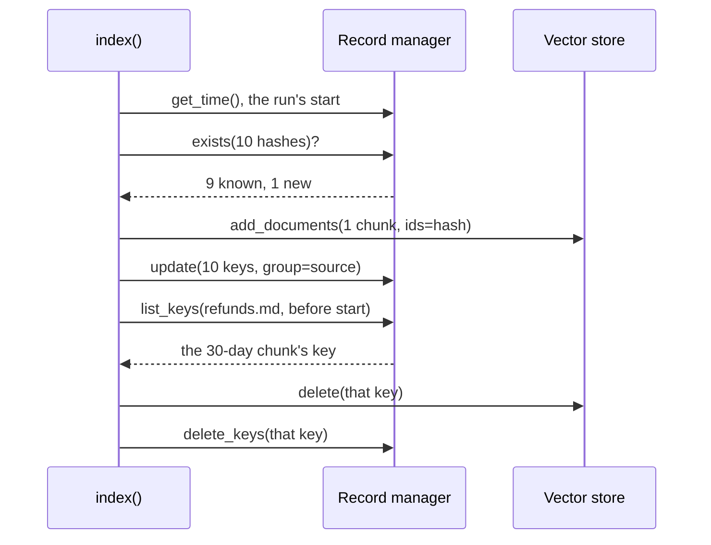

# M14.5 Theory: Incremental indexing: Indexing API and record manager

*[M14 theory](../README.md) · Lesson 14.5 · Notebooks: [`05a_indexing_api.ipynb`](../../notebook/05a_indexing_api.ipynb) · [All theory pages](../../../../../THEORY.md)*
<!-- subtitle: A record manager makes re-indexing idempotent, and the cleanup mode decides what each run may delete -->

## Idempotent re-indexing

> **What you'll learn**
>
> - **Explain** how the Indexing API turns each chunk into a hash ID and decides what to embed.
> - **Trace** one sync run through the record manager and the store.
> - **Compare** the four cleanup modes by what each may delete.
> - **Choose** a sync schedule that handles edits, new files and deleted files without wiping the store.

Lesson 14.4 filtered what one query sees. This lesson keeps the store itself correct as the handbook changes.

Larkspur edits the refund window from 30 days to 14 and reruns its sync with no cleanup. The new chunk is added and the old one stays. *What is the refund window?* can retrieve the 30-day rule and the 14-day rule side by side.

A sync job is idempotent when running it twice on the same folder leaves the store as one run did and embeds nothing the second time. LangChain's Indexing API gives you that with three parts: the vector store, a **record manager** that remembers what has been written, and the `index()` function that compares the two on every run. The notebook wires them like this:

| Part | In the notebook | Job |
|---|---|---|
| Vector store | The PGVector collection from lesson 14.4 | Holds the vectors, under their hash IDs |
| Record manager | A SQL record manager in the same Postgres, namespace `pgvector/vectordb` | Remembers each hash, its source and when it was last seen |
| `index()` | Given the documents, both of the above, `incremental` cleanup and `source` as the source key | Compares the two and writes only what changed |

*Table 1: The three parts of the Indexing API, as notebook 14.5 wires them.*

Every chunk's ID is a hash. `index()` hashes the chunk's text, hashes its metadata serialised as sorted JSON, then hashes the two together. With the default `key_encoder="sha1"` the result is written as a UUID, and LangChain warns that SHA-1 is not collision-resistant; pass `key_encoder="sha256"`, `"sha512"` or `"blake2b"` in new code. The record manager stores one row per hash: the key, a group ID (the value of `source_id_key`, here the file name) and the time it was last seen.

A run goes like this, in batches of `batch_size=100`:

*Figure 1: One batch through the Indexing API: one new chunk written, one stale key deleted.*

Known hashes are skipped and only have their timestamp refreshed. New hashes are embedded and written under the hash as their ID. Writing the same chunk twice overwrites instead of duplicating. Then every key in the batch is stamped with a time no earlier than the run's start. Cleanup deletes keys whose stamp is older than the run's start: the chunks this run never saw.

An edited chunk is a new hash. The lab's refund edit comes back as `{'num_added': 1, 'num_updated': 0, 'num_skipped': 9, 'num_deleted': 1}`. In `langchain-core` 1.7.0, `num_updated` counts only chunks re-written because of `force_update=True`, which re-embeds chunks whose hash is already known; the notebook's comments describe changed content as "updated", but changed text shows up as one add and one delete.

The hash covers text and metadata and nothing else. Add a metadata field to every chunk or change the splitter, and every hash changes. The next run then re-embeds the whole corpus. Change the embedding model, and no hash changes, so the next run skips everything and leaves the old vectors in place. For a model change, build a new collection with its own record-manager namespace, or run once with `force_update=True`.

The notebook's own sequence, replayed for this page with in-memory stores in place of Postgres, returns the numbers its comments expect. Seven chunks of `bella_vista.txt` go in under `cleanup=None`. After one chunk is edited, one removed and one added, the second `None` run adds 2, skips 5, deletes 0 and leaves 9 entries in the store: the old version and the removed chunk are both still there. The third run, under `incremental`, adds 2 and deletes 6. An empty batch under `incremental` changes nothing; under `full` it deletes all 5 remaining entries.

## Choosing a cleanup mode

`cleanup` decides which keys a run may delete. `incremental` and `scoped_full` need `source_id_key`, because they delete by source.

| Mode | Deletes | When it runs |
|---|---|---|
| `None` | Nothing | |
| `"incremental"` | Keys from sources that sent chunks in this batch, not seen in this run | After each batch |
| `"scoped_full"` | Keys from sources seen anywhere in this run, not seen in this run | Once, at the end |
| `"full"` | Every key not seen in this run, whatever its source | Once, at the end |

*Table 2: The four cleanup modes.*

The [interactive lab](interactive/record-manager-lab.html) runs a JavaScript port of `index()` over the Larkspur folder. Across 26,920 sequences of 1 to 6 runs (100,761 `index()` calls, every folder state and mode, batch sizes 100 and 3), its counts, stored IDs and record-manager keys match `langchain_core` 1.7.0 in every call. Starting from a store loaded with all 10 chunks, one more run gives:

| Change, then one run | `None` | `incremental` | `scoped_full` | `full` |
|---|---|---|---|---|
| `refunds.md` edited, 30 days to 14 | 1 added, 0 deleted; the 30-day chunk stays | 1 added, 1 deleted | 1 added, 1 deleted | 1 added, 1 deleted |
| `outages.md` deleted | 0 deleted; its 2 chunks stay | 0 deleted; its 2 chunks stay | 0 deleted; its 2 chunks stay | 2 deleted |
| `support.md` added | 1 added | 1 added | 1 added | 1 added |
| Loader returns only `refunds.md` | 2 skipped, 0 deleted | 2 skipped, 0 deleted | 2 skipped, 0 deleted | 8 deleted |
| Loader returns nothing | nothing | nothing | nothing | all 10 deleted |

*Table 3: One run after each change, under each mode, from the lab (matched against langchain-core 1.7.0).*

<!-- lab: interactive/record-manager-lab.html -->

- **Stale pile-up under `None`.** It is the opening example. After the refund edit the store holds 11 chunks, and the golden question can retrieve the 30-day rule and the 14-day rule side by side. Switch `refunds.md` back to 30 days and run again: 0 added, because the 30-day hash was never removed, and now the 14-day chunk is the stale one.
- **Invisible deletion under `incremental`.** It handles edits but cannot see deleted files. It cleans a source only when that source sends at least one chunk. A file removed from the folder sends none, so its chunks stay until a `full` run or an explicit `delete()` by ID.
- **Partial-load wipe under `full`.** It treats "not returned" as "deleted". It is the only mode that removes a deleted file, and the only one that wipes the store when the loader returns a partial folder or nothing at all. Run it only over the whole corpus, and refuse to run it when the loader returns far fewer files than last time.
- **`scoped_full` matches `incremental` at this size.** The difference appears when one source's chunks span several batches: `incremental` cleans after each batch and does redundant work, while `scoped_full` collects the sources it saw and cleans once at the end.

## In practice: the Larkspur sync schedule

For the handbook, the modes combine into one schedule:

1. **Nightly: `incremental`, keyed on `source`.** Policy edits and new files are handled, and nothing outside the changed sources is touched.
2. **Weekly: `full` over the complete folder**, refused when the loader returns far fewer files than last time. This removes files the team deleted without risking a partial-load wipe.
3. **On a model change: a new collection with its own record-manager namespace**, or one run with `force_update=True`.
4. **One clock for every writer.** The SQL record manager keeps the keys in the same Postgres as the vectors and reads the time from the database. An update raises a time-sync error if that clock reads earlier than the run's start.

> **Next:** M15 changes what gets indexed: summaries, parent documents and questions in place of raw chunks.

## Key Takeaways

- The Indexing API hashes each chunk's text and metadata into its ID, so unchanged chunks are skipped and an edit is one add plus one delete. A model change alters no hash and needs a rebuild.
- `incremental` cleanup handles edits but never removes a deleted file. Only `full` does, and it also wipes everything the loader failed to return.
- Run `incremental` nightly keyed on `source`, and `full` only over the whole corpus behind a file-count guard.

## Check yourself

1. You switch to a new embedding model and rerun the sync job. Why does it embed nothing, and how do you rebuild?

Each chunk's ID is a hash of its text and metadata only, so a model change leaves every hash the same. The run skips every chunk and leaves the old model's vectors in place. Build a new collection with its own record-manager namespace, or run once with `force_update=True`.

2. The outages file is deleted from the Larkspur folder and the nightly sync runs with incremental cleanup. How many of its chunks are removed?

None. `incremental` cleans a source only when that source sends at least one chunk in the batch, and a deleted file sends none. Its 2 chunks stay until a `full` run or an explicit `delete()` by ID.

3. A loader bug returns only the refunds file, and the job runs with full cleanup. What happens, and how do you guard against it?

`full` treats every key not seen in the run as deleted, so the 8 chunks from the other files are deleted. Run `full` only over the whole corpus, and refuse to run it when the loader returns far fewer files than last time. Larkspur's plan is a nightly `incremental` sync plus a weekly `full` run guarded by a file-count check.

---
*Previous: [14.4 Postgres + pgvector with metadata-filtered search](../04_postgres_pgvector_with_metadata_filtered_search/README.md). Next: [M14 interview questions](../README.md#interview-spotlight-5-questions-you-might-get-asked).*
