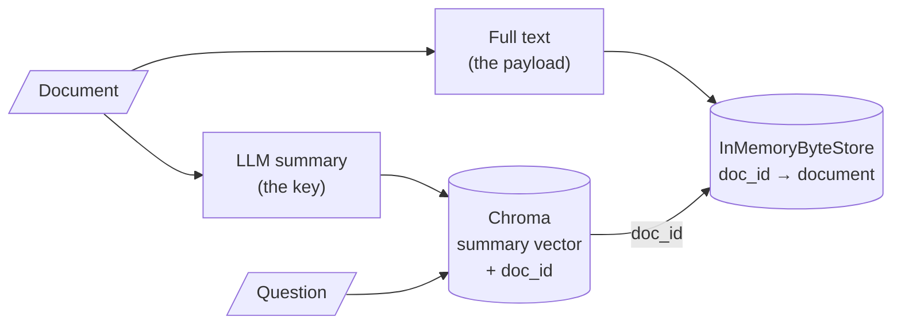

# M15.1 Theory: Multi-representation indexing: search summaries, return documents

*[M15 theory](../README.md) · Lesson 15.1 · Notebooks: [`01a_multi_representation_indexing.ipynb`](../../notebook/01a_multi_representation_indexing.ipynb) · [All theory pages](../../../../../THEORY.md)*
<!-- subtitle: Give matching and answering their own text: a short key to search and a full payload to return -->

## Search key vs payload

> **What you'll learn**
>
> - **Explain** why one text cannot serve well as both the thing you match and the thing you return.
> - **Describe** how a multi-vector retriever links a searched summary to a returned document.
> - **Compare** the five M15 techniques as choices of search key and payload.
> - **Diagnose** a summary key that matches topic questions and misses detail questions.

M14 stored one vector per chunk and returned that same chunk. This module changes what gets indexed, starting with the simplest split: one text to search, another to return.

Larkspur indexes each handbook page by an LLM summary and returns the full page. The summary of "Refunds and cancellations" covers monthly plans and cancelling. Asked *How long do I have to get a full refund on an annual plan?*, the index has nothing about annual refunds to match, though the page it would return holds the answer.

A plain index stores one text per entry and uses it twice: its embedding is matched against the question, and the text itself goes into the prompt. Those two jobs pull in opposite directions. Matching works best on short, focused text, because one vector has to stand for the whole entry. Answering works best on complete text, because the model can only use what it reads.

Multi-representation indexing gives each job its own text. The **search key** is embedded and matched; the **payload** is returned. Notebook 01a uses an LLM summary as the key and the full document as the payload:

*Figure 1: Multi-representation indexing. The summary is searched, and its `doc_id` fetches the full document.*

The pieces, as the notebook wires them:

| Piece | In notebook 01a | Job |
|---|---|---|
| Vector store | `Chroma(collection_name="summaries")` | Holds summary embeddings only |
| Docstore | `InMemoryByteStore()` | Holds the full documents, keyed by id |
| Link | `id_key="doc_id"`, one `uuid4` per document | Stored in each summary's metadata |
| Retriever | `MultiVectorRetriever(vectorstore=…, byte_store=…, id_key="doc_id")` | Searches summaries, returns documents |

*Table 1: The four pieces of a multi-vector retriever in notebook 01a.*

The notebook loads two LangChain blog posts, splits them at `chunk_size=10000`, which leaves three pieces (the 11,652-character LangSmith post becomes two), and summarises each piece with `gpt-3.5-turbo` and the prompt "Summarize the following document". Two calls show the split. `vectorstore.similarity_search("What is LangSmith?")` returns a summary, and `retriever.invoke("What is LangSmith?")` returns the full post that summary points to.

Every technique in this module is a choice of key and payload:

| Lesson | Search key (embedded) | Payload (returned) | Index-time cost |
|---|---|---|---|
| 15.1 | LLM summary | Full document | One LLM call per document |
| 15.2 | Small child chunk | Larger parent chunk or whole document | Splitting only |
| 15.3 | Page summary, then chunks of that page | Chunks | One summary call per page |
| 15.4 | Questions an LLM wrote for the chunk | The chunk | One LLM call per chunk |
| 15.5 | Chunk with a header or written context | The same text | One LLM call per document for a title, one per chunk for context |

*Table 2: Every technique in M15 as a choice of search key and payload.*

For the Larkspur page, a summary of "Refunds and cancellations" is a sharp key for *What is your refund policy?*. For *How long do I have to get a full refund on an annual plan?* it depends on what the summariser kept. If the summary mentions the 30-day refund on annual plans, the question matches and the payload brings the 100 GB condition back with it. If the summary covers only monthly plans and cancelling, nothing about annual refunds is left to match. Check a summary key on questions about details as well as questions about topics. A summary that dropped the detail a question needs is a **lossy summary key**, and it is the failure in the opening example.

## In practice: summary keys for the Larkspur handbook

For the handbook, a summary key works only if it keeps what questions ask about:

1. **Ask the summariser to keep conditions and numbers**, such as "30 days" and "100 GB", not only the topic.
2. **Test the keys on detail questions** from the golden set, such as the annual-plan refund, as well as topic questions.
3. **Keep the full page as the payload**, so the conditions travel back with any match.
4. **Budget one LLM call per page**, repeated whenever a page changes.

> **Next:** lesson 15.2 gets the same split without an LLM, by searching small chunks and returning the larger ones they came from.

## Key Takeaways

- Matching works best on short, focused text and answering on complete text. Multi-representation indexing embeds a search key and returns a separate payload, linked by a `doc_id`.
- Every advanced indexing technique is a choice of key and payload, with its own index-time cost.
- A summary key can only match what the summariser kept. Test it on questions about details as well as topics.

## Check yourself

1. Why does a plain index struggle to use one text for both matching and answering?

The two jobs pull in opposite directions. Matching works best on short, focused text, because one vector has to stand for the whole entry; answering works best on complete text, because the model can only use what it reads. Multi-representation indexing gives each job its own text: a search key that is embedded and a payload that is returned.

2. In notebook 01a, what do a similarity search on the vector store and a call to the retriever return for the question What is LangSmith?

`vectorstore.similarity_search` returns a summary, because the Chroma collection holds only summary embeddings. `retriever.invoke` returns the full post that summary points to: the `MultiVectorRetriever` reads the `doc_id` in the summary's metadata and fetches the document from the `InMemoryByteStore`.

3. A summary key matches the question about the refund policy but misses the one about a full refund on an annual plan. What went wrong?

The summariser left the detail out. If the summary covers only monthly plans and cancelling, nothing about annual refunds is left to match, even though the payload holds the answer. Check a summary key on questions about details as well as questions about topics.

---
*Previous: [M15 overview](../README.md). Next: [15.2 Parent-document retrieval, in memory and on Postgres](../02_parent_document_retrieval_in_memory_and_on_postgres/README.md).*
