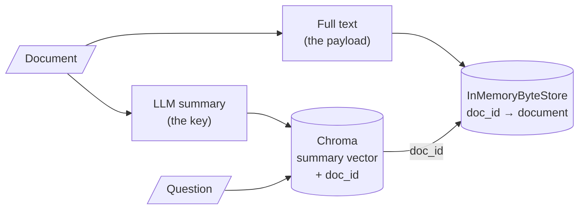

# M15.1 Theory: Multi-representation indexing: search summaries, return documents

*[M15 theory](../README.md) · Lesson 15.1 · Notebooks: [`01a_multi_representation_indexing.ipynb`](../../notebook/01a_multi_representation_indexing.ipynb) · [All theory pages](../../../../../THEORY.md)*
<!-- subtitle: Give matching and answering their own text: a short key to search and a full payload to return -->
<!-- format: approved -->

## Search key vs payload

> **What you'll learn**
>
> - **Explain** why one text cannot serve well as both the thing you match and the thing you return.
> - **Describe** how a multi-vector retriever links a searched summary to a returned document.
> - **Compare** the five M15 techniques as choices of search key and payload.
> - **Diagnose** a summary key that matches topic questions and misses detail questions.

M14 stored one vector per chunk and returned that same chunk. This module changes what gets indexed, starting with the simplest split: one text to search, another to return.

Larkspur indexes each handbook page by an LLM summary and returns the full page. The summary of "Refunds and cancellations" covers monthly plans and cancelling. Asked *How long do I have to get a full refund on an annual plan?*, the index has nothing about annual refunds to match. The page it would have returned holds the answer.

A plain index stores one text per entry and uses it twice. Its embedding is matched against the question, and the text itself goes into the prompt. Those two jobs pull in opposite directions:

- **Matching** works best on short, focused text, because one vector has to stand for the whole entry. A long page that mixes refunds, credits and exports gets a vector that averages all three.
- **Answering** works best on complete text, because the model can only use what it reads. A short extract can drop the condition that decides the answer.

**Multi-representation indexing** gives each job its own text. The **search key** is embedded and matched; the **payload** is returned. Notebook 01a uses an LLM summary as the key and the full document as the payload:

*Figure 1: Multi-representation indexing. The summary is searched, and its `doc_id` fetches the full document.*

The pieces, as the notebook wires them:

| Piece | In notebook 01a | Job |
|---|---|---|
| Vector store | `Chroma(collection_name="summaries")` | Holds summary embeddings only |
| Docstore | `InMemoryByteStore()` | Holds the full documents, keyed by id |
| Link | `id_key="doc_id"`, one `uuid4` per document | Stored in each summary's metadata |
| Retriever | `MultiVectorRetriever(vectorstore=…, byte_store=…, id_key="doc_id")` | Searches summaries, returns documents |

*Table 1: The four pieces of a multi-vector retriever in notebook 01a.*

The notebook loads two LangChain blog posts and splits them at `chunk_size=10000`. That leaves three pieces: the 11,652-character LangSmith post becomes two (9,865 and 1,785 characters), and the 4,728-character web-research post stays whole. Each piece is summarised with `gpt-3.5-turbo` and the prompt "Summarize the following document".

Two calls on the same question show the split between the stores. Following *What is LangSmith?* through the index:

| Call | Searches | Returns |
|---|---|---|
| `vectorstore.similarity_search` | Summary embeddings in Chroma | A summary, the key itself |
| `retriever.invoke` | The same summary embeddings | The full piece whose `doc_id` the best summary carries, read from the byte store |

*Table 2: The same question through the vector store alone and through the multi-vector retriever (piece lengths measured by rerunning the notebook's splitter).*

The question meets only summaries, and the model meets only full text. The id in the summary's metadata is the whole link between them, so a summary whose id has no entry in the byte store returns nothing.

## Every M15 technique as a key and a payload

Every technique in this module is a choice of key and payload:

| Lesson | Search key (embedded) | Payload (returned) | Index-time cost |
|---|---|---|---|
| 15.1 | LLM summary | Full document | One LLM call per document |
| 15.2 | Small child chunk | Larger parent chunk or whole document | Splitting only |
| 15.3 | Page summary, then chunks of that page | Chunks | One summary call per page |
| 15.4 | Questions an LLM wrote for the chunk | The chunk | One LLM call per chunk |
| 15.5 | Chunk with a header or written context | The same text | One LLM call per document for a title, one per chunk for context |

*Table 3: Every technique in M15 as a choice of search key and payload.*

The retrieval code between the two stores stays the same in every row. What changes is who writes the key (a splitter, an LLM, or a template) and how much text the payload carries.

## When the summary drops the detail

For the Larkspur page, a summary of "Refunds and cancellations" is a sharp key for *What is your refund policy?*. For *How long do I have to get a full refund on an annual plan?* it depends on what the summariser kept. The switcher shows two summaries of the same page against that question. Both summaries are illustrative, written for this page, not notebook output.

Choose a summary key and follow the annual-plan refund question through it.

<button type="button" data-mode="keeps" aria-pressed="false" aria-controls="key-keeps">Summary keeps the conditions</button>
<button type="button" data-mode="lossy" aria-pressed="false" aria-controls="key-lossy">Lossy summary key</button>

<section id="key-keeps" class="mode-panel" data-announcement="The summary names the 30-day annual refund, so the question matches and the full page comes back."><h4>Summary keeps the conditions</h4><dl><dt>Key (illustrative)</dt><dd>Monthly plans are not refundable. Annual plans get a full refund within 30 days if under 100 GB of outbound traffic, then prorated refunds minus a 15% fee.</dd><dt>Match</dt><dd>The key shares "annual", "full refund" and "30 days" with the question.</dd><dt>Payload</dt><dd>The full page, with the 100 GB condition and the 5 to 10 business days.</dd></dl></section>
<section id="key-lossy" class="mode-panel" data-announcement="The summary covers only monthly plans and cancelling, so nothing about annual refunds is left to match."><h4>Lossy summary key</h4><dl><dt>Key (illustrative)</dt><dd>Explains how billing cycles work and how to cancel a plan from the Billing page; monthly plans are not refundable.</dd><dt>Match</dt><dd>Nothing about annual refunds is left in the key. Another page can outrank it.</dd><dt>Payload</dt><dd>Never fetched, though it holds the answer.</dd></dl></section>

If the summary mentions the 30-day refund on annual plans, the question matches and the payload brings the 100 GB condition back with it. If the summary covers only monthly plans and cancelling, nothing about annual refunds is left to match. A summary that dropped the detail a question needs is a **lossy summary key**, and it is the failure in the opening example. The payload cannot repair it, because the payload is only fetched after the key matches.

## In practice: summary keys for the Larkspur handbook

For the handbook, a summary key works only if it keeps what questions ask about:

1. **Ask the summariser to keep conditions and numbers**, such as "30 days" and "100 GB", not only the topic. The notebook's one-line prompt asks for neither.
2. **Test the keys on detail questions** from the golden set, such as the annual-plan refund, as well as topic questions.
3. **Keep the full page as the payload**, so the conditions travel back with any match.
4. **Budget one LLM call per page**, repeated whenever a page changes.

Lesson 15.2 gets the same split without an LLM, by searching small chunks and returning the larger ones they came from.

## Limits of this evidence

- **The notebook prints no measurement.** It shows that the retriever returns full documents for a summary match on one question. It does not compare summary keys with plain chunks, so it says nothing about which retrieves better.
- **The summaries are not in the repository.** Notebooks ship without outputs, and `gpt-3.5-turbo` writes a different summary on each run. The two keys in the switcher are illustrative.
- **The docstore is in memory.** `InMemoryByteStore` is lost when the process stops, while Chroma can persist. Lesson 15.2 covers what happens to the summaries then.

## References

1. LangChain reference, [MultiVectorRetriever](https://reference.langchain.com/python/langchain-classic/retrievers/multi_vector/MultiVectorRetriever).
2. Sarthi and others, [RAPTOR: recursive abstractive processing for tree-organised retrieval](https://arxiv.org/abs/2401.18059), 2024. Summaries as retrieval keys, built into a tree.

## Key Takeaways

- Matching works best on short, focused text and answering on complete text. Multi-representation indexing embeds a search key and returns a separate payload, linked by a `doc_id`.
- Every advanced indexing technique is a choice of key and payload, with its own index-time cost.
- A summary key can only match what the summariser kept. Test it on questions about details as well as topics.

## Check yourself

1. Why does a plain index struggle to use one text for both matching and answering?

The two jobs pull in opposite directions. Matching works best on short, focused text, because one vector has to stand for the whole entry; answering works best on complete text, because the model can only use what it reads. Multi-representation indexing gives each job its own text: a search key that is embedded and a payload that is returned.

2. In notebook 01a, what do a similarity search on the vector store and a call to the retriever return for the question What is LangSmith?

`vectorstore.similarity_search` returns a summary, because the Chroma collection holds only summary embeddings. `retriever.invoke` returns the full post that summary points to: the `MultiVectorRetriever` reads the `doc_id` in the summary's metadata and fetches the document from the `InMemoryByteStore`.

3. A summary key matches the question about the refund policy but misses the one about a full refund on an annual plan. What went wrong?

The summariser left the detail out. If the summary covers only monthly plans and cancelling, nothing about annual refunds is left to match, even though the payload holds the answer. Check a summary key on questions about details as well as questions about topics.

---
*Previous: [M15 overview](../README.md). Next: [15.2 Parent-document retrieval, in memory and on Postgres](../02_parent_document_retrieval_in_memory_and_on_postgres/README.md).*
