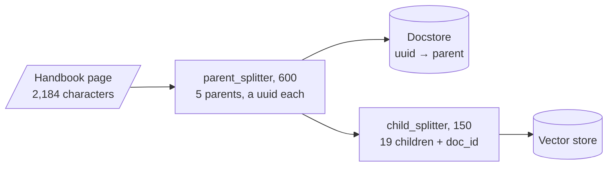

# M15.2 Theory: Parent-document retrieval, in memory and on Postgres

*[M15 theory](../README.md) · Lesson 15.2 · Notebooks: [`02a_parent_document_retrieval.ipynb`](../../notebook/02a_parent_document_retrieval.ipynb), [`02b_parent_document_retriever_postgres.ipynb`](../../../optional/notebook/02b_parent_document_retriever_postgres.ipynb) (optional) · [All theory pages](../../../../../THEORY.md)*
<!-- subtitle: Search small children, return their larger parent, and keep both halves of the index in step -->
<!-- format: approved -->

## Docstore

> **What you'll learn**
>
> - **Explain** how a parent-document retriever links small search chunks to the larger text it returns.
> - **Diagnose** an empty result after a restart, a misordered parent and a duplicated index.
> - **Measure** child and parent sizes by whole answers and tokens per question.
> - **Choose** a child size near the evidence and a parent size near a section.

Lesson 15.1 wrote a summary to serve as the search key. Parent-document retrieval gets a sharp key with no LLM call, by cutting the text into pieces of two sizes.

At a child size of 150 characters, the best match for the Larkspur refund question is a child that ends at "…as long as the account has used less". Sent to the model alone, it gives the 30-day rule without the 100 GB condition. Parent-document retrieval keeps that sharp child as the key and sends its parent instead.

Parent-document retrieval splits along size instead of meaning. Small **child** chunks are the search keys; the larger **parent** each child was cut from is the payload. The vector store holds the children. The **docstore** holds the parents, keyed by id, and each child carries its parent's id in its metadata (`doc_id` by default).

`ParentDocumentRetriever.add_documents` does the splitting and the bookkeeping:

*Figure 1: Indexing the Larkspur page with parent-document retrieval, at child 150 and parent 600.*

The counts are the lab's at child 150 and parent 600. Without a `parent_splitter`, each original document is the parent.

At query time the retriever turns a ranked list of children into a short list of parents. The walkthrough follows the refund question at child 150 and parent 600, with the top 2 children as in the lab.

Step through one call to the retriever and see what each stage reads and passes on.

<button type="button" data-step="search" aria-pressed="false" aria-controls="pdr-search">Search children</button>
<button type="button" data-step="ids" aria-pressed="false" aria-controls="pdr-ids">Collect parent ids</button>
<button type="button" data-step="fetch" aria-pressed="false" aria-controls="pdr-fetch">Fetch parents</button>
<button type="button" data-step="drop" aria-pressed="false" aria-controls="pdr-drop">Drop missing ids</button>

<section id="pdr-search" class="step-panel"><h4>1. Similarity search over the children</h4>
The question is compared with the 19 children only. Child #5 ranks first (0.630 in the lab), the one that ends at "…as long as the account has used less". Child #2, about billing cycles, ranks second (0.190).
</section>
<section id="pdr-ids" class="step-panel"><h4>2. Parent ids in rank order, without repeats</h4>
Each child carries its parent's id in <code>doc_id</code>. The retriever reads them in rank order and skips an id it has already seen. Two children from one parent yield that parent once. Here the list is P2 (from child #5), then P1 (from child #2).
</section>
<section id="pdr-fetch" class="step-panel"><h4>3. One <code>docstore.mget</code> call</h4>
The list of ids goes to the docstore in one call. The contract is one value per id, in the same order, with nothing for an id the store does not hold. P2 comes back at about 131 tokens with the whole refund sentence, P1 at about 72.
</section>
<section id="pdr-drop" class="step-panel"><h4>4. Missing parents dropped</h4>
Any id the docstore did not return is removed without an error. Here both parents exist, and the model reads about 203 tokens in place of the two children. Across the three golden questions that averages 206 tokens, against 53 for the children alone.
</section>

<button type="button" data-walk="previous">Previous</button>
<button type="button" data-walk="next">Next</button>

Stage 4 is where silent failures hide, because a missing parent and an empty result look the same to the caller.

Notebook 02a runs both shapes on two LangChain blog posts. With only `child_splitter` at 400, the parents are the two whole posts: the docstore lists two keys and every answer arrives as a full post. With `parent_splitter` at 2000 and `child_splitter` at 400 the parents are 2,000-character sections (ten of them for these two posts, counted by rerunning the splitter), and the retriever is wired into a `RetrievalQA` "stuff" chain.

The docstore is any `BaseStore`: four methods, `mget`, `mset`, `mdelete` and `yield_keys`. The notebooks use `InMemoryStore`, which disappears when the process stops, while a vector store such as Chroma can persist on disk. A restart then leaves children whose parents are gone, and `invoke` returns nothing for them, without an error. We call these **orphaned children**. Optional notebook 02b moves both halves into Postgres: `PGVector` for the children and a custom `PostgresStore` that keeps each parent as JSONB in a `docstore` table.

Check three details in 02b's store before you copy it:

- **Unordered `mget`.** The `BaseStore` contract says `mget` returns one value per key, in key order, with `None` for a missing key. 02b's `mget` returns whatever rows the query yields, in database order, and skips missing keys. `MultiVectorRetriever` relies on that order to keep the parents ranked, so the best parent can arrive second.
- **Silent store error.** Every method logs exceptions and carries on; `mget` then returns an empty list. A database outage looks like a question with no context.
- **Run-minted ids**, as in M14. `add_documents(docs, ids=None)` gives every parent a fresh `uuid4` on each call. Running ingestion twice stores every parent and child twice. Pass stable ids (one per parent, after the parent splitter) and delete a document's children and parents together when it changes.

## Choosing child and parent sizes

The child size decides what can be matched. The parent size decides what the model reads and what each question costs. The [interactive lab](interactive/search-small-return-large-lab.html) runs a port of `ParentDocumentRetriever` on the Larkspur page with TF-IDF standing in for embeddings and the top 2 children per question, as in the M10 baseline. On all 242 slider settings and all three golden questions it returns the same children, scores and parents as the real retriever (`InMemoryVectorStore` with scikit-learn TF-IDF vectors): 0 mismatches, scores within 2e-16.

<!-- lab: interactive/search-small-return-large-lab.html -->

| Child / parent | Children, parents | Answers whole: children only | Answers whole: parents | Mean tokens: children / parents |
|---|---|---|---|---|
| 150 / 600 | 19, 5 | 0 of 3 | 3 of 3 | 53 / 206 |
| 150 / 400 | 19, 8 | 0 of 3 | 2 of 3 | 53 / 155 |
| 200 / 800 | 16, 4 | 1 of 3 | 3 of 3 | 79 / 182 |
| 400 / 2000, notebook 02a | 9, 2 | 2 of 3 | 3 of 3 | 165 / 478 |
| 400 / whole page | 8, 1 | 2 of 3 | 3 of 3 | 164 / 546 |
| 400 / 400 | 8, 8 | 2 of 3 | 2 of 3 | 164 / 164 |

*Table 1: Six child and parent sizes on the Larkspur page, from the lab.*

"Children only" is plain chunking at the child size: the same two matches sent as they are. Tokens use the four-characters-per-token rule.

- **Small children match sharply and cut answers.** At 150, child #5 is the best match for the refund question and ends at "…as long as the account has used less". Sent alone it gives the 30-day rule without the 100 GB condition. Its parent holds the whole sentence.
- **Parent-boundary cut.** A parent boundary can cut an answer too. With parents of 400 characters, the outage answer ("The credits are not added automatically. You claim them…") falls across two parents, and no child size gets it back whole.
- **Parents cost tokens on every question.** The notebook's 2,000-character parents return most of this short page: 478 tokens on average against 165 for the children. With no parent splitter, every question costs 546 tokens, the whole page.
- **Children from one parent return it once.** At 200 / 800 both outage matches come from the same parent, and the model reads it once, at 196 tokens.
- **A parent no larger than its child is plain chunking.** At 400 / 400 each parent yields one child identical to itself, and the two columns match.

Across the 217 settings where parents are larger than children, the children alone contain the whole answer in 394 of the 651 question and setting pairs; their parents contain it in 613. Size the child near the length of the evidence your questions need (the refund sentence is 141 characters) and the parent near a section, then check on the golden set that no parent boundary cuts an answer.

## In practice: sizing the Larkspur parents

Table 1 gives the handbook's settings directly:

1. **Children near the evidence**: the refund sentence is 141 characters, and children of 150 to 200 match it sharply.
2. **Parents near a section**: 600 or 800 keeps all three golden answers whole; 400 cuts the outage answer.
3. **Persist both halves**, and if you write your own docstore, return parents in key order and raise on errors.
4. **Give parents stable ids**, and delete a page's children and parents together when it changes.

Lesson 15.3 uses a larger unit earlier, to decide where to search before any chunk competes.

## Limits of this evidence

- **TF-IDF stands in for embeddings.** The lab's ranks come from scikit-learn TF-IDF on one 2,184-character page. An embedding model ranks children differently. The 150 / 600 result says where to start testing, not which sizes win.
- **Three questions, one page.** "Answers whole" checks whether a returned text contains the golden answer sentence. It does not check what the model then writes.
- **Tokens are estimated** at four characters per token, not counted with a tokeniser.
- **The Postgres store was read, not run.** Its three defects come from its code; this lesson did not reproduce them against a database.

## References

1. LangChain reference, [ParentDocumentRetriever](https://reference.langchain.com/python/langchain-classic/retrievers/parent_document_retriever/ParentDocumentRetriever).
2. LangChain reference, [BaseStore](https://reference.langchain.com/python/langchain-core/stores/BaseStore), the key-value contract every docstore implements.

## Key Takeaways

- Parent-document retrieval searches small children and returns their larger parents from a docstore. Persist the docstore with the vectors, or a restart silently returns nothing.
- Before copying a custom docstore, check that `mget` keeps key order, surfaces errors and uses stable ids, so ingestion does not duplicate every chunk.
- Size the child near the length of the evidence and the parent near a section. Parents cost tokens on every question, and a parent boundary can still cut an answer.

## Check yourself

1. At query time, how does the parent-document retriever turn matching children into the text the model reads?

It runs a similarity search over the children, collects their parent ids in rank order without repeats, fetches those parents with `docstore.mget`, and drops any id the docstore does not return. Children from one parent therefore return it once: at 200 / 800 both outage matches come from the same parent, and the model reads it once.

2. At child size 150 and parent size 600, what does the model get for the refund question from the children alone, and what from their parents?

The best child ends at "…as long as the account has used less". Sent alone, it gives the 30-day rule without the 100 GB condition. Its parent holds the whole sentence. In the lab table the children answer 0 of 3 questions whole and the parents 3 of 3, at 53 against 206 tokens on average.

3. After a restart, the retriever returns nothing for questions it answered before, and raises no error. What happened?

The docstore was an `InMemoryStore`, which disappears when the process stops, while the vector store persisted the children. `invoke` drops parent ids the docstore does not return, so every hit vanishes silently. Persist both halves, as notebook 02b does with `PGVector` and a Postgres docstore, after checking its `mget` order, error handling and ids.

---
*Previous: [15.1 Multi-representation indexing: search summaries, return documents](../01_multi_representation_indexing_search_summaries_return_documents/README.md). Next: [15.3 Hierarchical indices: summary tier and detail tier](../03_hierarchical_indices_summary_tier_and_detail_tier/README.md).*
