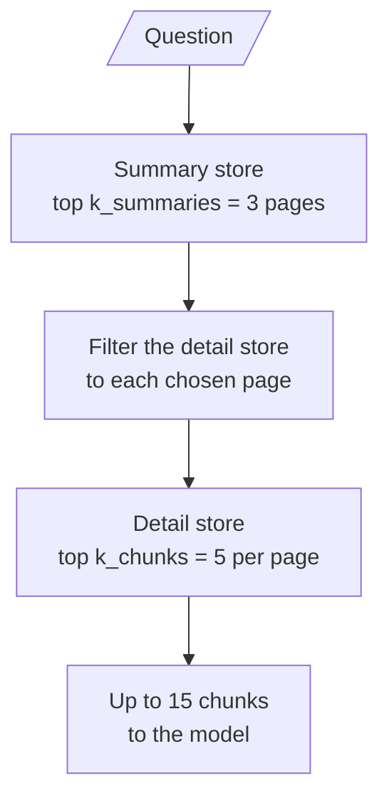

# M15.3 Theory: Hierarchical indices: summary tier and detail tier

*[M15 theory](../README.md) · Lesson 15.3 · Notebooks: [`03a_hierarchical_indices.ipynb`](../../notebook/03a_hierarchical_indices.ipynb) · [All theory pages](../../../../../THEORY.md)*
<!-- subtitle: Pick the page first and the chunk second, and a page the first tier misses hides every chunk on it -->
<!-- format: approved -->

## Top-down search

> **What you'll learn**
>
> - **Explain** how a two-tier index searches page summaries before chunks.
> - **Compare** what the summary tier buys with what it costs.
> - **Diagnose** a strong chunk that never appears because its page was not chosen.
> - **Calculate** the most chunks a two-tier search can send to the model.

Lesson 15.2 returned a larger unit around each match. A hierarchical index uses the larger unit earlier, to decide where to search at all.

In a flat Larkspur index, *Do I get service credits automatically after an outage?* competes against every chunk in the handbook, including a refund chunk about "Credits from SLA breaches" that shares its words. That refund chunk can take a top slot the outage answer needed.

A hierarchical index has two tiers. The **summary tier** has one entry per page or section, and the **detail tier** has the ordinary chunks. Both carry the page number. A question first picks the best pages from the summary tier, then searches the detail tier only inside those pages.

<!-- animated: diagrams/top-down-search.anim.html -->

*Figure 1: Top-down search. The summary tier picks pages, and the detail search runs only inside them.*

Notebook 03a builds both tiers from one PDF with `encode_pdf_hierarchical`:

- `PyPDFLoader` gives one Document per page. Each page is summarised with `load_summarize_chain(..., chain_type="map_reduce")` on `gpt-4o-mini`, five pages at a time with a one-second pause between batches and exponential backoff on rate limits.
- The pages are also split into detail chunks at `chunk_size=1000`, `chunk_overlap=200`, each tagged with `page`, `chunk_id` and `summary: False`.
- Each tier goes into its own FAISS store, saved to disk so the summaries are paid for once.

`retrieve_hierarchical(query, summary_store, detailed_store, k_summaries=3, k_chunks=5)` runs the summary search, then for each summary calls `similarity_search(query, k=5, filter=…)` with a filter that keeps only chunks whose `page` matches. The result is up to 15 chunks, grouped by page in the order the summary tier ranked the pages.

Following the notebook's question, *What is the greenhouse effect?*, through the two tiers:

| Stage | Searches | Keeps | Passes on |
|---|---|---|---|
| Summary tier | One summary per PDF page | The top 3 summaries | Their 3 page numbers, in rank order |
| Detail tier, once per page | The detail store, filtered to that page | Up to 5 chunks | The chunks, grouped under their page |
| Result | | Up to 3 × 5 chunks | One list for the prompt |

*Table 1: Top-down search in notebook 03a, stage by stage.*

The filter has a catch the notebook does not mention. FAISS applies a filter after the search: it fetches the 20 nearest chunks from the whole detail store (`fetch_k=20` by default), then keeps those on the chosen page. A chosen page whose chunks are not in that global top 20 returns fewer than 5 chunks, possibly none. We call this **filter starvation**. Raising `fetch_k` fixes it, at the cost of a wider search per page.

What the two tiers buy:

- **Pages compete as wholes.** A page summary says what the page is about. A broad question ("What is the greenhouse effect?") lands on the right pages before any chunk-level detail is compared.
- **Off-page chunks never enter the result.** A chunk with matching words on an unrelated page is filtered out, however well it scores. It can still take one of the 20 fetched slots and starve the chosen page.

And what they cost:

- **Tier-capped recall.** The summary tier caps recall. If the right page is not in the top 3 summaries, its chunks are never searched, however well they would score. Log which pages the summary tier chose, so a miss can be traced to the tier that caused it.
- **Stale summaries.** Summaries are an index-time LLM bill and a staleness risk. One summarisation per page, repeated whenever the page changes.
- **The result size is a product.** `k_summaries × k_chunks` is the number of chunks the model can receive. Changing either one changes the prompt budget.

## In practice: section summaries for the Larkspur handbook

For the Larkspur handbook, each section ("Refunds and cancellations", "Outages and service credits", "Data export and retention") would be one summary. *Do I get service credits automatically after an outage?* would pick the outage summary first and then keep only that section's chunks. A refund chunk about "Credits from SLA breaches" cannot reach the prompt. Four settings keep it that way:

1. **One summary per section**, regenerated whenever the section changes.
2. **A prompt budget set by both numbers**: 3 sections × 5 chunks is up to 15 chunks per question.
3. **A `fetch_k` large enough** that each chosen section still yields its chunks; with three short sections, fetching every chunk costs little.
4. **A log of the sections chosen** for every question, which lets a miss be traced to the summary tier.

Lesson 15.4 changes the key again, from what a chunk says to the questions a reader would ask about it.

## Limits of this evidence

- **No result is recorded.** Notebook 03a ships without outputs and prints no comparison with a flat index. Nothing here shows that two tiers retrieve better on its climate PDF.
- **The animation is illustrative.** It uses the notebook's parameters (3 and 5), but which pages and chunks light up is made up.
- **The Larkspur outcome is reasoned, not run.** The handbook was not indexed in two tiers for this lesson.

## References

1. Sarthi and others, [RAPTOR: recursive abstractive processing for tree-organised retrieval](https://arxiv.org/abs/2401.18059), 2024. A deeper version of the summary tier: clusters of chunks summarised level by level into a tree.

## Key Takeaways

- A hierarchical index picks the best pages from a summary tier, then keeps only chunks from those pages. FAISS filters after fetching the top 20 chunks overall. Set `fetch_k` high enough that a chosen page is not starved.
- The summary tier caps recall: a page it misses is never searched. Log which pages it chose so a miss can be traced.
- Summaries cost one LLM call per page and go stale when pages change. The model receives up to `k_summaries × k_chunks` chunks, so both numbers set the prompt budget.

## Check yourself

1. For the question about service credits after an outage, why can a refund chunk about credits from SLA breaches not crowd out the answer?

The question first picks the best section summaries, and the outage summary wins as a whole. The detail search then keeps only chunks from the chosen pages. A chunk with matching words on an unrelated page is filtered out, however well it scores.

2. With 3 summaries and 5 chunks per summary, how many chunks can reach the model, and what happens if you raise the chunk count to 10?

Up to 15 chunks, because the result size is `k_summaries × k_chunks`. Raising `k_chunks` to 10 allows up to 30. Changing either number changes the prompt budget.

3. A chunk that would score well against the question never appears in the results. Which tier do you check first, and what should you log?

The summary tier. If the right page is not in the top 3 summaries, its chunks are never searched, however well they would score. Log which pages the summary tier chose; then a miss can be traced to the tier that caused it.

---
*Previous: [15.2 Parent-document retrieval, in memory and on Postgres](../02_parent_document_retrieval_in_memory_and_on_postgres/README.md). Next: [15.4 Question-side indexing: HyPE and document augmentation](../04_question_side_indexing_hype_and_document_augmentation/README.md).*
