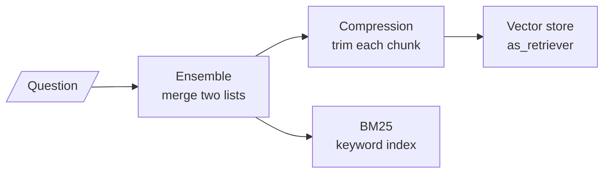

# M16.1 Theory: The retriever interface and its search modes

*[M16 theory](../README.md) · Lesson 16.1 · Notebooks: [`01a_retrievers.ipynb`](../../notebook/01a_retrievers.ipynb) · [All theory pages](../../../../../THEORY.md)*
<!-- subtitle: Similarity search always answers, even when the index holds nothing worth sending -->

## Search modes

> **What you'll learn**
>
> - **Explain** why every retriever, however elaborate, looks the same to the chain that calls it.
> - **Compare** the six search modes by what they return and what they cost per question.
> - **Diagnose** a score threshold that reads a distance as a relevance score.
> - **Choose** a first defence for questions the index cannot answer.

Part IV ended with a working pipeline: load, chunk, embed, store, retrieve the top `k`. This module changes only the retrieve step, so it starts with what a retriever is.

A Larkspur customer asks *Can I rent a GPU server for model training?* Larkspur does not sell GPU servers, and the handbook says nothing about them. Plain similarity search returns three chunks anyway, the three plan sheets, and the model is asked to answer from them.

A **retriever** is any object that takes a query string and returns a list of documents. In LangChain that is one method, `invoke(query)`. The signature is the whole contract, which is why retrievers stack: a wrapper that calls another retriever and post-processes its list is itself a retriever.

Here is how three wrappers sit around one vector store:

*Figure 1: Retrievers nest. The chain calls the outer one and sees the same interface at every depth.*

A vector store becomes a retriever through `as_retriever`, with a search type and its settings. Notebook `01a` builds a twelve-sentence Chroma store and tries each mode on questions such as *what is the old capital of India?*:

| Mode | What it returns | Extra cost per question |
|---|---|---|
| **Similarity** (`k = 3`) | The 3 nearest chunks, however far away they are | None |
| **MMR** (`k = 3` from `fetch_k = 10`) | 3 of the 10 nearest, chosen to differ from each other (lesson 16.4) | None |
| **Score threshold** (`k = 3`, threshold 0.3) | Up to 3 chunks with relevance at least 0.3; possibly none | None |
| **Multi-query** | The union of results for several LLM-written rewordings | 1 LLM call, then one search per rewording |
| **Contextual compression** | The same chunks cut to their relevant sentences, or only the chunks an LLM keeps | 1 LLM call per retrieved chunk |
| **Ensemble** (weights 0.7 and 0.3) | One list merged from several retrievers by weighted rank fusion (lesson 16.3) | One more search per retriever, no LLM call |

*Table 1: The six modes in `01a`.*

The first row is the one that failed the GPU question. Similarity search has no notion of "nothing relevant": it sorts every chunk by distance and hands over the first `k`. We call this **forced top-k**. The model receives the closest chunks whether they are close or not, and a fluent answer built from the plan sheets reads like a yes.

Here are the real cosine scores for that question and for an in-scope one, embedded with `all-MiniLM-L6-v2` over the 19 Larkspur chunks of this module's lab:

| Question | 1st chunk | 2nd chunk | 3rd chunk |
|---|---|---|---|
| *How long does a refund take?* | `refund-timing` 0.770 | `refund-window` 0.608 | `support` 0.297 |
| *Can I rent a GPU server for model training?* | `plan-816` 0.206 | `plan-204` 0.200 | `plan-408` 0.183 |

*Table 2: Relevance scores, in-scope against out-of-scope (cosine similarity, `all-MiniLM-L6-v2`).*

Similarity search sends all six chunks. A floor of 0.3 sends the two refund chunks for the first question and nothing for the second, which is the right answer: the index holds nothing to say about GPUs.

## Distance or relevance: two score directions

A score threshold is the first defence against forced top-k, and it goes wrong in a predictable way, because vector stores report scores in two directions:

- **Distance**: lower is closer. `similarity_search_with_score` returns it. `01a` sets Chroma's space to cosine, because Chroma uses Euclidean distance unless told otherwise.
- **Relevance score**: higher is closer. `similarity_search_with_relevance_scores` returns it, and the score-threshold mode is built on it. For cosine space, Chroma computes it as 1 minus the distance.

One chunk from `01a`, traced through both:

| Reported as | Value | Passes "at least 0.3"? |
|---|---|---|
| Cosine distance | 0.35375 | Read as relevance, it would barely pass |
| Relevance (1 minus distance) | 0.64625 | Yes, comfortably |

*Table 3: The same chunk, two scores.*

Comparing a distance with a threshold written for relevance inverts the filter: the closest chunks have the smallest distances and are the first to be cut. We call this the **flipped threshold**. Print a known-good pair and a known-bad pair before trusting any threshold.

`01a` also builds a custom retriever that does the conversion itself, keeps chunks above a threshold (0.51 for *what is the financial capital of India?*), and writes the rounded score into each chunk's metadata. That habit pays off later: a logged score can be plotted, and a threshold can then be tuned from real distributions rather than copied.

> **Pitfall: a portable threshold.** A threshold belongs to one embedding model and one distance function on one corpus. Table 2's 0.3 works for `all-MiniLM-L6-v2` here; another model spreads the same questions over a different range. Re-tune it whenever the model changes.

## What each wrapper spends

Table 1's cost column decides which wrappers a team can afford per question. Each one fixes a different failure:

- **Multi-query**: wording that misses the documents. Spends one LLM call and several searches to raise recall.
- **Compression**: chunks full of text the question does not need. Spends one LLM call per chunk to cut tokens and noise.
- **Ensemble**: a single retriever's blind spot. Spends one search per extra retriever and no LLM call.

`01a`'s ensemble merges a compressed retriever with a plain one over the same store. Ensembles are not only for dense plus keyword search: any two retrievers with different blind spots can be fused. Lesson 16.6 compares the patterns side by side and counts the calls when they nest.

## In practice: an out-of-scope guard for Larkspur

For Larkspur's support assistant, the retriever needs a way to return nothing:

1. **Log scores first.** Write each chunk's relevance into its metadata, and record it for every query for a week.
2. **Set the floor from data.** Take in-scope golden questions and out-of-scope ones such as the GPU question, and place the threshold between their score ranges (0.3 separates Table 2's two questions).
3. **Treat empty as an answer.** An empty list routes to a fixed reply ("The handbook doesn't cover that") instead of a model call.
4. **Re-tune on model change.** A new embedding model means a new floor.

The guard handles questions the handbook cannot answer. Lesson 16.2 turns to questions it can answer but the embedding retriever still misses.

## Key Takeaways

- Every retriever exposes `invoke(query)` and returns documents, so multi-query, compression and ensemble wrappers stack without the chain noticing.
- Similarity search always returns `k` chunks (forced top-k): the GPU question gets three plan sheets at 0.18 to 0.21. A score threshold lets the retriever return nothing.
- Check whether a store reports a distance (lower is closer) or a relevance score (higher is closer), and tune any threshold per embedding model from logged scores.

## Check yourself

1. Why can a chain not tell a plain vector search from a hybrid, compressed, multi-query retriever?

Every retriever has one signature: it takes a query string and returns a list of documents. A wrapper that calls another retriever and post-processes its list is itself a retriever, so the chain sees the same interface at every depth.

2. Chroma in cosine space reports a distance of 0.35375 for a chunk. What does the score-threshold mode compare, and does the chunk pass a threshold of 0.3?

It compares a relevance score, where higher is closer. For cosine, Chroma computes 1 minus the distance, so 0.35375 becomes 0.64625 and the chunk passes comfortably. Comparing the raw distance against a relevance threshold is the flipped threshold: it cuts the closest chunks first.

3. The GPU question gets three plan sheets scoring 0.18 to 0.21, while the refund question's evidence scores 0.61 to 0.77. What do you change, and what must the assistant do when nothing passes?

Add a score threshold set between the two ranges, such as 0.3 for this model and corpus, so the out-of-scope question retrieves nothing. An empty result is a valid outcome: route it to a fixed "not covered" reply instead of asking the model to answer from unrelated chunks.

---
*Previous: [M16 overview](../README.md). Next: [16.2 Dense + sparse hybrid retrieval with BM25 and EnsembleRetriever](../02_dense_sparse_hybrid_retrieval_with_bm25_and_ensembleretriever/README.md).*
