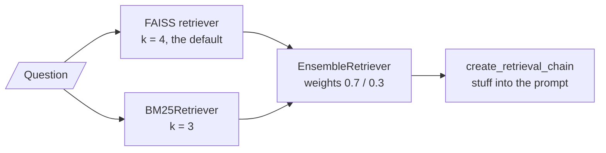
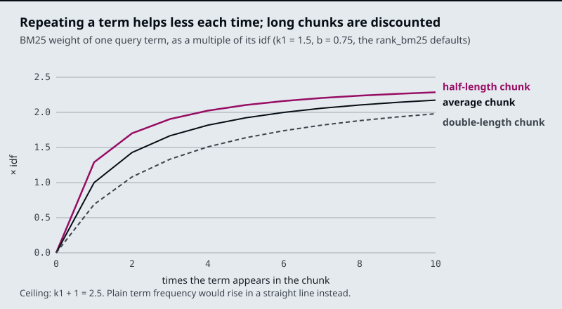

# M16.2 Theory: Dense + sparse hybrid retrieval with BM25 and EnsembleRetriever

*[M16 theory](../README.md) · Lesson 16.2 · Notebooks: [`02a_dense_sparse_hybrid_retrieval.ipynb`](../../notebook/02a_dense_sparse_hybrid_retrieval.ipynb), [`02b_hybrid_search_rag.ipynb`](../../../optional/notebook/02b_hybrid_search_rag.ipynb) (optional) · [All theory pages](../../../../../THEORY.md)*
<!-- subtitle: Embeddings miss exact codes, keyword search misses paraphrase, so production retrieval runs both -->

## Dense vs sparse

> **What you'll learn**
>
> - **Explain** why an embedding retriever misses an error code that a keyword retriever finds, and the reverse.
> - **Compare** dense and sparse retrieval on the Larkspur golden questions, rank by rank.
> - **Explain** the two corrections BM25 makes to TF-IDF.
> - **Diagnose** a keyword retriever that misses because of its tokeniser, before touching its parameters.

Lesson 16.1 treated the retriever as a black box with one method. This lesson opens two different boxes and shows that each one fails on the questions the other gets right.

A Larkspur customer pastes *What does E-4021 mean?* The handbook has a chunk that starts "Error E-4021: the export stopped at the 50 GB snapshot limit." The embedding retriever ranks it 5th, behind four other error-code chunks that look alike to it, and a top-3 cut drops the one chunk that answers.

A **dense** retriever turns every chunk and the question into an embedding, a vector in which every position holds a number, and ranks chunks by vector similarity. A **sparse** retriever describes a chunk by its words: one weight per vocabulary word, zero for almost all of them. The two match on different evidence:

| | Dense (embeddings) | Sparse (BM25) |
|---|---|---|
| A chunk is | A vector; 1,536 numbers for `text-embedding-3-small` in `02a` | Token counts over the vocabulary, mostly zero |
| Matches | Meaning: paraphrase, synonyms | Exact tokens |
| Misses | Rare exact strings: order IDs, plan names, error codes | Different words for the same thing |
| Needs | An embedding model at index and query time | A tokeniser; no model |

*Table 1: Dense and sparse retrieval side by side.*

An error code has no learned meaning for an embedding model, so its few characters move the chunk's vector very little. BM25 treats `e-4021` as one more token and a rare one, which is the case it weights most.

The module's lab ranks the same 19 Larkspur chunks both ways, with BM25 and with `all-MiniLM-L6-v2` cosine similarity. Here is where each retriever puts the evidence for its seven golden questions:

| Golden question | Evidence chunk | BM25 rank | Dense rank |
|---|---|---|---|
| *How long does a refund take?* | `refund-window` / `refund-timing` | 1 / 3 | 2 / 1 |
| *What happens if my server goes down?* | `sla` / `incidents` | 3 / none | 2 / 1 |
| *Where do I find out what caused the downtime?* | `incidents` | 9 | 1 |
| *What does E-4021 mean?* | `err-4021` | 2 | 5 |
| *E-4102 for the third time. Can I take my files with me another way?* | `err-4102` / `export` | 1 / 4 | 1 / 4 |
| *E-4021 for the third time. Can I take my files with me another way?* | `err-4021` / `export` | 1 / 4 | 2 / 5 |
| *E-5013 for the third time. Will my machines get shut off?* | `err-5013` / `suspension` | 1 / 5 | 4 / 3 |

*Table 2: Rank of each evidence chunk (computed with the lab's BM25 and `all-MiniLM-L6-v2`). "None" means BM25 gave the chunk a score of 0.*

The pattern is the one Table 1 predicts. The downtime questions share no word with the `incidents` chunk ("root-cause report", "recovery"), so BM25 ranks it 9th or not at all, while the dense retriever puts it first. The code questions flip it: BM25 finds the code chunk at rank 1 or 2, and the dense retriever finds the look-alike codes first.

> **Key distinction:** neither retriever is the better one. Each fails on a question type the other handles, so the golden set has to contain both types, or a switch from one to the other looks like a pure win.

`02a` combines the two with `EnsembleRetriever`:

*Figure 1: The hybrid chain in `02a`. Both retrievers see the same question; the ensemble merges their lists.*

The weights follow the order of the retrievers list: `02a` gives 0.7 to dense and 0.3 to BM25, and `02b` lists BM25 first with 0.5 each. The ensemble hands its merged list to a chain that stuffs every returned chunk into the prompt. Lesson 16.3 shows how the merge works and how those weights can bury a keyword hit.

## BM25

**BM25** scores a chunk by summing one term for every query word the chunk contains. Each term multiplies how rare the word is by how often it appears in the chunk, with two corrections that plain TF-IDF lacks:

| Piece | Meaning | Default in `rank_bm25` |
|---|---|---|
| idf | How rare the word is across all chunks; `log((N - n + 0.5) / (n + 0.5))` for a word in `n` of `N` chunks | Negative values (words in over half the chunks) get a small floor |
| tf | How often the word occurs in this chunk | |
| `k1` | **Saturation**: each extra occurrence adds less, up to a ceiling of `k1 + 1` times the idf | 1.5 |
| `b` | **Length normalisation**: chunks longer than average are scaled down, shorter ones up | 0.75 |

*Table 3: The pieces of a BM25 term. The term-frequency part is `tf × (k1 + 1) / (tf + k1 × (1 - b + b × length / average length))`.*

In plain TF-IDF a word that appears ten times counts ten times as much as one that appears once. A chunk that repeats "refund" ten times is not ten times as relevant, so BM25 bends the curve. Here is that curve for chunks of three lengths:

*Figure 2: Term-frequency weight against occurrences, with `k1 = 1.5` and `b = 0.75`.*

Reading four points off the curve, as multiples of the word's idf:

| Occurrences | Chunk length | Weight |
|---|---|---|
| 1 | Average | 1.00 |
| 2 | Average | 1.43 |
| 10 | Average | 2.17 |
| 1 | Twice the average | 0.69 |

*Table 4: Saturation and length normalisation in numbers.*

The second occurrence adds 0.43, the next eight add 0.74 between them, and the ceiling is 2.5. Length normalisation exists because a long chunk contains more words by chance.

## Fix the tokeniser first

BM25 can only match tokens the tokeniser produces. LangChain's `BM25Retriever` uses `BM25Okapi` from `rank_bm25` and, by default, splits on whitespace: no lower-casing, punctuation kept on the word.

`02a` indexes five sentences and asks *How can I build an application using LLMs?* Here is what the default tokeniser lets match (scores computed with `rank_bm25` on that corpus):

| Sentence | Tokens matched | BM25 score |
|---|---|---|
| LangChain helps build LLM applications. | `build` | 1.261 |
| Langchain can be used to develop agentic ai application. | `can` | 0.973 |
| The other three | none | 0 |

*Table 5: What whitespace splitting matches.*

The question's `application` does not match `application.` with its full stop, and `LLMs?` does not match `LLM`. Case splits words too: `LangChain` (one sentence) and `Langchain` (two sentences) are separate tokens with idf 1.10 and 0.34. The retriever still returns `k = 3` sentences, so its third result scored 0 and was picked by tie order. We call this **token mismatch**: the evidence holds the word, and the index holds a different string.

The fix is a tokeniser that lower-cases, strips punctuation and keeps hyphenated identifiers in one piece, passed to the retriever as its preprocessing function. On the same corpus it lifts the second sentence to 1.947, because `application` now matches. A code typed at the end of a question (`ORD-88213?`) becomes `ord-88213` and matches the chunk that contains it. The lab's BM25 in Table 2 uses this tokeniser.

> **Pitfall: tuning around a token mismatch.** `LLMs` still misses `LLM` after the fix; matching word forms needs a stemmer. Tune `k1` and `b` only after the tokens are right, because the tokens decide what can match at all.

## In practice: Larkspur's hybrid retriever

For Larkspur's support search, Table 2 says which questions need which half:

1. **Keep the dense half** for questions worded unlike the handbook: downtime, "money back", "shut off".
2. **Add BM25** for questions that quote an error code, a plan name (`LC-408`) or an order ID.
3. **Tokenise for codes**: lower-case, strip punctuation, keep `e-4021` and `lc-408` whole. Check it on a pasted code with a trailing question mark.
4. **Put both question types in the golden set**, so a change that helps one type and hurts the other shows up.

Running two retrievers gives two ranked lists for every question. Lesson 16.3 turns them into one.

## Key Takeaways

- Dense retrieval matches meaning and misses rare exact strings; BM25 matches exact tokens and misses paraphrase. On the Larkspur set, dense ranks `err-4021` 5th and BM25 ranks `incidents` 9th.
- BM25 is TF-IDF with saturation (`k1`, each extra occurrence adds less) and length normalisation (`b`, long chunks scaled down).
- Fix the tokeniser before tuning `k1` and `b`. Whitespace splitting keeps case and punctuation, so `application.` never matches `application` (token mismatch).

## Check yourself

1. Why does BM25 find the chunk for E-4021 at rank 2 when the dense retriever puts it 5th?

An error code has no learned meaning for an embedding model, so its characters move the chunk's vector very little and four look-alike error chunks rank above it. BM25 treats `e-4021` as a rare token with a high idf, the case it weights most.

2. With the rank_bm25 defaults, what is a word worth at one, two and ten occurrences in an average-length chunk, and at one occurrence in a chunk twice that length?

1.00, 1.43 and 2.17 times its idf, and 0.69 in the double-length chunk. Each extra occurrence adds less, up to a ceiling of `k1 + 1` (2.5) times the idf, and `b` scales term frequency down for chunks longer than average.

3. The default BM25 retriever matches only build and can in "How can I build an application using LLMs?" What is wrong, and what do you fix first?

Token mismatch: the default tokeniser splits on whitespace, so `application` misses `application.` and `LLMs?` misses `LLM`. Fix the tokeniser first (lower-case, strip punctuation, keep hyphenated IDs together), which lifts the second sentence to 1.947. Tune `k1` and `b` only after that.

---
*Previous: [16.1 The retriever interface and its search modes](../01_the_retriever_interface_and_its_search_modes/README.md). Next: [16.3 Fusion retrieval: score normalisation vs rank fusion](../03_fusion_retrieval_score_normalisation_vs_rank_fusion/README.md).*
