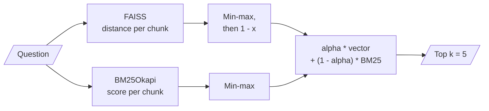
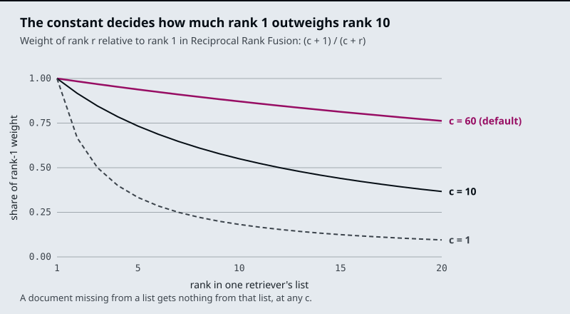
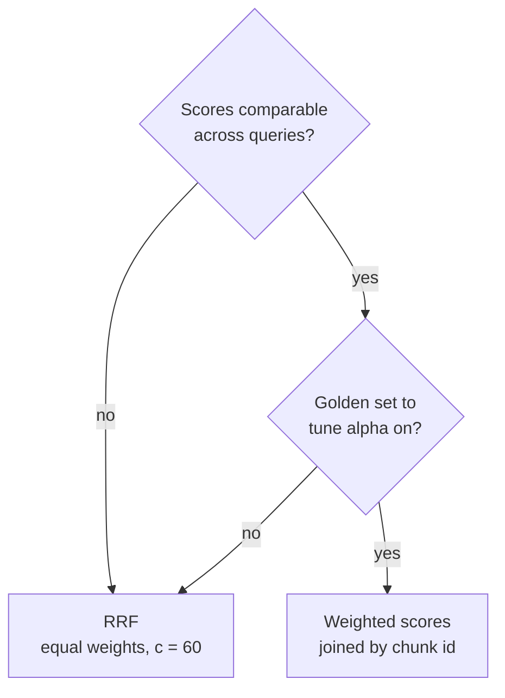

# M16.3 Theory: Fusion retrieval: score normalisation vs rank fusion

*[M16 theory](../README.md) · Lesson 16.3 · Notebooks: [`03a_fusion_retrieval.ipynb`](../../notebook/03a_fusion_retrieval.ipynb) · [All theory pages](../../../../../THEORY.md)*
<!-- subtitle: Scores need calibration, ranks do not, and neither can rescue a chunk no retriever returned -->

## Two lists, one answer

> **What you'll learn**
>
> - **Explain** how weighted score fusion and Reciprocal Rank Fusion each turn two ranked lists into one.
> - **Diagnose** four fusion failures: the min-max mirage, the position join, the buried keyword hit and the shallow hand-over.
> - **Compute** an RRF score by hand and predict which chunk wins.
> - **Choose** a fusion method, and know which knob to turn first.

Lesson 16.2 ran BM25 and an embedding retriever side by side and found that each misses what the other finds. This lesson merges their two lists into the one list the model sees.

A Larkspur customer writes *E-4102 for the third time. Can I take my files with me another way?* Two chunks answer it: `err-4102` (the export link expired) and `export` (where else to export from). BM25 ranks them 1st and 4th; the dense retriever also ranks them 1st and 4th, with different chunks in between. Either retriever alone sends one of the two in its top 3.

Fusion fixes that question. Here is the lab's recall@3 for all seven golden questions, fusing by weighted scores with `alpha` as the dense share:

| Golden question | BM25 only (`alpha` 0) | Fused (`alpha` 0.5) | Dense only (`alpha` 1) |
|---|---|---|---|
| *How long does a refund take?* | 1.00 | 1.00 | 1.00 |
| *What happens if my server goes down?* | 0.50 | 0.50 | 1.00 |
| *Where do I find out what caused the downtime?* | 0.00 | 1.00 | 1.00 |
| *What does E-4021 mean?* | 1.00 | 1.00 | 0.00 |
| *E-4102 … take my files with me another way?* | 0.50 | 1.00 | 0.50 |
| *E-4021 … take my files with me another way?* | 0.50 | 1.00 | 0.50 |
| *E-5013 … will my machines get shut off?* | 0.50 | 1.00 | 0.50 |
| **Mean** | **0.57** | **0.93** | **0.64** |

*Table 1: Recall@3 by `alpha` (the module's hybrid fusion lab, 19 Larkspur chunks, BM25 and `all-MiniLM-L6-v2`).*

The blend wins five rows and loses one: *What happens if my server goes down?* keeps only half its evidence at 0.5, because BM25's top scorer is `export`, which shares only the word "server" (from "server snapshots"), and min-max turns that weak match into a full 1.0 on the BM25 side. The fused top 3 is `export`, `sla`, `suspension`, and `incidents` drops out. A fusion method is a bet on which retriever to believe when they disagree, and the two methods below make that bet differently.

## Weighted score fusion

**Weighted score fusion** puts both retrievers' scores on one scale and adds them. Notebook `03a` does it this way:

*Figure 1: Weighted score fusion in `03a`.*

The scales differ: BM25 scores are unbounded sums of idf weights, and FAISS returns L2 distances where lower is better. `03a` splits a climate-change PDF into 1,000-character chunks with 200 of overlap, scores every chunk both ways, **min-max normalises** each list (subtract the minimum, divide by the range, so the values run from 0 to 1), flips the distances so higher means closer, and ranks by the weighted sum with `alpha = 0.5` and `k = 5`. `alpha = 1` is pure dense retrieval; `alpha = 0` is pure BM25.

Min-max is relative to the current query's results. The best chunk always scores 1.0 and the worst 0.0, even when no chunk is relevant. We call this the **min-max mirage**: a question the corpus cannot answer still produces a confident-looking top score. One outlier also squashes everything else. If one chunk contains a rare code and scores far above the rest in BM25, every other chunk's BM25 share shrinks toward 0 and the dense half decides their order. The same `alpha` therefore weighs the two retrievers differently from one question to the next.

In return, score fusion keeps information that ranks throw away: how far ahead the top hit is.

> **Pitfall: the position join.** As written, `03a` takes its document list in one order (distance to an empty query), its vector scores in a second (distance to the question) and its BM25 scores in a third (corpus order), then adds them index by index. Each combined score mixes three different chunks. Join scores by chunk id, read out in one fixed order, never by list position.

Keying on the chunk's text assumes no two chunks are identical, which is also what `EnsembleRetriever` assumes unless you give it an id field.

## Reciprocal Rank Fusion

**Reciprocal Rank Fusion** (RRF) ignores scores and uses each chunk's position in each list. A chunk earns `w / (c + rank)` from every list it appears in, and the sums decide the order:

| Symbol | Meaning | In `EnsembleRetriever` |
|---|---|---|
| rank | The chunk's position in one retriever's list, starting at 1 | A chunk missing from a list earns nothing from it |
| `c` | A constant that flattens the rank curve | 60, from Cormack, Clarke and Büttcher (SIGIR 2009) |
| `w` | The list's weight | Equal if you pass none |

*Table 2: The terms of an RRF score.*

`EnsembleRetriever` runs each retriever, adds the terms per chunk, and returns every unique chunk sorted by the sum. It does not cut the list to a final `k`.

Three consequences follow from the formula, each plain arithmetic:

| Case (weights as stated) | Score | What it shows |
|---|---|---|
| Ranked 3rd by both retrievers (1 and 1) | 2/63 = 0.0317 | Agreement beats a single strong vote |
| Ranked 1st by one, missing from the other (1 and 1) | 1/61 = 0.0164 | |
| Ranked 1st by BM25 only (0.7 dense, 0.3 BM25) | 0.3/61 = 0.00492 | Sinks below every dense result down to rank 82 |
| Ranked 82nd by dense only (0.7 dense, 0.3 BM25) | 0.7/142 = 0.00493 | |

*Table 3: RRF by hand, with `c = 60`.*

The last two rows describe `02a`'s weights from lesson 16.2. For an exact-code question that the dense retriever misses, the code chunk lands below every dense result. We call this the **buried keyword hit**. With equal weights the same chunk ties one that only the dense retriever ranks first.

The constant `c` sets how steeply rank matters. The chart plots each rank's weight as a share of rank 1's:

*Figure 2: Rank weight relative to rank 1 for several values of `c`.*

With `c = 60`, rank 10 keeps 0.87 of rank 1's weight and rank 20 keeps 0.76, so being in both lists matters more than being near the top of one. With `c = 1`, rank 10 keeps 0.18 and the top of each list dominates.

The [interactive hybrid fusion lab](interactive/hybrid-fusion-lab.html) runs real BM25 in JavaScript over the 19 Larkspur chunks, ranks them by `all-MiniLM-L6-v2` similarity, and fuses the two lists both ways. With equal weights, `c = 60` and 4 chunks handed over per retriever, RRF answers 5 of 7 golden questions fully (mean recall@3 0.86), against 6 of 7 for weighted fusion at `alpha = 0.5`. Both losses have evidence at rank 5 in one retriever, one place below the hand-over. Raise the hand-over to 10 and RRF reaches 0.93 at any `c` from 2 to 100.

<!-- lab: interactive/hybrid-fusion-lab.html -->

That is the **shallow hand-over**: fusion only reorders what the retrievers returned, so a chunk that made neither list is gone before the merge. The depth each retriever returns matters more than `c`.

## Choosing a fusion method

The decision comes down to whether scores carry meaning you can trust across queries:

*Figure 3: Pick RRF unless you can calibrate scores and tune `alpha`. Either way, set the hand-over depth first.*

Here is how the two compare on the points that decide it:

| | Weighted score fusion (`03a`) | Reciprocal Rank Fusion (`EnsembleRetriever`) |
|---|---|---|
| Combines | Normalised scores | Ranks |
| Calibration | `alpha` tuned on the golden set; its meaning shifts with each query's score spread | None; optional weight per retriever |
| Keeps | How far ahead the top hit is | Only the order |
| Chunks one retriever missed | None in `03a`, which scores every chunk both ways | Earn nothing from that retriever |
| Cost | Scores the whole corpus twice per query in `03a` | One top-`k` search per retriever |

*Table 4: Weighted score fusion against RRF.*

## In practice: fusing Larkspur's two lists

For Larkspur's support search:

1. **Start with RRF, equal weights, `c = 60`.** BM25 scores and cosine similarities do not share a scale, and equal weights keep code-only hits from being buried.
2. **Hand over 10 chunks per retriever** before cutting to the final 3.
3. **Tune on question types.** Report recall separately for code questions and paraphrase questions; a mean can hide one type getting worse.
4. **Log both input lists** with chunk ids, so a miss can be traced to a retriever or to the merge.

RAG-Fusion in [M17](../../../../m17_query_transformation/mandatory/theory/README.md) applies the same formula to the result lists of several rewritten questions. Lesson 16.4 turns to a different problem with the fused list: chunks that all say the same thing.

## Key Takeaways

- Weighted score fusion min-max normalises each list per query, so the best chunk always scores 1.0 (the min-max mirage). Join scores by chunk id, never by list position.
- RRF uses only ranks, with `c = 60` in `EnsembleRetriever`. Agreement beats a single strong vote (2/63 against 1/61), and uneven weights can bury a keyword-only hit.
- Fusion cannot rescue a chunk that made neither list. Set each retriever's hand-over depth before tuning `c` or `alpha`.

## Check yourself

1. Why can min-max weighted fusion produce confident-looking scores for a question the corpus cannot answer?

Min-max is relative to the current query's results: the best chunk always gets 1.0 and the worst 0.0, even when nothing is relevant. One outlier also squashes the rest toward 0, so the same `alpha` weighs the two retrievers differently from one question to the next.

2. With weights of 0.7 dense and 0.3 BM25, where does a chunk that only BM25 ranks first end up after RRF?

Below every chunk the dense retriever returns at rank 82 or better. It scores 0.3/61 = 0.00492, while dense rank 82 scores 0.7/142 = 0.00493. That is the buried keyword hit; with equal weights it would tie a chunk only the dense retriever ranks first.

3. In the lab, RRF with 4 chunks per retriever answers 5 of 7 golden questions fully, and both misses have evidence at rank 5. Do you tune c or something else?

Raise the hand-over depth. With 10 chunks per retriever RRF reaches a mean recall@3 of 0.93 at any `c` from 2 to 100. Fusion only reorders what the retrievers returned, so a shallow hand-over loses chunks no constant can bring back.

---
*Previous: [16.2 Dense + sparse hybrid retrieval with BM25 and EnsembleRetriever](../02_dense_sparse_hybrid_retrieval_with_bm25_and_ensembleretriever/README.md). Next: [16.4 Maximal Marginal Relevance for diversity](../04_maximal_marginal_relevance_for_diversity/README.md).*
