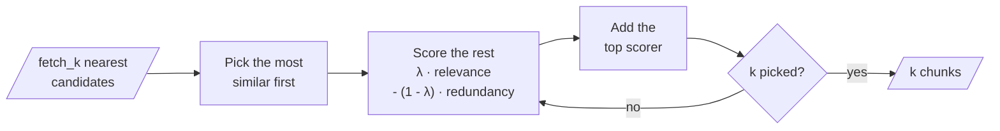

# M16.4 Theory: Maximal Marginal Relevance for diversity

*[M16 theory](../README.md) · Lesson 16.4 · Notebooks: [`04a_maximal_marginal_relevance.ipynb`](../../notebook/04a_maximal_marginal_relevance.ipynb) · [All theory pages](../../../../../THEORY.md)*
<!-- subtitle: Relevance minus redundancy, one pick at a time, from a pool you choose -->

## MMR λ

> **What you'll learn**
>
> - **Explain** how Maximal Marginal Relevance picks chunks one at a time, charging each for what is already picked.
> - **Trace** a Larkspur question through MMR at several values of λ and see which chunks survive.
> - **Diagnose** two failures diversity cannot fix: losing needed evidence, and keeping a stale policy.
> - **Choose** λ and the candidate pool from golden questions.

Lesson 16.3 merged two ranked lists into one. Whatever the merge, the top of a ranked list tends to hold chunks that are near each other as well as near the question.

Larkspur's handbook index holds the current refund policy and, left over from a migration, last year's: "full refund within 14 days … less than 50 GB" against today's "30 days … less than 100 GB". A customer asks *Can I get my money back on an annual plan and how long does it take?* Plain top-3 returns both refund-window versions and the refund-timing chunk. Two of three slots say nearly the same thing, and one of them is wrong.

We call this **redundant top-k**: the nearest chunks are near each other too, so the model gets fewer distinct facts for the same tokens. Overlapping chunks from M12's splitter cause it, and so does one rule repeated in two documents.

**Maximal Marginal Relevance** (MMR) picks chunks one at a time. The first pick is the candidate most similar to the question. Every later pick maximises `λ × similarity to the question - (1 - λ) × highest similarity to any chunk already picked`:

<!-- animated: diagrams/mmr-loop.anim.html -->

*Figure 1: The MMR loop. The penalty term grows with every pick.*

λ is `lambda_mult` in LangChain, 0.5 by default. Reading the formula at its ends and middle:

| `lambda_mult` | What MMR does after the first pick |
|---|---|
| 1.0 | The penalty is 0, so it returns the `k` most similar candidates: plain similarity search |
| 0.5 (default) | Relevance and redundancy count equally |
| 0.0 | Relevance drops out; each pick is the candidate least like anything already picked |

*Table 1: λ at three settings.*

The first pick is the same at every λ, because nothing is picked yet to be redundant with.

Here is the Larkspur question traced through LangChain's own MMR function, with the 19 handbook chunks of this module's lab plus the planted old policy, embedded with `all-MiniLM-L6-v2`. The two refund-window versions have a cosine similarity of 0.992 with each other, and the question scores them 0.655 and 0.654:

| λ | Picks (`k = 3`, all 20 chunks as the pool) | Evidence kept |
|---|---|---|
| 1.0 | `refund-window`, `refund-window-old`, `refund-timing` | Both, plus the stale copy |
| 0.9 | `refund-window`, `refund-window-old`, `refund-timing` | Both, plus the stale copy |
| 0.7 | `refund-window`, `refund-timing`, `retention` | Both, no duplicate |
| 0.5 | `refund-window`, `incidents`, `retention` | `refund-timing` lost |
| 0.0 | `refund-window`, `err-4102`, `incidents` | `refund-timing` lost |

*Table 2: MMR picks for the refund question (`langchain_core` MMR, `all-MiniLM-L6-v2`; the old policy chunk is planted).*

At 0.7 MMR does exactly what it is for: the near-copy is dropped and the timing chunk stays. At the default of 0.5 the redundancy penalty also lands on `refund-timing`, which shares the word "refund" and much of its meaning with the first pick, and an incident-report chunk takes its slot. We call that **over-diversification**: diversity bought by throwing away evidence the question needed.

## The candidate pool

MMR never searches the whole index. It chooses among the `fetch_k` nearest chunks, 20 by default; `01a` uses `k = 3` from 10, and `04a` uses `k = 3` with the default pool. That makes `fetch_k` the second knob. The same question at three pool sizes:

| λ | `fetch_k` 5 | `fetch_k` 10 | `fetch_k` 20 |
|---|---|---|---|
| 0.5 | `refund-window`, `retention`, `refund-timing` | `refund-window`, `retention`, `err-5011` | `refund-window`, `incidents`, `retention` |
| 0.0 | `refund-window`, `retention`, `cancel` | `refund-window`, `err-5011`, `sla` | `refund-window`, `err-4102`, `incidents` |

*Table 3: The pool decides how far MMR can wander (same setup as Table 2).*

A small pool keeps every pick on topic, because only on-topic chunks are in it. A pool much larger than `k` gives MMR room to find another topic, and room to reach chunks that are barely relevant: an expired-card error and an incident chunk for a refund question.

`04a` shows why MMR suits small, overlapping chunks. It splits a LangChain text into 300-character chunks with 50 of overlap, embeds them in FAISS, and asks *How does LangChain support agents and memory?* The question has two parts that may sit in different chunks, and neighbouring chunks share up to 50 characters, so plain top-k can return two windows onto the same passage.

## Where MMR misleads

Table 2 hides a second problem. The current policy won the first pick by 0.655 to 0.654, a gap of 0.001. With a slightly different question or embedding model, the old version wins, and MMR then penalises the current one as redundant and drops it. We call this the **stale first pick**.

> **Pitfall: diversity is not versioning.** MMR measures similarity, never correctness or freshness. It treats two policy versions as near-copies and keeps whichever it saw first. Filter on `version` or `date` metadata before MMR runs (lesson 16.5), or remove superseded chunks at index time.

## In practice: tuning MMR for Larkspur

1. **Remove stale versions first**, with a metadata filter or at index time, so MMR only handles genuine overlap.
2. **Start from λ = 0.7, not 0.5**, and check it on Table 2-style traces: a golden question with two related evidence chunks must keep both.
3. **Keep `fetch_k` near 2 to 4 times `k`** unless a question needs a distant topic.
4. **Tune on two kinds of golden question**: ones that need several distinct chunks, and single-fact ones that must not lose their second supporting chunk.

Lesson 16.5 adds the filters that MMR needs in front of it.

## Key Takeaways

- MMR picks one chunk at a time, scoring relevance to the question minus similarity to chunks already picked, so near-copies stop filling the context.
- λ = 1.0 is plain similarity search. Lower values drop duplicates, but on the Larkspur refund question λ = 0.5 also drops the needed timing chunk (over-diversification); 0.7 keeps it. `fetch_k` bounds the pool MMR chooses from.
- MMR sees similarity, not freshness. Filter out old policy versions before it runs, or the stale first pick can keep the wrong one.

## Check yourself

1. What does MMR return at lambda_mult 1.0, and why is its first pick the same at every value of lambda?

At 1.0 the redundancy penalty is 0, so MMR returns the `k` most similar candidates, which is plain similarity search. The first pick is always the candidate most similar to the question, because nothing is picked yet for it to be redundant with.

2. On the Larkspur refund question, lambda 0.7 keeps refund-window and refund-timing but lambda 0.5 replaces refund-timing with an incident chunk. Why?

At 0.5 redundancy weighs as much as relevance, and `refund-timing` is similar to the first pick, `refund-window`, because both are about refunds. Its penalty outweighs its relevance, so a less similar, less relevant chunk wins the slot. That is over-diversification; 0.7 keeps enough weight on relevance to hold the timing chunk.

3. The index holds this year's and last year's refund policy, and answers sometimes quote last year's. Why does MMR not prevent this, and what should run first?

MMR measures similarity, not freshness. The two versions score 0.655 and 0.654 against the question, so either can be the first pick, and MMR then drops the other as redundant (the stale first pick). Filter on `version` or `date` metadata before MMR, or remove superseded chunks at index time.

---
*Previous: [16.3 Fusion retrieval: score normalisation vs rank fusion](../03_fusion_retrieval_score_normalisation_vs_rank_fusion/README.md). Next: [16.5 Multi-faceted filtering](../05_multi_faceted_filtering/README.md).*
