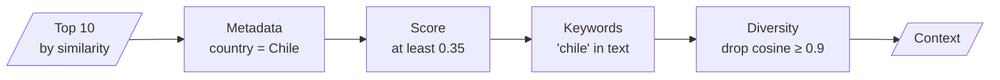
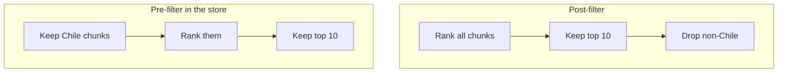

# M16.5 Theory: Multi-faceted filtering

*[M16 theory](../README.md) · Lesson 16.5 · Notebooks: [`05a_multi_faceted_filtering.ipynb`](../../notebook/05a_multi_faceted_filtering.ipynb) · [All theory pages](../../../../../THEORY.md)*
<!-- subtitle: Ranking orders chunks; filters decide which chunks are allowed at all -->

## Four filters in sequence

> **What you'll learn**
>
> - **Explain** the difference between ranking a chunk and allowing it.
> - **Order** four filters by cost: metadata, score, keyword, diversity.
> - **Diagnose** a filter that empties the result because it ran after the search.
> - **Choose** which facets to write at ingestion so later filters have something to test.

Lesson 16.4 ended on a failure MMR cannot fix: last year's refund policy competing with this year's. Similarity cannot tell the two apart, and diversity keeps whichever came first. A rule that can tell them apart has to look at something other than the text's meaning.

That is a **filter**: a yes-or-no test on a chunk. Ranking decides the order of chunks; filtering decides which chunks are allowed at all. A Larkspur question about refunds on annual plans should never see the superseded policy, however well it scores.

Notebook `05a` builds four filters on a customer table. Each row of `customers-100.csv` becomes a document whose metadata holds country, company, city, subscription date and website. It embeds them with `all-MiniLM-L6-v2` in Chroma, retrieves the top 10 for *Which customers work for companies in Chile?* with relevance scores, and passes them through this chain:

*Figure 1: The four filters in `05a`, cheapest first.*

Each filter removes a different kind of wrong chunk, at a different price:

| Filter | `05a` setting | What it removes | Cost |
|---|---|---|---|
| Metadata | `country` equals Chile, exact match on every key | Chunks whose fields contradict the question | A dictionary lookup |
| Similarity threshold | relevance at least 0.35 | Chunks in the top 10 only because something has to be (forced top-k from lesson 16.1) | A comparison |
| Content | `chile`, lower-cased substring, all keywords required | Chunks without a term the evidence must contain | A string search |
| Diversity | cosine at least 0.9 with a chunk already kept | Near-duplicates, kept greedily in rank order | One embedding call per chunk |

*Table 1: The four filters and their cost.*

The order is a cost decision. Exact checks run first, and the one filter that calls the embedding model runs last, on whatever survives. Each filter is optional, so the same function serves a question with a known country and one without.

The diversity filter is a hard cut at one similarity. MMR from lesson 16.4 makes the same trade softly, weighing redundancy against relevance with λ.

## Pre-filter or post-filter

The four filters in `05a` only remove. They run on the 10 chunks the search returned, so if a Chilean customer ranked 11th, no filter brings it back. A strict combination can remove all ten and leave nothing. We call this **post-filter starvation**: the filter is right and the result is empty, because the search spent its slots on chunks the filter was always going to reject.

When the condition is known before the search, push it into the store:

*Figure 2: The same condition before and after ranking. Only the pre-filter guarantees 10 matching chunks when 10 exist.*

Chroma takes the condition as a filter argument on the similarity search and ranks only the matching chunks, so every one of the 10 slots goes to a match. Keep post-filters for conditions the store cannot express, such as the diversity check.

Here is the arithmetic of starvation, for a condition that one chunk in twenty satisfies and spread evenly through the ranking (*Illustrative*):

| Approach | Chunks ranked | Matches that reach the model (at most 10) |
|---|---|---|
| Post-filter on top 10 | All | About 0 to 1 |
| Post-filter on top 100 | All | About 5 |
| Pre-filter in the store | Matching only | 10 |

*Table 2: Matches reaching the model for a rare condition (illustrative).*

The settings in `05a` are specific to its setup. A relevance threshold of 0.35 belongs to `all-MiniLM-L6-v2` on that table. The substring test for `chile` would also accept any longer word that contains those letters.

## Facets come from ingestion

A filter can only test a field that exists. For the Larkspur handbook the useful facets are written at ingestion: the handbook section, which M12's header splitter records, and the `version` and `date` fields of the [M11 metadata schema](../../../../../p04_rag_foundations/m11_document_ingestion/mandatory/theory/01_the_document_abstraction_and_metadata_design/README.md#metadata-schema).

> **Key distinction:** a facet missing at ingestion cannot be recovered by retrieval. If the old refund policy was indexed without a version, no filter, MMR setting or reranker can reliably drop it.

## In practice: filtering Larkspur's refund questions

1. **Pre-filter on version.** Every handbook query filters to the current `version` in the store, before ranking. That removes last year's refund policy outright.
2. **Pre-filter on section** when the question names a topic the router is sure of, such as Refunds.
3. **Post-filter on score** with the floor from lesson 16.1, so an out-of-scope question still returns nothing.
4. **Leave diversity to MMR** on the survivors, at the λ lesson 16.4 settled on.

Lesson 16.6 steps back from single techniques and compares whole retriever patterns, including what they cost when they nest.

## Key Takeaways

- Ranking orders chunks; filtering decides which are allowed. Run cheap exact checks (metadata, score, keywords) before the diversity check that needs an embedding call per chunk.
- Post-filters only remove from what the search returned and can leave nothing (post-filter starvation). When a condition is known up front, pass it to the store so every slot goes to a match.
- Write facets such as section, `version` and `date` at ingestion; a field that was never written cannot be filtered on.

## Check yourself

1. Why does the multi-faceted filter run the metadata, score and keyword checks before the diversity check?

Order is a cost decision. The first three are a dictionary lookup, a comparison and a string search; the diversity check needs one embedding call per chunk. Running the cheap exact checks first means the embedding model sees only the chunks that survive them.

2. A Chilean customer ranks 11th by similarity for the Chile question. Will the post-filters find it, and what should you do instead?

No. The filters only remove from the 10 chunks the search returned, so a chunk ranked 11th never comes back, and strict filters can leave nothing at all (post-filter starvation). Pass the country condition to the store's search as a filter, so all 10 slots go to matching chunks.

3. Larkspur's index holds two refund policies, and the old one has no version field. Which of filtering, MMR or reranking can reliably remove it, and what has to change?

None of them reliably. MMR and reranking see similarity, and the two versions are near-copies; a filter needs a field to test, and the old chunk has none. Re-ingest with a `version` or `date` field, or delete the superseded chunks, then pre-filter on the current version.

---
*Previous: [16.4 Maximal Marginal Relevance for diversity](../04_maximal_marginal_relevance_for_diversity/README.md). Next: [16.6 Retriever patterns compared; hybrid + rerank on Databricks Vector Search](../06_retriever_patterns_compared_hybrid_rerank_on_databricks_vector_search/README.md).*
