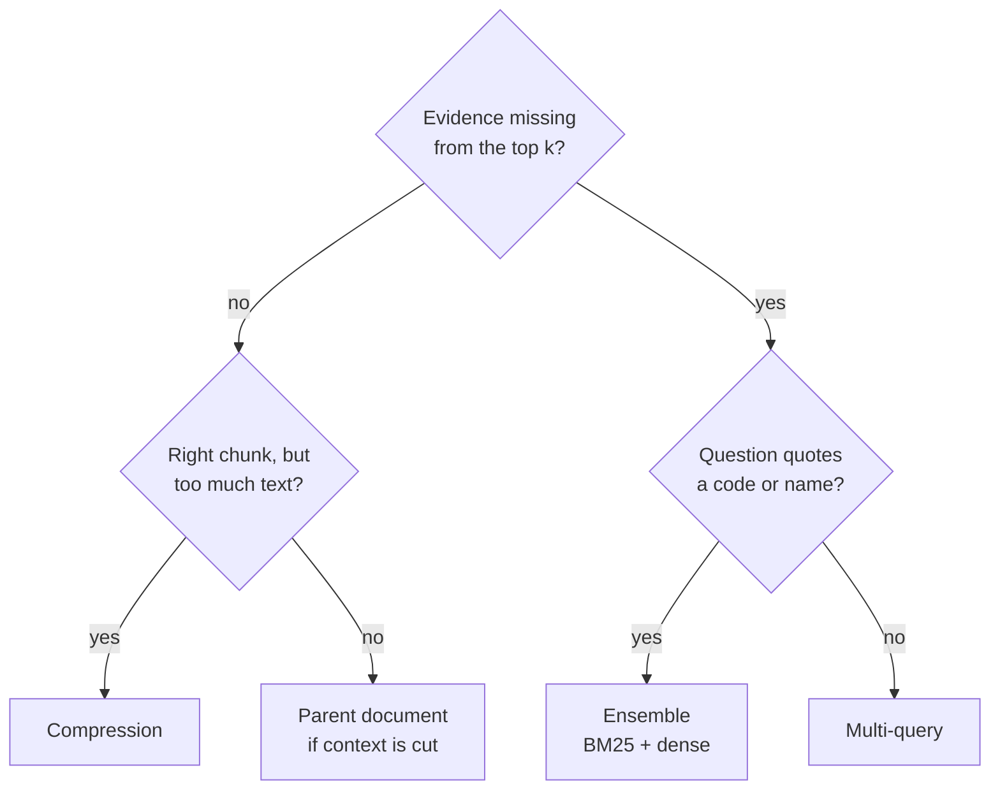
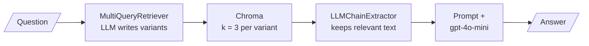

# M16.6 Theory: Retriever patterns compared; hybrid + rerank on Databricks Vector Search

*[M16 theory](../README.md) · Lesson 16.6 · Notebooks: [`06a_advanced_retriever_patterns.ipynb`](../../notebook/06a_advanced_retriever_patterns.ipynb), [`06b_hybrid_search_and_reranking_databricks.ipynb`](../../../optional/notebook/06b_hybrid_search_and_reranking_databricks.ipynb) (optional) · [All theory pages](../../../../../THEORY.md)*
<!-- subtitle: Each retriever pattern fixes one failure at its own price, and the prices add up when they nest -->

## Choosing a retriever pattern

> **What you'll learn**
>
> - **Match** four retriever patterns to the failure each one fixes.
> - **Count** the LLM calls a nested retriever spends per question.
> - **Compare** hybrid search inside the vector store with an ensemble in the application.
> - **Judge** a vendor's quality claim for a reranker before paying its latency.

Lessons 16.1 to 16.5 each fixed one retrieval failure: forced top-k, the dense miss on exact codes, the merge of two lists, redundant chunks, chunks that should never be allowed. This lesson puts the fixes side by side as patterns a team can pick from.

Larkspur's team wants better answers and adds every pattern they have heard of: multi-query in front, compression behind, an ensemble underneath. Answers improve a little, and the cost per question rises several times over. Nobody counted the calls before stacking them.

Notebook `06a` runs four patterns over the same eight topic-tagged documents in Chroma. Each fixes a different failure and costs something different:

| Pattern | Fixes | Extra cost per question | `06a` setup |
|---|---|---|---|
| **Multi-query** | Wording that misses the documents | 1 LLM call, then one search per variant | Base retriever `k = 2`, temperature 0.3 |
| **Contextual compression** | Chunks full of text the question does not need | 1 LLM call per retrieved chunk | Base retriever `k = 4` |
| **Ensemble** (BM25 + dense) | Exact terms the dense retriever misses | One more search; no LLM call | `k = 3` each, weights 0.4 BM25 and 0.6 dense |
| **Parent document** | Small chunks that match well but lack context | A docstore lookup | 200-character children (20 overlap) inside 800-character parents (100 overlap) |

*Table 1: Four patterns, the failure each fixes, and its price.*

Choosing starts from the failure seen on the golden set, not from the pattern list. Here is that diagnosis as a chain of checks:

*Figure 1: Pick the pattern from the failure, one check at a time.*

`06a`'s ensemble demo uses three questions chosen to separate the halves: *ACID transactions* (keyword-heavy, BM25 should help), *How do I store AI model outputs for later retrieval?* (worded unlike any document, dense should help), and *fast similarity lookup for embeddings* (mixed). It prints the top result from BM25, dense and the ensemble for each, side by side. That is the shape a team's own comparison should take: golden questions of each kind, every retriever's answer next to the others.

## Nesting patterns

Because every pattern is a retriever, they nest. `06a`'s last demo wraps multi-query inside compression and feeds the result to a prompt:

*Figure 2: Multi-query inside compression, as `06a` builds it.*

Multi-query widens the pool for recall and compression narrows each chunk for precision, so the two pull in opposite directions on purpose. The calls add up, and the middle term grows with the union of results:

| Stage | LLM calls | Assumption |
|---|---|---|
| Write variants | 1 | One call returns 3 variants |
| Search | 0 | 4 searches (question plus 3 variants), `k = 3` each |
| Compress | 7 | 12 results, 7 unique after de-duplication, one call each |
| Answer | 1 | |
| **Total** | **9** | Against 1 for plain retrieval plus an answer |

*Table 2: LLM calls per question in the nested pipeline (illustrative: the union size depends on how much the variants overlap).*

We call this **call stacking**: each wrapper's cost is reasonable alone, and the product of them is what the bill shows. Nine calls in sequence also means nine round trips of latency before the user sees a word.

> **Pitfall: call stacking.** Count calls per question before nesting, and measure each layer's gain on the golden set separately. A layer that adds two calls and no recall comes out.

## Hybrid in the store

Notebook `06b` moves hybrid search and reranking into the vector store. On a Databricks Vector Search index it embeds the question with `BAAI/bge-large-en-v1.5` (1,024 dimensions, normalised) and makes one call per mode, returning 5 results:

| Mode | What the call adds |
|---|---|
| Vector only | The query vector |
| Hybrid | The query text and a hybrid query type |
| Hybrid + rerank | A reranker over the text column |

*Table 3: Three search modes in `06b`.*

Hybrid in the store and an ensemble in the application do the same job in different places:

| | Hybrid in the store | Ensemble in the application |
|---|---|---|
| Keyword index lives | Next to the vectors, kept in sync by the store | In application memory, built from the full document list |
| Corpus changes | Indexed with the rest | The BM25 index is rebuilt |
| Fusion | On the server, one round trip | In code you can read and log |
| Suits | Scale and many writers | Inspection, tuning, small corpora |

*Table 4: Two places to run hybrid search.*

`06b` describes the reranker as about 15% better in quality for 1 to 1.5 seconds of extra latency. The notebook states those figures without measuring them. Treat a number like that as a hypothesis: measure the gain and the latency on your own golden set before paying for it. [M18](../../../../m18_reranking_post_retrieval/mandatory/theory/README.md) covers rerankers and the retrieve-wide, rerank-narrow design.

## In practice: Larkspur's retriever stack

1. **Diagnose first.** Run the golden set, and sort misses into Figure 1's boxes.
2. **Ensemble for codes.** Error codes and plan names were the dense misses in lesson 16.2; BM25 plus dense with RRF fixes them for one extra search and no LLM call.
3. **Hold multi-query** until paraphrase misses remain after the ensemble, and count its calls when it goes in.
4. **Choose the location by scale.** An application ensemble while the handbook is small and changing; the store's hybrid mode once many teams write to it.

M17 picks up where multi-query leaves off, with the full family of query rewrites.

## Key Takeaways

- Each pattern fixes one failure at its own price: multi-query fixes wording, compression trims noisy chunks at one LLM call each, an ensemble catches exact terms, and parent documents restore missing context.
- Patterns nest because each is a retriever, but calls multiply (call stacking): multi-query inside compression can spend about 9 LLM calls where plain retrieval spends 1.
- Hybrid in the store fuses on the server and stays in sync; an application ensemble is easier to inspect. Measure any reranker's gain and latency on your golden set before enabling it.

## Check yourself

1. In the nested pipeline, why do multi-query and compression pull in opposite directions, and what drives their LLM call count?

Multi-query widens the pool for recall; compression narrows each chunk for precision. They cost one call for the variants, one per unique chunk in the union for extraction, and one for the answer, so the count grows with the size of the union.

2. Small 200-character chunks match Larkspur questions well, but the passages that reach the model lack context. Which pattern fixes that, and at what cost?

The parent document retriever. It searches the small child chunks and returns the larger parents that contain them (800 characters in `06a`). The extra cost is a docstore lookup, with no LLM call.

3. Notebook 06b says the Databricks reranker is about 15% better for 1 to 1.5 seconds of extra latency. Should Larkspur turn it on on that basis?

Not on that basis. The notebook states the figures without measuring them. Measure the quality gain and the added latency on Larkspur's own golden set first, and keep the reranker only if the gain is worth the latency.

---
*Previous: [16.5 Multi-faceted filtering](../05_multi_faceted_filtering/README.md). Next: [M16 interview questions](../README.md#interview-spotlight-5-questions-you-might-get-asked).*
