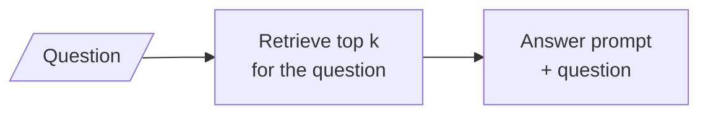
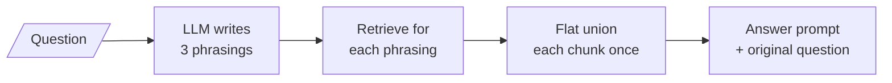

# M17.2 Theory: Multi-query retrieval

*[M17 theory](../README.md) · Lesson 17.2 · Notebooks: [`02a_multi_query_retrieval.ipynb`](../../notebook/02a_multi_query_retrieval.ipynb), [`02b_multiquery_retrieval_walkthrough.ipynb`](../../../optional/notebook/02b_multiquery_retrieval_walkthrough.ipynb) (optional), [`02c_better_queries.ipynb`](../../../optional/notebook/02c_better_queries.ipynb) (optional) · [All theory pages](../../../../../THEORY.md)*
<!-- subtitle: Ask the question three ways, search each way, and keep everything any phrasing found -->
<!-- format: approved -->

## One question, one point in space

> **What you'll learn**
>
> - **Explain** why several phrasings of one question reach chunks a single phrasing misses.
> - **Trace** three variants of a Larkspur question through retrieval and a flat union.
> - **Diagnose** two silent multi-query bugs: the id-only merge and junk variants.
> - **Judge** whether the extra calls bought anything, against the single-query baseline.

Lesson 17.1 named the vocabulary gap and closed it with one expanded query. Expansion still produces a single query, and a single query is a single point in embedding space.

If that point happens to sit far from how the handbook words the answer, the relevant chunks are missed, and nothing reports it. Retrieval fails silently: the top `k` is always full, as lesson 16.1 showed. The outage question in the M10 index retrieves `reboot`, `sizing` and `export` with confidence and neither evidence chunk.

Single-query retrieval has one path from question to chunks:

*Figure 1: Single-query retrieval. One phrasing, one ranked list, and no way to see what it missed.*

**Multi-query retrieval** asks an LLM to write several phrasings of the question, retrieves for each, and merges the results:

*Figure 2: Multi-query retrieval. One LLM call in, one retrieval per phrasing, one merged list out.*

Notebook `02a` asks for three phrasings, each targeting a different facet of the question and using different vocabulary. Its knowledge base is two LangChain blog posts, chunked at 400 tokens with 60 of overlap and embedded with `text-embedding-3-small`, and its baseline cell first records what the question alone retrieves, so the variants have something to beat.

## Vocabulary spread

The mechanism is **vocabulary spread**: each phrasing reaches for different words, and each set of words lands near different chunks. `02a` illustrates it with three ways of asking about LangSmith. A definition question lands near product overviews, a debugging question near tracing and errors, a production question near reliability.

The module's lab carries hand-written variants for the Larkspur golden questions, in the style of the `02a` prompt. Here are the first three for the outage question, each retrieving its top 4 from the M10 TF-IDF index:

| Phrasing | Retrieved (top 4, nonzero only) |
|---|---|
| *What happens if my server goes down?* (as asked) | `reboot`, `sizing`, `export` |
| *What compensation do I receive when an outage affects my server?* | **`sla`**, `reboot`, `sizing`, `export` |
| *How does Larkspur communicate during a service incident?* | **`sla`**, **`incidents`**, `reboot` |
| *What uptime or availability does Larkspur guarantee?* | **`sla`**, `reboot` |

*Table 1: Three variants of the outage question (the module's query-variant lab, M10 index, TF-IDF). Evidence chunks in bold.*

The variants succeed by borrowing the handbook's vocabulary: "outage", "incident", "availability". None of them is a better question than the original. Together they cover more of the space around it.

## Merging: the flat union

Three lists come back, and they overlap. The **flat union** keeps each chunk once, in the order it was first seen: the first variant's list, then whatever the second adds, and so on. Here is what the union buys over the question as asked, on all three golden questions:

| Golden question | Union of 3 variants | Recall at 2 | Recall at 3 | As asked, recall at 2 |
|---|---|---|---|---|
| *How long does a refund take?* | `refund-timing`, `refund-window`, `support`, `retention`, `export`, `sla` | 1.00 | 1.00 | 0.50 |
| *What happens if my server goes down?* | `sla`, `reboot`, `sizing`, `export`, `incidents` | 0.50 | 0.50 | 0.00 |
| *Can I export my data after I cancel my plan?* | `retention`, `export`, `refund-window`, `cancel`, `reboot`, `sizing` | 1.00 | 1.00 | 1.00 |
| **Mean** | | **0.83** | **0.83** | **0.50** |

*Table 2: Flat union of three variants against the question as asked (same lab and index).*

Here is the outage row of Table 2 traced through the chain:

Step through the outage question from variants to the two chunks the answer prompt keeps.

<button type="button" data-step="0" aria-pressed="false" aria-controls="union-step-0">1. Variants</button><button type="button" data-step="1" aria-pressed="false" aria-controls="union-step-1">2. Retrieve</button><button type="button" data-step="2" aria-pressed="false" aria-controls="union-step-2">3. Union</button><button type="button" data-step="3" aria-pressed="false" aria-controls="union-step-3">4. Cut at 2</button>

<section id="union-step-0" class="step-panel" aria-labelledby="union-heading-0"><h4 id="union-heading-0">1. Variants</h4><dl><dt>Input</dt><dd><em>What happens if my server goes down?</em></dd><dt>Output</dt><dd>three phrasings: compensation for an outage, communication during an incident, the guaranteed uptime</dd></dl></section><section id="union-step-1" class="step-panel" aria-labelledby="union-heading-1"><h4 id="union-heading-1">2. Retrieve</h4><dl><dt>Per phrasing</dt><dd>top 4 nonzero chunks from the M10 TF-IDF index</dd><dt>Evidence found</dt><dd><code>sla</code> by all three; <code>incidents</code> by the second only</dd></dl></section><section id="union-step-2" class="step-panel" aria-labelledby="union-heading-2"><h4 id="union-heading-2">3. Union</h4><dl><dt>Rule</dt><dd>each chunk once, keyed by its text, in order of first arrival</dd><dt>Result</dt><dd><code>sla</code>, <code>reboot</code>, <code>sizing</code>, <code>export</code>, <code>incidents</code></dd></dl></section><section id="union-step-3" class="step-panel" aria-labelledby="union-heading-3"><h4 id="union-heading-3">4. Cut at 2</h4><dl><dt>Kept</dt><dd><code>sla</code> and <code>reboot</code></dd><dt>Recall at 2</dt><dd>0.50: <code>incidents</code> was found and arrived 5th</dd></dl></section>

<button type="button" data-walk="previous">Previous</button>

<button type="button" data-walk="next">Next step</button>

Mean recall at 2 rises from 0.50 to 0.83. The outage row shows what the union cannot do. `incidents` was found, by the second variant, and still lands 5th, because the first variant's four chunks come first. The union knows nothing about rank or agreement: a chunk every variant ranked first looks the same as one that scraped into one list. We call this **order by arrival**, and lesson 17.3 replaces it with rank fusion.

`02a` ends with the check that keeps the technique honest: compare the merged chunks with the baseline. If the variants return what the original query returned, multi-query is pure overhead on that corpus, and the export question above is such a case.

## Two silent bugs

Both bugs below shipped in earlier versions of the notebooks, and neither raised an error.

**The id-only merge.** The original `get_unique_union()` in `02a` de-duplicated by document id and returned the ids, not the documents. Every LangChain document has an id attribute. That branch always ran, and the answer prompt's context held a list of bare identifiers. The model answered from memory, fluently, and the output looked like a working RAG chain. The fix keys the merge by the chunk's text and returns the documents themselves; `02a` then asserts that the context contains real passage text.

**Junk variants.** Parsing the LLM's reply by splitting it on newlines assumes exactly three bare lines. Models add headers, numbering, blank lines and preambles such as "Here are three variations:", and each of those becomes a query sent to the retriever. The failure is intermittent: the same chain returns clean lines on one run and markdown on the next. `02a` binds a schema with structured output, so the reply is a list of exactly the phrasings. The optional notebooks `02b` and `02c` show the older approach, a regular expression that cleans the split text, and use the same pattern to generate five hypothetical answers for HyDE (lesson 17.5).

The two parsing approaches handle the same untidy reply very differently. The reply below is illustrative, written in the shape the bug describes:

Choose how the reply is turned into queries. The model's reply: a preamble line, a blank line, then three numbered phrasings.

<button type="button" data-mode="split" aria-pressed="false" aria-controls="parse-split">Split on newlines</button>
<button type="button" data-mode="schema" aria-pressed="false" aria-controls="parse-schema">Structured output</button>

<section id="parse-split" class="mode-panel" data-announcement="Newline split selected. Five queries, two of them junk."><h4>Split on newlines</h4><dl><dt>Queries sent</dt><dd>5: the preamble, an empty string and three numbered phrasings</dd><dt>Effect</dt><dd>two retrievals search for junk, and their chunks join the union; no error is raised</dd></dl></section>
<section id="parse-schema" class="mode-panel" data-announcement="Structured output selected. Only the phrasings."><h4>Structured output with a <code>queries</code> list</h4><dl><dt>Queries sent</dt><dd>only the items of the <code>queries</code> list</dd><dt>Effect</dt><dd>no preamble or blank line can become a query; the field description asks for three</dd></dl></section>

> **Pitfall: fluent answers from an empty context.** A RAG chain whose context is broken still answers. Print what the retriever handed to the prompt before judging the answer.

## What it costs

Multi-query adds one LLM call and turns one retrieval into three:

| Step | LLM calls | Retrievals |
|---|---|---|
| Write 3 phrasings | 1 | 0 |
| Retrieve per phrasing | 0 | 3, run in parallel |
| Answer | 1 | 0 |
| **Total** | **2** | **3** |

*Table 3: Calls per question, against 1 and 1 for plain RAG.*

The retrievals are independent. `02a` runs them as one parallel batch, and the wall-clock cost is roughly one retrieval plus one LLM call. The context also grows: the outage union holds 5 chunks where the original question returned 3.

## In practice: multi-query on the Larkspur handbook

1. **Use it where the baseline misses.** The refund and outage questions gain; the export question gains nothing.
2. **Parse with a schema** and log every phrasing. A drifting or junk variant then shows up in traces.
3. **Assert the context is text**, not ids, in a test that runs on every change.
4. **Cut by rank, not arrival.** At two chunks the union drops `incidents`. Lesson 17.3 keeps the same variants and fixes the order.

## Limits

- **The numbers come from the lab, not the notebook.** Tables 1 and 2 use the module lab's hand-written variants on the M10 TF-IDF index. Notebook `02a` searches two blog posts with OpenAI embeddings, and its variants change on every run.
- **Three is requested, not enforced.** The `queries` field is a plain list whose description asks for three phrasings. A reply with two or five still parses; count them if your cost budget depends on it.
- **Three golden questions are a small sample.** The rise from 0.50 to 0.83 is three questions on one small handbook. Measure on your own labelled set before turning multi-query on everywhere.

## References

1. LangChain, [MultiQueryRetriever API reference](https://reference.langchain.com/python/langchain-classic/retrievers/multi_query/MultiQueryRetriever).
2. LangChain, [Structured output](https://docs.langchain.com/oss/python/langchain/structured-output).
3. Rackauckas, [RAG-Fusion: a new take on retrieval-augmented generation](https://arxiv.org/abs/2402.03367), 2024.

## Key Takeaways

- One question is one point in embedding space. Multi-query writes three phrasings, retrieves for each, and keeps the union, which lifts mean recall at 2 on the Larkspur golden questions from 0.50 to 0.83.
- The flat union orders chunks by arrival, so found evidence can still miss the cut: `incidents` lands 5th for the outage question.
- Return documents from the merge, never ids, and parse phrasings with a schema. Both bugs fail silently while the chain keeps answering fluently.

## Check yourself

1. The outage question as asked retrieves neither evidence chunk. How do three phrasings reach them?

By vocabulary spread. Each phrasing uses different words, and the variants borrow the handbook's own: "outage", "incident", "availability". The compensation variant reaches `sla`, and the incident variant reaches both `sla` and `incidents`.

2. The union of three variants contains incidents, yet recall at 2 for the outage question is only 0.50. Why?

The flat union orders chunks by arrival: the first variant's four chunks come first, and `incidents`, found by the second variant, lands 5th. The union ignores rank and agreement, so found evidence can still miss the cut. Rank fusion (lesson 17.3) fixes the order.

3. A multi-query chain gives fluent answers, but they never quote the handbook. Where do you look first?

At what the retriever handed to the answer prompt. If the merge returned document ids instead of documents, the context holds bare identifiers and the model answers from memory. Key the merge by chunk text, return the documents, and assert that the context contains passage text.

---
*Previous: [17.1 Query rewriting and expansion](../01_query_rewriting_and_expansion/README.md). Next: [17.3 RAG-Fusion with Reciprocal Rank Fusion](../03_rag_fusion_with_reciprocal_rank_fusion/README.md).*
