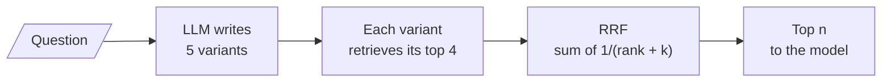

# M17.3 Theory: RAG-Fusion with Reciprocal Rank Fusion

*[M17 theory](../README.md) · Lesson 17.3 · Notebooks: [`03a_rag_fusion.ipynb`](../../notebook/03a_rag_fusion.ipynb) · [All theory pages](../../../../../THEORY.md)*
<!-- subtitle: Fuse the rankings of several phrasings, so chunks many variants agree on rise to the top -->
<!-- format: approved -->

## RRF

> **What you'll learn**
>
> - **Explain** what Reciprocal Rank Fusion keeps that a flat union throws away.
> - **Trace** the Larkspur outage question through five variants and a fused list.
> - **Predict** when the constant `k` changes the order, and compute both orders by hand.
> - **Diagnose** agreement on a distractor, the failure fusion cannot see.

Lesson 17.2 merged three phrasings with a flat union and found the evidence for the outage question, then ranked it 5th by order of arrival. The union keeps every chunk once and throws away two signals: where each list ranked the chunk, and how many lists found it.

**RAG-Fusion** keeps both. It asks for five phrasings, because agreement means little across two or three rankings, and fuses the lists with **Reciprocal Rank Fusion** (RRF). Notebook `03a` scores each chunk by adding `1 / (rank + k)` for every variant that retrieved it, with rank counted from 0 and `k = 60`:

<!-- animated: diagrams/rrf-fusion.anim.html -->

*Figure 1: RAG-Fusion. The fusion step needs only ranks, a dictionary and a sort.*

With `k = 60`, first place in one list adds 1/60, about 0.0167, and fourth place adds 1/63, about 0.0159. Being found by more variants therefore matters more than placing first in any one of them. RRF uses ranks and never similarity scores, because scores from different queries are not on the same scale.

[M16's fusion page](../../../../m16_retrievers_hybrid_search/mandatory/theory/03_fusion_retrieval_score_normalisation_vs_rank_fusion/README.md#reciprocal-rank-fusion) covers the same formula with the more common convention that counts ranks from 1. There the lists come from BM25 and dense retrieval; here they come from five phrasings of one question.

## The outage question, fused

The [interactive query-variant lab](interactive/query-variant-fusion-lab.html) runs RAG-Fusion on the M10 index: the same twelve Larkspur chunks, the same TF-IDF, and five hand-written variants per golden question in the style of the `03a` prompt. Each variant retrieves its top 4 (LangChain's default `k`), minus chunks it shares no term with. For *What happens if my server goes down?* at `k = 60`, the fused list reads:

| # | Chunk | RRF score | Ranks in variants 1 to 5 | Golden set |
|---|---|---|---|---|
| 1 | `reboot` | 0.0656 | 1, 2, 1, 0, none | |
| 2 | `sla` | 0.0500 | 0, 0, 0, none, none | evidence |
| 3 | `incidents` | 0.0331 | none, 1, none, none, 0 | evidence |
| 4 | `sizing` | 0.0325 | 2, none, none, 1, none | |
| 5 | `export` | 0.0320 | 3, none, none, 2, none | |

*Table 1: The fused list for the outage question (the module's lab, ranks from 0).*

The question as asked reaches neither evidence chunk. The variants reach both, and fusion lifts `incidents` from 5th place in the union to 3rd. At three chunks sent, recall is 1.00 against 0.00 for the question as asked.

`reboot` still comes first. Four of the five variants match it, on "server" or on "does" (the chunk says "does not change"), and the fourth variant drifted to *How do I restart a server that has stopped responding?* We call this **agreement on a distractor**: RRF counts votes, and votes for the wrong chunk count too. Cut at two chunks and `incidents` is gone again.

<!-- lab: interactive/query-variant-fusion-lab.html -->

> **Key distinction:** fusion only reorders what the variants retrieved. It cannot add a chunk no variant found, and it cannot tell a relevant agreement from an irrelevant one. A reranker (M18) can.

## What `k` controls

A small `k` makes rank position dominate: at `k = 1`, first place is worth 1 and fourth place 0.25. A large `k` flattens the curve until only the number of votes counts. `03a` runs `k` at 1, 5, 60 and 1000 and notes that the order changes only when rank and agreement disagree.

In the refund question they do. Two variants rank `refund-window` 1st and 2nd (ranks 1 and 0); three variants rank `retention` low (ranks 3, 3 and 2). By hand:

| Chunk | Ranks | Score at `k = 60` | Score at `k = 1` |
|---|---|---|---|
| `refund-window` | 1, 0 | 1/61 + 1/60 = 0.0331 | 1/2 + 1/1 = 1.50 |
| `retention` | 3, 3, 2 | 1/63 + 1/63 + 1/62 = 0.0479 | 1/4 + 1/4 + 1/3 = 0.83 |

*Table 2: Rank against agreement, computed by hand.*

At `k = 60` the three weak votes for `retention` beat the two strong votes for the evidence chunk. At `k = 1` the strong votes win. Here is what that flip does to the two chunks the answer prompt receives:

Choose a value of <code>k</code> for the refund question, cut at two chunks.

<button type="button" data-mode="k60" aria-pressed="false" aria-controls="k-60">k = 60</button>
<button type="button" data-mode="k1" aria-pressed="false" aria-controls="k-1">k = 1</button>

<section id="k-60" class="mode-panel" data-announcement="k equals 60 selected. Agreement wins; recall at 2 is 0.50."><h4><code>k = 60</code>: agreement counts most</h4><dl><dt>Head-to-head</dt><dd><code>retention</code> 0.0479 beats <code>refund-window</code> 0.0331</dd><dt>Refund recall at 2</dt><dd>0.50</dd><dt>Golden-set mean at 2</dt><dd>0.67</dd></dl></section>
<section id="k-1" class="mode-panel" data-announcement="k equals 1 selected. Rank wins; recall at 2 is 1.00."><h4><code>k = 1</code>: rank position counts most</h4><dl><dt>Head-to-head</dt><dd><code>refund-window</code> 1.50 beats <code>retention</code> 0.83</dd><dt>Refund recall at 2</dt><dd>1.00</dd><dt>Golden-set mean at 2</dt><dd>0.83</dd></dl></section>

 Mean recall over the three golden questions, from the lab:

| Chunks sent | Question as asked (M10) | Flat union | RRF `k = 1` | RRF `k = 5`, `60` or `1000` |
|---|---|---|---|---|
| 2 | 0.50 | 0.83 | 0.83 | 0.67 |
| 3 | 0.50 | 0.83 | 1.00 | 1.00 |

*Table 3: Mean recall by merge method and cut (five variants per question).*

Every merge beats the question as asked. At three chunks every RRF setting beats the union. At two chunks the conventional `k = 60` loses to both the union and `k = 1`, because the refund question drops from 1.00 to 0.50. The value 60 comes from the original RRF paper (Cormack, Clarke and Büttcher, 2009), tuned on other collections; tune `k` and the cut together on the golden set.

## Details that bite

- **Merge documents, not ids.** RAG-Fusion inherits lesson 17.2's id-only merge bug if it reuses that merge: key by chunk text, return documents, and assert the context holds passage text.
- **Junk variants vote.** In a union a junk line only adds noise. In RAG-Fusion each junk query produces a ranked list that votes, so a header such as "Here are five queries:" can lift whichever chunk it matches. Parse with a schema.
- **Cost.** One LLM call for the five variants, five retrievals run in parallel, and a fusion step that is a dictionary and a sort. The answer call makes it 2 LLM calls and 5 retrievals.

## In practice: fusing Larkspur's variants

1. **Five variants, fused, cut at 3** for questions the router sends here: mean recall 1.00 on the golden set.
2. **Tune `k` with the cut.** If the product sends only 2 chunks, `k = 1` scores 0.83 and `k = 60` scores 0.67 on this set.
3. **Watch the distractor.** Log each fused list with its votes; `reboot` winning the outage question shows the variants drifting.
4. **Add a reranker** (M18) over the fused pool when distractors keep winning.

Lesson 17.4 changes the question in a different direction: instead of rewording it, it asks a broader one.

## Limits

- **Hand-written variants on a small index.** Every number on this page comes from the lab: five hand-written variants per golden question over the twelve M10 chunks, scored with TF-IDF. Notebook `03a` generates its variants with a model, and they change on every run.
- **Three questions decide the `k` comparison.** The 0.67 against 0.83 gap at two chunks comes from one question, refund, changing order. It shows that `k` can matter; it does not show which `k` suits another corpus.
- **Ranks count from 0.** `03a` and the lab give first place rank 0, so each vote is worth slightly more than on M16's page, which counts from 1. Compare scores only within one convention.

## References

1. Cormack, Clarke and Büttcher, [Reciprocal rank fusion outperforms Condorcet and individual rank learning methods](https://cormack.uwaterloo.ca/cormacksigir09-rrf.pdf), SIGIR 2009.
2. Rackauckas, [RAG-Fusion: a new take on retrieval-augmented generation](https://arxiv.org/abs/2402.03367), 2024.

## Key Takeaways

- RAG-Fusion retrieves for five phrasings and fuses the rankings with RRF, which rewards chunks many variants find; on the Larkspur outage question it lifts `incidents` from 5th to 3rd.
- Agreement on a distractor still counts (`reboot` wins with four votes), and fusion only reorders what the variants retrieved.
- The constant `k` matters when rank and agreement disagree. At two chunks, `k = 60` scores 0.67 against 0.83 for `k = 1`; tune `k` and the cut together.

## Check yourself

1. What does RAG-Fusion keep that multi-query's flat union throws away?

Where each list ranked a chunk and how many lists found it. RRF adds `1 / (rank + k)` for every variant that retrieved the chunk; with `k = 60`, first place adds about 0.0167 and fourth place about 0.0159, so being found by more variants matters more than placing first in one.

2. Two variants rank refund-window at 1 and 0; three rank retention at 3, 3 and 2. Which comes first at k = 60, and at k = 1?

At `k = 60`, `retention` wins, 0.0479 to 0.0331, because the large `k` flattens the curve and agreement counts. At `k = 1`, `refund-window` wins, 1.50 to 0.83, because rank position dominates. The order changes only when rank and agreement disagree.

3. RAG-Fusion raised recall on the golden set, but the outage question's top chunk is reboot instructions. What is happening, and what helps?

Agreement on a distractor: four of five variants matched `reboot` on "server" or "does", and one variant drifted toward restarting a server. RRF counts those votes like any others. Check the variants for drift, cut at a depth that keeps both evidence chunks, and add a reranker over the fused pool.

---
*Previous: [17.2 Multi-query retrieval](../02_multi_query_retrieval/README.md). Next: [17.4 Step-back prompting](../04_step_back_prompting/README.md).*
