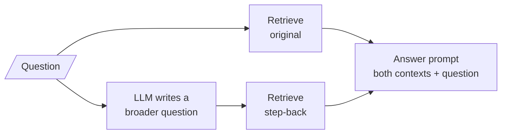

# M17.4 Theory: Step-back prompting

*[M17 theory](../README.md) · Lesson 17.4 · Notebooks: [`04a_step_back_prompting.ipynb`](../../notebook/04a_step_back_prompting.ipynb) · [All theory pages](../../../../../THEORY.md)*
<!-- subtitle: A narrow question retrieves its premise; a broader one retrieves what settles it -->

## The specificity trap

> **What you'll learn**
>
> - **Explain** why a specific question, especially one with a false premise, retrieves the wrong context.
> - **Trace** step-back retrieval: a broader question, two searches, one combined context.
> - **Explain** why two worked examples teach "make it broader" better than an instruction.
> - **Choose** between step-back and plain retrieval by question type and cost.

Lessons 17.2 and 17.3 reworded the question to reach the handbook's vocabulary. Rewording keeps the question's scope. Some questions fail because the scope itself is wrong.

Notebook `04a` opens with *Did Leonardo da Vinci invent the printing press?* A retriever searches for exactly that and mostly finds pages about Gutenberg, movable type and 1440. None of them says what Leonardo did invent, which is the knowledge that settles the question. The question carries a **false premise**, and searching on its words retrieves documents about the premise rather than the answer.

We call this the **specificity trap**: the narrower and more assumption-laden the question, the more its words steer retrieval toward the assumption.

Larkspur has the same shape of question. A customer on a monthly plan asks *Can I get a refund on my monthly plan?* The handbook offers refunds on annual plans only, and the answer the customer needs is "no, but cancelling stops the next charge". That second fact sits in the `cancel` chunk, which shares almost no words with the question.

## Asking the broader question

**Step-back prompting** (Zheng et al., [arXiv:2310.06117](https://arxiv.org/abs/2310.06117)) asks an LLM for a more general question, retrieves for both the original and the general one, and answers from the combined context:

*Figure 1: Step-back retrieval. Two searches, one for specifics and one for background.*

The two contexts do different jobs. The original question's context supplies specifics; the step-back context supplies the background that can correct a premise. `04a` feeds both, plus the original question, to a community answer prompt written to take exactly those three inputs.

Here are both questions for each example, with what each one surfaces:

| | Question searched | What it surfaces |
|---|---|---|
| Original | *Did Leonardo da Vinci invent the printing press?* | Printing-press history: Gutenberg |
| Step-back | *What inventions is Leonardo da Vinci associated with?* | Leonardo's actual work |
| Original | *Can I get a refund on my monthly plan?* | `refund-window`, `billing`, `sla` |
| Step-back | *What is the refund policy for each plan type?* | `refund-window`, `retention`, `cancel` |

*Table 1: Original against step-back retrieval. The Leonardo rows are `04a`'s live web search; the Larkspur rows are the top 3 from the M10 TF-IDF index, with the step-back question written by hand.*

On the Larkspur handbook the gain is small and honest. Both questions find `refund-window`, the chunk that states the annual-plan rule. The step-back question adds `cancel`, the fact the customer needs next, and the combined context holds five distinct chunks where the original held three. On a twelve-chunk handbook there is little background to miss; on the open web, `04a`'s search results move from Gutenberg to Leonardo.

## Teaching abstraction by example

"Make this question more general" is hard to specify in prose. Too loose, and the model rewrites the question into something unrelated; too strict, and it barely changes anything. `04a` teaches the move with two worked examples instead:

| Input | Output |
|---|---|
| *Did the Beatles ever write a book?* | *What types of creative works did the Beatles produce?* |
| *Was Albert Einstein a musician?* | *What fields did Albert Einstein work in?* |

*Table 2: The two few-shot examples in `04a`.*

Both show the same pattern: a yes-or-no question about one specific thing becomes an open question about the category it belongs to. The few-shot template expands into real message pairs (a user turn, then the model's reply) before the real question, so the model imitates the pattern rather than interpreting an instruction.

The pattern can overshoot. We call that **over-generalising**: a step-back question so broad that it retrieves a vague overview instead of the background that matters. *What does Larkspur offer?* would be a step back from the refund question too, and it would retrieve almost anything.

## When it pays

Step-back doubles the calls of plain RAG:

| | Plain RAG | Step-back RAG |
|---|---|---|
| LLM calls per question | 1 (answer) | 2 (step-back question, answer) |
| Retrievals | 1 | 2 |
| False-premise questions | Often confidently wrong | Retrieves the context that corrects the premise |
| Multi-hop or reasoning questions | Weak | Background context supports the reasoning |
| Direct lookups | Ideal | Wasted call; the broad query can dilute a precise one |
| Failure mode | Misses context | Over-generalises and retrieves something vague |

*Table 3: Plain against step-back RAG, from `04a`'s comparison.*

The two retrievals are independent, so `04a` runs them in parallel, and the extra latency is mostly one short LLM call.

> **Interview tip:** step-back helps only when the corpus contains the broader background. On a narrow corpus, generalising returns the same documents, as the Larkspur rows of Table 1 nearly do.

## In practice: step-back on Larkspur's policy questions

1. **Route yes-or-no policy questions here**, especially ones that name a plan, a period or an amount the policy might not cover.
2. **Write Larkspur few-shots**: *Can I pause my server for a month?* becomes *What can I change about a running server?*
3. **Keep the original retrieval.** It supplies the specifics; the step-back retrieval only adds background.
4. **Skip direct lookups** such as *What is the refund window?*, where the original question already matches the chunk.

Lesson 17.5 attacks the other half of the asymmetry from lesson 17.1: not the question's scope, but its shape.

## Key Takeaways

- A specific question, especially one with a false premise, steers retrieval toward its assumption (the specificity trap): Leonardo's question finds Gutenberg.
- Step-back retrieves for the original and a broader question and answers from both. It costs 2 LLM calls and 2 retrievals, and helps only where the corpus holds the background.
- Teach the abstraction with two worked examples, and watch for over-generalising, a step-back question too broad to retrieve anything specific.

## Check yourself

1. Why does "Did Leonardo da Vinci invent the printing press?" retrieve pages about Gutenberg?

The question carries a false premise, and its words are about the printing press, so retrieval finds documents about the premise. The knowledge that settles it, what Leonardo did invent, shares few of those words. A broader step-back question retrieves it.

2. For "Can I get a refund on my monthly plan?", what does the step-back question add to the Larkspur context?

Both questions retrieve `refund-window`, which states the annual-plan rule. The step-back question, *What is the refund policy for each plan type?*, adds `cancel`, which says cancelling stops the next charge, the fact a monthly customer needs. The gain is small because the handbook is small.

3. A teammate wants step-back on every Larkspur question. What do you tell them?

It doubles the calls (2 LLM calls and 2 retrievals) and only helps specific or premise-laden questions on a corpus with background to find. Direct lookups lose a call and risk a diluted query. Route policy questions with a possible false premise to step-back and send direct lookups straight to retrieval.

---
*Previous: [17.3 RAG-Fusion with Reciprocal Rank Fusion](../03_rag_fusion_with_reciprocal_rank_fusion/README.md). Next: [17.5 HyDE: embed a hypothetical answer](../05_hyde_embed_a_hypothetical_answer/README.md).*
