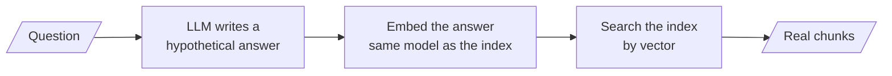
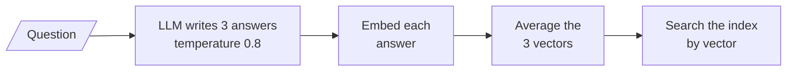

# M17.5 Theory: HyDE: embed a hypothetical answer

*[M17 theory](../README.md) · Lesson 17.5 · Notebooks: [`05a_hyde.ipynb`](../../notebook/05a_hyde.ipynb), [`05b_hyde_walkthrough.ipynb`](../../../optional/notebook/05b_hyde_walkthrough.ipynb) (optional), [`05c_hyde_rag_techniques.ipynb`](../../../optional/notebook/05c_hyde_rag_techniques.ipynb) (optional) · [All theory pages](../../../../../THEORY.md)*
<!-- subtitle: Search with an invented answer, because answers look like documents and questions do not -->
<!-- format: approved -->

## HyDE

> **What you'll learn**
>
> - **Explain** why an invented answer can retrieve better than the question it answers.
> - **Trace** a hypothetical answer through the index, and see a misleading one fail.
> - **Explain** which embedding calls run the LLM and which pass straight through.
> - **Decide** whether HyDE suits a private corpus, with a test rather than an assumption.

Lessons 17.2 to 17.4 changed the question's words or its scope. The result was still a question: short, interrogative, unlike the passage that answers it. Lesson 17.1 called that the shape half of the [query–document asymmetry](../01_query_rewriting_and_expansion/README.md#querydocument-asymmetry).

**HyDE** (Hypothetical Document Embeddings, Gao et al., [arXiv:2212.10496](https://arxiv.org/abs/2212.10496)) attacks the shape. Instead of embedding the question, it asks an LLM to write an answer, embeds that answer, and searches with its vector. An invented answer is declarative, long and full of the vocabulary documentation uses, so it lands nearer the real passage than the question does:

*Figure 1: HyDE. The invented answer is a search key; only real chunks come back.*

The hypothetical answer may state wrong facts, and that does not matter. It is discarded after embedding, never reaches the user and never enters the context.

Here is the outage question searched three ways on the M10 TF-IDF index. The two hypothetical answers are hand-written to show the two outcomes; an LLM would write something similar:

| Search key | Top 3 retrieved | Recall at 2 |
|---|---|---|
| The question: *What happens if my server goes down?* | `reboot` 0.416, `sizing` 0.389, `export` 0.217 | 0.00 |
| A good guess: "…the uptime guarantee applies. When availability falls below the promised level because of an outage, customers receive service credits, and the status page posts incident updates until recovery." | `sla` 0.476, `incidents` 0.423, `reboot` 0.100 | 1.00 |
| A jargon guess: "…the platform automatically fails over to a standby node in another zone, and live migration restores your virtual machine without data loss." | `export` 0.511, `reboot` 0.275, `sizing` 0.257 | 0.00 |

*Table 1: The same question searched by itself and by two hypothetical answers (M10 index, TF-IDF; both answers illustrative).*

Choose the search key for <em>What happens if my server goes down?</em> and compare what the index returns.

<button type="button" data-mode="question" aria-pressed="false" aria-controls="hyde-question">The question</button>
<button type="button" data-mode="good" aria-pressed="false" aria-controls="hyde-good">A good guess</button>
<button type="button" data-mode="jargon" aria-pressed="false" aria-controls="hyde-jargon">A jargon guess</button>

<section id="hyde-question" class="mode-panel" data-announcement="Question selected. Recall at 2 is 0.00."><h4>The question as the key</h4><dl><dt>Words that match</dt><dd>"server" only</dd><dt>Top 2</dt><dd><code>reboot</code> 0.416, <code>sizing</code> 0.389</dd><dt>Recall at 2</dt><dd>0.00</dd></dl></section>
<section id="hyde-good" class="mode-panel" data-announcement="Good guess selected. Recall at 2 is 1.00."><h4>A good guess as the key</h4><dl><dt>Words that match</dt><dd>availability, outage, service credits, incident</dd><dt>Top 2</dt><dd><code>sla</code> 0.476, <code>incidents</code> 0.423</dd><dt>Recall at 2</dt><dd>1.00</dd></dl></section>
<section id="hyde-jargon" class="mode-panel" data-announcement="Jargon guess selected. Recall at 2 is 0.00."><h4>A jargon guess as the key</h4><dl><dt>Words that match</dt><dd>data, loss, zone: none of them about outages in this handbook</dd><dt>Top 2</dt><dd><code>export</code> 0.511, <code>reboot</code> 0.275</dd><dt>Recall at 2</dt><dd>0.00</dd></dl></section>

The good guess uses the handbook's words, "availability", "outage", "service credits", "incident", and finds both evidence chunks. The jargon guess describes how a different provider handles failure. Its words ("data", "loss", "zone") pull the search toward the export chunk. We call this **invented jargon**: a confident hypothetical answer written in vocabulary the corpus never uses.

## Two models, one index

HyDE always needs two models: an LLM to write and an embedding model to embed. The embedding model must be the one that built the index, or the vectors are not comparable. The index itself is built plainly. Documents are already answer-shaped, and indexing through an LLM would cost a generation per chunk.

LangChain packages the steps as a hypothetical document embedder, which behaves differently for the two methods every embedding model has:

| Method | Called when | What it does |
|---|---|---|
| Embed documents | Building the index | Passes straight through to the base embedder; no LLM call |
| Embed query | Every search | Runs the LLM, then embeds the generated text |

*Table 2: The two embedding paths of the HyDE embedder.*

Notebook `05a` checks the first row: a document embedded through the HyDE wrapper matches its plain embedding. That pass-through makes the wrapper a drop-in. Hand it to a vector store as its embedding model, and indexing stays plain while every similarity search applies HyDE.

The wrapper ships with built-in prompt templates inherited from the datasets the paper used; the general one asks the model to "write a passage to answer the question". `05a` writes its own prompt instead, asking for an excerpt from technical documentation, so the hypothetical answer matches the genre of the indexed chunks.

## Several hypothetical answers

The paper generates several hypothetical answers and averages their embeddings. No single invention then dominates the search vector. A jargon guess averaged with two good ones pulls the vector less.

*Figure 2: HyDE with several hypothetical answers. One search, with a key no single guess controls.*

LangChain's current wrapper cannot do this: its chain returns one string, and its averaging step always averages exactly one vector. `05a` generates three answers itself at temperature 0.8, embeds them and averages them, then checks how similar the three are to each other. A cosine similarity near 1.0 means the answers are near-identical, and the average bought nothing for three times the generation cost. The optional notebook `05b` builds HyDE by hand, then with LangChain's wrapper and a custom prompt; `05c` asks for one hypothetical document sized to the index's chunk length, so the search key and the chunks have the same shape.

## When it helps and when it hurts

HyDE trades one LLM call for a better-shaped search key:

| | Plain retrieval | HyDE |
|---|---|---|
| Cost per query | One embedding call | One LLM call plus one embedding call |
| Short or vague questions | Often misses | The LLM supplies the missing vocabulary |
| Niche or private corpus | Retrieves what is there | The LLM can invent jargon and steer away from the right chunk |
| Questions that already read like documents | Strong | No better, sometimes worse |

*Table 3: Plain retrieval against HyDE.*

> **Pitfall: invented jargon on a private corpus.** No model was trained on Larkspur's handbook. Its hypothetical answers come from what it knows about hosting providers in general, and Table 1 shows both outcomes that knowledge can produce.

## In practice: testing HyDE on the Larkspur handbook

1. **Run the golden set twice**, with and without HyDE, and count the overlap and the recall per question, as `05a` ends by doing.
2. **Prompt in the handbook's genre**: "Write a short excerpt from a cloud hosting provider's support handbook that answers…"
3. **Generate three answers and average them** when single guesses vary; check their mutual similarity to see whether the extra calls buy anything.
4. **Route only short, vague questions** to HyDE; exact codes go to BM25 (M16), compound questions to decomposition.

Lesson 17.6 takes those compound questions: one query that carries several needs.

## Limits

- **Table 1 uses TF-IDF and hand-written guesses.** HyDE is designed for dense embeddings; the M10 TF-IDF index shows the vocabulary effect clearly but not the full embedding-space effect. `05a` uses `text-embedding-3-small` and model-written answers, and prints chunks rather than recall.
- **No threshold for "near-identical".** `05a` reports the mutual similarity of its three answers and says a value close to 1.0 means averaging adds little. It sets no cut-off; pick one from your own runs.
- **One question, two guesses.** The page shows that the outcome depends on the guess's vocabulary, not how often a model writes each kind. Measure that on your golden set.

## References

1. Gao et al., [Precise zero-shot dense retrieval without relevance labels](https://arxiv.org/abs/2212.10496), 2022.
2. LangChain, [HypotheticalDocumentEmbedder API reference](https://reference.langchain.com/python/langchain-classic/chains/hyde/base/HypotheticalDocumentEmbedder).

## Key Takeaways

- HyDE embeds an LLM-written answer instead of the question, because an answer-shaped text lands nearer the real passage; on the outage question a good guess lifts recall at 2 from 0.00 to 1.00.
- A guess in vocabulary the corpus never uses (invented jargon) misleads the search, and the risk is highest on a private corpus such as Larkspur's.
- Embed with the same model that built the index: the HyDE embedder runs the LLM only for queries. Test on the golden set before turning it on.

## Check yourself

1. The hypothetical answer HyDE writes may state wrong facts. Why does that not mislead the user?

It is only a search key. It is embedded, then discarded: it never reaches the user and never enters the context. The chunks that come back from the index are real, and the answer is built from them.

2. Two hypothetical answers to the outage question give recall at 2 of 1.00 and 0.00. What separates them?

Vocabulary. The good guess uses the handbook's words (availability, outage, service credits, incident) and retrieves `sla` and `incidents`. The jargon guess describes failover and live migration, words the handbook never uses, and its "data loss" pulls the search to the export chunk.

3. You pass the HyDE embedder to a vector store to build the Larkspur index. Does indexing call the LLM, and what must the base embedder be?

No. Embedding documents passes straight through to the base embedder, so indexing stays plain; only query embedding runs the LLM. The base embedder must be the model that built the index, or the query and chunk vectors are not comparable.

---
*Previous: [17.4 Step-back prompting](../04_step_back_prompting/README.md). Next: [17.6 Query decomposition for multi-hop questions](../06_query_decomposition_for_multi_hop_questions/README.md).*
