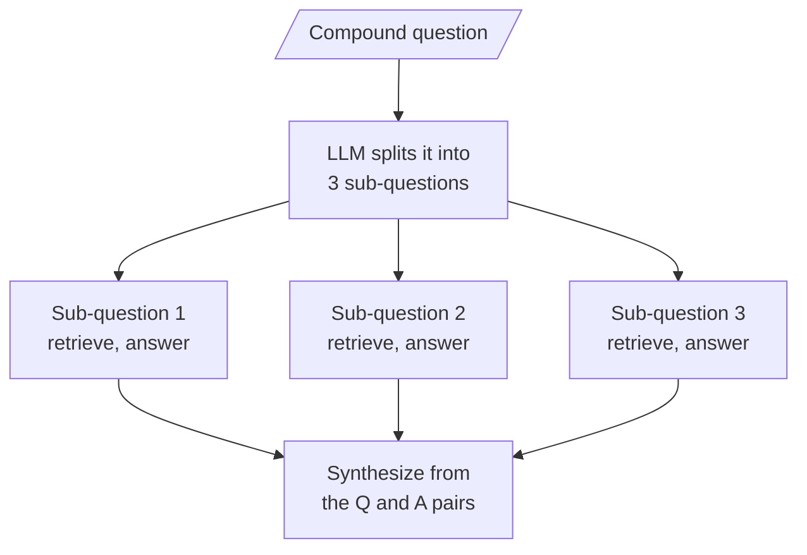

# M17.6 Theory: Query decomposition for multi-hop questions

*[M17 theory](../README.md) · Lesson 17.6 · Notebooks: [`06a_query_decomposition.ipynb`](../../notebook/06a_query_decomposition.ipynb), [`06b_query_decomposition_walkthrough.ipynb`](../../../optional/notebook/06b_query_decomposition_walkthrough.ipynb) (optional) · [All theory pages](../../../../../THEORY.md)*
<!-- subtitle: One vector for three needs lands near none of them, so split the question first -->

## Decomposing compound questions

> **What you'll learn**
>
> - **Explain** why a compound question's single vector can miss one of its needs.
> - **Trace** a three-part Larkspur question through decomposition, sub-answers and synthesis.
> - **Count** the calls decomposition spends, and recover the wall-clock time.
> - **Diagnose** the list explosion that turned three sub-questions into eighteen.

Lessons 17.2 to 17.5 all produced better search keys for one need. Some questions carry two or three needs, and a better key for the whole question is still one key.

A Larkspur customer writes *If I cancel my annual plan, do I get a refund, when does the money arrive, and how long is my data kept?* Three chunks answer it: `refund-window`, `refund-timing` and `retention`. Dense or sparse, retrieval gives the whole question one vector, which lands between the needs. With a top-k cut, the strongest needs crowd out the weakest. We call this the **between-needs vector**.

Here is the single query against three sub-questions on the M10 TF-IDF index:

| Search | Top retrieved | Evidence found |
|---|---|---|
| The whole question, top 3 | `retention` 0.297, `refund-window` 0.290, `cancel` 0.184 | 2 of 3; `refund-timing` not in the top 4 |
| *Do I get a refund if I cancel my annual plan?* | `refund-window` 0.394 | `refund-window` |
| *When does refund money arrive back on my statement?* | `refund-timing` 0.200 | `refund-timing` |
| *How long is my data kept after I cancel my plan?* | `retention` 0.404 | `retention` |

*Table 1: One compound question against its three sub-questions (M10 index, TF-IDF; sub-questions written by hand in the style of the `06a` prompt).*

The timing need loses inside the compound question because its words ("when", "money", "arrive") are few and common, while "cancel", "plan" and "data" pull toward `cancel` and `retention`. Asked alone, each need gets the whole query to itself.

**Query decomposition** splits the question before retrieval and answers each part on its own:

*Figure 1: Decomposition. Each sub-question is a small RAG chain; the synthesis sees only their answers.*

The synthesis prompt sees the three question-and-answer pairs, never the retrieved chunks, so its context stays small however many sub-questions there were. Notebook `06a` asks *What is LangSmith, and why do we need it?*, a definition plus a justification. It splits its corpus into 100-token chunks so that each holds about one idea, and counts the unique chunks the three sub-questions reach against the single query's.

## What it costs

Decomposition is the most expensive technique in this module:

| Step | LLM calls | Retrievals |
|---|---|---|
| Decompose | 1 | 0 |
| Answer each sub-question | 3 | 3 |
| Synthesize | 1 | 0 |
| **Total** | **5** | **3** |

*Table 2: Calls for three sub-questions, against 1 and 1 for plain RAG.*

The sub-questions are independent, so `06a` runs their chains as one parallel batch, which recovers most of the wall-clock time at the same token cost.

Errors propagate. A bad sub-question produces a confident wrong sub-answer, and the synthesis has no chunks to check it against. We call this the **unchecked sub-answer**. Log every sub-question and sub-answer, so a wrong final answer can be traced to the part that caused it.

## Get the list right

The first version of `06a` asked for prose and split the reply on newlines. The prompt asked for sub-questions and then for "multiple search queries", and the model returned both under markdown headers. The split produced about 18 items: headers, blank strings and bullets, each triggering a retrieval and an LLM call:

| | Intended | Observed on some runs |
|---|---|---|
| Items parsed | 3 sub-questions | About 18: headers, blanks, bullets, questions |
| Sub-answer LLM calls | 3 | About 18 |
| Retrievals | 3 | About 18 |

*Table 3: The list explosion in the first version of `06a`.*

We call this the **list explosion**. It came and went, because the same chain returned three clean lines on other runs. The fix is a prompt that asks for one thing and a schema bound with structured output, which returns a list of exactly the sub-questions.

> **Pitfall: list explosion.** Any chain whose call count depends on parsed LLM output needs a schema and a cap. Log the count per request; a jump from 5 calls to 20 is the signature.

## In practice: decomposition on the Larkspur handbook

M10's symptom table sends "half an answer; one fact found, another missed" to decomposition. Not every two-part question needs it:

1. **Decompose when a single query misses a need.** The three-part cancellation question above loses `refund-timing`; decomposition finds all three.
2. **Skip it when the single query already covers both parts.** *Can I export my data after I cancel my plan?* reads like two needs, yet the M10 lab retrieves both evidence chunks at `k = 2`, because one chunk says "Export your data" and the other "After a plan is cancelled". Decomposing it costs four extra LLM calls for nothing.
3. **Find the difference on the golden set**, and let a router (lesson 17.7) send only the compound questions that need it.

## Key Takeaways

- One vector for a compound question lands between its needs (the between-needs vector): the Larkspur cancellation question finds 2 of 3 evidence chunks; its three sub-questions find all 3.
- Three sub-questions cost 5 LLM calls and 3 retrievals. Run them in parallel, and log sub-answers, because a wrong one reaches the synthesis unchecked.
- Get the sub-questions from a structured-output schema; splitting prose on newlines produced about 18 queries instead of 3.

## Check yourself

1. The cancellation question's single query retrieves retention, refund-window and cancel. Why does refund-timing miss?

The question gives one vector for three needs. The timing need's words are few and common, while "cancel", "plan" and "data" pull toward the cancellation and retention chunks, so the timing chunk falls out of the top 4. Asked alone, *When does refund money arrive back on my statement?* retrieves it first.

2. How many LLM calls and retrievals does decomposing into three sub-questions cost, and how do you cut the wall-clock time?

5 LLM calls (decompose, three answers, synthesis) and 3 retrievals, against 1 and 1 for plain RAG. The sub-questions are independent, so running their chains as one parallel batch recovers most of the wall-clock time at the same token cost.

3. A decomposition chain sometimes makes about 18 retrievals instead of 3. What causes it, and what is the fix?

The list explosion: the prompt asked for prose and the code split it on newlines, and the model returned sub-questions and search queries under markdown headers, so every header, blank line and bullet became a sub-question. Ask for one thing and bind a schema with structured output, which returns exactly the sub-questions.

---
*Previous: [17.5 HyDE: embed a hypothetical answer](../05_hyde_embed_a_hypothetical_answer/README.md). Next: [17.7 Routing: LLM classifier and semantic routing](../07_routing_llm_classifier_and_semantic_routing/README.md).*
