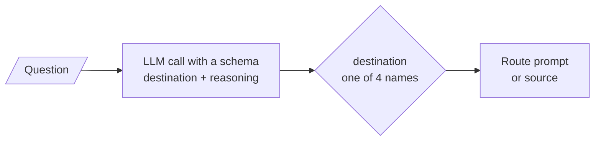
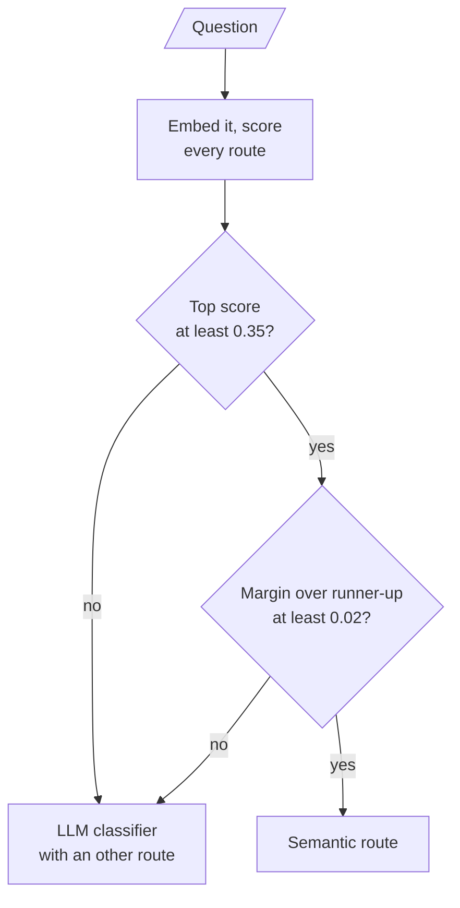

# M17.7 Theory: Routing: LLM classifier and semantic routing

*[M17 theory](../README.md) · Lesson 17.7 · Notebooks: [`07a_routing_with_llm_classifier.ipynb`](../../notebook/07a_routing_with_llm_classifier.ipynb), [`07b_semantic_routing.ipynb`](../../notebook/07b_semantic_routing.ipynb) · [All theory pages](../../../../../THEORY.md)*
<!-- subtitle: Decide where a question goes before anything answers it, cheaply when you can and carefully when you must -->
<!-- format: approved -->

## Logical vs semantic routing

> **What you'll learn**
>
> - **Compare** an LLM classifier and an embedding-similarity router on cost, reach and failure.
> - **Diagnose** a classifier that silently returns no route, and one that always returns a route.
> - **Read** route scores and margins, and set the thresholds that send unclear questions onward.
> - **Design** Larkspur's routes and test them on real scores.

Lessons 17.1 to 17.6 each fit one kind of question: decomposition for compound ones, HyDE for vague ones, step-back for premises, plain retrieval for direct lookups. Applying all of them to every question is the transform-everything habit from lesson 17.1. Something has to choose per question.

A **router** decides where a question goes before anything answers it: which prompt, which data source, which transformation. Notebooks `07a` and `07b` build the same four-way router twice, over personal finance, book reviews, health and fitness, and travel:

- **Logical routing**: an LLM reads the question and chooses.
- **Semantic routing**: the question is embedded and sent to the destination whose example questions it is closest to.

The two fail in different ways:

| | Logical (LLM classifier) | Semantic (embedding similarity) |
|---|---|---|
| Decides by | The model reasoning over the question | Cosine similarity to each route's example questions |
| Cost per query | One LLM call | One embedding call, about 100 times cheaper in `07a`'s comparison |
| Handles | Nuance, new phrasings, several clauses | Questions that resemble the examples |
| Fails by | Picking a plausible but wrong route | Routing on surface resemblance; a near-tie looks like a decision |
| Out-of-scope questions | Still routed, unless it has an "other" route | Always routed: no "none of these" |

*Table 1: Logical against semantic routing.*

## The LLM classifier

The first version of `07a` asked for the category as free text and compared it with exact strings. The model answered "health & fitness" and "travel guides", which match neither "Health & Fitness" nor "Travel Guide": every branch fell through and the router returned nothing. The notebook still appeared to work. We call this the **silent fall-through**.

The fix binds a schema with structured output whose destination field is a fixed set of the four route names, so no other value can come back, plus a one-sentence reasoning field that makes each decision readable in traces:

*Figure 1: The LLM classifier after the fix. Every question costs one LLM call, and only a listed name can come back.*

A fixed set guarantees a valid route, not a sensible one. Asked *What is the capital of France?*, the classifier still picks one of the four. We call this the **forced route**. A production router needs:

- **An "other" destination**: out-of-scope questions then have somewhere honest to go.
- **A regression set** of questions with expected routes, because adding a route changes decisions on old questions.
- **A small model.** Routing is classification; it rarely needs the model that writes answers.

## Semantic routing

Each route is defined by a few example questions, three per route in `07b`, embedded once at start-up. Per query the router embeds the question, takes each route's highest similarity to its examples, and picks the highest route. The routing path never calls an LLM.

`07b` shows why the winner alone is not enough. With `text-embedding-3-small`, *How can I travel on a budget?* is one of the travel examples word for word and scores 1.0000, while personal finance still scores about 0.50 on "budget". *Are meal-prep books worth buying?* wins by a margin of about 0.002, with every route near 0.28, and book reviews is not even in the top two despite the word "books". The router returns both answers with the same confidence.

Two thresholds turn scores into a confidence check: a **minimum top score** (did anything match?) and a **minimum margin** over the runner-up (was the choice distinguishable?). `07b` uses 0.35 and 0.02 and calls them illustrative. Questions that fail either go to the LLM classifier, which makes the two routers one system:

*Figure 2: A semantic router with an LLM fallback. Most traffic pays for one embedding.*

## Larkspur's routes, scored

A Larkspur support assistant can route on the handbook's own sections. We gave each route two example questions and scored six test questions with `all-MiniLM-L6-v2`:

| Route | Handbook chunks behind it | Example questions |
|---|---|---|
| billing | `billing`, `cancel`, `refund-window`, `refund-timing`, `promo` | How long does a refund take? When am I charged for an annual plan? |
| data | `export`, `retention` | Can I export my data after I cancel my plan? How long is my data kept? |
| reliability | `sla`, `incidents` | What happens if my server goes down? Where do I see incident updates? |
| servers | `sizing`, `reboot` | Which server size do I need? Does a reboot change my IP address? |

*Table 2: Four Larkspur routes and their examples.*

Here are the scores, with the decision Figure 2's thresholds make:

| Question | Top route | Runner-up | Margin | Decision at 0.35 and 0.02 |
|---|---|---|---|---|
| *How long does a refund take?* | billing 1.000 | data 0.284 | 0.716 | billing |
| *Is my money back in five days?* | billing 0.505 | data 0.282 | 0.224 | billing |
| *Do I get a refund if an outage lasts a day?* | billing 0.503 | reliability 0.458 | 0.045 | billing |
| *Will restarting my machine lose my files?* | servers 0.473 | reliability 0.466 | 0.008 | classifier |
| *Can I download my databases?* | data 0.325 | reliability 0.192 | 0.134 | classifier |
| *What is the capital of France?* | billing 0.086 | servers 0.078 | 0.008 | classifier |

*Table 3: Route scores for six questions (`all-MiniLM-L6-v2`, highest similarity to each route's examples).*

We recomputed Table 3 with `all-MiniLM-L6-v2` and normalised vectors; every score and margin matches. The out-of-scope question shows how the three designs differ on one input:

Choose a router design for <em>What is the capital of France?</em>

<button type="button" data-mode="semantic" aria-pressed="false" aria-controls="router-semantic">Semantic only</button>
<button type="button" data-mode="classifier" aria-pressed="false" aria-controls="router-classifier">Classifier, four routes</button>
<button type="button" data-mode="guarded" aria-pressed="false" aria-controls="router-guarded">Guarded, with other</button>

<section id="router-semantic" class="mode-panel" data-announcement="Semantic only selected. Routed to billing."><h4>Semantic only</h4><dl><dt>Scores</dt><dd>billing 0.086, servers 0.078</dd><dt>Result</dt><dd>billing, returned like any other decision</dd><dt>Cost</dt><dd>one embedding call</dd></dl></section>
<section id="router-classifier" class="mode-panel" data-announcement="Four-route classifier selected. A forced route."><h4>Classifier with four route names</h4><dl><dt>Result</dt><dd>one of the four names, because nothing else can come back: a forced route</dd><dt>Cost</dt><dd>one LLM call</dd></dl></section>
<section id="router-guarded" class="mode-panel" data-announcement="Guarded router selected. Sent to the classifier, which can say other."><h4>Semantic with thresholds, classifier with an other route</h4><dl><dt>Check</dt><dd>top score 0.086 is under the 0.35 floor</dd><dt>Result</dt><dd>sent to the classifier, which can answer "other"</dd><dt>Cost</dt><dd>one embedding call plus one LLM call</dd></dl></section>

The guard catches the near-tie and the out-of-scope question. It also shows two limits. *Can I download my databases?* is a clear data question, but its top score of 0.325 falls under the floor, so it pays for a classifier call it did not need. And the outage-refund question belongs to billing and reliability at once; it passes with a margin of 0.045 and goes to billing alone. A margin floor of 0.05 would send it to the classifier.

> **Pitfall: borrowed thresholds.** 0.35 and 0.02 were set for `text-embedding-3-small` on `07b`'s routes. Scores from another model spread differently, as Table 3 shows. Set both thresholds on logged traffic for your own model and routes.

## In practice: routing Larkspur's questions

1. **Semantic router first**, with Table 2's routes and more examples per route drawn from real tickets.
2. **Tune the floor and the margin** on logged questions with known routes; Table 3 suggests a lower floor and a higher margin for this model.
3. **Classifier fallback with an "other" route** for anything that fails either check.
4. **Send cross-topic questions to both routes** when the two top scores sit close, rather than forcing one.

Routing chooses a destination. Lesson 17.8 makes a related move inside one source: it turns part of the question into a metadata filter.

## Limits

- **"About 100 times cheaper" is the notebooks' estimate.** `07a` and `07b` state it in their comparison tables; neither measures it. The ratio depends on the two models' prices.
- **Six questions, two examples per route.** Table 3 shows how the thresholds behave, not their error rate. Tune them on logged traffic with known routes.
- **The "other" route is a recommendation.** `07a`'s fixed set has the four topic names only; the "other" destination is this page's advice, not the notebook's code.

## References

1. Aurelio AI, [Semantic Router](https://github.com/aurelio-labs/semantic-router), open-source library.
2. LangChain, [Structured output](https://docs.langchain.com/oss/python/langchain/structured-output).
3. Reimers and Gurevych, [Sentence-BERT: sentence embeddings using Siamese BERT-networks](https://arxiv.org/abs/1908.10084), 2019.

## Key Takeaways

- Logical routing asks an LLM to choose; semantic routing picks the route whose examples are closest by embedding, about 100 times cheaper per query in `07a`'s comparison.
- A fixed set of route names prevents the silent fall-through but not the forced route: add an "other" destination and a regression set of questions with expected routes.
- Gate semantic routes on a minimum top score and a minimum margin, and tune both per model: on Larkspur's routes the guard catches a 0.008 near-tie but also sends a clear data question to the classifier.

## Check yourself

1. Why does the fixed LLM classifier return its route through a fixed set of names, and what does that still not guarantee?

Free text broke the first version: "health & fitness" matched none of the exact strings, every branch fell through and the router returned nothing while appearing to work. A fixed set guarantees a valid route name, not a sensible one; asked the capital of France, it still picks one of the four, so it needs an "other" route.

2. "Will restarting my machine lose my files?" scores servers 0.473 and reliability 0.466. With thresholds of 0.35 and 0.02, where does it go, and why?

To the LLM classifier. Its top score passes the 0.35 floor, but its margin over the runner-up is 0.008, below 0.02, so the choice is not distinguishable. Without the margin check the semantic router would have returned servers with the same confidence as an exact match.

3. "Can I download my databases?" is clearly a data question, yet the router sends it to the classifier. What does that tell you about the thresholds?

Its top score, 0.325 for data, falls under the 0.35 floor borrowed from a different embedding model, even though its margin of 0.134 is large. The floor is too high for `all-MiniLM-L6-v2` on these routes. Set the floor and the margin from logged questions scored by your own model.

---
*Previous: [17.6 Query decomposition for multi-hop questions](../06_query_decomposition_for_multi_hop_questions/README.md). Next: [17.8 Self-querying: natural language to metadata filter](../08_self_querying_natural_language_to_metadata_filter/README.md).*
