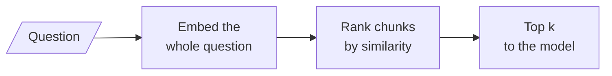
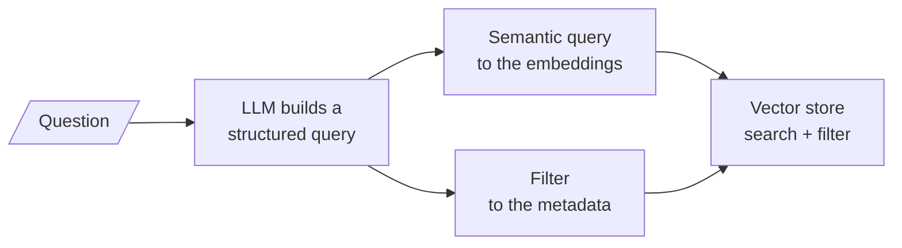

# M17.8 Theory: Self-querying: natural language to metadata filter

*[M17 theory](../README.md) · Lesson 17.8 · Notebooks: [`08a_self_querying_retrieval.ipynb`](../../notebook/08a_self_querying_retrieval.ipynb) · [All theory pages](../../../../../THEORY.md)*
<!-- subtitle: Embeddings compare meaning, not numbers, so let an LLM turn the factual half of a question into a filter -->
<!-- format: approved -->

## Meaning cannot compare numbers

> **What you'll learn**
>
> - **Explain** why similarity search cannot answer "more than", "after" or "one of".
> - **Trace** a question as an LLM splits it into a semantic query and a structured filter.
> - **Explain** why the metadata description is a prompt, and why a field's declared type matters.
> - **Diagnose** a self-querying retriever that returns nothing, or quietly drops its filter.

Lesson 17.7 routed whole questions to a destination. Some questions need a different split: part of the question is about meaning, and part is a condition on a fact.

A Larkspur customer asks *Which plans have more than 8 GB of memory?* The three plan sheets (from the M16 lab corpus) say LC-204 has 4 GB, LC-408 16 GB and LC-816 32 GB. Similarity search ranks them by how much each sheet resembles the question:

*Figure 1: Similarity search alone. The condition "more than 8 GB" is embedded with the rest and never evaluated.*

| Rank | Chunk | Similarity | More than 8 GB? |
|---|---|---|---|
| 1 | `plan-816` (32 GB) | 0.599 | ✓ |
| 2 | `plan-408` (16 GB) | 0.595 | ✓ |
| 3 | `plan-204` (4 GB) | 0.574 | ✗ |
| 4 | `sizing` | 0.536 | |

*Table 1: Similarity scores for the memory question (`all-MiniLM-L6-v2`, M16 lab corpus).*

We recomputed Table 1 from the M16 lab's plan sheets with normalised `all-MiniLM-L6-v2` vectors; the four scores match. The three sheets score within 0.025 of each other, because they read alike. At `k = 3` the 4 GB plan is in the context, and the model has to notice that it fails the condition. "More than 8" has a vector, and the vector cannot perform a comparison. We call this the **comparison blind spot**.

Notebook `08a` shows the same failure on a book catalogue. Asked for books rated above 4.5, plain similarity search returns books rated 4.3, because "rated above 4.5" sits near every book description that mentions ratings.

## Splitting the question

A **self-querying retriever** puts an LLM in front of the retriever. The LLM splits the question into two parts, and each goes to the tool that can evaluate it:

*Figure 2: Self-querying. Meaning goes to the embeddings; facts go to the metadata index.*

`08a`'s catalogue makes the division concrete. Each book's embedded text is a short thematic description, and its metadata holds seven attributes: title, author, year, genre, rating, language and country. The embedded text answers questions about themes; the metadata answers questions about facts. Here are the structured queries the LLM built:

| Question | Semantic query | Filter |
|---|---|---|
| Books with deep themes and a rating above 4.5 | "deep themes" | rating greater than 4.5 |
| What books come from the USA? | (almost empty) | country equals USA |
| A book with complex characters and a gripping plot | the whole question | none |
| *Which plans have more than 8 GB of memory?* (Larkspur, illustrative) | "plans" | memory_gb greater than 8 |

*Table 2: Structured queries. The first three rows are `08a`'s; the Larkspur row assumes the plan sheets carry a memory_gb field.*

The constraint is removed from the semantic query and re-expressed as a filter. A pure metadata lookup leaves almost nothing to embed, and a purely semantic question produces no filter and degrades to ordinary similarity search. For Larkspur, the filter keeps LC-408 and LC-816 and drops LC-204, whatever their similarity scores:

Choose the retriever for <em>Which plans have more than 8 GB of memory?</em> at <code>k = 3</code>.

<button type="button" data-mode="similarity" aria-pressed="false" aria-controls="filter-similarity">Similarity only</button>
<button type="button" data-mode="selfquery" aria-pressed="false" aria-controls="filter-selfquery">Self-querying</button>

<section id="filter-similarity" class="mode-panel" data-announcement="Similarity only selected. The 4 GB plan is in the context."><h4>Similarity only</h4><dl><dt>Context</dt><dd>LC-816 (32 GB), LC-408 (16 GB), LC-204 (4 GB)</dd><dt>Risk</dt><dd>the model must notice that LC-204 fails the condition</dd></dl></section>
<section id="filter-selfquery" class="mode-panel" data-announcement="Self-querying selected. Only the two qualifying plans."><h4>Self-querying (illustrative <code>memory_gb</code> field)</h4><dl><dt>Structured query</dt><dd>"plans", with memory_gb greater than 8</dd><dt>Context</dt><dd>LC-816 and LC-408 only; the store applied the comparison</dd></dl></section>

`08a` exercises each comparison the filter language offers: equality on a category, a numeric greater-than, a range built from two comparisons joined by AND, and set membership built with OR.

## The schema is a prompt

The LLM cannot guess which fields exist. A list of attribute descriptions, one per field with a name, a type and a sentence, is written into the query-construction prompt. Two details carry weight:

- **The type permits comparisons.** Declared as a float, rating allows greater-than; declared as a string, the model can only test equality.
- **The description is a prompt, not documentation.** "The rating of the book (1-5 scale)" tells the model what values are plausible.

A field that is not described cannot be filtered on. A field that was never written at ingestion cannot be filtered on either, which is lesson 16.5's point again: facets come from ingestion.

`08a` also lets the question set the result count. With the limit option on, "two books" becomes a limit of 2; without it, the phrase is silently ignored and the default `k` applies.

## When the filter goes wrong

The query constructor is an LLM, so its output varies between runs. `08a` asked the same question four times and recorded what came back:

| Run outcome | Times in 4 | What the store did |
|---|---|---|
| Filter value 4.5 as a number | 2 | Filtered correctly |
| Filter value "4.5" as a string | 1 | Raised an error: a greater-than needs a number |
| No filter at all | 1 | Plain similarity search; 4.3-rated books came back |

*Table 3: Four runs of one question through the query constructor (`08a`).*

Choose one of the three outcomes <code>08a</code> recorded for "rated above 4.5".

<button type="button" data-mode="number" aria-pressed="false" aria-controls="runs-number">4.5 as a number</button>
<button type="button" data-mode="string" aria-pressed="false" aria-controls="runs-string">"4.5" as a string</button>
<button type="button" data-mode="none" aria-pressed="false" aria-controls="runs-none">No filter</button>

<section id="runs-number" class="mode-panel" data-announcement="Number selected. Filtered correctly."><h4>Filter value 4.5 as a number (2 of 4 runs)</h4><dl><dt>Store</dt><dd>applies rating greater than 4.5</dd><dt>Visible?</dt><dd>yes: correct results</dd></dl></section>
<section id="runs-string" class="mode-panel" data-announcement="String selected. The call raises an error."><h4>Filter value "4.5" as a string (1 of 4)</h4><dl><dt>Store</dt><dd>raises an error: a greater-than needs a number</dd><dt>Fix</dt><dd>coerce numeric filter values before the store sees them</dd></dl></section>
<section id="runs-none" class="mode-panel" data-announcement="No filter selected. Silent fallback to similarity search."><h4>No filter at all (1 of 4)</h4><dl><dt>Store</dt><dd>plain similarity search; books rated 4.3 come back</dd><dt>Visible?</dt><dd>only if the structured query is logged beside the result</dd></dl></section>

Two failures hide in that table. The string value crashes the call, and `08a` fixes it by coercing numeric filter values before they reach the store. The missing filter is worse, because nothing fails: the retriever quietly falls back to similarity search. We call this the **dropped filter**. `08a`'s helper prints the filter the LLM produced beside every result, so a dropped filter is visible.

> **Pitfall: an empty result is not "nothing matched".** A filter on "annual" when the metadata says "Annual", or a field the schema never declared, returns zero chunks with no error. Log the structured query for every call, and treat an empty filtered result as a reason to retry without the filter or to ask the user.

`08a` also passes the store's query translator explicitly, because the automatic detection broke when one vector store integration moved to a different package. That is a version detail; the lasting point is that the translator renders the structured query into the store's own filter syntax.

## In practice: self-querying the Larkspur handbook

1. **Write facets at ingestion**: plan name, memory, vCPUs and traffic on the plan sheets; section, `version` and `date` on policy chunks.
2. **Describe each field with a type and one sentence**, numbers as numbers.
3. **Coerce and log** every structured query, and alert on calls where a question with a number produced no filter.
4. **Route here only questions with a condition on a fact** (Figure 3 in lesson 17.1); everything else keeps plain or transformed retrieval.

This closes the query side of retrieval. M18 turns to the other side: what to do with the chunks once they come back.

## Limits

- **The Larkspur filter is illustrative.** The M16 plan sheets carry their facts in text, not in a `memory_gb` field. The self-query row assumes that field was written at ingestion.
- **Four runs are a small sample.** Table 3 shows that the constructor's output varies, not how often each failure occurs. Count outcomes on your own logged queries.
- **Filter syntax is store-specific.** The translator renders one structured query into each store's filter language, and stores differ in which comparisons they support.

## References

1. LangChain, [SelfQueryRetriever API reference](https://reference.langchain.com/python/langchain-classic/retrievers/self_query/base/SelfQueryRetriever).
2. LangChain, [Structured output](https://docs.langchain.com/oss/python/langchain/structured-output).

## Key Takeaways

- Embeddings compare meaning, not numbers (the comparison blind spot): the three Larkspur plan sheets score within 0.025 of each other for "more than 8 GB", and the 4 GB plan makes the top 3.
- A self-querying retriever has an LLM split the question into a semantic query and a metadata filter; the schema of field names, types and descriptions is part of its prompt.
- The constructor's output varies: coerce numeric values, log the structured query, and watch for the dropped filter, which falls back to similarity search without an error.

## Check yourself

1. Why does similarity search put the 4 GB plan in the top 3 when a customer asks which plans have more than 8 GB of memory?

A vector encodes meaning and cannot perform a comparison. The three plan sheets read alike, so they score 0.599, 0.595 and 0.574, and the 4 GB plan ranks third whatever its memory. A metadata filter on memory greater than 8 is the tool that can evaluate the condition.

2. In the self-querying retriever, what happens to "a rating above 4.5" in "books with deep themes and a rating above 4.5"?

The LLM removes it from the semantic query, which becomes "deep themes", and re-expresses it as a filter: rating greater than 4.5. The embeddings search on meaning, and the metadata index applies the comparison. The comparison works only because rating is declared as a number.

3. A self-querying retriever sometimes returns 4.3-rated books for "rated above 4.5", with no error in the logs. What is happening?

The dropped filter: on some runs the LLM produced no filter at all, and the retriever fell back to plain similarity search. In `08a` this happened once in four runs. Log the structured query beside every result, and alert when a question with a number yields no filter.

---
*Previous: [17.7 Routing: LLM classifier and semantic routing](../07_routing_llm_classifier_and_semantic_routing/README.md). Next: [M17 interview questions](../README.md#interview-spotlight-5-questions-you-might-get-asked).*
