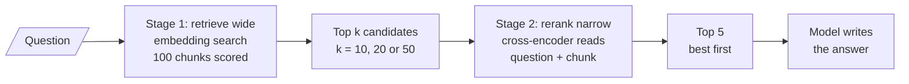
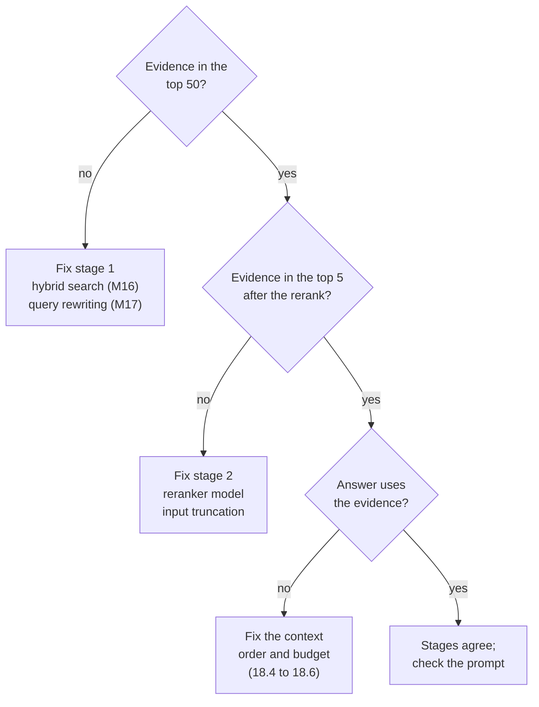

# M18.1 Theory: Two-stage retrieval: retrieve wide, rerank narrow

*[M18 theory](../README.md) · Lesson 18.1 · Notebooks: [`01a_two_stage_reranking.ipynb`](../../notebook/01a_two_stage_reranking.ipynb) · [All theory pages](../../../../../THEORY.md)*
<!-- subtitle: Give retrieval one job and reranking another, and judge each by its own number -->
<!-- format: approved -->

## Recall@50 → precision@5

> **What you'll learn**
>
> - **Explain** why retrieval splits into a cheap wide stage and a slow narrow one.
> - **Trace** Larkspur questions through both stages and read where each one fails.
> - **Diagnose** a wrong answer by asking three questions in order, one per stage.
> - **Choose** the first-stage depth from the recall curve and the latency budget.
> - **Explain** why a model reads the middle of a long context least reliably, and what that means for the cut.

M16 and M17 widened what retrieval can find: two kinds of search, fused, and several phrasings of the question. A wider net catches more evidence and more noise with it. M18 decides what survives the cut to the model.

A Larkspur customer asks *Do I get compensated when Larkspur has an outage?* Three chunks of the 100-chunk handbook in this module's lab answer it: `sla`, `sla-claim` and `sla-exclusions`. The embedding retriever ranks them 1st, 9th and 11th. The top 5 holds one of them and four distractors, including `payment-methods` and `transfer`: precision@5 is 0.20. The evidence was found; it was found too low.

**Two-stage retrieval** gives each stage one job and one metric:

*Figure 1: The two stages in this module's lab. Stage 1 scores every chunk cheaply; stage 2 rescores only the k it returned.*

| Stage | Job | Metric | Cost per question |
|---|---|---|---|
| 1. Retrieve wide | Get the evidence somewhere into the candidate list | Recall@50 | One query embedding and an index lookup, nearly the same at any depth |
| 2. Rerank narrow | Put the evidence at the top and cut the rest | Precision@5 | One reranker pass per candidate: 50 passes at depth 50 |

*Table 1: The two stages and their metrics.*

The arrow in the heading is a ceiling. The top 5 after reranking is a subset of the candidates before it, so recall@5 after the rerank can never exceed recall at the first-stage depth. A reranker reorders; it cannot fetch. We call this the **candidate ceiling**.

Notebook `01a` builds the smallest version: a vector search returns 8 chunks, and a small LLM (`llama-3.1-8b-instant`) reads all eight in one prompt and returns their indices in order of relevance, "retrieve many, keep few". Its parser keeps only the comma-separated tokens that are digits. An index the model omits or garbles drops that chunk without an error. The lab scales it to the production shape and keeps the first stage dense only. Its numbers isolate the reranker. Stage 1 is `all-MiniLM-L6-v2`; stage 2 is one of two real cross-encoders, with latency measured on a laptop CPU. Here are four Larkspur questions through both stages, with the larger reranker:

| Question | Evidence ranks, stage 1 | Precision@5, stage 1 | Evidence ranks after rerank, `k = 20` | Precision@5 after | Rerank time |
|---|---|---|---|---|---|
| *Do I get compensated when Larkspur has an outage?* | 1, 9, 11 | 0.20 | 1, 3, 2 | 0.60 | 623 ms |
| *Can I export my data after I cancel my plan?* | 5, 1, 2 | 0.60 | 3, 1, 2 | 0.60 | 623 ms |
| *How long until a refund shows up on my card?* | 2, 1 | 0.40 | 1, 2 | 0.40 | 623 ms |
| *Which plan should I pick for a PostgreSQL database?* | 5, 52, 1 | 0.40 | 2, none, 3 | 0.40 | 623 ms |

*Table 2: Two stages on four questions (the module's rerank precision lab: `all-MiniLM-L6-v2`, then `BAAI/bge-reranker-v2-m3` over 20 candidates).*

Only the outage question gains. The export and refund questions already had their evidence in the top 5. The reranker spends 623 ms reshuffling it. The PostgreSQL question shows the candidate ceiling: `disk-iops` sits at stage-1 rank 52, past any depth the lab offers. No reranker can reach it, and the fix belongs in stage 1.

<!-- lab: interactive/rerank-precision-lab.html -->

The [interactive rerank precision lab](interactive/rerank-precision-lab.html) lets you move the depth and switch rerankers. Drop the outage question to `k = 10` and `sla-exclusions` falls outside the candidates; precision@5 stops at 0.40.

## Choosing the depth

Depth pulls in two directions. Recall at depth `k` never falls as `k` grows, because a deeper list contains the shallower one. Rerank cost rises with every candidate, and with the larger model it rises fast:

| Depth `k` | `ms-marco-MiniLM-L-6-v2` (22M) | `bge-reranker-v2-m3` (568M) |
|---|---|---|
| 10 | 21 ms | 296 ms |
| 20 | 39 ms | 623 ms |
| 50 | 95 ms | 1,606 ms |

*Table 3: Measured rerank latency by depth (the lab, laptop CPU).*

For the outage question the depth stops mattering at 20: all three evidence chunks are candidates, and 50 costs 2.6 times as much for the same precision@5. The small model costs a sixteenth of the large one at `k = 20` and lifts nothing on this set: it leaves the outage question at 0.20. A reranker's size is not its value on your data.

The same 20 candidates through each second stage show where the difference lands:

Choose the second stage for the outage question at k = 20.

<button type="button" data-mode="off" aria-pressed="false" aria-controls="rr-off">No reranker</button>
<button type="button" data-mode="mini" aria-pressed="false" aria-controls="rr-mini">MiniLM-L6 (22M)</button>
<button type="button" data-mode="m3" aria-pressed="false" aria-controls="rr-m3">bge-reranker-v2-m3 (568M)</button>

<section id="rr-off" class="mode-panel" data-announcement="No reranker selected. Precision at 5 is 0.20."><h4>No reranker</h4><dl><dt>Top 5 sent</dt><dd><code>sla</code>, <code>payment-methods</code>, <code>transfer</code>, <code>compliance</code>, <code>community</code></dd><dt>Evidence ranks</dt><dd>1, 9, 11</dd><dt>Precision@5</dt><dd>0.20 at 0 ms of rerank time</dd></dl></section>
<section id="rr-mini" class="mode-panel" data-announcement="MiniLM selected. Precision at 5 stays 0.20."><h4>MiniLM-L6 (22M)</h4><dl><dt>Top 5 sent</dt><dd><code>sla</code>, <code>payment-methods</code>, <code>transfer</code>, <code>data-residency</code>, <code>dns</code></dd><dt>Evidence ranks</dt><dd>1, 11, 12: the two claim chunks fall further</dd><dt>Precision@5</dt><dd>0.20 at 39 ms</dd></dl></section>
<section id="rr-m3" class="mode-panel" data-announcement="bge reranker selected. Precision at 5 rises to 0.60."><h4>bge-reranker-v2-m3 (568M)</h4><dl><dt>Top 5 sent</dt><dd><code>sla</code>, <code>sla-exclusions</code>, <code>sla-claim</code>, <code>dns</code>, <code>community</code></dd><dt>Evidence ranks</dt><dd>1, 3, 2</dd><dt>Precision@5</dt><dd>0.60 at 623 ms</dd></dl></section>

We recomputed every value above from the lab's stored scores. The stored cross-encoder scores came from real model runs; the page does not call either model.

To pick the depth for your own corpus, plot stage-1 recall at each depth on the golden set and find where it flattens. Past that point a deeper list only adds rerank latency. The notebooks in this module sit at the shallow end:

| Notebook | First stage returns | Reranker | Keeps |
|---|---|---|---|
| `01a` | 8 | LLM, one listwise call | All 8, reordered |
| `02a` | LangChain's default `k` | `BAAI/bge-reranker-base` | 3 |
| `02b` (optional) | 10 | `ms-marco-MiniLM-L-6-v2` | All 10, reordered |
| `03a`, LLM | 15, or 30 in its custom retriever | An LLM, one call per chunk | 3, or 2 |
| `03a`, cross-encoder | 10 | `ms-marco-MiniLM-L-6-v2` | 5 |

*Table 4: Depth and cut in the M18 notebooks.*

When an answer is wrong, the two metrics say which stage to fix. Ask the questions in order:

*Figure 2: Debug the stages in order. Each "no" names the stage to fix.*

## Lost in the middle

Liu et al. (*Lost in the Middle: How Language Models Use Long Contexts*, 2023) gave models a question with many retrieved passages and moved the one that held the answer through the list. Accuracy was highest with the answer near the start or the end of the context and lowest with it in the middle. M10 met the same effect when it raised `k`.

We call this **buried evidence**: the chunk reached the prompt and the model still did not use it. For a RAG pipeline it has three consequences:

- **Send fewer chunks.** With five chunks there is little middle to get lost in. If stage 1 sends 20 chunks for the export question and `retention` sits at position 11, it is in the part of the prompt the model reads least reliably.
- **Send them in rank order, best first.** `01a`'s last step does this: it rebuilds the list from the LLM's ranking, and the chunk judged most relevant leads the prompt.
- **If you must send many, put the strongest at the edges.** LangChain's long-context reorder transformer places the highest-ranked documents at the start and the end and the weakest in the middle. The M18 notebooks do not use it; reranking and a small cut usually make it unnecessary.

> **Key distinction:** precision@5 measures whether the evidence reached the cut. Lost in the middle is about whether the model used it once there. A small cut, best first, serves both.

## In practice: Larkspur's two-stage pipeline

Here is the outage question through the pipeline, with the decision each stage makes.

Step through the outage question at k = 20 with the bge reranker.

<button type="button" data-step="0" aria-pressed="false" aria-controls="tw-step-0">1. Measure depth</button><button type="button" data-step="1" aria-pressed="false" aria-controls="tw-step-1">2. Retrieve 20</button><button type="button" data-step="2" aria-pressed="false" aria-controls="tw-step-2">3. Rerank</button><button type="button" data-step="3" aria-pressed="false" aria-controls="tw-step-3">4. Cut to 5</button><button type="button" data-step="4" aria-pressed="false" aria-controls="tw-step-4">5. Route misses</button>

<section id="tw-step-0" class="step-panel" aria-labelledby="tw-heading-0"><h4 id="tw-heading-0">1. Measure stage-1 recall by depth</h4><dl><dt>Input</dt><dd>the golden question and its three evidence chunks</dd><dt>Finding</dt><dd>recall is 0.67 at k = 10 and 1.00 from k = 20; the curve flattens at 20</dd></dl></section><section id="tw-step-1" class="step-panel" aria-labelledby="tw-heading-1"><h4 id="tw-heading-1">2. Retrieve 20 candidates</h4><dl><dt>Stage 1 ranks</dt><dd><code>sla</code> 1, <code>sla-claim</code> 9, <code>sla-exclusions</code> 11</dd><dt>Top 5 as retrieved</dt><dd>one evidence chunk, precision@5 0.20</dd></dl></section><section id="tw-step-2" class="step-panel" aria-labelledby="tw-heading-2"><h4 id="tw-heading-2">3. Rerank the 20</h4><dl><dt>Work</dt><dd>20 question-chunk pairs through the cross-encoder, 623 ms on the lab's CPU</dd><dt>New ranks</dt><dd><code>sla</code> 1, <code>sla-exclusions</code> 2, <code>sla-claim</code> 3</dd></dl></section><section id="tw-step-3" class="step-panel" aria-labelledby="tw-heading-3"><h4 id="tw-heading-3">4. Cut to 5, best first</h4><dl><dt>Sent</dt><dd>three evidence chunks in the first three places, then <code>dns</code> and <code>community</code></dd><dt>Precision@5</dt><dd>0.60; no evidence sits in the middle of the prompt</dd></dl></section><section id="tw-step-4" class="step-panel" aria-labelledby="tw-heading-4"><h4 id="tw-heading-4">5. Route the misses</h4><dl><dt>Log</dt><dd>which questions the reranker changed: here, one of four</dd><dt>Ceiling misses</dt><dd>PostgreSQL-style misses (<code>disk-iops</code> at rank 52) go back to stage 1: hybrid search or query rewriting, never a bigger reranker</dd></dl></section>

<button type="button" data-walk="previous">Previous</button>

<button type="button" data-walk="next">Next step</button>

Lesson 18.2 opens the reranker itself: why reading question and chunk together judges relevance better than comparing two vectors.

## Limits

- **Four questions, one corpus.** The lab's gains and depths come from 4 golden questions over a 100-chunk handbook. They show the method, not a depth to copy.
- **Dense stage 1 only.** The lab keeps the first stage to embeddings so the numbers isolate the reranker. A hybrid first stage (M16) would likely lift `disk-iops` and move every recall figure.
- **Latency is one machine.** Table 3 is a laptop CPU, the fastest of repeated batches. A GPU, a hosted reranker or a different batch size changes it.
- **Lost in the middle is an external result.** No notebook here measures it; the guidance follows the cited paper.

## References

1. Liu et al., [Lost in the Middle: How Language Models Use Long Contexts](https://arxiv.org/abs/2307.03172), 2023.
2. Nogueira and Cho, [Passage Re-ranking with BERT](https://arxiv.org/abs/1901.04085), 2019.
3. Sentence Transformers, [Cross-Encoders](https://www.sbert.net/examples/cross_encoder/applications/README.html).
4. BAAI, [bge-reranker-v2-m3 model card](https://huggingface.co/BAAI/bge-reranker-v2-m3).
5. Cross-encoder, [ms-marco-MiniLM-L6-v2 model card](https://huggingface.co/cross-encoder/ms-marco-MiniLM-L6-v2).

## Key Takeaways

- Judge stage 1 on recall at its depth and stage 2 on precision at the cut. A reranker reorders and cannot fetch (the candidate ceiling): `disk-iops` at rank 52 is out of reach at any lab depth.
- Pick the depth where stage-1 recall flattens, and measure each reranker on your data: on the outage question the 568M model reaches 0.60 precision@5 at `k = 20` (623 ms) and gains nothing more at 50 (1,606 ms), while the 22M model stays at 0.20.
- Models read the middle of a long context least reliably (buried evidence). Send few chunks, best first.

## Check yourself

1. The PostgreSQL question's disk-iops chunk sits at stage-1 rank 52. Why can no reranker in the lab fix it, and where does the fix belong?

A reranker reorders the candidates it is given and cannot fetch others. The lab's deepest candidate list is 50, so `disk-iops` is never a candidate, and recall after the rerank can never exceed recall at the first-stage depth. The fix belongs in stage 1: hybrid search (M16) or query rewriting (M17).

2. With the bge reranker, the outage question scores precision@5 of 0.40 at k = 10 and 0.60 at both k = 20 and k = 50. Which depth do you pick, and why?

20. At 10, `sla-exclusions` (stage-1 rank 11) is outside the candidates. At 20 all three evidence chunks are candidates, and 50 adds nothing but latency: 1,606 ms against 623 ms. Pick the shallowest depth on the flat part of the recall curve that fits the budget.

3. Stage 1 sends 20 chunks for the export question, retention lands at position 11, and the answer ignores it. Why, and what should change?

Buried evidence: models use passages near the start or end of the context most reliably and the middle least, so position 11 of 20 is where evidence gets lost. Rerank, then send fewer chunks in rank order with the best first. If many must go, put the strongest at the edges.

---
*Previous: [M18 overview](../README.md). Next: [18.2 Cross-encoder reranking in a RAG chain](../02_cross_encoder_reranking_in_a_rag_chain/README.md).*
