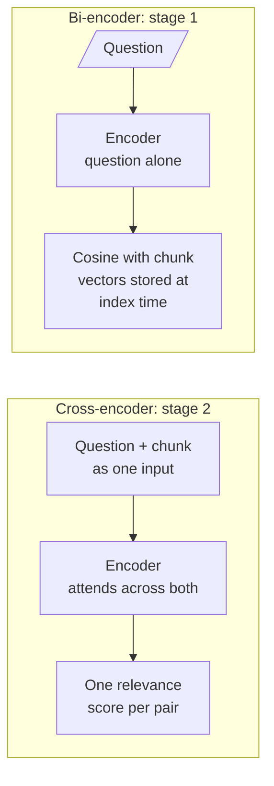
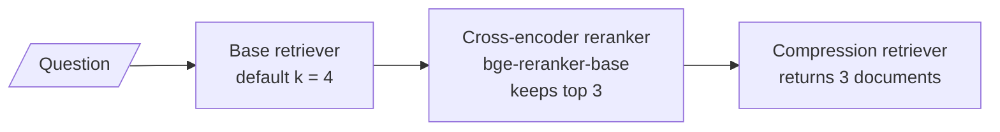
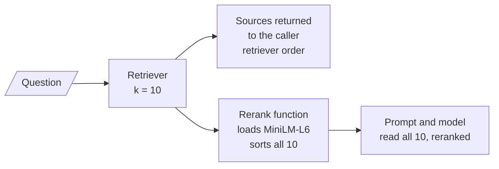

# M18.2 Theory: Cross-encoder reranking in a RAG chain

*[M18 theory](../README.md) · Lesson 18.2 · Notebooks: [`02a_cross_encoder_reranking.ipynb`](../../notebook/02a_cross_encoder_reranking.ipynb), [`02b_reranking_cross_encoder_walkthrough.ipynb`](../../../optional/notebook/02b_reranking_cross_encoder_walkthrough.ipynb) (optional) · [All theory pages](../../../../../THEORY.md)*
<!-- subtitle: Read the question and the chunk together, and a near miss stops looking like an answer -->
<!-- format: approved -->

## Bi-encoder vs cross-encoder

> **What you'll learn**
>
> - **Explain** why reading question and chunk together judges relevance better than comparing two vectors.
> - **Trace** the Larkspur export question as a cross-encoder demotes a distractor that shares its words.
> - **Place** a reranker in a LangChain chain as a document compressor.
> - **Diagnose** three production mistakes: a tiny candidate list, a model loaded per question, and a threshold on uncalibrated scores.

Lesson 18.1 treated the reranker as a box that lifts evidence from rank 9 to rank 3. This lesson opens it. Both stages read text with a transformer encoder; they differ in what goes into the encoder together:

*Figure 1: A bi-encoder encodes each text alone; a cross-encoder encodes the pair.*

A **bi-encoder** turns the question and each chunk into vectors separately and compares them with cosine similarity. The chunk vectors are computed once, when the index is built. Answering a question then costs one embedding and a nearest-neighbour search however large the index is. `all-MiniLM-L6-v2`, the first stage in lesson 18.1, has about 22M parameters and 384-dimensional vectors.

The price is that each chunk is summarised into one vector before any question exists, and that one vector serves every question. We call the result a **near miss**: a chunk that shares the question's words and not its answer.

A **cross-encoder** reads the question and one chunk as a single input. Every question token can attend to every chunk token, and the model outputs one relevance score. Nothing can be computed ahead of time, because the input depends on the question: scoring 50 candidates means 50 forward passes. That is why it runs only on the short list.

## The near miss, traced

*Can I export my data after I cancel my plan?* has a near miss in the lab's handbook: the `cancel` chunk ("You can cancel any plan from the Billing page. Cancelling stops the next charge…") shares "cancel" and "plan" with the question and says nothing about data. Here are the bi-encoder's top five and what the larger cross-encoder makes of them:

| Chunk | Bi-encoder similarity (rank) | Cross-encoder score (rank) | Evidence |
|---|---|---|---|
| `retention` | 0.817 (1) | 0.993 (1) | ✓ |
| `cancel-access` | 0.628 (2) | 0.907 (2) | ✓ |
| `cancel` | 0.561 (3) | 0.001 (5) | |
| `refund-monthly` | 0.502 (4) | 0.0001 (7) | |
| `export` | 0.479 (5) | 0.064 (3) | ✓ |

*Table 1: The export question's top five, before and after `BAAI/bge-reranker-v2-m3` over 10 candidates (the module's rerank precision lab).*

The bi-encoder puts `cancel` 3rd on shared vocabulary. The cross-encoder gives it 0.001 and lifts `export`, which says how to download the data, into 3rd place. Precision@5 is 0.60 either way here: `export` was already 5th. The change is that the top 3 is now all evidence.

The two models compare like this:

| | Bi-encoder | Cross-encoder |
|---|---|---|
| Input | Question or chunk, alone | Question and chunk together |
| Output | A vector | A relevance score |
| Work at index time | Embed every chunk once | None |
| Work per question | One embedding, one index search | One forward pass per candidate |
| Used for | Stage 1 over the whole index | Stage 2 over the candidates |
| In these notebooks | `all-MiniLM-L6-v2`, OpenAI embeddings | `BAAI/bge-reranker-base`, `ms-marco-MiniLM-L-6-v2`; Cohere's hosted reranker in 18.6 |

*Table 2: Bi-encoder against cross-encoder.*

## Wiring it into a chain

The two notebooks put the cross-encoder into a chain in different ways.

**`02a` uses LangChain's wrapper.** A Hugging Face cross-encoder loads `BAAI/bge-reranker-base`, a cross-encoder reranker scores the candidates and keeps the top 3, and a contextual compression retriever runs it after the base retriever. In LangChain a reranker is a **document compressor**: it takes the retrieved documents and the question and returns fewer documents. Lesson 18.4 plugs an extractor into the same slot.

*Figure 2: Notebook `02a`. The reranker is a document compressor inside one retriever: every caller gets the cut list.*

**`02b` writes the step by hand.** It builds question-and-chunk pairs, scores the whole list in one call, sorts by score and inserts the result into the chain as a plain function that rewrites the context before the prompt.

*Figure 3: Notebook `02b`. The rerank happens inside the answer branch. The sources the chain returns are the retriever's list, not what the model read.*

The same question through each wiring changes what the model reads and what the caller can audit:

Choose a wiring and compare what each part of the chain sees.

<button type="button" data-mode="wrapper" aria-pressed="false" aria-controls="wire-wrapper">02a: compressor wrapper</button>
<button type="button" data-mode="function" aria-pressed="false" aria-controls="wire-function">02b: hand-written function</button>

<section id="wire-wrapper" class="mode-panel" data-announcement="Compressor wrapper selected. The model reads 3 of 4."><h4>02a: compressor wrapper</h4><dl><dt>Candidates scored</dt><dd>4, LangChain's default</dd><dt>Model reads</dt><dd>the top 3, reranked</dd><dt>Caller sees</dt><dd>the same 3 documents</dd><dt>Model loads</dt><dd>once, when the reranker is built</dd></dl></section>
<section id="wire-function" class="mode-panel" data-announcement="Hand-written function selected. The model reads all 10."><h4>02b: hand-written function</h4><dl><dt>Candidates scored</dt><dd>10, in one batch</dd><dt>Model reads</dt><dd>all 10, reranked, no cut</dd><dt>Caller sees</dt><dd>the retriever's 10 in their original order</dd><dt>Model loads</dt><dd>on every question, inside the function</dd></dl></section>

Neither is wrong as a teaching step. Each needs one change before production, and the table below names it.

Three details in that code matter in production:

| Mistake | Where | Effect | Fix |
|---|---|---|---|
| **Token rerank** | `02a` keeps LangChain's default `k` for the base retriever | The reranker picks 3 from a list barely longer than 3 | Raise the base retriever's `k` to where stage-1 recall flattens (18.1) |
| **Per-question load** | `02b` creates the cross-encoder inside its rerank function | The model loads again on every question | Load it once at start-up |
| **Reorder without a cut** | `02b`'s chain version returns all 10 reranked chunks | The step reorders but never narrows | Slice to the top few, as `02b`'s earlier cell does with the first two |

*Table 3: Three wiring mistakes in the notebooks, and their fixes. A fourth sits in Figure 3: log the reranked list as the sources, not the retriever's.*

## Scores rank; they do not measure

Look at the raw scores for the same export question from the two lab rerankers. The larger model gives `retention` 0.993 and `cancel` 0.001; the smaller one gives them 7.769 and minus 0.964. One outputs something like a probability, the other an unbounded logit. Both put the chunks in nearly the same order.

Cross-encoder scores rank the candidates for one question. Nothing guarantees that a score means the same thing across questions or across models. The 18.6 notebook notes that Cohere's reranker returns values "very close to 0 or 1" and spreads them with a beta transform before using them.

> **Pitfall: a fixed threshold on reranker scores.** A cut at 0.5 means something for the larger lab model and nothing for the smaller. Before you drop chunks below a score, check the score distribution on your golden set, for the exact model you run.

## In practice: a cross-encoder for Larkspur

1. **Rerank 20 candidates** from the hybrid first stage (M16), as lesson 18.1's depth curve suggested.
2. **Load the model once**, score all pairs in one batch, and keep the top 5.
3. **Rank, then cut by count**, not by a score threshold, until the golden set shows a threshold that holds.
4. **Log both ranks** for every cited chunk. The near misses the reranker demotes then show up in the logs.

Lesson 18.3 asks whether an LLM can do the same job better, and what it costs to ask.

## Limits

- **One question traced.** Table 1 is the export question from the lab's stored scores. The near-miss pattern is general; the exact scores belong to this handbook and these two models.
- **Notebook corpora differ.** `02a` and `02b` rerank their own sample documents, not the Larkspur handbook, and print no scores in the shipped notebooks.
- **Calibration is not tested here.** The page shows two scales disagreeing. It does not measure how a threshold behaves across questions for either model.

## References

1. Reimers and Gurevych, [Sentence-BERT: Sentence Embeddings using Siamese BERT-Networks](https://arxiv.org/abs/1908.10084), 2019.
2. Nogueira and Cho, [Passage Re-ranking with BERT](https://arxiv.org/abs/1901.04085), 2019.
3. Sentence Transformers, [Cross-Encoders](https://www.sbert.net/examples/cross_encoder/applications/README.html).
4. BAAI, [bge-reranker-base model card](https://huggingface.co/BAAI/bge-reranker-base).

## Key Takeaways

- A bi-encoder embeds chunks once and scales to the whole index; a cross-encoder reads question and chunk together and needs one forward pass per candidate, so it runs on the short list.
- Reading the pair demotes near misses: for the export question the `cancel` chunk drops from bi-encoder rank 3 to cross-encoder 0.001, and `export` rises to 3rd.
- In LangChain a reranker is a document compressor. Raise the base `k`, load the model once, cut to the top few, and never reuse a score threshold across models.

## Check yourself

1. For the export question, why does the bi-encoder rank the cancel chunk 3rd while the cross-encoder gives it 0.001?

The bi-encoder summarises `cancel` into one vector before any question exists, and that vector sits near the question because both mention cancelling a plan. The cross-encoder reads the question and the chunk as one input and can see that the chunk says nothing about data, so it scores it near zero and lifts `export` instead.

2. Notebook 02b's rerank step is slow on every question and passes all 10 chunks to the model. What two changes fix it?

Load the cross-encoder once at start-up instead of inside the rerank function, where it loads again on every question. Then slice the sorted list to the top few, so the step narrows as well as reorders.

3. A teammate drops every chunk with a reranker score below 0.5, then swaps in a smaller cross-encoder. What breaks, and what should they do instead?

The two lab rerankers score on different scales: the larger one outputs values like 0.993 and 0.001, the smaller one logits like 7.769 and minus 0.964. A 0.5 cut means something for one and nothing for the other. Cut by count, or set any threshold from the score distribution of the exact model on the golden set.

---
*Previous: [18.1 Two-stage retrieval: retrieve wide, rerank narrow](../01_two_stage_retrieval_retrieve_wide_rerank_narrow/README.md). Next: [18.3 LLM reranking vs cross-encoder reranking](../03_llm_reranking_vs_cross_encoder_reranking/README.md).*
