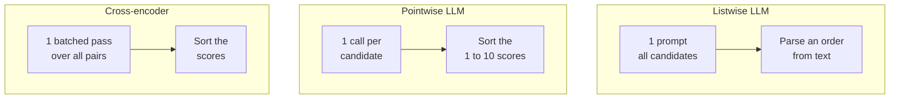
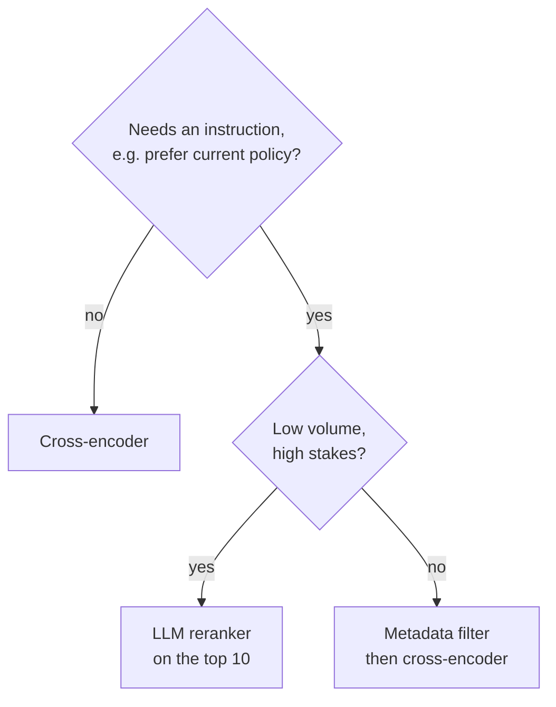

# M18.3 Theory: LLM reranking vs cross-encoder reranking

*[M18 theory](../README.md) · Lesson 18.3 · Notebooks: [`03a_reranking_methods.ipynb`](../../notebook/03a_reranking_methods.ipynb) · [All theory pages](../../../../../THEORY.md)*
<!-- subtitle: An LLM can follow instructions a cross-encoder cannot, at a price paid per candidate -->
<!-- format: approved -->

## LLM reranker or cross-encoder

> **What you'll learn**
>
> - **Compare** listwise LLM, pointwise LLM and cross-encoder reranking by calls, output and failure.
> - **Diagnose** three LLM reranking failures: the silent drop, score ties and serial latency.
> - **Do** the arithmetic on calls and ties for a candidate list of 15.
> - **Choose** a reranker for Larkspur by traffic and stakes.

Lesson 18.2 showed a cross-encoder demoting a near miss by reading question and chunk together. An LLM reads them together too, and it can also follow an instruction. Larkspur's handbook holds an archived refund policy alongside the current one; "prefer the current policy" is an instruction no cross-encoder can take.

An LLM can rerank in two ways, and this module shows both:

- **Listwise**: one prompt holds every numbered candidate and asks for their indices from most to least relevant. Notebook `01a` does this with eight candidates.
- **Pointwise**: one call per candidate rates it on a scale of 1 to 10, read back through structured output; the scores are then sorted. Notebook `03a` does this with `gpt-4o` at temperature 0 and keeps the top 3. Its schema declares the score a `float`. Nothing forces whole numbers; the prompt's 1-to-10 scale invites them.

Here is how the three rerankers spend their calls on one question:

*Figure 1: Three ways to rerank one candidate list.*

`03a` also builds a cross-encoder retriever that retrieves 10 chunks and keeps 5, after one batched scoring call over the 10 pairs with `ms-marco-MiniLM-L-6-v2`. The three compare like this:

| | Listwise LLM (`01a`) | Pointwise LLM (`03a`) | Cross-encoder (`02a`, `03a`) |
|---|---|---|---|
| Calls per question | 1, holding every candidate | 1 per candidate: 15 in the example, up to 30 in `03a`'s custom retriever | 1 batched pass over all pairs |
| Runs on | A hosted LLM | A hosted LLM | Your own CPU or GPU |
| Output | Text to parse into an order | A score from 1 to 10 per chunk | A score per pair |
| Sees other candidates | Yes | No | No |
| Fails by | Dropping or repeating indices | Ties, slow sequential calls | Truncating chunks longer than its input limit |

*Table 1: Three rerankers compared.*

The same 15 candidates for one Larkspur question, through each reranker:

Choose a reranker and compare what it spends and how it can fail on 15 candidates.

<button type="button" data-mode="listwise" aria-pressed="false" aria-controls="kind-listwise">Listwise LLM</button>
<button type="button" data-mode="pointwise" aria-pressed="false" aria-controls="kind-pointwise">Pointwise LLM</button>
<button type="button" data-mode="cross" aria-pressed="false" aria-controls="kind-cross">Cross-encoder</button>

<section id="kind-listwise" class="mode-panel" data-announcement="Listwise selected. One call, risk of a silent drop."><h4>Listwise LLM</h4><dl><dt>Calls</dt><dd>1 prompt holding all 15</dd><dt>Result</dt><dd>a text list of indices to parse</dd><dt>Can follow</dt><dd>an instruction such as "prefer the current policy"</dd><dt>Watch for</dt><dd>an index left out or repeated; the chunk vanishes without an error</dd></dl></section>
<section id="kind-pointwise" class="mode-panel" data-announcement="Pointwise selected. Fifteen calls and score ties."><h4>Pointwise LLM</h4><dl><dt>Calls</dt><dd>15, one after another in <code>03a</code></dd><dt>Result</dt><dd>one score per chunk, sorted</dd><dt>Can follow</dt><dd>an instruction, but sees one chunk at a time</dd><dt>Watch for</dt><dd>at least 6 of 15 sharing a whole-number score; ties keep stage-1 order</dd></dl></section>
<section id="kind-cross" class="mode-panel" data-announcement="Cross-encoder selected. One batched pass, no instructions."><h4>Cross-encoder</h4><dl><dt>Calls</dt><dd>1 batched pass over 15 pairs on your own hardware</dd><dt>Result</dt><dd>a real-valued score per pair, ties unlikely</dd><dt>Can follow</dt><dd>no instruction; it scores relevance only</dd><dt>Watch for</dt><dd>chunks longer than its input limit, truncated before scoring</dd></dl></section>

## How each one fails

Each failure in Table 1's last row shows up in the notebook code.

**The silent drop.** `01a`'s parser keeps only the tokens that are digits and rebuilds the list from them. A chunk the LLM leaves out of its answer disappears from the result, and nothing reports it. Check that the returned indices are a permutation of the inputs, and append any missing ones at the end.

**Score ties.** Fifteen candidates scored in whole numbers from 1 to 10 cannot all differ. There are only ten values: at most nine candidates can hold a score alone, and at least six share theirs with another candidate. In practice an LLM uses fewer than ten values, and the ties grow. The sort keeps tied chunks in their stage-1 order: the reranker decides less than it appears to.

**Serial latency.** The pointwise loop calls the model once per document, one after another. Its `try`/`except` for a score that will not parse never fires: structured output either returns a number or raises inside the call. The arithmetic, with an assumed 1 second per call:

| Candidates | Sequential calls | Wall-clock, sequential | Wall-clock, 10 in parallel |
|---|---|---|---|
| 15 | 15 | about 15 s | about 2 s |
| 30 | 30 | about 30 s | about 3 s |

*Table 2: Pointwise LLM reranking latency (illustrative: assumes 1 s per call and no rate limits).*

Parallel calls fix the latency, not the cost: 30 calls are billed as 30 whichever way they run.

> **Pitfall: the silent drop.** Any reranker whose output is parsed from text can lose candidates without an error. Assert that every input index comes back exactly once.

`03a`'s last example builds a corpus of five chunks to show why reranking helps. Three are short sentences that repeat the question's words without naming the city ("The capital of France is great."), and two are longer passages about visiting Paris. It prints the top 2 by plain similarity next to the top 2 from the LLM reranker. The notebook ships without outputs. The comparison has to be run to be read, and this page quotes no result from it.

## Choosing for Larkspur

The choice comes down to traffic and stakes:

*Figure 2: Default to a cross-encoder; pay for an LLM only when an instruction matters and traffic is low.*

A cross-encoder runs locally with no per-call fee and no parsing step to fail. It is the default second stage. An LLM reranker earns its cost on low-volume, high-stakes questions where it can follow an instruction. A middle path is to let the cross-encoder cut 50 candidates to 10 and the LLM order the last 10.

The archived-policy problem has a cheaper answer than either. A `version` filter before ranking (lesson 16.5) removes the old policy outright. No reranker has to be told to prefer the new one.

## In practice: Larkspur's second stage

1. **Cross-encoder by default**, over 20 hybrid candidates, as lessons 18.1 and 18.2 set up.
2. **Version filter before ranking**: instructions about freshness are then not needed.
3. **LLM reranker for escalations only**: billing disputes routed to a human-review queue, a few dozen a day, on the cross-encoder's top 10.
4. **Compare on precision@5 and p95 latency together** on the golden set; a reranker that wins on one and loses badly on the other does not ship.

Ranking decides which chunks reach the prompt. Lesson 18.4 decides how much of each one does.

## Limits

- **No measured comparison.** The notebooks run on different corpora and ship without outputs. This page compares the rerankers by their mechanics and arithmetic, not by a precision result.
- **Latency is assumed.** Table 2 uses 1 second per call. Real latency depends on the model, the provider and rate limits.
- **Ties depend on the model's habits.** The pigeonhole bound assumes whole-number answers. A model that returns decimals ties less often.

## References

1. Sun et al., [Is ChatGPT Good at Search? Investigating Large Language Models as Re-Ranking Agents](https://arxiv.org/abs/2304.09542), 2023.
2. Nogueira and Cho, [Passage Re-ranking with BERT](https://arxiv.org/abs/1901.04085), 2019.
3. LangChain, [Structured output](https://docs.langchain.com/oss/python/langchain/structured-output).
4. Sentence Transformers, [Cross-Encoders](https://www.sbert.net/examples/cross_encoder/applications/README.html).

## Key Takeaways

- A listwise LLM sends every candidate in one prompt, a pointwise LLM rates each chunk in its own call, and a cross-encoder scores all pairs in one batched pass on your own hardware.
- Listwise parsing can drop candidates silently, pointwise scores tie (15 candidates on a 10-point scale must share values) and add a call per candidate, and cross-encoders truncate long chunks.
- Default to a cross-encoder; use an LLM reranker for low-volume, high-stakes questions that need an instruction, and filter stale versions out before either.

## Check yourself

1. A listwise LLM reranker returns its order as text, and one chunk never appears in the final list. What happened, and what check prevents it?

The silent drop: the parser rebuilds the list only from the indices the model wrote, so a chunk the model left out disappears without an error. Assert that the returned indices are a permutation of the inputs, and append any missing ones at the end.

2. A pointwise LLM reranker scores 15 candidates in whole numbers from 1 to 10. Why must some tie, and what decides their order?

There are only ten possible values for fifteen candidates, so at least six share their score with another, and an LLM usually uses fewer values. The sort is stable, so tied chunks keep their stage-1 order: the reranker decides less than it appears to.

3. Larkspur wants the reranker to prefer the current refund policy over an archived copy. Which tool do you reach for first?

A `version` metadata filter before ranking. It removes the archived copy outright, so no reranker has to be instructed. Only if a real instruction remains, on low-volume, high-stakes traffic, does an LLM reranker over the cross-encoder's top 10 earn its per-call cost.

---
*Previous: [18.2 Cross-encoder reranking in a RAG chain](../02_cross_encoder_reranking_in_a_rag_chain/README.md). Next: [18.4 Contextual compression](../04_contextual_compression/README.md).*
