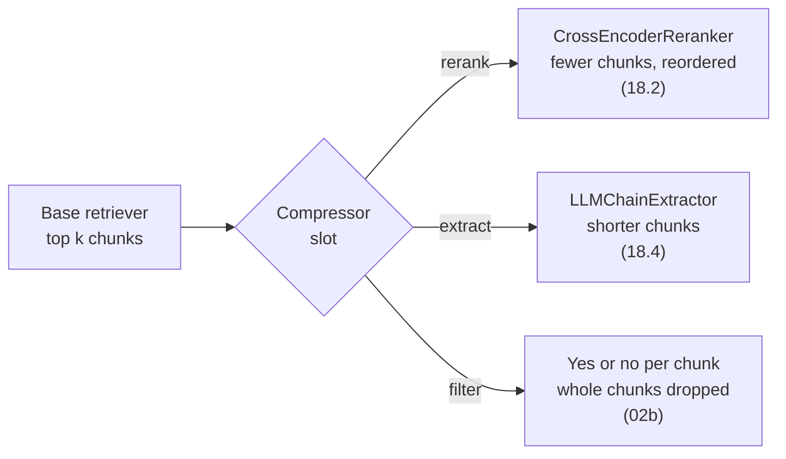

# M18.4 Theory: Contextual compression

*[M18 theory](../README.md) · Lesson 18.4 · Notebooks: [`04a_contextual_compression.ipynb`](../../notebook/04a_contextual_compression.ipynb) · [All theory pages](../../../../../THEORY.md)*
<!-- subtitle: Every step after retrieval saves or spends one budget, and compression saves it by trusting an LLM with the source -->

## Context budget

> **What you'll learn**
>
> - **Explain** the context budget and which post-retrieval steps save or spend it.
> - **Trace** a chunk through an extractor, and see the compressor slot that rerankers and filters share.
> - **Diagnose** a compressed chunk that lost the condition on a rule.
> - **Plan** saving and spending together for one Larkspur pipeline.

Lessons 18.1 to 18.3 decided which chunks reach the prompt. Each one still arrives whole, and most of a chunk is usually not about the question.

The **context budget** is the share of each prompt that retrieved text may take. Four things set it: the model's context window, the cost of input tokens, the latency of reading them, and the position effect from lesson 18.1, which makes a long context less reliable than a short one.

Every step after retrieval either saves from that budget or spends it:

| Step | Lesson | Effect on the budget | What it costs |
|---|---|---|---|
| Cut to the top few after reranking | 18.1 to 18.3 | Saves: fewer chunks | Rerank latency |
| Drop chunks that do not answer | `02b` (optional) | Saves: whole chunks | One LLM call per chunk |
| Extract the relevant sentences | 18.4 | Saves: shorter chunks | One LLM call per chunk |
| Add the neighbouring chunks | 18.5 | Spends: 800 characters per hit at `05a`'s settings, twice the chunk | A lookup per neighbour |
| Rebuild contiguous segments | 18.6 | Spends: up to 30 chunks of 800 characters, 24,000 characters, at `06a`'s settings | A reranker pass over the document's chunks |

*Table 1: Post-retrieval steps and the budget.*

Saving and spending go together. Here is one budget of 4,000 characters of retrieved text, spent three ways (*Illustrative*, using `05a`'s split of 400-character chunks with 200 of overlap):

| Plan | Hits kept | Characters per hit | Total |
|---|---|---|---|
| Plain chunks | 10 | 400 | 4,000 |
| Each hit with both neighbours (18.5) | 5 | 800 | 4,000 |
| Each hit compressed to its relevant sentence | about 30 | about 130 | about 4,000 |

*Table 2: One budget, three shapes (illustrative).*

A pipeline that expands each hit to its neighbours can afford it by keeping five hits instead of ten. One that compresses each chunk can keep many more, if it trusts the compressor.

## Extraction

**Contextual compression** cuts each retrieved chunk down to the parts that bear on the question. Notebook `04a` uses an LLM chain extractor, wrapping a small chat model at temperature 0, inside the contextual compression retriever, the same wrapper lesson 18.2 used for the cross-encoder. For each retrieved chunk the extractor asks the LLM to copy out only the relevant parts; a chunk with nothing relevant comes back empty and is dropped. A question-answering chain then answers from what is left.

All three post-retrieval moves fill the same slot:

*Figure 1: The compressor slot. The retriever and the chain stay the same whichever compressor fills it.*

Here is what extraction does to one Larkspur chunk for *How long does a refund take?*:

| | Text |
|---|---|
| Retrieved chunk (`refund-timing`) | Refunds go back to the original payment method and take 5 to 10 business days to appear on your statement. |
| Extracted | take 5 to 10 business days to appear on your statement |

*Table 3: Extraction keeps the answer and drops the rest (illustrative extraction).*

## Where compression lies

Compression has the same risk as M12's propositions: an LLM sits between the source and the prompt. Ask *Can I get a full refund on my annual plan?* and the `refund-window` chunk comes back. Two extractions are plausible:

| Extraction | Kept | Answer the model gives |
|---|---|---|
| Faithful | "An annual plan can get a full refund within 30 days of purchase if the account used less than 100 GB of outbound traffic." | Yes, within 30 days and under 100 GB |
| Lossy | "An annual plan can get a full refund within 30 days of purchase" | Yes, within 30 days |

*Table 4: A planted lossy extraction (illustrative).*

The lossy version reads as more relevant, because the traffic condition looks like detail. We call this the **dropped qualifier**: the extractor keeps the rule and removes the condition that limits it, and the model gives a confident wrong answer to a customer who used 400 GB.

> **Pitfall: the dropped qualifier.** Check compressed context for faithfulness on golden questions whose answers carry conditions, and keep each chunk's id so the citation points at the full source text, not the extract.

Filtering has a simpler failure. The optional `02b` notebook asks a small model whether each chunk suits the question and keeps it only if the reply equals the string "True" exactly. A reply of "True." with a full stop drops the chunk. We call this **string-match judging**. Ask for structured output, as lesson 18.3's pointwise reranker does, instead of matching text.

## In practice: spending Larkspur's budget

1. **Rerank and cut to 5** before any compression; never pay an LLM call per chunk on 50 candidates.
2. **Compress only long chunks.** Larkspur's handbook chunks are one or two sentences, so extraction saves little and risks the dropped qualifier; it pays on long policy pages.
3. **Keep chunk ids through compression**, and cite the full chunk.
4. **Add a golden question with a condition** (the 100 GB limit) and check the answer states it.

Compression shrinks a chunk to fit. Lesson 18.5 does the opposite, for answers that run past a chunk's edge.

## Key Takeaways

- Every step after retrieval saves or spends one context budget. Plan them together: expanding each hit means keeping fewer hits, and compressing each chunk lets you keep more.
- An extractor copies out only the relevant parts of each chunk at one LLM call per chunk, and drops chunks with nothing relevant; rerankers, extractors and filters all fill the same compressor slot.
- An extractor can drop the condition that limits a rule (the dropped qualifier). Check compressed context for faithfulness, keep chunk ids for citations, and judge filters with structured output, not string matches.

## Check yourself

1. A pipeline expands every hit to its two neighbours. What must change elsewhere to stay within the same context budget?

It must keep fewer hits. At `05a`'s split of 400 characters with 200 of overlap, each window is 800 characters, twice a chunk, so a budget that held ten plain chunks holds five windows. Saving and spending are planned together: cut harder after reranking, or compress, to pay for the expansion.

2. An extractor turns the refund-window chunk into "An annual plan can get a full refund within 30 days of purchase". What went wrong, and how would you catch it?

The dropped qualifier: the extract kept the rule and removed its condition, "if the account used less than 100 GB of outbound traffic", so a customer over the limit gets a confident wrong yes. Catch it with golden questions whose answers carry conditions, checked for faithfulness, and cite the full chunk by id.

3. A relevance filter keeps a chunk only when the model replies "True", and good chunks keep vanishing. Why, and what is the fix?

String-match judging: a reply of "True." or "true" fails the exact comparison and the chunk is dropped. Ask the model for structured output, a boolean or a score in a schema, so the judgement does not depend on how the model punctuates.

---
*Previous: [18.3 LLM reranking vs cross-encoder reranking](../03_llm_reranking_vs_cross_encoder_reranking/README.md). Next: [18.5 Context enrichment windows](../05_context_enrichment_windows/README.md).*
