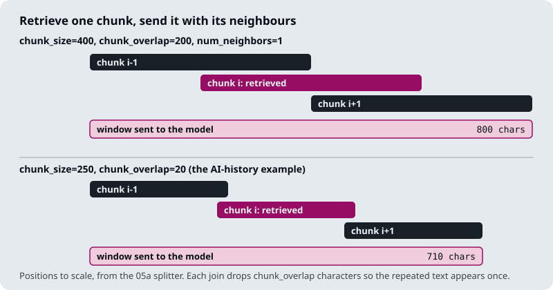

# M18.5 Theory: Context enrichment windows

*[M18 theory](../README.md) · Lesson 18.5 · Notebooks: [`05a_context_enrichment_window.ipynb`](../../notebook/05a_context_enrichment_window.ipynb) · [All theory pages](../../../../../THEORY.md)*
<!-- subtitle: Retrieve with small chunks, answer with the passage around them -->

## Enrichment windows

> **What you'll learn**
>
> - **Explain** how an enrichment window keeps small chunks' precision and large chunks' completeness.
> - **Compute** a window's length from the chunk size and overlap.
> - **Trace** a Larkspur rule cut across a chunk boundary, and the window that rejoins it.
> - **Diagnose** four demo shortcuts that break in production.

Lesson 18.4 shrank chunks to save budget. Sometimes the chunk is already too small: the answer starts in one chunk and ends in the next.

Larkspur's refund rule shows it. M12's 300-character split ends chunk 2 of the refund section at "used less than" and starts chunk 3 with the 100 GB condition. A question about refunds on annual plans retrieves chunk 2, the reranker rightly puts it first, and the model reads a rule with its condition missing. We call this the **boundary cut**: the ranking is right and the unit of context is too small.

Small chunks retrieve precisely and large chunks answer completely (M12). An **enrichment window** keeps both: index small chunks, and when one is retrieved, send it to the model together with the chunks on either side of it.

Notebook `05a` splits the text into fixed-size character chunks and stores each chunk's position in its metadata. The retriever returns one chunk. A window function then fetches the chunks one position before and after it, sorts the three by position and joins them, dropping the overlap at each join so repeated text appears once:

*Figure 1: One retrieved chunk and its two neighbours, joined into a window.*

## How long a window is

Neighbouring chunks start `chunk_size - chunk_overlap` characters apart, so a window of three chunks covers `2 × (chunk_size - chunk_overlap) + chunk_size` characters. `05a` runs two examples:

| Example in `05a` | Split (size / overlap) | Retrieved chunk | Window | Growth |
|---|---|---|---|---|
| Climate change PDF | 400 / 200 | 400 characters | 800 characters | 2× |
| AI-history passage, *When did deep learning become prominent in AI?* | 250 / 20 | 250 characters | 710 characters | 2.84× |

*Table 1: Window length at two splits.*

The more the chunks already overlap, the less a neighbour adds. Either way the growth comes out of the context budget from lesson 18.4, so a pipeline that widens each hit usually keeps fewer hits.

For Larkspur's refund section at M12's 300-character split, the window around chunk 2 holds chunks 1 to 3, so the 100 GB condition at the start of chunk 3 arrives with the rule it limits.

Here is the same question with and without the window:

| Context sent | Contains the 100 GB condition? | Answer to a customer who used 400 GB |
|---|---|---|
| Chunk 2 alone | ✗ | Yes, a full refund within 30 days |
| Window, chunks 1 to 3 | ✓ | No: the account went over 100 GB |

*Table 2: The boundary cut, with and without a window (illustrative answers).*

## Where the demo breaks

`05a`'s helpers are written for a demo, and four of their shortcuts break in production:

| Shortcut in `05a` | What breaks | Fix |
|---|---|---|
| The join takes the overlap as its own argument | If it differs from the split's overlap, joins repeat or delete text; the AI-history call relies on a default that happens to match | Read the overlap from the split, never pass it twice |
| Fetching a neighbour scans the whole store with an empty search and a loop | Every lookup reads every chunk; the notebook calls it a simplified version | Keep chunk text in a key-value store keyed by document id and chunk index |
| Every chunk's metadata carries the full document text | The index holds one copy of the document per chunk | Store the text once, by document id |
| Chunk indexes restart per document | A window can join the end of one file to the start of another | Key every chunk by document id and index together |

*Table 3: Four demo shortcuts and their fixes.*

The last row has a second effect. Two hits next to each other produce overlapping windows, and the model reads the shared chunk twice. We call this **window overlap**. Merge adjacent windows into one passage; lesson 18.6 solves that problem in general, by choosing contiguous segments directly.

> **Interview tip:** an enrichment window is a fixed-size answer to a variable-size problem. It grows every hit by the same amount, whether the answer needs one neighbour, none or five.

## In practice: windows on the Larkspur handbook

1. **Key chunks by document id and index** at ingestion, in a key-value store beside the vector index.
2. **Window the top 3 hits**, one neighbour each side, and keep fewer hits to pay for them.
3. **Merge adjacent windows** before building the prompt.
4. **Add a boundary-cut golden question** (the 100 GB condition) so a change of splitter that moves the cut is caught.

Lesson 18.6 replaces the fixed window with a segment whose length the reranker's scores decide.

## Key Takeaways

- Index small chunks for precise retrieval, then send each hit with its neighbours so a rule cut across a boundary (the boundary cut) arrives whole.
- A three-chunk window covers `2 × (chunk_size - chunk_overlap) + chunk_size` characters: 800 at a 400 / 200 split, 710 at 250 / 20. The growth comes out of the context budget.
- Join with the split's own overlap, key chunks by document id and chunk index, and merge windows from adjacent hits.

## Check yourself

1. The reranker puts Larkspur's refund chunk 2 first, yet the answer omits the 100 GB condition. What is wrong, and what fixes it?

The boundary cut: M12's 300-character split ends chunk 2 at "used less than" and puts the condition in chunk 3. The ranking is right and the unit of context is too small. An enrichment window sends chunk 2 with its neighbours, chunks 1 and 3, so the rule arrives whole.

2. How long is a one-neighbour window at a split of 400 characters with 200 overlap, and at 250 with 20?

`2 × (chunk_size - chunk_overlap) + chunk_size`: 800 characters at 400 / 200 (twice the chunk) and 710 at 250 / 20 (2.84 times). The more the chunks already overlap, the less each neighbour adds.

3. A multi-document index sometimes returns windows that join the end of one file to the start of another. Why?

Chunk indexes restart per document, and the window looks neighbours up by index alone, so index 0 of the next file sits beside the last index of this one. Key every chunk by document id and index together, in a key-value store, and look neighbours up within the same document.

---
*Previous: [18.4 Contextual compression](../04_contextual_compression/README.md). Next: [18.6 Relevant segment extraction](../../../optional/theory/06_relevant_segment_extraction/README.md).*
