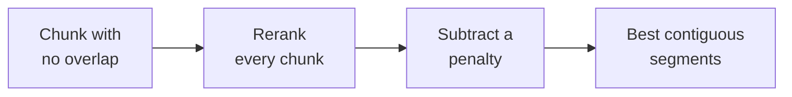
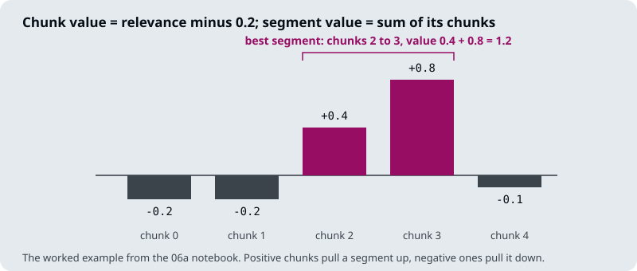

# M18.6 Theory: Relevant segment extraction

*[M18 theory](../../../mandatory/theory/README.md) · Lesson 18.6 · Notebooks: [`06a_relevant_segment_extraction.ipynb`](../../notebook/06a_relevant_segment_extraction.ipynb) (optional) · [All theory pages](../../../../../THEORY.md)*
<!-- subtitle: Let the reranker's scores decide how much contiguous text to send, instead of a fixed window -->

## Relevant segment extraction

> **What you'll learn**
>
> - **Explain** why relevant chunks cluster inside their documents, and how RSE uses that.
> - **Trace** chunk values through a penalty to the best contiguous segment.
> - **Compute** the best segment for a short list of chunk values by hand.
> - **Judge** a reported benchmark gain that this course did not measure.

Lesson 18.5's window grows every hit by the same amount. A factoid answer needs no neighbours; a financial statement spread over a dozen chunks needs all of them. A fixed window serves neither well.

**Relevant segment extraction** (RSE) lets the reranker's scores decide how much to send. It rests on one observation from notebook `06a`: "relevant chunks tend to be clustered within their original documents". RSE finds those clusters and sends each as one contiguous segment, in document order, including chunks between two relevant ones that the reranker scored low.

`06a` runs it on Nike's 2023 annual report, in four steps:

*Figure 1: The RSE pipeline in `06a`.*

1. **Chunk with no overlap**: 800-character chunks, overlap 0. Without overlap, joining neighbouring chunks rebuilds the original text exactly.
2. **Score every chunk**: Cohere's hosted reranker scores each chunk against *Nike consolidated financial statements*. The scores bunch near 0 and 1, so a beta transform (both shape parameters 0.4) spreads them out, and each is multiplied by a decay on its rank (e to the minus rank over 30), so rank counts as well as score.
3. **Subtract a penalty**: 0.2 per chunk, which makes irrelevant chunks negative and relevant ones positive.
4. **Find the best segments**: a segment's value is the sum of its chunk values, so finding the best one is a constrained maximum-sum run.

## The best segment, by hand

`06a`'s worked example has five chunk values after the penalty:

*Figure 2: Five chunk values and the best segment.*

Checking each candidate run is quick arithmetic:

| Segment (chunks) | Sum | Note |
|---|---|---|
| 2 to 3 | 0.4 + 0.8 = 1.2 | Best |
| 2 to 4 | 1.2 - 0.1 = 1.1 | Adding chunk 4 subtracts |
| 1 to 3 | -0.2 + 1.2 = 1.0 | Adding chunk 1 subtracts |
| 3 alone | 0.8 | |
| 0 to 4 | 0.7 | The whole list |

*Table 1: Candidate segments for `06a`'s five values (chunks numbered from 0).*

The search returns chunks 2 to 3 with a value of 1.2. No other run of chunks outside it has a positive sum, so it stops after one segment.

On the full report the search runs by brute force under three limits: at most 20 chunks per segment, 30 chunks in total, and a minimum segment value of 0.7. It repeats until no segment clears the minimum. Only 7 of chunks 320 to 339 were marked relevant, yet chunks 323 to 333 all hold the consolidated financial statements; the first segment is 323 to 336. Top-k retrieval would have left out the low-scored chunks inside the cluster. We call that the **gapped cluster**: relevant text interrupted by chunks a reranker scores low on their own.

When only one chunk is relevant, there is no cluster to join, and RSE returns that chunk on its own. It behaves like top-k retrieval on factoid questions and like a large chunk on broad ones, without fixing the chunk size in advance.

## The reported gain

`06a` reports its authors' evaluation on their KITE benchmark: 50 questions across four document collections (AI papers, cloud-company 10-Ks, a company handbook and Supreme Court opinions), each answer graded 0 to 10 by an LLM. RSE is compared with top-k retrieval at `k = 20`, with the same Cohere reranker and the same generation model in both.

The average score rises from 4.72 with top-k to 6.73 with RSE. The notebook reports the context length as roughly equal in both configurations, so the gain does not come from sending more text.

> **Pitfall: quoting a benchmark you did not run.** These are the authors' numbers on their benchmark, not a measurement in this course. The notebook's per-dataset table also does not add up to its averages (two cells read 45.5 and 45.4 on a 0 to 10 scale), so only the averages are quoted here. Measure RSE on your own golden set before relying on it.

RSE spends the context budget from lesson 18.4 in a bounded way: at `06a`'s settings, at most 30 chunks of 800 characters, 24,000 characters in all.

## In practice: RSE on the Larkspur handbook

1. **Chunk each handbook section with no overlap**, so segments rebuild the text exactly.
2. **Cap segment length at a section's chunk count**: Larkspur's sections are short, so 20 chunks per segment would span several topics.
3. **Cap the total** to what the generation prompt holds after the instructions.
4. **Compare with lesson 18.5's windows** on the golden set; on a handbook of one-sentence rules, the two may send the same text.

## Key Takeaways

- Relevant chunks cluster within their documents. RSE subtracts a penalty from each chunk's reranker value and sends the contiguous runs with the highest sums, including low-scored chunks inside a cluster (the gapped cluster).
- Chunk with no overlap, so joined neighbours rebuild the original text exactly. RSE then acts like top-k on factoid questions and like a large chunk on broad ones.
- The KITE gain (average 4.72 to 6.73) is the authors' number, not a course measurement. Cap segment length and total chunks to fit your prompt.

## Check yourself

1. Chunk values after the penalty are -0.2, -0.2, 0.4, 0.8 and -0.1. Which segment does RSE return, and why does it not extend to chunk 4?

Chunks 2 to 3, with a value of 0.4 + 0.8 = 1.2. Extending to chunk 4 adds -0.1 and lowers the sum to 1.1, and extending back to chunk 1 adds -0.2. No other run outside the segment has a positive sum, so the search stops after one segment.

2. Only 7 of the annual report's chunks 320 to 339 were marked relevant, yet RSE returns 323 to 336. Why include chunks the reranker scored low?

Relevant chunks cluster, and the consolidated financial statements run through chunks 323 to 333. Some chunks inside that run score low on their own, but a segment's value is the sum of its chunks, so a strong cluster carries them. Top-k would have dropped them and sent the statements with gaps.

3. Should Larkspur adopt RSE because KITE's average rose from 4.72 to 6.73?

Not on that basis. The scores are the authors' own, on their benchmark, graded by an LLM, and the notebook's per-dataset table does not even add up to its averages. Run RSE against the current pipeline on Larkspur's golden set, with segment caps sized to the handbook's short sections.

---
*Previous: [18.5 Context enrichment windows](../../../mandatory/theory/05_context_enrichment_windows/README.md). Next: [M18 interview questions](../../../mandatory/theory/README.md#interview-spotlight-5-questions-you-might-get-asked).*
