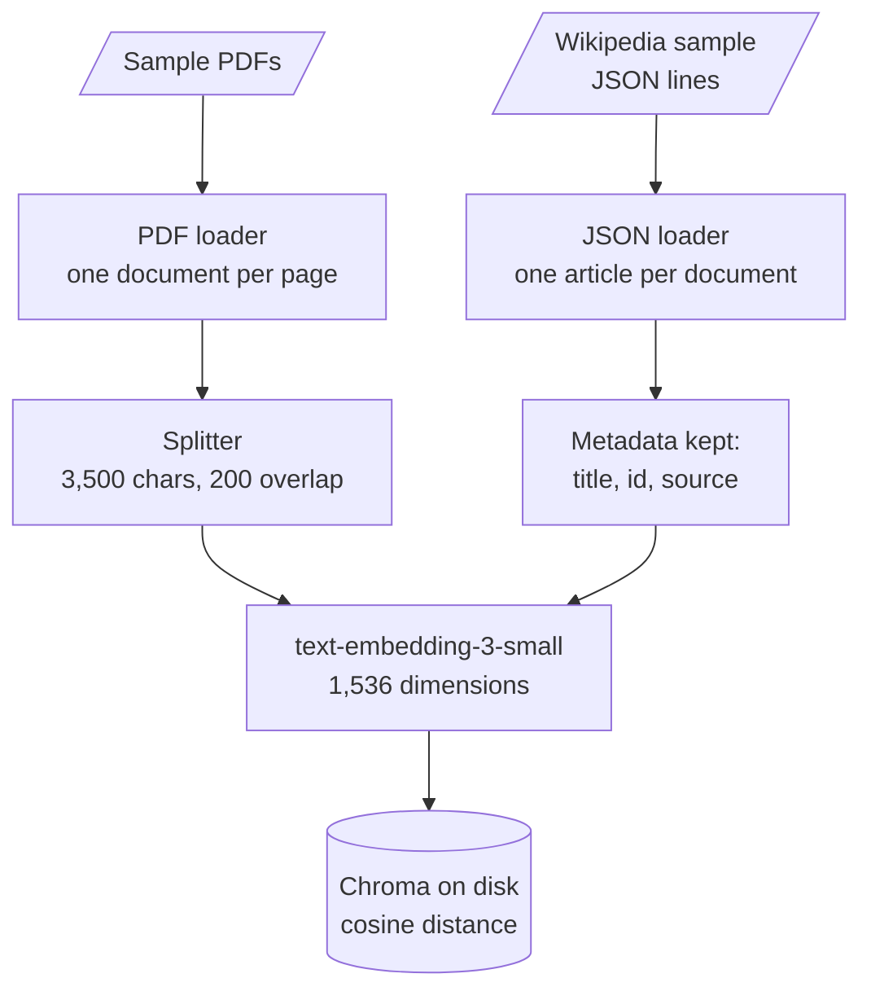
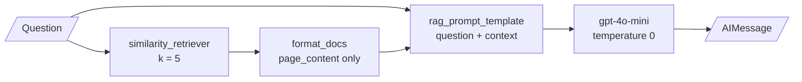

# M19.1 Theory: Environment setup and a complete RAG system

*[M19 theory](../README.md) · Lesson 19.1 · Notebooks: [`01a_setup.ipynb`](../../notebook/01a_setup.ipynb), [`01b_build_a_simple_rag_system.ipynb`](../../notebook/01b_build_a_simple_rag_system.ipynb), [`01c_simple_rag_pdf.ipynb`](../../../optional/notebook/01c_simple_rag_pdf.ipynb) (optional) · [All theory pages](../../../../../THEORY.md)*
<!-- subtitle: A grounded answer needs evidence, a limit and a way out, and a checkable one needs its sources kept -->
<!-- format: approved -->

## Grounded generation

> **What you'll learn**
>
> - **Trace** a complete RAG system from two kinds of source to an answer.
> - **Explain** the three parts of a grounded prompt and what each one prevents.
> - **Diagnose** a chain whose answers cannot be checked, and an embedding call that embeds characters.
> - **Test** grounding with questions the corpus cannot answer.

Lessons M16 to M18 made retrieval find more, rank better and fit the budget. M19 turns a retrieval pipeline into a system someone can rely on, and starts by building one end to end.

A Larkspur customer asks *Does Larkspur offer a free tier?* The handbook says nothing about one. A chain that retrieves five chunks and asks the model to "answer the question" gets a fluent reply anyway, drawn from what the model knows about other hosting providers. The answer reads as policy, and it is invented.

**Grounded generation** means the answer comes from evidence the system retrieved for this question, and the model is told to use nothing else. The rest of this page builds that system in two halves: an index built once, and a chain that runs per question.

## Building the index once

Notebook `01b` indexes two kinds of source into one store. Figure 1 shows the offline half: everything that happens before the first question arrives.

*Figure 1: The indexing half of `01b`. Articles stay whole; only the PDFs are split.*

Table 1 lists each stage with the choice the notebook makes.

| Stage | What `01b` does |
|---|---|
| Load | A JSON-lines loader reads a Wikipedia sample one article per document, keeping title, id and source as metadata; a PDF loader reads every PDF in a sample folder |
| Split | 3,500-character chunks with 200 of overlap for the PDFs; Wikipedia articles stay whole |
| Embed | `text-embedding-3-small`, 1,536 dimensions |
| Store | Chroma, persisted to disk, set to cosine distance; without that setting Chroma uses Euclidean distance ([M10.4](../../../../../p04_rag_foundations/m10_rag_lifecycle/mandatory/theory/04_your_first_langchain_rag_with_chroma/README.md#distance-not-similarity)) |
| Retrieve | Similarity search, `k = 5` |
| Generate | A small chat model at temperature 0, with a prompt that restricts it to the retrieved context |

*Table 1: The pipeline in `01b`.*

Persisting matters for the second half. The notebook reopens the store from disk with the same collection name and the same embedding model. A question asked tomorrow therefore lands in the same 1,536-dimension space as today's chunks.

## The chain that answers

The chain itself is three steps:

*Figure 2: The `01b` chain. The retrieved chunks become plain text inside the prompt.*

Grounding rests on three things, and `01b`'s prompt has all three:

| Part | `01b`'s wording | What it prevents |
|---|---|---|
| **Evidence for this question** | The five retrieved chunks | The model answering from the whole of its training |
| **A limit** | "Answer the following question using only the following pieces of retrieved context" | Blending in outside knowledge |
| **A way out** | "If the answer is not in the context, do not make up answers, just say that you don't know" | A forced answer when the evidence is missing |

*Table 2: The three parts of a grounded prompt.*

The third part is the one most often left out. Without a permitted refusal, a model asked about something the context lacks answers from what it learned in training. We call that an **ungrounded fill**: the free-tier answer above.

The comparison below sends the free-tier question through three versions of the prompt. Retrieval is identical in all three; only the instructions change (*Illustrative*: the expected behaviour of each prompt, not a recorded run).

Choose a prompt to see what the model is allowed to do with five chunks that say nothing about a free tier.

<button type="button" data-mode="bare" aria-pressed="false" aria-controls="prompt-bare">Question only</button><button type="button" data-mode="limit" aria-pressed="false" aria-controls="prompt-limit">Limit, no way out</button><button type="button" data-mode="full" aria-pressed="false" aria-controls="prompt-full">All three parts</button>

<section id="prompt-bare" class="mode-panel" data-announcement="Question only selected. The model fills the gap."><h4>Question only</h4><dl><dt>Prompt</dt><dd>the chunks and "answer the question"</dd><dt>What the model may use</dt><dd>the chunks and anything it learned in training</dd><dt>Likely answer</dt><dd>a confident free-tier description borrowed from other providers: an ungrounded fill</dd></dl></section>
<section id="prompt-limit" class="mode-panel" data-announcement="Limit without a way out selected. The model is cornered."><h4>Limit, no way out</h4><dl><dt>Prompt</dt><dd>"using only the following pieces of retrieved context"</dd><dt>What the model may use</dt><dd>the chunks, but it must still produce an answer</dd><dt>Likely answer</dt><dd>a stretched reading of the nearest chunk, such as the pricing page, presented as if it settled the question</dd></dl></section>
<section id="prompt-full" class="mode-panel" data-announcement="All three parts selected. The model may refuse."><h4>All three parts</h4><dl><dt>Prompt</dt><dd>the limit plus "just say that you don't know"</dd><dt>What the model may use</dt><dd>the chunks, with refusal as a permitted answer</dd><dt>Expected answer</dt><dd>"I don't know"; whether a given model complies is measured, not assumed</dd></dl></section>

Here is what grounding should produce on two Larkspur questions (*Illustrative*: expected answers, not a recorded run):

| Question | Retrieved evidence | Grounded answer |
|---|---|---|
| *Can I export my data after I cancel my plan?* | `export`, `retention` | Yes, within 30 days, from Settings, then Data |
| *Does Larkspur offer a free tier?* | Nothing relevant | I don't know |

*Table 3: Grounded answers, with and without evidence.*

Whether a given model complies is a property you test. Put questions with no answer in the golden set and count the refusals. The instruction does not guarantee compliance either: a model can still blend in outside knowledge or misread a chunk, and [M29](../../../../../p08_agentic_rag/m29_crag_and_self_rag/mandatory/theory/README.md) and [M32](../../../../../p08_agentic_rag/m32_reliability_feedback/mandatory/theory/README.md) add a second call that grades the answer against its evidence.

## What this chain throws away

`01b`'s formatting step joins the chunks' text and nothing else. The title, id and source in metadata never reach the model, and the chain returns only the model's message. The answer may be grounded, but nobody can check it: there is no list of chunks, and no way to say which one a sentence came from. We call this **formatted-away sources**.

The walkthrough follows the export question through the chain and marks where the evidence trail ends.

Step through one question to see what each stage receives and what it passes on.

<button type="button" data-step="0" aria-pressed="false" aria-controls="chain-step-0">1. Retrieve</button><button type="button" data-step="1" aria-pressed="false" aria-controls="chain-step-1">2. Format</button><button type="button" data-step="2" aria-pressed="false" aria-controls="chain-step-2">3. Prompt</button><button type="button" data-step="3" aria-pressed="false" aria-controls="chain-step-3">4. Generate</button><button type="button" data-step="4" aria-pressed="false" aria-controls="chain-step-4">5. Return</button>

<section id="chain-step-0" class="step-panel" aria-labelledby="chain-heading-0"><h4 id="chain-heading-0">1. Retrieve</h4><dl><dt>Input</dt><dd>the question, embedded once</dd><dt>Output</dt><dd>five documents, each with its text and its metadata (title, id, source)</dd></dl></section><section id="chain-step-1" class="step-panel" aria-labelledby="chain-heading-1"><h4 id="chain-heading-1">2. Format</h4><dl><dt>Input</dt><dd>the five documents</dd><dt>Output</dt><dd>one string of chunk text separated by blank lines; the metadata is dropped here</dd></dl></section><section id="chain-step-2" class="step-panel" aria-labelledby="chain-heading-2"><h4 id="chain-heading-2">3. Prompt</h4><dl><dt>Input</dt><dd>the question, passed through unchanged, and the context string</dd><dt>Output</dt><dd>one message with the limit, the way out, the question and the context</dd></dl></section><section id="chain-step-3" class="step-panel" aria-labelledby="chain-heading-3"><h4 id="chain-heading-3">4. Generate</h4><dl><dt>Input</dt><dd>the filled prompt, at temperature 0</dd><dt>Output</dt><dd>an answer that may quote a chunk, with no way to name which one</dd></dl></section><section id="chain-step-4" class="step-panel" aria-labelledby="chain-heading-4"><h4 id="chain-heading-4">5. Return</h4><dl><dt>Returned</dt><dd>the model's message only</dd><dt>Lost</dt><dd>the five documents from stage 1; a reviewer cannot check the answer against them</dd></dl></section>

<button type="button" data-walk="previous">Previous</button>

<button type="button" data-walk="next">Next step</button>

Stages 2 and 5 are where checkability ends. Lesson 19.2 keeps the documents in the output and gives the model their ids. Every sentence can then point at its evidence.

## A setup trap

`01b` embeds the string "Hello, world!" with the batch method meant for a list of documents, and gets back 13 vectors. A Python string is iterable, so each of its 13 characters is embedded on its own. The single-query method, or a one-item list, gives one 1,536-dimension vector.

> **Pitfall: character embedding.** The same mistake inside an indexing loop embeds characters and stores them without an error. Check that the number of vectors equals the number of chunks after every indexing run.

The optional `01c` notebook builds the same pipeline on FAISS from one climate-change PDF, with 1,000-character chunks, 200 of overlap and `k = 2`, and reconstructs the index matrix to show its shape: one row per chunk, 1,536 columns. The 33-page PDF splits into 97 chunks and the matrix is 97 by 1,536; that row count is the vectors-equal-chunks check in practice.

## In practice: a grounded Larkspur assistant

1. **Use all three parts** of Table 2 in the prompt, including the way out.
2. **Add unanswerable golden questions** (free tier, GPU servers) and track the refusal rate.
3. **Count vectors against chunks** after indexing.
4. **Keep the chunks in the output**, which lesson 19.2 shows how to do in one retrieval.

## Limits

- The notebook's sample questions run against Wikipedia articles and papers, not the Larkspur handbook. The Larkspur answers on this page are illustrative expectations, not recorded outputs.
- A refusal instruction lowers the rate of ungrounded fills; it does not remove them. Only a measured refusal rate on unanswerable questions says how a given model behaves.
- The 97-chunk count was recomputed offline from the PDF with the notebook's splitter settings. The embedding dimension comes from the model's documentation and the notebook's printed comments, not from a fresh API call.

## References

1. Lewis et al., [Retrieval-Augmented Generation for Knowledge-Intensive NLP Tasks](https://arxiv.org/abs/2005.11401), 2020.
2. OpenAI, [New embedding models and API updates](https://openai.com/index/new-embedding-models-and-api-updates/), January 2024.
3. Chroma, [Configure a collection's distance function](https://docs.trychroma.com/docs/collections/configure).
4. Douze et al., [The Faiss library](https://arxiv.org/abs/2401.08281), 2024.

## Key Takeaways

- Grounding needs three things in the prompt: evidence retrieved for this question, an instruction to use only that evidence, and permission to say "I don't know". Without the last, the model fills gaps from training (an ungrounded fill).
- The instruction does not guarantee compliance. Put questions with no answer in the golden set and count the refusals.
- A chain that formats only the chunk text and returns only the answer cannot be checked (formatted-away sources). Keep the chunks and their metadata if anyone needs to verify a sentence.

## Check yourself

1. A Larkspur assistant answers "Does Larkspur offer a free tier?" with a confident description of one. Which part of a grounded prompt is missing?

Most likely the way out: permission to say "I don't know" when the answer is not in the context. Without it, a model whose evidence lacks the answer fills the gap from training. Add it, then test with unanswerable golden questions and count the refusals, because the instruction alone does not guarantee compliance.

2. The 01b chain's answers are grounded, but a reviewer cannot tell which chunk any sentence came from. Why?

The formatting step joins only the chunks' text, so titles, ids and sources never reach the model, and the chain returns only the model's message. There is no list of chunks to check against. Keeping the retrieved chunks in the output, as lesson 19.2 does, makes the answer checkable.

3. Embedding "Hello, world!" returns 13 vectors. What went wrong, and why is it dangerous in an indexing loop?

The batch method expects a list of strings, and a Python string is iterable, so each of its 13 characters was embedded separately. In an indexing loop the same mistake stores character vectors without an error. Use the single-query method or a one-item list, and check that vectors equal chunks after indexing.

---
*Previous: [M19 overview](../README.md). Next: [19.2 Answers with sources and per-claim citations](../02_answers_with_sources_and_per_claim_citations/README.md).*
