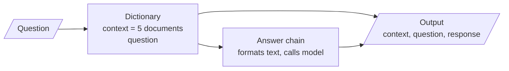
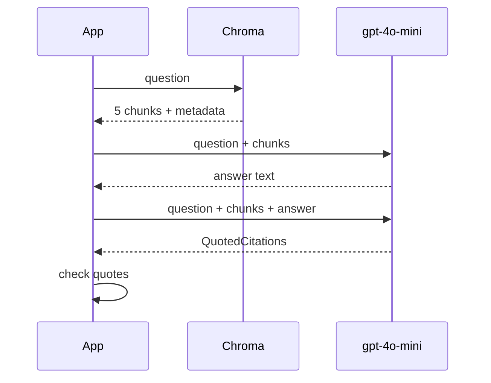

# M19.2 Theory: Answers with sources and per-claim citations

*[M19 theory](../README.md) · Lesson 19.2 · Notebooks: [`02a_rag_system_with_sources.ipynb`](../../notebook/02a_rag_system_with_sources.ipynb), [`02b_rag_system_with_citations.ipynb`](../../notebook/02b_rag_system_with_citations.ipynb) · [All theory pages](../../../../../THEORY.md)*
<!-- subtitle: Keep the chunks the model read, ask for verbatim quotes, and check every quote in code -->
<!-- format: approved -->

## Returning the sources

> **What you'll learn**
>
> - **Explain** how to keep the retrieved chunks in a chain's output with one retrieval.
> - **Design** a citation schema whose quotes a machine can check.
> - **Diagnose** three things the schema does not guarantee: support, per-claim links and verbatim quotes.
> - **Verify** citations in code, and track the failure rate.

Lesson 19.1's chain answered from five chunks and then threw them away. A Larkspur agent reading *Yes, annual plans are refundable within 30 days* has no way to see which handbook passage said so, or whether one did.

Both M19.2 notebooks first run the M15 contextual retrieval notebook ([M15.5](../../../../../p04_rag_foundations/m15_advanced_indexing/mandatory/theory/05_context_aware_chunks_contextual_headers_and_contextual_retrieval/README.md#contextual-retrieval)). That run builds the index the citations depend on, and writes four metadata fields on every chunk:

| Field | Wikipedia articles | PDF chunks |
|---|---|---|
| `id` | The article's id from the source file | A fresh random id per chunk |
| `source` | "Wikipedia" | The file path |
| `title` | The article title | The file name |
| `page` | Always 1 | The PDF loader's page number, which counts from 0 |

*Table 1: The metadata every chunk carries.*

Shown as stored, a 0-based page tells a reader "page 0", or sends them to the page before the right one. Add 1 when you display it. We call this the **off-by-one page**.

### Sources at the answer level

Notebook `02a` keeps the retrieved documents in the chain's output instead of formatting them away. The retriever's result and the question go into a dictionary, and a pass-through step runs the answer chain on that dictionary and adds the answer beside them. Figure 1 shows the shape.

*Figure 1: The `02a` chain. The answer chain reads the same five documents that the output keeps.*

The output holds three things: the five context documents, the question, and the response. The retriever runs once. The chunks the user sees are therefore the chunks the model read.

This is source attribution at the answer level: the reader gets a list of five sources and has to find the supporting sentence in each.

## Citation schema

Notebook `02b` asks for more: which chunk supports the answer, and the exact sentences. A **citation schema** is a structured output the model fills, one record per supporting chunk:

| Field | What it holds | Why it earns its place |
|---|---|---|
| `id` | The id of the chunk that justifies the answer | Joins a citation back to a retrieved chunk, which is what lets code check it |
| `source` | Where the chunk came from | Shown to the reader |
| `title` | The document's title | Shown to the reader |
| `page` | The page in the source | Sends a reader to the right place in a long PDF |
| `quotes` | Verbatim sentences from that chunk, as one string | The part a machine can check: a quote either appears in the chunk or it does not |

*Table 2: The fields of `02b`'s citation record. The schema returns a list of these.*

The citations come from a second model call, after the answer:

*Figure 2: Answer first, then citations, then a check in code.*

The answer chain prints each chunk's id, source, title and page above its text, which lets the model copy real ids into its citations. On the Larkspur handbook, *Can I get a refund on my annual plan?* should produce one citation (*Illustrative*: a representative output, not a recorded run):

| Field | Value |
|---|---|
| `id` | refund-window |
| `source`, `title` | handbook.pdf |
| `page` | 2 |
| `quotes` | An annual plan can get a full refund within 30 days of purchase if the account used less than 100 GB of outbound traffic. |

*Table 3: A citation for the refund question (illustrative).*

The two notebooks hand the reader different things for the same question. The comparison below puts 19.1's chain beside them, using the refund question (*Illustrative* outputs).

Choose a chain to see what a Larkspur agent receives for the refund question, and what they can check.

<button type="button" data-mode="answer" aria-pressed="false" aria-controls="out-answer">Answer only (19.1)</button><button type="button" data-mode="sources" aria-pressed="false" aria-controls="out-sources">Answer and sources (02a)</button><button type="button" data-mode="cited" aria-pressed="false" aria-controls="out-cited">Checked citations (02b)</button>

<section id="out-answer" class="mode-panel" data-announcement="Answer only selected. Nothing to check against."><h4>Answer only</h4><dl><dt>Returned</dt><dd>the answer text</dd><dt>Model calls</dt><dd>one</dd><dt>What the agent can check</dt><dd>nothing; the five chunks were formatted away</dd></dl></section>
<section id="out-sources" class="mode-panel" data-announcement="Answer and sources selected. The agent searches five chunks."><h4>Answer and sources</h4><dl><dt>Returned</dt><dd>the answer, the question and the five documents with metadata</dd><dt>Model calls</dt><dd>one</dd><dt>What the agent can check</dt><dd>every chunk the model read; finding the supporting sentence is their job</dd></dl></section>
<section id="out-cited" class="mode-panel" data-announcement="Checked citations selected. The agent sees the quoted sentence."><h4>Checked citations</h4><dl><dt>Returned</dt><dd>the answer, the documents and a citation naming <code>refund-window</code>, page 2, with the 100 GB sentence quoted</dd><dt>Model calls</dt><dd>two</dd><dt>What the agent can check</dt><dd>the quoted sentence, already confirmed in code to appear in the chunk it names</dd></dl></section>

The second call doubles the model cost per question. It buys a quote that code can test, which is the step answer-level sources leave to a person.

## What the schema does not guarantee

Three gaps remain, each with a name:

- **Citation after the fact.** The second call looks for support for text that already exists. It shows the answer can be justified from the chunks, not that the model used them. A claim with no support may get a loose citation or none, and nothing marks which.
- **The flat list.** The schema is a list per answer. Nothing ties a citation to the sentence of the answer it supports. For true per-claim citations, add a claim field (the answer sentence) or have the answer call emit numbered markers that the citations reference.
- **The paraphrased quote.** The schema asks for exact sentences; the model can still paraphrase or merge two. `02b`'s display code highlights each quoted sentence in its chunk with a pattern match. A paraphrase highlights nothing and raises nothing, and a citation whose id matches no retrieved chunk comes back with no context. Both fail silently.

So check every citation in code before showing it: look the chunk up by id, normalise whitespace in both texts, and test whether the quote is a substring of the chunk. Here are four planted citations against the refund chunk:

| Planted quote | Check result | Why |
|---|---|---|
| The verbatim sentence | Pass | It is a substring of the chunk |
| The same sentence broken across two lines | Pass | Whitespace is normalised before comparing |
| "Annual plans are fully refundable for 30 days." | Fail | A paraphrase, and it drops the 100 GB condition |
| Any quote under an id that was not retrieved | Fail | No chunk to check against |

*Table 4: Planted citations against the quote check.*

Drop or flag the citations that fail, and track the failure rate as a production metric. A rising rate means the prompt, the model or the chunk text changed.

> **Pitfall: a citation prompt that sees a Python object.** `02b`'s citation chain passes the list of retrieved documents straight into its prompt. The model reads the documents' programming representation, metadata and all, rather than the formatted text the answer chain saw. Format the chunks the same way for both calls.

## In practice: cited answers for Larkspur

1. **Keep the context in the output**, one retrieval, as `02a` does.
2. **Ask for the five-field schema**, plus a claim field so each citation names the answer sentence it supports.
3. **Check every quote in code**; show only citations that pass, and display pages from 1.
4. **Alert on the failure rate**, per model and prompt version.

Citations show which chunk supports an answer. Lesson 19.3 asks a related question about retrieval itself: why a chunk was retrieved at all.

## Limits

- The refund citation and the four planted quotes are illustrative. The notebooks' own runs use Wikipedia and paper questions, and ship without outputs.
- A passing substring check proves the quote exists in the chunk. It does not prove the quote supports the claim, or that the answer states the rule completely.
- `02b`'s display code also matches on page: a citation with the right id but a wrong page gets no context either. The quote check on this page is an addition; the notebook only highlights.

## References

1. Gao et al., [Enabling Large Language Models to Generate Text with Citations](https://arxiv.org/abs/2305.14627), 2023.
2. Liu et al., [Evaluating Verifiability in Generative Search Engines](https://arxiv.org/abs/2304.09848), 2023.
3. LangChain, [Structured output](https://docs.langchain.com/oss/python/langchain/structured-output).

## Key Takeaways

- Keep the retrieved documents in the chain's output, so the retriever runs once and the sources shown are the chunks the model read; display PDF pages from 1, not 0.
- A citation schema with `id`, `page` and verbatim `quotes` makes citations checkable. It is still a flat list per answer, written after the fact, so add a claim field for per-claim citations.
- The model can paraphrase a quote or cite an id that was never retrieved. Verify every quote against its chunk in code, drop failures, and track the failure rate.

## Check yourself

1. Why does keeping the retrieved documents in the chain's output, rather than retrieving again for display, matter?

The retriever runs once, so the chunks shown to the user are exactly the chunks the model read. Retrieving again for display could return different chunks, and the user would check the answer against evidence the model never saw.

2. A citation for the refund question quotes "Annual plans are fully refundable for 30 days." What does the quote check do, and why is this citation dangerous?

The check fails it, because the text is not a substring of the `refund-window` chunk. It is a paraphrase that also drops the 100 GB condition, so showing it would put an incomplete rule behind a citation that looks authoritative. Drop or flag it, and count it in the failure rate.

3. The citation schema returns a list of records for the whole answer. What can it not tell you, and how would you change it?

Which sentence of the answer each citation supports, and whether the model actually used the cited chunk, since citations are found after the answer is written. Add a claim field holding the answer sentence, or have the answer call emit numbered markers that the citations reference.

---
*Previous: [19.1 Environment setup and a complete RAG system](../01_environment_setup_and_a_complete_rag_system/README.md). Next: [19.3 Explainable retrieval](../03_explainable_retrieval/README.md).*
