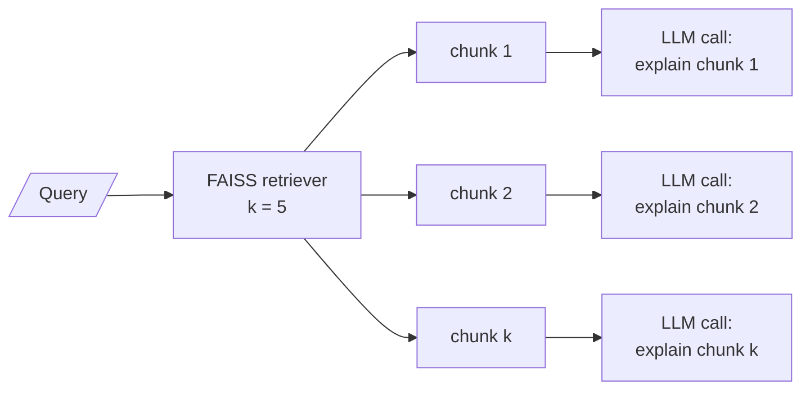
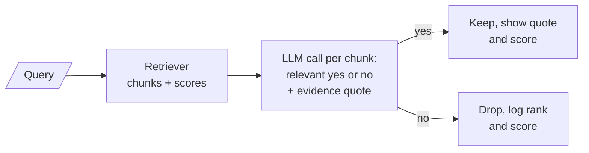

# M19.3 Theory: Explainable retrieval

*[M19 theory](../README.md) · Lesson 19.3 · Notebooks: [`03a_explainable_retrieval.ipynb`](../../notebook/03a_explainable_retrieval.ipynb) · [All theory pages](../../../../../THEORY.md)*
<!-- subtitle: An explanation written after the ranking describes the text, not why it was ranked -->
<!-- format: approved -->

## Explaining a retrieved chunk

> **What you'll learn**
>
> - **Trace** an explainable retriever: one search, then one explanation call per chunk.
> - **Diagnose** an explanation that rationalises a ranking error.
> - **Separate** explaining a chunk to a user from debugging a ranking.
> - **Redesign** the explainer as a relevance grader.

Lesson 19.2 linked each answer to the chunks that support it. A user can still ask the step before that: why did the system pick these chunks at all?

Notebook `03a` answers with an **explainable retriever**. It wraps a FAISS index with `k = 5` and, for every chunk it returns, makes one more LLM call that writes a paragraph on why the chunk fits the query. The output is a list of pairs: the chunk's content and its explanation.

*Figure 1: One retrieval, then one explanation call per chunk.*

Each explanation call receives two things: the query and one chunk's text. It does not receive the similarity score, the chunk's rank or the other chunks. Three properties of this design decide where it is useful.

## It costs one call per chunk

The loop calls the explanation chain `k` times, one after another. At `k = 5` a single search becomes five model calls before any answer is written:

| Explained chunks | Explanation calls | With the answer call |
|---|---|---|
| All 5 retrieved | 5 | 6 |
| Only the 2 the answer cites | 2 | 3 |
| Only the one a user expands | 1, on demand | 1 + 1 |

*Table 1: Calls per question for three explanation policies.*

Run the calls as one batch to cut the wait, or explain only what a reader will look at.

## It explains the text, not the ranking

The prompt says "Explain why this context is relevant to the query". The model never sees the similarity score or the other chunks, and it is not offered "this chunk is not relevant" as an answer.

On the Larkspur handbook that matters. In the M10 TF-IDF index, *What happens if my server goes down?* ranks the `reboot` chunk first, on the shared word "server" ([M10.2](../../../../../p04_rag_foundations/m10_rag_lifecycle/mandatory/theory/02_indexing_from_scratch_with_tf_idf_and_nearest_neighbours/README.md#top-k)). Asked why `reboot` is relevant, with no way to say it is not, the model's likely reply is a reason:

| Retrieved chunk | Why it ranked first | Likely explanation (*Illustrative*) |
|---|---|---|
| `reboot`: "You can reboot a server from the console…" | Shares "server" with the question (TF-IDF 0.416) | "Rebooting is one way to recover a server that has gone down." |

*Table 2: An explanation for a ranking error (illustrative reply).*

That reads as an explanation and is a rationalisation of a ranking error. We call it the **rationalised miss**. The chunk was ranked by similarity between two vectors; the paragraph is the model's reading of the query and the chunk side by side, written after the fact.

Table 3 shows what the ranking actually did for that question. Scores were recomputed with scikit-learn's TF-IDF and English stop words over the twelve M10 chunks, which reproduces the M10 lab.

| Rank | Chunk | TF-IDF score | Evidence for the question |
|---|---|---|---|
| 1 | `reboot` | 0.416 | No |
| 2 | `sizing` | 0.389 | No |
| 3 | `export` | 0.217 | No |
| tied at 0 | `sla`, `incidents` | 0.000 | Yes |

*Table 3: The real ranking for the outage question. Both evidence chunks score zero.*

The score log tells an engineer the problem is vocabulary: "goes down" never meets "outage". The explanation for `reboot` hides it.

> **Key distinction:** an explanation can guide a user and mislead an engineer. To debug retrieval, print the scores and the rank of the chunk you expected, never the explanation.

## Ask a question that can say no

A version that helps both readers changes the question:

| `03a` asks | Ask instead |
|---|---|
| Why is this context relevant? | Is this context relevant to the query? Answer yes or no, then quote the sentence that decides it. |
| One free-text paragraph | A structured result: relevant or not, a verbatim evidence quote, and the retriever's score |
| Every retrieved chunk | Only the chunks the answer used, or the ones a user expands |

*Table 4: From explainer to relevance grader.*

The yes-or-no form is a **relevance grader**. Figure 2 shows where it sits: the same retrieval, but each call returns a verdict that a filter can act on.

*Figure 2: The relevance grader. A verdict of "no" removes the chunk and leaves a trace an engineer can read.*

On the `reboot` chunk it can return "no", with the score beside it, which is the signal the explainer could never give. [M28](../../../../../p08_agentic_rag/m28_retrieval_grading_rewriting/mandatory/theory/README.md) uses it to filter chunks and rewrite the query, and [M32.1](../../../../../p08_agentic_rag/m32_reliability_feedback/mandatory/theory/01_reliable_rag_relevance_checks_hallucination_checks_source_highlighting/README.md#relevance-grading) adds a hallucination check and source highlighting on top.

The comparison below shows what each design returns for the `reboot` chunk on the outage question (*Illustrative* model replies; the scores are the real ones from Table 3).

Choose a design to see what it reports about the top-ranked chunk for "What happens if my server goes down?".

<button type="button" data-mode="explainer" aria-pressed="false" aria-controls="ex-explainer">Explainer (03a)</button><button type="button" data-mode="grader" aria-pressed="false" aria-controls="ex-grader">Relevance grader</button><button type="button" data-mode="log" aria-pressed="false" aria-controls="ex-log">Score log</button>

<section id="ex-explainer" class="mode-panel" data-announcement="Explainer selected. It defends the chunk."><h4>Explainer</h4><dl><dt>Question asked</dt><dd>why is this context relevant?</dd><dt>Reply</dt><dd>"Rebooting is one way to recover a server that has gone down."</dd><dt>What a reader learns</dt><dd>a plausible reason; the ranking error is hidden</dd></dl></section>
<section id="ex-grader" class="mode-panel" data-announcement="Relevance grader selected. It rejects the chunk."><h4>Relevance grader</h4><dl><dt>Question asked</dt><dd>is this context relevant? yes or no, with the deciding sentence</dd><dt>Reply</dt><dd>no; the chunk describes a manual reboot, not what happens during an outage; score 0.416</dd><dt>What a reader learns</dt><dd>the chunk should be dropped, and the top score was a weak signal</dd></dl></section>
<section id="ex-log" class="mode-panel" data-announcement="Score log selected. Both evidence chunks score zero."><h4>Score log</h4><dl><dt>Question asked</dt><dd>none; no model call</dd><dt>Record</dt><dd><code>reboot</code> 0.416, <code>sizing</code> 0.389, <code>export</code> 0.217; <code>sla</code> and <code>incidents</code> 0</dd><dt>What a reader learns</dt><dd>the evidence never matched; the fix belongs in retrieval (embeddings or query rewriting), not in the prompt</dd></dl></section>

The grader serves the user and the filter; the score log serves the engineer. Neither needs the free-text paragraph.

Two notes on running `03a` today. Its retriever call uses a method that the current LangChain core no longer has, so it raises an attribute error; the current call is the retriever's standard invoke. And the demo indexes three sentences with `k = 5`; FAISS returns all three, so each query gets three explanations, including two for texts about photosynthesis and global warming when the question is why the sky is blue. That is forced top-k (lesson 16.1) again, now with a paragraph defending each forced pick.

## In practice: explanations for Larkspur agents

1. **Explain on demand**: a support agent clicks a source to see why it is there; no call is spent otherwise.
2. **Grade, then explain**: ask the yes-or-no question first, and show the verbatim evidence quote as the explanation.
3. **Show the score** beside every explanation, so a weak match is visible as weak.
4. **Debug with ranks**, logged per query, never with explanation text.

Lesson 19.4 leaves free text: Larkspur's server catalogue is a table, and a table row needs its own representation before it can be retrieved.

## Limits

- The explanation and grader replies on this page are illustrative. `03a` ships without outputs, and its demo corpus is three science sentences, not the handbook.
- The TF-IDF scores come from the M10 index. `03a` ranks with OpenAI embeddings, which would score the outage question differently; the point about explanations not seeing scores holds for either.
- A grader is also a model call. It can be wrong in both directions, so its verdicts need the same golden-set measurement as any other judge.
- The missing retriever method was checked against the installed `langchain-core` 1.7.0.

## References

1. Jacovi and Goldberg, [Towards Faithfully Interpretable NLP Systems](https://arxiv.org/abs/2004.03685), 2020.
2. Turpin et al., [Language Models Don't Always Say What They Think](https://arxiv.org/abs/2305.04388), 2023.
3. Yan et al., [Corrective Retrieval Augmented Generation](https://arxiv.org/abs/2401.15884), 2024.
4. scikit-learn, [TfidfVectorizer](https://scikit-learn.org/stable/modules/generated/sklearn.feature_extraction.text.TfidfVectorizer.html).

## Key Takeaways

- An explainable retriever adds one LLM call per chunk. Batch the calls, or explain only the chunks the answer cites or a user expands.
- A prompt that asks why a chunk is relevant gets a reason even for a ranking error (the rationalised miss). The paragraph explains the text, not the ranking, so debug retrieval with scores and ranks.
- Ask a yes-or-no relevance question with a verbatim quote and the retriever's score instead. That turns the explainer into a relevance grader that can say no.

## Check yourself

1. The explainable retriever runs with k = 5. How many LLM calls does one question cost before the answer, and how would you reduce them?

Five, one explanation per retrieved chunk, made one after another. Batch them to cut the wait, and explain only the chunks the answer cites, or only the one a user expands, to cut the count.

2. For "What happens if my server goes down?", the explainer says the reboot chunk is relevant because rebooting recovers a server. Why should an engineer distrust this?

It is a rationalised miss. TF-IDF ranked `reboot` first only because it shares the word "server", and the prompt asked why the chunk is relevant with no option to say it is not. The paragraph describes the text after the fact; the score and the rank of the expected chunks show what actually happened.

3. How do you change the explainer so it can flag the reboot chunk as a bad retrieval?

Ask a yes-or-no question instead: is this context relevant, then quote the sentence that decides it. Return a structured result with the verdict, the verbatim evidence and the retriever's score. That relevance grader can answer "no" for `reboot`, which the "why is this relevant" prompt never could.

---
*Previous: [19.2 Answers with sources and per-claim citations](../02_answers_with_sources_and_per_claim_citations/README.md). Next: [19.4 RAG over structured data: CSV and JSON](../04_rag_over_structured_data_csv_and_json/README.md).*
