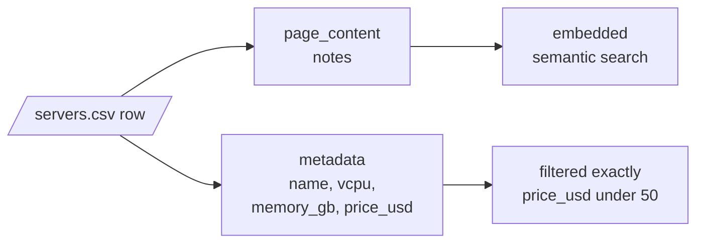
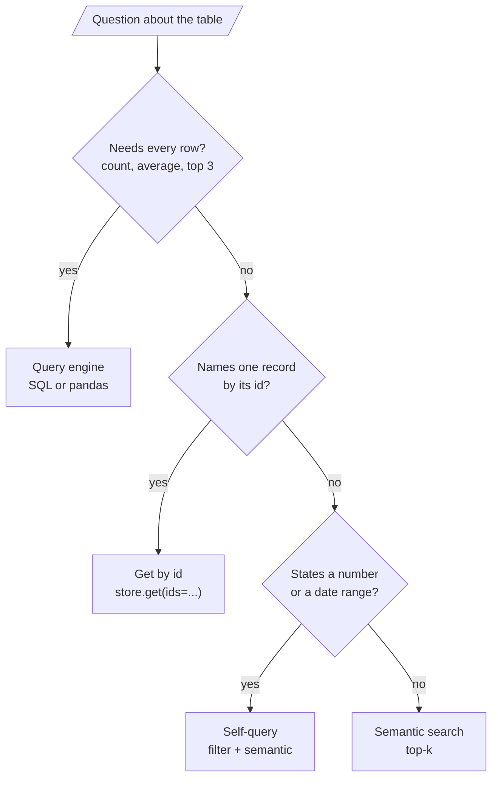

# M19.4 Theory: RAG over structured data: CSV and JSON

*[M19 theory](../README.md) · Lesson 19.4 · Notebooks: [`04a_structured_data_rag.ipynb`](../../notebook/04a_structured_data_rag.ipynb), [`04b_simple_csv_rag.ipynb`](../../../optional/notebook/04b_simple_csv_rag.ipynb) (optional), [`04c_json_rag.ipynb`](../../../optional/notebook/04c_json_rag.ipynb) (optional) · [All theory pages](../../../../../THEORY.md)*
<!-- subtitle: Embed what carries meaning, filter what carries magnitude, and never average a sample -->
<!-- format: approved -->

## Record representation

> **What you'll learn**
>
> - **Choose** which fields of a table row to embed and which to keep as metadata.
> - **Flatten** a nested JSON record without losing what you need to filter on.
> - **Diagnose** four question types that retrieval answers fluently and wrongly.
> - **Route** a question about a table to search, a filter, a lookup or a query engine.

Lessons 19.1 to 19.3 worked on prose: handbook paragraphs and PDF pages. Larkspur also has a server catalogue, a table of ten sizes with vCPUs, memory, a monthly price and a one-line description. Ask *What is the average monthly price of a Larkspur server?* and a RAG chain retrieves four rows and averages those, confidently and wrongly.

A table row is a set of typed fields; an embedding model takes one string. Something has to turn the row into text, and that choice, the **record representation**, decides what the index can find. Notebook `04a` shows three ways to write the same row. For the `ls-mem-4` row:

| Representation | Text that gets embedded |
|---|---|
| Every column (CSV-loader style) | name: ls-mem-4, vcpu: 4, memory_gb: 32, price_usd: 140, notes: Memory-optimised server for large PostgreSQL databases and analytics queries, one field per line |
| Natural language | A 4-vCPU, 32 GB server, ls-mem-4, at $140 a month. Memory-optimised server for large PostgreSQL databases and analytics queries. |
| Description only | Memory-optimised server for large PostgreSQL databases and analytics queries. |

*Table 1: Three representations of one catalogue row.*

`04a`'s rule picks the third and moves everything else to metadata. Free text carries meaning and belongs in the embedded text; identifiers, categories, numbers and dates are things you filter on, and belong in metadata, where a filter compares them exactly:

*Figure 1: One row, split by job.*

The module's lab measures what the choice does, with real `all-MiniLM-L6-v2` scores:

| Question | Description only | Every column | What it shows |
|---|---|---|---|
| *A server for a memory-hungry database* | `ls-mem-4` 0.733, `ls-mem-2` 0.626, then a 0.115 gap to the third row | The two still lead, but `ls-mem-2` (0.464491) beats the general-purpose `ls-small` (0.464116) by 0.0004 | **Field dilution**: names and numbers in each string pull every row towards every other |
| *Tell me about ls-cpu-8.* | Sibling `ls-cpu-4` ranks first, 0.535 against 0.517 | `ls-cpu-8` wins by 0.050 (0.708 against 0.659) | Neither is a lookup; fetching the record by id is |

*Table 2: Two representations under two questions (the module's sample-or-population lab).*

Two details make the split work. `04a` casts every number to an integer before it goes into metadata, because a range filter compares numbers and a CSV loader returns strings ([M11.3](../../../../../p04_rag_foundations/m11_document_ingestion/optional/theory/03_semi_structured_sources_csv_rows_and_json_jsonl_with_jq_schemas/README.md)). And the context sent to the model adds the metadata back after each description, so the model can quote a price it could not search on.

The rule is a default. "Built in 1962" carries meaning a buyer might search for, in a way "295000" does not. Judge each field by whether its value has meaning or only magnitude.

## Nested JSON

JSON adds depth. A support ticket in `04a` has a nested customer object, a list of tags and a list of messages. Its conversion makes two separate decisions:

- **Meaning goes to the embedded text**: the subject and the conversation, one "sender: body" line per message.
- **Filters go to flat metadata**: the customer's tier becomes a top-level customer-tier field, because Chroma rejects nested objects in metadata.

Lists are the hard case. `04a` joins the tags into one string, "export,performance,timeout", and an equality filter on that string matches only the whole string in that order. Check what your store accepts before flattening: the Chroma version installed in this course (1.5.9) stores a list value as metadata, and its contains operator matches list membership. In a scratch test it returned the record whose tags were the list export and performance, and not the one holding the single string "export,timeout".

Where the store has no list type, the options are a boolean field per tag, or a relational table for tags with only ids in the vector store. When filtering is that relational, the vector store is the wrong primary home for the data.

The optional notebooks show the two ends. `04b` loads a customer CSV with every column in the text and asks *which company does Sheryl Baxter work for?*, an exact lookup by name. `04c` uses JSON path expressions to pick the fields of each Nobel Prize record (year, category, laureate names) that become text before embedding.

## Retrieval reads a sample

Retrieval returns the `k` rows most similar to the question. Four kinds of question need something else, and on a table they look like ordinary questions:

| Question | Needs | Why retrieval cannot answer it |
|---|---|---|
| Aggregation: average, count, sum | Every row | It reads `k` rows; raising `k` only moves the cliff and fills the context |
| Comparison: "under $50", "since 2025" | Rows that pass a test | The number in the question is embedded as text and filters nothing |
| Exact lookup: by id, SKU, order number | One known row | Identifiers have no useful similarity |
| Ranking: the three cheapest | A total order | Similarity orders by meaning, not by price |

*Table 3: Four question types retrieval cannot answer.*

The [interactive sample-or-population lab](interactive/sample-or-population-lab.html) runs all four on the server catalogue, with description-only text:

| Question | Right answer | What retrieval gives |
|---|---|---|
| *What is the average monthly price of a Larkspur server?* | $102.50 | $36.25 at `k = 4`; $60.56 at `k = 9`. Only `k = 10`, the whole table, is right, because `ls-gpu-1` ($480) ranks last for this question in both representations |
| *Which servers cost less than $50 a month?* | Four servers | `k = 4` retrieves three of them plus `ls-large` at $80; `k = 5` gets all four, with `ls-large` still in the context. With every column embedded it takes `k = 6`, and two over-budget rows come along |
| *Tell me about ls-cpu-8.* | The `ls-cpu-8` row | At `k = 1` the model reads only `ls-cpu-4` and would describe the wrong server |

*Table 4: Three questions in the lab.*

<!-- lab: interactive/sample-or-population-lab.html -->

Each of these comes back as a fluent, specific answer. We call this the **sample average**: an answer computed over the rows retrieval happened to return, presented as a fact about the whole table. `04a`'s comparison names the difference between the two approaches: query generation fails loudly (a bad query raises an error or returns nothing), and retrieval fails quietly (it answers from whatever it retrieved).

The walkthrough follows the average-price question at `k = 4` with description-only text, using the lab's rankings, and then the route that answers it.

Step through the question to see where the sample average is born and how routing removes it.

<button type="button" data-step="0" aria-pressed="false" aria-controls="avg-step-0">1. Retrieve</button><button type="button" data-step="1" aria-pressed="false" aria-controls="avg-step-1">2. Read the sample</button><button type="button" data-step="2" aria-pressed="false" aria-controls="avg-step-2">3. Answer</button><button type="button" data-step="3" aria-pressed="false" aria-controls="avg-step-3">4. Route instead</button>

<section id="avg-step-0" class="step-panel" aria-labelledby="avg-heading-0"><h4 id="avg-heading-0">1. Retrieve</h4><dl><dt>Input</dt><dd>"What is the average monthly price of a Larkspur server?"</dd><dt>Top four rows</dt><dd><code>ls-small</code>, <code>ls-nano</code>, <code>ls-large</code>, <code>ls-medium</code>: the general-purpose descriptions sit closest to a question about servers in general</dd></dl></section><section id="avg-step-1" class="step-panel" aria-labelledby="avg-heading-1"><h4 id="avg-heading-1">2. Read the sample</h4><dl><dt>Prices in context</dt><dd>$20, $5, $80 and $40</dd><dt>Missing</dt><dd>six rows, including <code>ls-gpu-1</code> at $480, which ranks last for this question</dd></dl></section><section id="avg-step-2" class="step-panel" aria-labelledby="avg-heading-2"><h4 id="avg-heading-2">3. Answer</h4><dl><dt>Computed</dt><dd>$145 over four rows: $36.25</dd><dt>Presented as</dt><dd>the average Larkspur price, with nothing to say it covers four rows of ten</dd></dl></section><section id="avg-step-3" class="step-panel" aria-labelledby="avg-heading-3"><h4 id="avg-heading-3">4. Route instead</h4><dl><dt>Router decision</dt><dd>aggregate: the question needs every row</dd><dt>Query engine</dt><dd>averages all ten prices, $1,025 in total: $102.50</dd></dl></section>

<button type="button" data-walk="previous">Previous</button>

<button type="button" data-walk="next">Next step</button>

Raising `k` only moves the cliff. At `k = 9` the answer is $60.56, still wrong, because the one row that drags the average up is the one retrieval ranks last.

## Routing a table question

So route by the kind of question, not the kind of data:

*Figure 2: Route a table question by what it needs.*

`04a` builds each branch in its simplest form:

- **Router**: one prompt classifies a question as aggregate, lookup or semantic, and the system refuses the first two instead of answering from a sample.
- **Self-query**: a structured-output call turns *Which properties cost less than $400,000?* into a semantic part and, when extraction works, a maximum price of 400,000, which becomes a store filter. The notebook's filter uses less-than-or-equal, which lets a listing at exactly $400,000 through; "less than" needs strictly-less-than. The full version is [M17's self-querying lesson](../../../../m17_query_transformation/mandatory/theory/08_self_querying_natural_language_to_metadata_filter/README.md).
- **Query generation**: the model writes one line of pandas over the schema, and the notebook evaluates it.

> **Pitfall: evaluating model-written code.** That last branch runs code the model wrote with full interpreter access, and a data field can carry a prompt injection. In production, generate SQL against a read-only connection with a timeout, or run a sandboxed executor.

## In practice: Larkspur's server catalogue

1. **Embed descriptions only**; keep name, vCPUs, memory and price as typed metadata.
2. **Route averages and rankings to SQL** over the catalogue, read-only.
3. **Route "ls-cpu-8" to a get by id**, and price limits to a self-query filter with the right operator.
4. **Send semantic search only the descriptive questions**, such as a server for a memory-hungry database.

Lesson 19.5 keeps the same pipeline and moves it onto your own hardware.

## Limits

- The server catalogue is fictional, and `04a` itself runs on a property-listings CSV and a support-ticket JSON. The catalogue numbers come from the lab, which scores rows with `all-MiniLM-L6-v2`; an OpenAI embedding model would rank them differently.
- Every lab number on this page was recomputed from the lab's own row and similarity data. The model's answers in Table 4 are what a careful reader of the top-k rows would compute, not recorded model outputs.
- The router in `04a` is one classification prompt. It can misroute a question, and a misrouted aggregate still produces a sample average.

## References

1. Chroma, [Metadata filtering](https://docs.trychroma.com/docs/querying-collections/metadata-filtering).
2. Sentence Transformers, [all-MiniLM-L6-v2 model card](https://huggingface.co/sentence-transformers/all-MiniLM-L6-v2).
3. Hong et al., [Next-Generation Database Interfaces: A Survey of LLM-based Text-to-SQL](https://arxiv.org/abs/2406.08426), 2024.

## Key Takeaways

- Embed fields whose values carry meaning, and put identifiers, numbers and dates in metadata, cast to their real types. Embedding every column dilutes the vector (field dilution).
- Retrieval reads a sample of `k` rows. Aggregation, numeric comparison, exact lookup and ranking need every row, a filter or an id, and retrieval fails on them quietly: the catalogue's average comes back as $36.25 instead of $102.50.
- Route by the kind of question: a query engine for aggregates, get-by-id for lookups, self-query filters for ranges, semantic search for the rest. Never evaluate model-written code without a sandbox.

## Check yourself

1. Why does embedding every column of the catalogue make the memory-hungry database question harder to answer?

Field dilution: each row's string now carries names and numbers, which pull every row towards every other. With descriptions only, `ls-mem-4` and `ls-mem-2` lead the third row by 0.115; with every column, `ls-mem-2` beats the general-purpose `ls-small` by 0.0004.

2. A RAG chain answers the catalogue's average monthly price as $36.25. What happened, and what should answer it instead?

The sample average: retrieval returned four rows at `k = 4` and the model averaged those. The true average over all ten rows is $102.50, and `ls-gpu-1` at $480 ranks last for this question, so only the whole table gets it right. Route aggregation questions to a query engine over the full table.

3. A teammate wants to answer "Tell me about ls-cpu-8." by embedding every column so the name is in the text. What do you suggest?

A get by id. Embedding every column does make `ls-cpu-8` win, but only by 0.050, which is a ranking, not a lookup; with descriptions only, the sibling `ls-cpu-4` wins. A question that names one record by its id should fetch that record directly.

---
*Previous: [19.3 Explainable retrieval](../03_explainable_retrieval/README.md). Next: [19.5 Fully local RAG with Hugging Face and FAISS](../05_fully_local_rag_with_hugging_face_and_faiss/README.md).*
