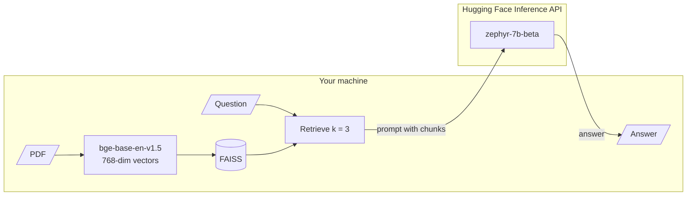
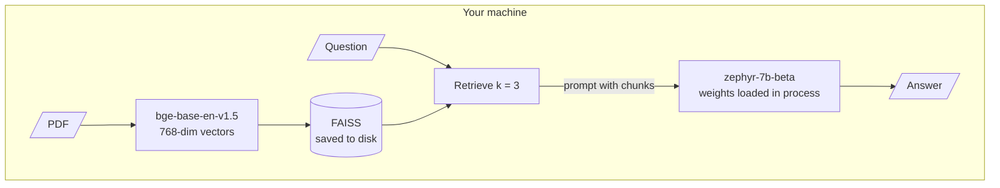

# M19.5 Theory: Fully local RAG with Hugging Face and FAISS

*[M19 theory](../README.md) · Lesson 19.5 · Notebooks: [`05a_local_rag_huggingface_faiss.ipynb`](../../notebook/05a_local_rag_huggingface_faiss.ipynb) · [All theory pages](../../../../../THEORY.md)*
<!-- subtitle: Local is a property of every component, and one remote call is enough to send the data out -->
<!-- format: approved -->

## Local inference

> **What you'll learn**
>
> - **Check** a "local" pipeline component by component for data that leaves the machine.
> - **Compare** the notebook's pipeline with a fully offline one.
> - **Explain** what keeping inference local costs: hardware, re-embedding, and the risk of loading a saved index.
> - **Diagnose** two small reuse bugs: a double retrieval and an answer split.

Lessons 19.1 to 19.4 called a hosted embedding model and a hosted chat model. Some Larkspur customers sign contracts that say support tickets and the handbook may not leave their network. For them, every model call is a question of where the data goes.

**Local inference** means a model runs on hardware you control and its inputs never cross the network. Notebook `05a` replaces every OpenAI call with open models:

| Setting | Value |
|---|---|
| Document | A climate-change PDF |
| Chunks | 1,000 characters, 200 overlap |
| Embeddings | `BAAI/bge-base-en-v1.5`, on CPU, normalised, 768 dimensions |
| Index | FAISS, in memory |
| Retrieval | `k = 3` |
| Generation | `HuggingFaceH4/zephyr-7b-beta` through Hugging Face's endpoint client, 256 new tokens at most |

*Table 1: `05a`'s configuration.*

"Local" has to be checked per component, because one remote call is enough to send the data out. Here the embedding model and the index run on your machine. The generator does not: the endpoint client calls the Hugging Face Inference API, and the notebook checks for an API token before it starts. Every prompt, with the three retrieved chunks inside it, leaves the machine:

*Figure 1: `05a` as written. Indexing is local; generation is not.*

We call this the **half-local pipeline**. The notebook's own comparison table lists data privacy as "Stays local", which is true only for indexing. Its next steps name the fix: swap the endpoint client for a local pipeline that loads the model weights and generates in your process. Figure 2 shows that version.

*Figure 2: The fully offline pipeline. The prompt never leaves the machine; the weights and the memory to run them must be on it.*

Table 2 sets the two side by side, component by component.

| Component | `05a` as written | Fully offline |
|---|---|---|
| Embeddings | Local, CPU | Local, CPU |
| Vector index | Local, FAISS in memory | Local, FAISS saved to disk |
| Generator | Remote: Hugging Face Inference API, needs a token | Local: a pipeline that loads the weights, needs enough memory |
| Data leaving the machine | Every prompt, chunks included | None |

*Table 2: Half-local against fully offline.*

The comparison below follows one Larkspur support ticket through three deployments: the hosted pipeline of lessons 19.1 to 19.4, `05a` as written, and the fully offline version.

Choose a deployment to see which steps keep a customer's ticket on their network.

<button type="button" data-mode="hosted" aria-pressed="false" aria-controls="loc-hosted">Hosted (19.1 to 19.4)</button><button type="button" data-mode="half" aria-pressed="false" aria-controls="loc-half">05a as written</button><button type="button" data-mode="offline" aria-pressed="false" aria-controls="loc-offline">Fully offline</button>

<section id="loc-hosted" class="mode-panel" data-announcement="Hosted selected. Text leaves at indexing and at every question."><h4>Hosted</h4><dl><dt>Indexing</dt><dd>every chunk is sent to a hosted embedding model</dd><dt>Each question</dt><dd>the question goes out to be embedded, then the prompt with its chunks goes out to the chat model</dd><dt>Leaves the network</dt><dd>the whole handbook once, and every ticket and its chunks per question</dd></dl></section>
<section id="loc-half" class="mode-panel" data-announcement="05a as written selected. The prompt leaves at generation."><h4><code>05a</code> as written</h4><dl><dt>Indexing</dt><dd>local: bge on CPU, FAISS in memory</dd><dt>Each question</dt><dd>embedded and retrieved locally; the prompt with three chunks goes to the Inference API</dd><dt>Leaves the network</dt><dd>every ticket and its three chunks: the half-local pipeline</dd></dl></section>
<section id="loc-offline" class="mode-panel" data-announcement="Fully offline selected. Nothing leaves the machine."><h4>Fully offline</h4><dl><dt>Indexing</dt><dd>local, with the index saved to disk by this pipeline</dd><dt>Each question</dt><dd>embedded, retrieved and answered in process</dd><dt>Leaves the network</dt><dd>nothing; the cost moves to hardware, latency and model downloads done in advance</dd></dl></section>

## What local costs

Keeping everything local trades the API bill for three costs:

- **Hardware and latency.** A 7B model generating on your own CPU or GPU replaces a network call. Measure tokens per second on the target machine before promising a latency.
- **One embedding model on both sides.** The query must be embedded by the model that embedded the chunks. Switching from OpenAI's 1,536-dimension vectors to bge's 768 means re-embedding the whole corpus, not only new documents.
- **Loading a saved index runs pickle.** FAISS's loader needs an explicit dangerous-deserialisation flag because the docstore is saved as a pickle file, and loading a pickle can run code. Load only index files your own pipeline wrote.

> **Pitfall: a borrowed index file.** A FAISS index downloaded from a shared drive or a model hub is code as well as data. Rebuild it from source documents, or load only files your pipeline wrote and stored where only it can write.

## Two reuse bugs

Two smaller things to change when you reuse `05a`'s code:

| Code in `05a` | What it does | Fix |
|---|---|---|
| A parallel step that runs the RAG chain and the retriever side by side, to return answer and sources | **Double retrieval**: retrieves twice, once inside the chain and once for the sources; a counting retriever in a scratch test was called two times | Retrieve once and reuse the result, as lesson 19.2's pass-through pattern does |
| The answer helper keeps only the text after the last "Answer:" | Strips a prompt echoed back with the completion; the installed endpoint client already returns only new text, so the split guards against nothing and cuts any answer that itself contains "Answer:" | Drop the split, or set "return only new text" explicitly when moving to a local pipeline |

*Table 3: Two reuse bugs in `05a`.*

On a fixed FAISS index the two retrievals return the same list, and the double retrieval only costs an extra search. On an index that updates between the calls, the sources shown could differ from the context the model read.

`05a`'s fallback evaluation counts expected keywords in each answer, such as "carbon dioxide" and "methane". Substring matching rewards any answer that mentions the words, right or wrong. Treat it as a smoke test, and use the golden-set metrics from [M10](../../../../../p04_rag_foundations/m10_rag_lifecycle/mandatory/theory/README.md) for decisions.

## In practice: an offline Larkspur deployment

1. **Audit every component** with Table 2: embeddings, index, reranker (M18), generator, and any grader.
2. **Generate in-process** on hardware sized from a measured tokens-per-second figure.
3. **Re-embed the whole handbook** with the local embedding model, and evaluate it on the golden set before switching.
4. **Write and load the index yourself**, never from a shared location.

This completes the M19 system: grounded, cited, explainable, table-aware and deployable where the data must stay.

## Limits

- No model was run for this page. The configuration comes from `05a`'s code; whether the Inference API still serves `zephyr-7b-beta` changes over time, and the half-local finding holds for any remote endpoint.
- The double retrieval was re-run with a counting retriever and stub model: two retriever calls with the parallel step, one with lesson 19.2's pass-through pattern.
- Tokens per second and memory needs depend on the machine; the page quotes none because the notebook measures none.

## References

1. BAAI, [bge-base-en-v1.5 model card](https://huggingface.co/BAAI/bge-base-en-v1.5).
2. Hugging Face, [zephyr-7b-beta model card](https://huggingface.co/HuggingFaceH4/zephyr-7b-beta).
3. Python Software Foundation, [pickle: Python object serialisation](https://docs.python.org/3/library/pickle.html).
4. Douze et al., [The Faiss library](https://arxiv.org/abs/2401.08281), 2024.

## Key Takeaways

- Check "local" per component. One remote call sends the data out: `05a`'s endpoint client ships every prompt, chunks included, to the Inference API (the half-local pipeline), while a local pipeline generates in your process.
- Changing embedding models means re-embedding the whole corpus. Measure tokens per second on the target hardware before promising a latency.
- Load only FAISS index files your own pipeline wrote, because the docstore is a pickle. Retrieve once and reuse the result, so the sources shown match the context.

## Check yourself

1. 05a embeds and indexes on your machine. Does a Larkspur customer's data stay on their network?

No. The generator runs through the Hugging Face Inference API, so every prompt, with the three retrieved chunks inside it, leaves the machine. Only indexing is local. Swapping the endpoint client for a local pipeline that loads the weights makes generation local too.

2. Moving Larkspur's pipeline from OpenAI embeddings to bge-base-en-v1.5, can you embed only new documents with the new model?

No. The query must be embedded by the same model that embedded the chunks, and the two models produce vectors of different sizes (1,536 against 768) in different spaces. Re-embed the whole corpus, and re-run the golden set before switching.

3. Why does loading a saved FAISS index need a dangerous-deserialisation flag, and what rule follows?

The index's docstore is saved as a pickle, and loading a pickle can run arbitrary code. Load only index files your own pipeline wrote and stored where only it can write; rebuild anything else from the source documents.

---
*Previous: [19.4 RAG over structured data: CSV and JSON](../04_rag_over_structured_data_csv_and_json/README.md). Next: [M19 interview questions](../README.md#interview-spotlight-5-questions-you-might-get-asked).*
