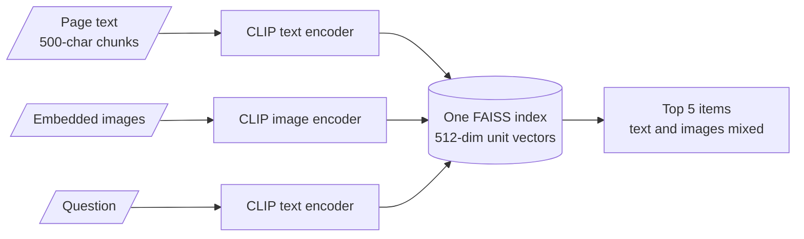
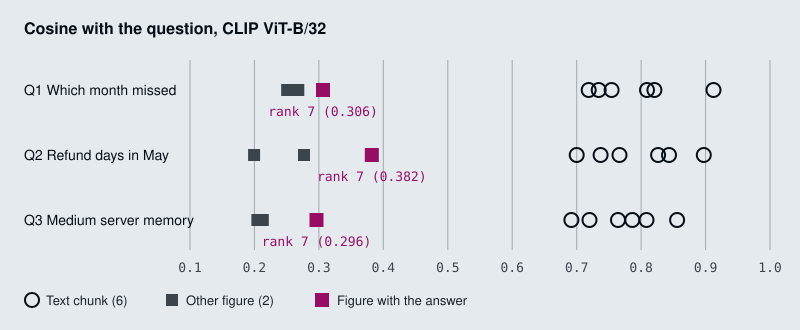
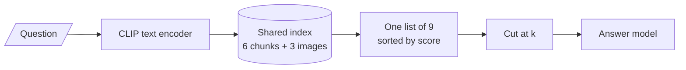
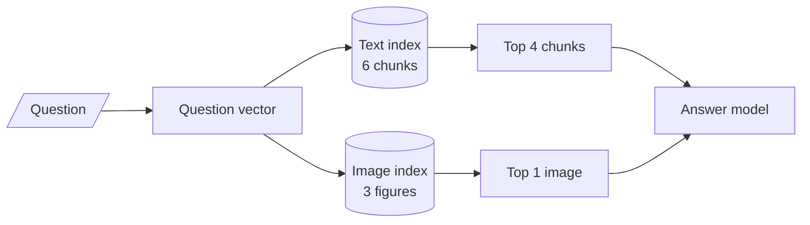

# M20.1 Theory: Shared text–image embedding space with CLIP

*[M20 theory](../README.md) · Lesson 20.1 · Notebooks: [`01a_multimodal_rag_with_clip.ipynb`](../../notebook/01a_multimodal_rag_with_clip.ipynb) · [All theory pages](../../../../../THEORY.md)*
<!-- subtitle: One space for text and images, two score bands, and the right chart ranked behind every paragraph -->
<!-- format: approved -->

## Joint embedding space

> **What you'll learn**
>
> - **Explain** how CLIP places text and images in one vector space.
> - **Trace** a PDF through CLIP indexing: text chunks and page images in one index.
> - **Diagnose** the two input limits that cut long chunks and small chart labels.
> - **Explain** the modality gap, and why one shared ranking hides the right figure.
> - **Choose** between separate quotas, one modality and a text model for text.

M19 built a system over text and tables. Larkspur's status reports also carry charts: monthly availability as bars, refund times by month, a server table as an image. A text-only pipeline drops them at load time, so *Which month missed the 99.95% availability target?* has no evidence in the index at all.

**CLIP** has two encoders, one for text and one for images, trained together so that an image and a caption describing it land close in the same vector space (Radford et al., *Learning Transferable Visual Models From Natural Language Supervision*, 2021). That shared space is a **joint embedding space**: a text question can retrieve an image directly. With `openai/clip-vit-base-patch32`, notebook `01a`'s model, both encoders end in a 512-dimension vector. The notebook normalises each to unit length, so a dot product is a cosine.

The two encoders feed one index, and the question uses the text side:

*Figure 1: CLIP indexing in `01a`. Both modalities share one index, and one ranking decides what reaches the model.*

Here is what `01a` does with a PDF:

| Step | Text | Images |
|---|---|---|
| Extract | Each page's text, split into 500-character chunks with 100 of overlap | Every embedded image on the page |
| Embed | CLIP's text encoder | CLIP's image encoder |
| Store | One FAISS index for both, ranked by L2 distance, which on unit vectors orders results like cosine | Same index; each image is a stub document marked as an image, with the image kept as base64 for the answer model |
| Answer | The question goes through the text encoder; the top 5 come back | Retrieved images go to a vision-capable chat model as image parts of one message ([M05](../../../../../p02_prompt_engineering/m05_multimodal_prompting/mandatory/theory/README.md) covers that format) |

*Table 1: CLIP indexing and retrieval in `01a`.*

The shared space makes the design look simple. The next two sections show where it loses information before any search runs, and then where it loses the right figure during the search.

## Two input limits

Both encoders have hard input limits, and both matter for documents:

| Limit | What CLIP does | What a document loses |
|---|---|---|
| **Text stops at 77 tokens** | Truncates the rest, without a warning | `01a`'s 500-character chunks run past 77: split the same way, page 2 of the Attention paper gives 11 chunks of 81 to 116 CLIP tokens, and even the sample PDF's 365-character page is 79 |
| **Images become 224 by 224** | Scales the shortest side to 224 and crops the centre square, then reads 7 by 7 patches of 32 pixels | A 400 by 300 chart becomes 299 by 224 and loses about a quarter of its width; small axis labels and printed values rarely survive |

*Table 2: CLIP's input limits and what they cut.*

CLIP was trained to match images with short captions, so a long paragraph is outside what it learned. We call the first row the **silent truncation**: the tail of every chunk is gone, and nothing in the output says so.

`01a`'s own sample cannot show a failure. Its PDF holds one 365-character text chunk and one 400 by 300 image of three unlabelled bars, so the index has two items and `k = 5` returns both for any question. The scores still show the pattern of the next section: for *What does the chart on page 1 show about revenue trends?* the text chunk scores 0.651 and the chart 0.270.

## One ranking, two modalities

The [interactive chart retrieval lab](interactive/chart-retrieval-lab.html) indexes three Larkspur status-report pages with `01a`'s own embedding functions: six text chunks and three figure images in one index, nine items. The scores split into two bands:

*Figure 2: CLIP scores on the lab pages. Every text chunk outscores every image.*

Every text chunk scores between 0.692 and 0.912 against every question; every image scores between 0.200 and 0.382. Liang et al. measured this split across contrastive models and named it the **modality gap** (*Mind the Gap*, NeurIPS 2022).

Inside the image band, CLIP does its job. For each question, the image with the answer is the best image:

| Question | Answer figure | Score | Best other image | Answer figure's rank in the shared index |
|---|---|---|---|---|
| *Which month missed the 99.95% availability target?* | Figure 1 | 0.306 | 0.268 | 7 of 9 |
| *How many business days did a refund take in May?* | Figure 2 | 0.382 | 0.277 | 7 of 9 |
| *How much memory does the Medium server have?* | Table 1 | 0.296 | 0.213 | 7 of 9 |

*Table 3: The answer figure is the best image and the seventh item (the module's chart retrieval lab).*

In the shared ranking that does not help. Each answer figure sits behind all six text chunks, so `01a`'s `k = 5` sends five text chunks and no image, and the model never sees a bar. It takes `k = 7` to reach the figure, and then the model reads six chunks of text to use one picture. We call this the **buried figure**.

<!-- lab: interactive/chart-retrieval-lab.html -->

> **Key distinction:** CLIP's scores are comparable within a modality and not across modalities. A figure at 0.306 is a strong image match; a text chunk at 0.692 may be a weak text match.

## Choosing around the gap

Since scores from different modalities are not comparable, the fix is to stop ranking them together. Two retrieval designs make the difference concrete.

The **shared ranking** is `01a`'s design: one index, one list, one cut at `k`. Whatever modality scores higher fills the list first.

*Figure 3: Shared ranking. Text and images compete in one list, and the cut at `k` decides alone.*

**Separate quotas** search each modality on its own and fix how many items of each kind reach the model. Each list is ranked only against its own kind, where CLIP's scores mean something.

*Figure 4: Separate quotas. Each modality has its own list and its own cut, then both go to the model.*

The same availability question gives a different context under each choice:

Choose a retrieval design for the availability question, and see what reaches the answer model.

<button type="button" data-mode="shared-5" aria-pressed="false" aria-controls="gap-shared-5">Shared, k = 5</button>
<button type="button" data-mode="shared-7" aria-pressed="false" aria-controls="gap-shared-7">Shared, k = 7</button>
<button type="button" data-mode="quota" aria-pressed="false" aria-controls="gap-quota">Separate quotas</button>

<section id="gap-shared-5" class="mode-panel" data-announcement="Shared ranking at k equals 5 selected. No image reaches the model."><h4>Shared ranking, k = 5 (01a's setting)</h4><dl><dt>Items sent</dt><dd>five text chunks, scores 0.692 or higher</dd><dt>Figure 1</dt><dd>rank 7 of 9, cut off</dd><dt>Result</dt><dd>the model sees no bar and cannot name May</dd></dl></section>
<section id="gap-shared-7" class="mode-panel" data-announcement="Shared ranking at k equals 7 selected. The figure arrives behind six chunks."><h4>Shared ranking, k = 7</h4><dl><dt>Items sent</dt><dd>all six text chunks, then Figure 1</dd><dt>Figure 1</dt><dd>included, at score 0.306</dd><dt>Result</dt><dd>the answer is in context, with six chunks of text the model must read to use one picture</dd></dl></section>
<section id="gap-quota" class="mode-panel" data-announcement="Separate quotas selected. The answer figure is the one image sent."><h4>Separate quotas: top 4 text, top 1 image</h4><dl><dt>Items sent</dt><dd>four text chunks and one image</dd><dt>Figure 1</dt><dd>the best image at 0.306, ahead of the next image at 0.268</dd><dt>Result</dt><dd>the answer figure reaches the model, as it does for all three lab questions</dd></dl></section>

Separate quotas are one of three ways around the gap:

| Option | How | Trade-off |
|---|---|---|
| **Separate quotas** | Search text and images separately; send the top text chunks plus the top image | On the lab pages the top-1 image is the answer figure for all three questions; costs one more search |
| **One modality** | Turn figures into text (lesson 20.2) or text into page images (lesson 20.3) | Every score comes from one comparison; captioning costs a vision call per image, page images cost a large index |
| **A text model for text** | Embed chunks with a text embedding model (M13); keep CLIP for image search | Fixes the 77-token cut; the two searches still need separate quotas |

*Table 4: Three ways around the modality gap.*

Raising `k` until the figure appears is not on the list. It works on three pages and fails on a real report, where dozens of chunks sit above every image.

## In practice: Larkspur's status reports

1. **Index figures and text separately**, with a text embedding model for the chunks and CLIP for the images.
2. **Send a quota**: the top 4 text chunks and the top 1 image.
3. **Check figure resolution**: a chart whose values are small printed labels may need captioning (lesson 20.2) rather than CLIP.
4. **Add a chart-only golden question** per report, such as the availability month, so a buried figure shows up as a miss.

Lesson 20.2 removes the gap the other way: it turns every figure into text before indexing.

## Limits of this evidence

- **Three pages, nine items.** The lab's pages are fictional Larkspur reports. The score bands and ranks are real CLIP outputs on those pages, and a different corpus moves the numbers. The gap itself is the general finding Liang et al. report.
- **The quota result is small.** Top-1 image is right for all three lab questions because each page has one relevant figure. A report with several similar charts needs a larger image quota or a reranker.
- **`01a` as shipped cannot fail.** Its two-item index returns everything at `k = 5`, so its run says nothing about ranking.
- **Answers were not scored.** The lab measures what reaches the model. Whether the model then reads 99.91% off a 224 by 224 crop is a separate question.

## References

1. Radford et al., [Learning Transferable Visual Models From Natural Language Supervision](https://arxiv.org/abs/2103.00020), 2021.
2. Liang et al., [Mind the Gap: the modality gap in multi-modal contrastive representation learning](https://arxiv.org/abs/2203.02053), NeurIPS 2022.
3. Hugging Face, [CLIP model documentation](https://huggingface.co/docs/transformers/model_doc/clip).
4. Hugging Face, [openai/clip-vit-base-patch32 model card](https://huggingface.co/openai/clip-vit-base-patch32).
5. Meta, [Faiss](https://faiss.ai/).

## Key Takeaways

- CLIP puts text and images in one 512-dimension space, but its text side stops at 77 tokens (the silent truncation) and its image side crops to 224 by 224, so long chunks and small chart labels are lost.
- Text and image scores sit in separate bands (0.692 to 0.912 against 0.200 to 0.382 on the lab pages). In one shared ranking the right figure falls behind every text chunk (the buried figure).
- Do not rank modalities together: use separate quotas, convert everything to one modality, or embed text with a text model.

## Check yourself

1. Notebook 01a splits pages into 500-character chunks before embedding them with CLIP. What happens to each chunk?

CLIP's text encoder stops at 77 tokens and truncates the rest without a warning. Split that way, page 2 of the Attention paper gives chunks of 81 to 116 CLIP tokens, so every chunk loses its tail. CLIP was trained on short captions, so a text embedding model is the better retriever for paragraphs.

2. For the availability question, Figure 1 is the best-scoring image at 0.306, yet with k = 5 the model never sees it. Why?

The modality gap: every text chunk scores between 0.692 and 0.912 and every image between 0.200 and 0.382, so in one shared ranking all six text chunks come before any image. Figure 1 ranks 7th of 9, and `k = 5` sends only text. It is the buried figure.

3. How would you change the retrieval so the answer figure reaches the model for all three lab questions?

Search text and images separately and send a quota, such as the top text chunks plus the top image: on the lab pages the top-1 image is the answer figure for all three questions. Alternatively convert everything to one modality, by captioning figures (20.2) or retrieving page images (20.3).

---
*Previous: [M20 overview](../README.md). Next: [20.2 Caption-then-index with a vision LLM](../02_caption_then_index_with_a_vision_llm/README.md).*
