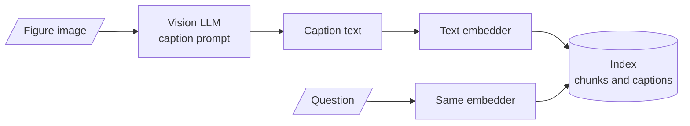

# M20.2 Theory: Caption-then-index with a vision LLM

*[M20 theory](../README.md) · Lesson 20.2 · Notebooks: [`02a_multimodal_rag_with_captioning.ipynb`](../../notebook/02a_multimodal_rag_with_captioning.ipynb) · [All theory pages](../../../../../THEORY.md)*
<!-- subtitle: Turn every figure into text once, at index time, and write the caption for the questions it must answer -->

## Captioning

> **What you'll learn**
>
> - **Explain** how captioning moves the vision work from query time to index time.
> - **Trace** captions competing with text chunks on one scale.
> - **Diagnose** a test question that never reaches a caption, and a caption that is found but cannot answer.
> - **Write** a caption prompt that holds every value a question needs.

Lesson 20.1 found the right Larkspur chart and then ranked it behind every paragraph, because CLIP scores images and text on different scales. Captioning removes the second scale.

**Captioning** moves the vision work to index time. A vision model looks at each figure once and writes text about it, and from then on the figure is a text chunk: the same embedder, the same vector store and the same retriever as the paragraphs around it:

*Figure 1: Caption-then-index. After indexing, a figure is a text chunk.*

Notebook `02a` builds it on the Attention paper:

| Step | What `02a` does |
|---|---|
| Extract | PyMuPDF reads each page's text into one document per page and saves every embedded image to disk |
| Caption | A fast Gemini vision model gets each image with a prompt asking for "a concise summary of the table or text that is well optimized for retrieval" |
| Index | Page texts and captions are both split into 400-token chunks with 50 of overlap, embedded with Cohere's English embedding model, and share one Chroma collection |
| Answer | The retriever returns `k = 1` item, and a Cohere chat model at temperature 0 answers from it |

*Table 1: The captioning pipeline in `02a`.*

The cost lands once per image, at index time, and never per question. The index holds only text, so every tool from M13 to M18 still applies to captions: hybrid search, reranking, metadata filters.

## A test that never reaches a caption

`02a`'s test question does not exercise the captions. PyMuPDF finds three raster images in the paper: Figure 1 on page 3 and the two images that make up Figure 2 on page 4. Figures 3 to 5 are not stored as images, so the extractor returns nothing for them.

The test question, *What is the BLEU score of the Transformer (base model)?*, is answered by Table 2 on page 8, which is text. The text extractor returns it with the rows flattened, one cell per line, and the training cost 3.3 × 10^18 comes out as "1018". The system prompt also says "Answer the question based upon your knowledge", which invites the model to answer from memory rather than from the retrieved chunk.

We call this the **text-only test**: a multimodal pipeline judged on a question that text retrieval already answers. To test captioning, ask about something only a figure shows.

## Captions on the Larkspur pages

The module's [interactive chart retrieval lab](../01_shared_text_image_embedding_space_with_clip/interactive/chart-retrieval-lab.html) embeds captions with `all-MiniLM-L6-v2`, the same model as the text chunks. The captions are representative, written the way a vision model following `02a`'s prompt would write them:

| Question | Caption's rank | What outranks it |
|---|---|---|
| *Which month missed the 99.95% availability target?* | 2 | The paragraph "Figure 1 shows monthly availability for April, May and June against the 99.95% target", 0.747 against 0.693 |
| *How many business days did a refund take in May?* | 1 | |
| *How much memory does the Medium server have?* | 1 | |

*Table 2: Detailed captions among text chunks (the module's lab; captions illustrative, scores real).*

The first misses at `k = 1` because the paragraph repeats the question's words. Captions compete with text chunks on one scale, so the ranking is fair, and a `k` of 2 or 3 sends both.

## What a caption must hold

`02a`'s prompt asks for a summary "well optimized for retrieval". Retrieval needs less than the answer does. A short caption that names the chart and leaves out the values, such as "Bar chart of monthly availability in Q2 against a target line.", still ranks 2, 3 and 2 for the three lab questions. It is found, and it cannot answer: nothing in it says May or 99.91%. We call this the **findable but empty** caption.

| Caption | Rank for the availability question | Can it answer? |
|---|---|---|
| "Bar chart of monthly availability in Q2 against a target line." | 2 | ✗ No month, no value |
| "Bar chart, Figure 1: monthly availability in Q2. April 99.98%, May 99.91%, June 99.97%. A dashed line marks the 99.95% target, and May falls below it." | 2 | ✓ May, 99.91% |

*Table 3: Two captions for Figure 1 (the module's lab; captions illustrative).*

Write the caption prompt for the questions the figure must answer:

- **Every printed value**, with its label and unit: "April 99.98%, May 99.91%, June 99.97%".
- **The title, axes and legend**, and any reference line ("a dashed line marks the 99.95% target").
- **The figure's place**: document, page, figure number, so a citation can point at it.
- **An explicit escape** for anything unreadable, as M05 does with a not-extracted marker, so the captioner leaves a gap instead of guessing.

> **Pitfall: a misread caption, trusted forever.** A caption is model output, written once and then trusted on every query. If the vision model reads 8 GB as 16 GB, retrieval finds the wrong number with full confidence.

`02a` already keeps each image's file name in its caption's metadata. That is enough to retrieve on the caption and then send the original image to a vision model at answer time, so the caption only has to be good enough to find the figure. Where a PDF has a real text layer, an element-level parser that returns each table as HTML ([M11, lesson 11.4](../../../../../p04_rag_foundations/m11_document_ingestion/mandatory/theory/04_pdf_and_word_parser_comparison_and_element_level_parsing/README.md)) keeps rows and columns that a caption would have to describe in prose.

## In practice: captioning Larkspur's reports

1. **Caption with a values-first prompt**: every value with label and unit, axes, reference lines, figure number, and an escape.
2. **Index captions beside text**, with the image file in metadata.
3. **Retrieve on captions, answer from images**: send the original figure to the vision model with the question.
4. **Test with chart-only questions**, such as the May availability, never with a question the text answers.

Lesson 20.3 skips extraction altogether and retrieves the page as an image.

## Key Takeaways

- Captioning pays the vision cost once per image at index time. Captions then compete with text chunks on one scale, and hybrid search, reranking and filters all still apply.
- A caption that names the chart is found but cannot answer (findable but empty). Prompt for every printed value with its label and unit, the axes and reference lines, the figure's place, and an escape for unreadable parts.
- A caption is model output trusted on every query. Keep the image reference in metadata, send the original image at answer time, and test with questions only a figure can answer.

## Check yourself

1. Notebook 02a tests its captioning pipeline with a question about a BLEU score. Why does that test say little about captioning?

The answer is in Table 2 on page 8, which is text, not one of the three raster images the extractor captioned. Text retrieval already answers it, and the system prompt invites the model to answer from memory. A captioning test needs a question that only a figure can answer.

2. The caption "Bar chart of monthly availability in Q2 against a target line." ranks 2nd for the availability question. Is that good enough?

It is found and cannot answer: it names neither May nor 99.91%, so the model reading it learns only that a chart exists. Prompt for every printed value with its label and unit and the reference line, or retrieve on the caption and send the original image to a vision model at answer time.

3. A vision model captioned a server table and wrote 16 GB where the image says 8 GB. What does the system do from then on, and how do you limit the damage?

It retrieves and repeats the wrong number on every query, with full confidence, because the caption is trusted text. Keep the image file in the caption's metadata and send the original image to a vision model at answer time, so the caption only has to find the figure. Spot-check captions against their images.

---
*Previous: [20.1 Shared text–image embedding space with CLIP](../01_shared_text_image_embedding_space_with_clip/README.md). Next: [20.3 Page-image retrieval with ColPali](../../../optional/theory/03_page_image_retrieval_with_colpali/README.md).*
