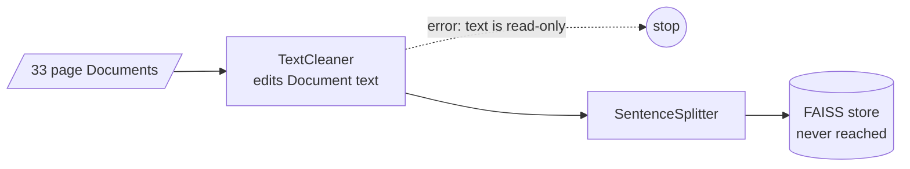
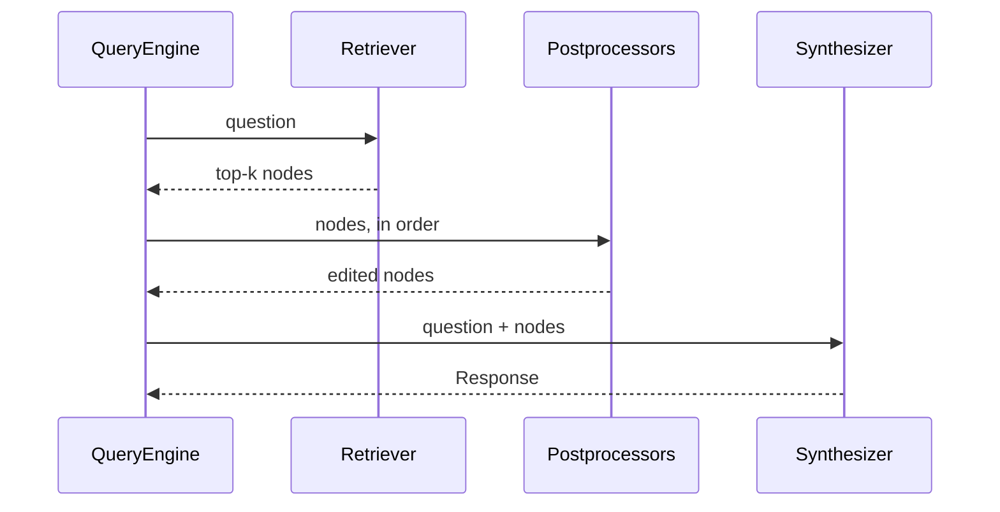

# M21.1 Theory: Simple PDF and CSV RAG in LlamaIndex

*[M21 theory](../README.md) · Lesson 21.1 · Notebooks: [`01a_simple_rag_with_llamaindex.ipynb`](../../notebook/01a_simple_rag_with_llamaindex.ipynb), [`01b_simple_csv_rag_with_llamaindex.ipynb`](../../../optional/notebook/01b_simple_csv_rag_with_llamaindex.ipynb) (optional) · [All theory pages](../../../../../THEORY.md)*
<!-- subtitle: Same ideas, new names, and two defaults that change the chunks you get from the same numbers -->
<!-- format: approved -->

## Nodes

> **What you'll learn**
>
> - **Map** LangChain's RAG pieces onto LlamaIndex's Documents, Nodes, retrievers and query engines.
> - **Explain** why the same chunk size gives different chunks in the two frameworks.
> - **Diagnose** an ingestion pipeline that crashes on its cleaner and leaves its vector store empty.
> - **Trace** a question through a query engine's three stages, and read what it returns.

M10 to M20 built every technique in LangChain. The ideas are framework-independent, and rebuilding them in LlamaIndex is the test: if a port behaves differently, either the framework does something different or the idea was only half understood.

LlamaIndex has two text objects where LangChain has one. A **Document** is what a reader loads: the directory reader turns `01a`'s climate-change PDF into 33 Documents, one per page, and a paged CSV reader turns `01b`'s 100-row customer file into 100 Documents, one per row. A **Node** is what the index stores: a piece of a Document with its own id, text, metadata, an optional embedding, and relationships. Every node the sentence splitter produces carries three relationships: its source Document, the previous node and the next node. The neighbour links let a query engine fetch the text around a hit later (lesson 21.4).

The concepts map onto the LangChain pieces from M10 to M18:

| LangChain | LlamaIndex | What changes |
|---|---|---|
| Document from a loader | Document from a reader | Loaded unit; PDF readers give one per page in both |
| Document chunk from a text splitter | Text node from a node parser | A node has an id and neighbour links |
| Recursive character splitter | Sentence splitter | Size in tokens, not characters |
| Embed, then add to the store | Ingestion pipeline, then vector store index | Transformations run as a list |
| Store as retriever, `k` | Index as retriever, `similarity_top_k` | Default `k` is 2 |
| Ensemble retriever | Query fusion retriever | Four fusion modes (21.2) |
| Compressor or reranker wrapper | Node postprocessor | A list on the query engine (21.3) |
| A retrieval chain | Query engine | Retrieve, postprocess, synthesise |

*Table 1: LangChain to LlamaIndex.*

## Same numbers, different chunks

Two differences change the chunks you get from the same settings.

**Chunk size counts tokens.** `01a` sets a chunk size of 200 with 50 of overlap and says so in a comment: LangChain's splitter measures characters by default, LlamaIndex's measures tokens. 200 tokens is several times longer than 200 characters, so a "200" ported from a LangChain notebook is not the same split. We call this the **unit swap**.

**Metadata counts against the chunk and goes into the embedding.** The sentence splitter builds the metadata string a node will carry, measures it in tokens and subtracts it from the chunk size before splitting. The PDF reader attaches seven fields (page label, file name, path, type, size and two dates) and excludes all but the page label and file path from the embedding and LLM text:

| Setting | Value on `01a`'s PDF |
|---|---|
| Chunk size | 200 tokens |
| Metadata kept in the embedded text (page label, file path) | 38 tokens |
| Room left for text | 162 tokens |
| Largest of the 123 nodes | 158 tokens of text |

*Table 2: Metadata eats the chunk (measured on the checkout used for this page).*

The absolute file path is part of every vector. Exclude fields from the embedding and LLM text on the Documents, before splitting, when they should be stored but not embedded.

Splitting never crosses a Document boundary. Notebook `02a` uses the splitter's defaults, 1,024 tokens with 200 overlap, and every PDF page fits in one chunk. The 33 pages become exactly 33 nodes. The page, not the chunk size, decides what a chunk is. On the Larkspur handbook the two sections load as two Documents; lesson 21.4 splits them into one node per sentence, 13 for refunds and 4 for exports.

## What `01a`'s ingestion actually builds

`01a` creates a FAISS index, passes it to an ingestion pipeline, then builds a vector store index from the nodes. An **ingestion pipeline** runs a list of transformations over Documents, in order, and writes the result to the vector store it was given. As the notebook writes it, the list is a text cleaner and then the splitter:

*Figure 1: `01a`'s pipeline as written. The cleaner sees Documents, not nodes.*

The working order splits first, cleans the nodes, embeds them inside the pipeline, and only then hands FAISS to the index:

*Figure 2: The fixed pipeline. The vectors live in the store the queries read.*

With the installed `llama-index-core` 0.14.25 the notebook's version goes wrong in two ways:

| Problem | Cause | Effect | Fix |
|---|---|---|---|
| **Cleaner crash** | The text cleaner comes before the splitter and receives Documents, whose text is read-only | An attribute error: Document's text has no setter | Put the cleaner after the splitter, as `02a` does; the 33 pages then become 123 nodes |
| **Empty store** | The pipeline has no embedding step, and it only adds nodes that already have an embedding to its store | FAISS holds 0 vectors; the index embeds the nodes again into the default in-memory store, which is what the notebook queries | Add the embedding model as the pipeline's last step, and build the index with FAISS as its storage |

*Table 3: Two ingestion bugs in `01a`, repeated in every M21 notebook.*

Run on the notebook's PDF with a local embedding model in place of OpenAI's, the fixed pipeline makes 123 embedding calls, one per node, the index makes none, and FAISS ends with 123 vectors. Rebuilding an index from the FAISS store alone fails with "Cannot initialize from a vector store that does not store text", because FAISS keeps vectors and no text.

> **Pitfall: the empty store.** A pipeline given a vector store that it never fills raises nothing. Count the vectors in the store after ingestion, as lesson 19.1 counted vectors against chunks.

## QueryEngine

A **query engine** turns a question into an answer in three stages. `index.as_query_engine(similarity_top_k=2)` returns one, and each query runs:

*Figure 3: A query engine's three stages.*

- **The retriever** embeds the question and returns the nearest nodes with their scores. The default is 2.
- **The postprocessors** run in list order. `01a` passes none; lessons 21.3 and 21.4 add a reranker and a window replacement here.
- **The synthesizer** puts the nodes' text into a prompt for the configured LLM. The default mode, compact, packs the nodes into as few prompts as the context window allows, then refines the answer across them.

The response holds the answer and the source nodes it was built from, with their scores. `01a`'s evaluation reads both: the answer goes to correctness and faithfulness metrics, the source texts become the retrieval context for DeepEval's contextual relevancy metric. Logging the source nodes on every production query gives the same view without an evaluation run.

The evaluation's first question, *What does climate change refer to?*, passes through the engine like this:

Step through one query and see what each stage reads and hands on.

<button type="button" data-step="0" aria-pressed="false" aria-controls="engine-step-0">1. Retrieve</button><button type="button" data-step="1" aria-pressed="false" aria-controls="engine-step-1">2. Postprocess</button><button type="button" data-step="2" aria-pressed="false" aria-controls="engine-step-2">3. Synthesise</button><button type="button" data-step="3" aria-pressed="false" aria-controls="engine-step-3">4. Evaluate</button>

<section id="engine-step-0" class="step-panel" aria-labelledby="engine-heading-0"><h4 id="engine-heading-0">1. The retriever finds two nodes</h4><dl><dt>Reads</dt><dd>the question, embedded with the same model as the nodes</dd><dt>Hands on</dt><dd>the 2 nearest of the 123 nodes, each with its score</dd></dl></section><section id="engine-step-1" class="step-panel" aria-labelledby="engine-heading-1"><h4 id="engine-heading-1">2. No postprocessors run</h4><dl><dt>Reads</dt><dd>the two scored nodes</dd><dt>Hands on</dt><dd>the same two, unchanged, because <code>01a</code> configures none. Lesson 21.3 puts a reranker in this slot</dd></dl></section><section id="engine-step-2" class="step-panel" aria-labelledby="engine-heading-2"><h4 id="engine-heading-2">3. The synthesizer writes the answer</h4><dl><dt>Reads</dt><dd>the question and the two nodes' text</dd><dt>Does</dt><dd>packs both into one prompt (compact mode) and calls the LLM</dd><dt>Hands on</dt><dd>a response holding the answer and both source nodes</dd></dl></section><section id="engine-step-3" class="step-panel" aria-labelledby="engine-heading-3"><h4 id="engine-heading-3">4. The evaluation reads the response</h4><dl><dt>Reads</dt><dd>the answer, the two source texts and the reference answer from the question file</dd><dt>Scores</dt><dd>correctness and faithfulness from the answer, contextual relevancy from the source texts, each judged by <code>gpt-4o</code></dd></dl></section>

<button type="button" data-walk="previous">Previous</button>

<button type="button" data-walk="next">Next step</button>

The engine can also run the retriever and postprocessors without the LLM, which is how lesson 21.4's lab was checked. Building the engine still needs an LLM: it resolves the configured model when created, and with none set and no OpenAI key it raises before any retrieval. Set a mock LLM for tests, or take a plain retriever from the index when you only need nodes.

## The CSV variant

`01b` reads each CSV row as one Document whose text is one "column: value" line per field: index, customer id, first name, last name, company and so on. It skips splitting, embeds each row, and asks *which company does sheryl Baxter work for?* with two results. The answer is in row 1 (Rasmussen Group), and the row's own text names her, so one retrieved row is enough.

A question about many rows, such as *how many customers are in Chile?*, gets the same two rows, and no prompt can count the other 98. That is lesson 19.4's sample average again: row-per-Document RAG answers lookups, and counts, sums and filters belong to a query over the table.

## In practice: porting Larkspur's pipeline

1. **Convert the chunk size**: Larkspur's 300-character split is about 75 tokens at a rough four characters per token, not 300; measure it with the splitter's own tokeniser.
2. **Exclude file paths** from embedded and LLM metadata before splitting.
3. **Embed in the pipeline** and count vectors in the store afterwards.
4. **Log source nodes** for every answer, as lesson 19.2 kept its context.

Lesson 21.2 ports M16's hybrid retrieval, where LlamaIndex's defaults differ most.

## Limits of this evidence

- **Measured on one checkout.** The token counts, the 123 nodes and the two ingestion bugs come from `llama-index-core` 0.14.25 with a local `all-MiniLM-L6-v2` embedding model in place of OpenAI's. Another release can change the splitter's metadata accounting or the pipeline's error.
- **No evaluation scores.** The notebooks ship without outputs, and `01a`'s evaluation calls `gpt-4o` as a judge on the one question the notebook asks. This page quotes none of its scores.
- **Four characters per token is a rough rule.** Measure a ported chunk size with the splitter's own tokeniser rather than dividing by four.

## References

1. LlamaIndex, [Documents and Nodes](https://developers.llamaindex.ai/python/framework/module_guides/loading/documents_and_nodes/) documentation.
2. LlamaIndex, [Ingestion Pipeline](https://developers.llamaindex.ai/python/framework/module_guides/loading/ingestion_pipeline/) documentation.
3. LlamaIndex, [Query Engine](https://developers.llamaindex.ai/python/framework/module_guides/deploying/query_engine/) documentation.

## Key Takeaways

- A Document is what a reader loads; a Node is what the index stores, with an id, metadata and neighbour links. Splitting never crosses a Document boundary.
- The sentence splitter counts tokens, not characters (the unit swap), and subtracts embedded metadata from the chunk size: 38 tokens of page label and path leave 162 of 200 for text.
- A query engine retrieves, postprocesses and synthesises; log its source nodes. Put the embedding model in the ingestion pipeline, or the vector store you passed stays empty.

## Check yourself

1. A teammate ports a LangChain pipeline with chunk size 200 to LlamaIndex and keeps the number. What changes?

The unit. LangChain's splitter counts characters by default and LlamaIndex's counts tokens, so 200 tokens is several times longer than 200 characters. LlamaIndex also subtracts embedded metadata from the chunk: on `01a`'s PDF, 38 tokens of page label and file path leave at most 162 tokens of text.

2. After 01a's ingestion runs, the FAISS index holds 0 vectors, yet queries return answers. How?

The pipeline has no embedding step and only adds already-embedded nodes to its store, so FAISS stays empty without an error. The vector store index then embeds the nodes again into the default in-memory store, and that is what the notebook queries. Embed in the pipeline and build the index with FAISS as its storage.

3. The CSV variant answers which company Sheryl Baxter works for. Why would it fail when asked how many customers are in Chile?

The first is a lookup: one row names her and holds the answer, and two retrieved rows include it. The second needs every row, and retrieval returns two, so no prompt can count the other 98. Counts, sums and filters belong to a query over the table, as in lesson 19.4.

---
*Previous: [M21 overview](../README.md). Next: [21.2 Fusion retrieval with QueryFusionRetriever](../02_fusion_retrieval_with_queryfusionretriever/README.md).*
