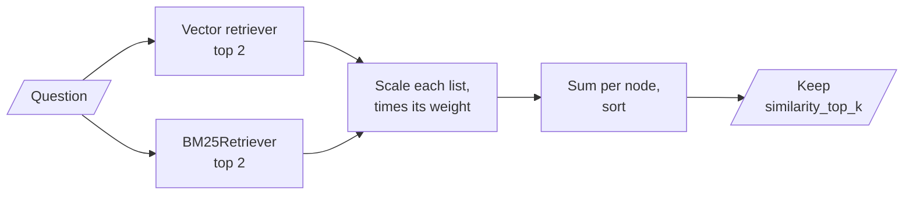

# M21.2 Theory: Fusion retrieval with QueryFusionRetriever

*[M21 theory](../README.md) · Lesson 21.2 · Notebooks: [`02a_fusion_retrieval_with_llamaindex.ipynb`](../../notebook/02a_fusion_retrieval_with_llamaindex.ipynb) · [All theory pages](../../../../../THEORY.md)*
<!-- subtitle: Same idea as M16's ensemble, different defaults, and a mode table that drops the answer three times out of four -->
<!-- format: approved -->

## QueryFusionRetriever

> **What you'll learn**
>
> - **Map** M16's hybrid ensemble onto LlamaIndex's fusion retriever, setting by setting.
> - **Explain** the three defaults that change what a port does.
> - **Trace** a Larkspur question through all four fusion modes, and see which keep the answer.
> - **Diagnose** a fusion retriever fed distances where it expects similarities.

Lesson 21.1 mapped the pieces. M16's hybrid retrieval is where a faithful port most often behaves differently, because the merge has several knobs and LlamaIndex sets them differently.

The **query fusion retriever** is LlamaIndex's ensemble retriever: it runs several retrievers and merges their lists. Notebook `02a` gives it a vector retriever and a BM25 retriever, both returning 2 nodes:

| Setting | `02a`'s value | Default |
|---|---|---|
| Retrievers | Vector, BM25 | |
| Retriever weights | 0.6, 0.4 | Equal |
| Number of queries | 1 | 4 |
| Mode | Distance-based score | Simple |
| Final `similarity_top_k` | Not set | 2 |

*Table 1: `02a`'s fusion settings against the defaults.*

*Figure 1: Fusion in `02a`.*

Three of the defaults change what a port does:

- **The number of queries defaults to 4.** The retriever keeps your question and asks the configured LLM to write 3 more, then runs every query on every retriever: with two retrievers, 8 retrievals and one LLM call per question. `02a` sets it to 1, which turns query generation off. M17 covers what the extra queries buy.
- **The final cut defaults to 2.** `02a` does not set it. Two retrievers with two hits each still return two nodes.
- **The mode defaults to simple.** The four modes, as the installed `llama-index-core` 0.14.25 implements them:

| Mode | Scaling inside each list | How lists combine |
|---|---|---|
| Relative score | Min-max: best 1, worst 0 | Times weight, summed per node |
| Distance-based score | Min-max between mean ± 3 standard deviations | Times weight, summed per node |
| Reciprocal rerank | `1 / (60 + rank)`, rank from 0 | Summed per node; weights ignored |
| Simple | None | Highest raw score per node |

*Table 2: The four fusion modes.*

Weights are divided by their sum: 0.6 and 0.4 stay as they are, and 3 and 2 become the same thing. Scores in the two score modes are also divided by the number of queries.

## The 45-day question, four ways

On the Larkspur handbook, split into one node per sentence, *Can I get a refund on an annual plan after 45 days?* gives two short lists. The vector side (`all-MiniLM-L6-v2`, run locally in place of the notebook's OpenAI model) returns the 30-day rule at 0.6922 and "Monthly plans are not refundable" at 0.5373. BM25 returns the 30-day rule at 2.3898 and the prorated rule, the one that answers the question, at 1.9076. Fused by the real fusion retriever with `02a`'s settings:

| Mode | Fused top 2 | Prorated rule |
|---|---|---|
| Distance-based score | 30-day rule 0.6667, monthly 0.2000 | 3rd, 0.1333 |
| Relative score | 30-day rule 1.0, monthly 0.0 | 3rd, 0.0 |
| Reciprocal rerank | 30-day rule 0.0333, monthly 0.0164 | 3rd, tied at 0.0164 |
| Simple | 30-day rule 2.3898, prorated 1.9076 | 2nd |

*Table 3: Four modes on one question (the real fusion retriever, `all-MiniLM-L6-v2` and LlamaIndex's BM25).*

The distance-based row is the notebook's own mode, and its arithmetic fits on one line per stage:

Step through distance-based fusion on the 45-day question and watch the answer fall to third place.

<button type="button" data-step="0" aria-pressed="false" aria-controls="fusion-step-0">1. Two lists</button><button type="button" data-step="1" aria-pressed="false" aria-controls="fusion-step-1">2. Scale</button><button type="button" data-step="2" aria-pressed="false" aria-controls="fusion-step-2">3. Weight and sum</button><button type="button" data-step="3" aria-pressed="false" aria-controls="fusion-step-3">4. Cut to 2</button>

<section id="fusion-step-0" class="step-panel" aria-labelledby="fusion-heading-0"><h4 id="fusion-heading-0">1. Each retriever returns two</h4><dl><dt>Vector</dt><dd>30-day rule 0.6922, monthly rule 0.5373</dd><dt>BM25</dt><dd>30-day rule 2.3898, prorated rule 1.9076</dd></dl></section><section id="fusion-step-1" class="step-panel" aria-labelledby="fusion-heading-1"><h4 id="fusion-heading-1">2. Each list is scaled on its own</h4><dl><dt>Rule</dt><dd>min-max between mean minus and plus 3 standard deviations</dd><dt>Result</dt><dd>both lists become 2/3 for the first hit and 1/3 for the second, whatever the gap</dd></dl></section><section id="fusion-step-2" class="step-panel" aria-labelledby="fusion-heading-2"><h4 id="fusion-heading-2">3. Weights multiply, nodes sum</h4><dl><dt>30-day rule</dt><dd>0.6 × 2/3 + 0.4 × 2/3 = 0.6667</dd><dt>Monthly rule</dt><dd>0.6 × 1/3 = 0.2000</dd><dt>Prorated rule</dt><dd>0.4 × 1/3 = 0.1333</dd></dl></section><section id="fusion-step-3" class="step-panel" aria-labelledby="fusion-heading-3"><h4 id="fusion-heading-3">4. The final cut keeps 2</h4><dl><dt>Kept</dt><dd>30-day rule, monthly rule</dd><dt>Dropped</dt><dd>the prorated rule, the only sentence that answers the question</dd></dl></section>

<button type="button" data-walk="previous">Previous</button>

<button type="button" data-walk="next">Next step</button>

Only simple keeps the answer, and for the wrong reason: it compares a BM25 score with a cosine similarity, and BM25 scores run higher. We call that **scale collision**. Three behaviours explain the rest of the table:

- **With two hits per list, the distance-based mode ignores the gap.** Two scores have a mean halfway between them and a standard deviation of half their difference, so mean ± 3 standard deviations always maps the better one to 2/3 and the worse to 1/3. In a check with fixed scores, dropping the vector runner-up from 0.80 to 0.10 left every fused score unchanged. The weights then decide the order: 0.6 × 1/3 = 0.2 for the vector runner-up beats 0.4 × 1/3 = 0.1333 for the BM25 runner-up. Flip the weights to 0.4 and 0.6 and the prorated rule takes second place at 0.2.
- **Relative score with two hits sends every runner-up to 0.** Both second places score 0 here, and the cut falls between equal scores.
- **Reciprocal rerank drops the weights.** The constant is 60 and ranks start at 0. A node first in one list scores 1/60. M16's ensemble multiplies each term by its weight and counts ranks from 1, so the two "RRF" scores are not interchangeable.

> **Pitfall: same name, different formula.** `02a`'s note says reciprocal rerank is unsuitable "since there is no normalization". Rank fusion never looks at the scores, and their scales cannot hurt it; the mode where scales collide is simple, the default. [M16's fusion lesson](../../../../m16_retrievers_hybrid_search/mandatory/theory/03_fusion_retrieval_score_normalisation_vs_rank_fusion/README.md) works through score and rank fusion in general; in LlamaIndex the same mode names carry different constants.

The BM25 side differs from LangChain's too. LlamaIndex's BM25 retriever uses an English stemmer, English stop words and a word pattern of two or more characters, so "refund" in the question matches "refunds" in the prorated rule. LangChain's splits on whitespace and would not match them: lesson 16.2's token mismatch, already fixed here.

## Score direction

Every fusion mode assumes a higher score is better. `02a`'s vector retriever comes from the default in-memory store, which returns cosine similarity. The assumption holds. Wire the notebook's FAISS store in properly (lesson 21.1) and it stops holding: a flat L2 index returns squared L2 distances as the score, where lower is better.

The same three handbook sentences, retrieved for the 45-day question through two FAISS indexes:

| Sentence | Inner-product index score | L2 index score |
|---|---|---|
| 30-day full-refund rule | 0.6922 | 0.6155 |
| Monthly plans are not refundable | 0.5373 | 0.9254 |
| Prorated rule | 0.5267 | 0.9465 |

*Table 4: One ranking, two score directions.*

The order is the same; the scale runs the other way. On unit-length vectors the squared distance is 2 minus twice the cosine (2 - 2 × 0.6922 = 0.6156). Feed the L2 list to relative score and the nearest sentence scales to 0 while the farthest gets the full weight. We call this the **flipped score**, the fusion cousin of lesson 16.1's flipped threshold.

Relative score's min-max on each column of Table 4 shows the flip:

Choose the index behind the vector retriever and see what relative-score mode makes of its three scores.

<button type="button" data-mode="inner" aria-pressed="false" aria-controls="direction-inner">Inner product</button>
<button type="button" data-mode="l2" aria-pressed="false" aria-controls="direction-l2">L2 distance</button>

<section id="direction-inner" class="mode-panel" data-announcement="Inner product selected. The nearest sentence scales to 1."><h4>Inner-product index on normalised vectors</h4><ul><li>Scores: 0.6922, 0.5373, 0.5267. Higher is nearer, as fusion assumes.</li><li>Scaled: 30-day rule 1.0, monthly rule 0.0640, prorated rule 0.0.</li><li>The nearest sentence gets the full weight.</li></ul></section>
<section id="direction-l2" class="mode-panel" data-announcement="L2 distance selected. The nearest sentence scales to 0."><h4>Flat L2 index</h4><ul><li>Scores: 0.6155, 0.9254, 0.9465. Lower is nearer, the opposite of what fusion assumes.</li><li>Scaled: 30-day rule 0.0, monthly rule 0.9363, prorated rule 1.0.</li><li>The nearest sentence gets nothing, and the farthest of the three now leads this list.</li></ul></section>

## In practice: Larkspur's hybrid port

1. **Set every argument**: number of queries, final `similarity_top_k`, mode and weights; never rely on the defaults.
2. **Retrieve deeper than 2 per list**: min-max modes need more than two points to scale.
3. **Use reciprocal rerank** when the lists' scales differ, knowing it ignores weights.
4. **Use an inner-product index on normalised vectors** for FAISS, and print each retriever's raw scores once before trusting the fused list.

Fusion decides which nodes come back. Lesson 21.3 reorders and trims them before the model reads them.

## Limits of this evidence

- **One question, a local model.** Tables 3 and 4 use the handbook split into sentences and `all-MiniLM-L6-v2`; `02a`'s OpenAI model scores differently, and other questions can rank the modes in another order.
- **Two hits per list is the worst case** for the two score modes. With deeper lists, min-max and the mean ± 3 standard deviations rule keep more of each list's spread.
- **One release.** The mode formulas and defaults are those of `llama-index-core` 0.14.25; the switcher's scaled values are hand arithmetic on Table 4, checked against that release's formula.

## References

1. Cormack, Clarke and Buettcher, [Reciprocal rank fusion outperforms Condorcet and individual rank learning methods](https://cormack.uwaterloo.ca/cormacksigir09-rrf.pdf), SIGIR 2009.
2. LlamaIndex, [Relative score fusion and distribution-based score fusion](https://developers.llamaindex.ai/python/framework/integrations/retrievers/relative_score_dist_fusion/) example.
3. LlamaIndex, [Reciprocal rerank fusion retriever](https://developers.llamaindex.ai/python/framework/integrations/retrievers/reciprocal_rerank_fusion/) example.

## Key Takeaways

- Check the defaults before porting: four queries add an LLM call and multiply retrievals, a final cut of 2 trims the fused list, and the default simple mode compares raw scores across retrievers (scale collision).
- With two hits per list the score modes flatten the gap and the weights decide the order; reciprocal rerank ignores the weights and counts ranks from 0. On the 45-day question three of four modes drop the answer.
- Every fusion mode assumes higher is better. Use inner product on normalised vectors rather than L2 distance (the flipped score), and print each retriever's raw scores once.

## Check yourself

1. A port of M16's hybrid retriever to LlamaIndex sets only the retrievers and weights. What does it do differently from the original?

It generates 3 extra queries with an LLM and runs all four on both retrievers, 8 retrievals per question; it cuts the fused list to 2; and it uses the simple mode, which takes the highest raw score per node and so compares BM25 scores with cosine similarities.

2. In distance-based mode with two hits per list, why does dropping the vector runner-up's score from 0.80 to 0.10 change nothing?

Two scores have a mean halfway between them and a standard deviation of half their difference, so scaling between mean ± 3 standard deviations always maps the better to 2/3 and the worse to 1/3. The gap disappears, and the weights decide the order: 0.6 × 1/3 beats 0.4 × 1/3.

3. A teammate wires FAISS with an L2 index into the fusion retriever in relative-score mode, and the worst sentence starts winning. Why?

The L2 index returns squared distances, where lower is better, but every fusion mode assumes higher is better. Min-max then scales the nearest sentence to 0 and the farthest to 1. Use an inner-product index on normalised vectors, which returns cosine similarity.

---
*Previous: [21.1 Simple PDF and CSV RAG in LlamaIndex](../01_simple_pdf_and_csv_rag_in_llamaindex/README.md). Next: [21.3 Reranking with node postprocessors](../03_reranking_with_node_postprocessors/README.md).*
