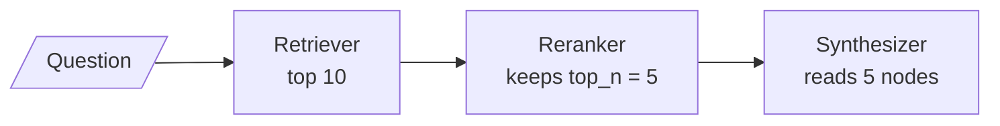

# M21.3 Theory: Reranking with node postprocessors

*[M21 theory](../README.md) · Lesson 21.3 · Notebooks: [`03a_reranking_with_llamaindex.ipynb`](../../notebook/03a_reranking_with_llamaindex.ipynb) · [All theory pages](../../../../../THEORY.md)*
<!-- subtitle: One slot between retrieval and synthesis, filled in list order, with defaults that change the model and the cut -->

## Postprocessors

> **What you'll learn**
>
> - **Explain** what a node postprocessor may do to the retrieved list, and when it runs.
> - **Compare** LlamaIndex's LLM reranker and cross-encoder reranker by calls, scores and defaults.
> - **Trace** the Larkspur 45-day question through a cross-encoder, and read a negative score correctly.
> - **Choose** the order of postprocessors when a reranker and a window share the list.

Lesson 21.2 fused two retrievers and, on the 45-day question, cut the answering sentence in three modes out of four. M18 handled that with a second stage. In LlamaIndex the second stage has a fixed slot.

A **node postprocessor** takes the retrieved list of scored nodes and the question, and returns a list. It can reorder the nodes, drop some, replace their scores or rewrite their text. A query engine runs its postprocessors in list order, after the retriever and before the synthesizer; outside an engine, one can be run by hand on a list of nodes, as `03a` does for its comparison.

`03a` uses the slot for two-stage retrieval ([M18](../../../../m18_reranking_post_retrieval/mandatory/theory/README.md)): retrieve wide with 10 results, rerank, keep 5:

*Figure 1: Two-stage retrieval in the postprocessor slot.*

The two rerankers in `03a` fill that box differently:

| | LLM rerank | Sentence-transformer rerank |
|---|---|---|
| How it scores | Sends the nodes to the configured LLM in batches (10 by default), asking for lines like "Doc: 9, Relevance: 7" | Scores every question-and-node pair with a cross-encoder |
| Calls for `03a`'s 10 nodes | 1 | 1 batched pass, local |
| New score | The integer from 1 to 10 | The model's raw output; the retrieval score can be kept in metadata |
| Dropped nodes | Any the model leaves out, and any line the parser cannot read, without an error | None beyond the cut |
| Defaults | Keeps 10 | Model `cross-encoder/stsb-distilroberta-base`, keeps 2 |
| `03a`'s settings | Keeps 5 | `cross-encoder/ms-marco-MiniLM-L-6-v2`, keeps 5 |

*Table 1: The two rerankers in `03a`.*

Two failures follow from the table. The LLM reranker can return fewer nodes than asked, with integer scores that tie often: lesson 18.3's silent drop and score ties. The cross-encoder's defaults name a different model and a cut of 2, so a port that drops the arguments changes both. We call that the **default swap**. M18 compares the two families in depth ([LLM against cross-encoder reranking](../../../../m18_reranking_post_retrieval/mandatory/theory/03_llm_reranking_vs_cross_encoder_reranking/README.md)); in LlamaIndex both swap in the same list.

The cross-encoder reads each node's embedding text, metadata included, so a long file path in metadata is part of every pair it scores (lesson 21.1).

## The handbook, reranked

Split the Larkspur handbook into one node per sentence, ask *Can I get a refund on an annual plan after 45 days?*, retrieve 10 with `all-MiniLM-L6-v2` and rerank with `03a`'s cross-encoder keeping 2:

| | First | Second |
|---|---|---|
| Retrieval alone, top 2 | 30-day full-refund rule (0.6922) | Monthly plans are not refundable (0.5373) |
| Cross-encoder over top 10 | 30-day full-refund rule (7.0657) | Prorated rule after day 30 (-2.1011) |

*Table 2: The 45-day question before and after reranking (local run).*

The reranker brings the sentence that answers the question into the context. It also scores that sentence below zero. The ms-marco cross-encoder returns a logit, not a probability, so its scores only rank. We call a cut at zero the **negative answer**: a filter that drops nodes under 0 would have dropped the answer.

> **Pitfall: the negative answer.** Calibrate any score cut-off on the golden set for the exact reranker you run, or cut by count.

## The capital-of-France example

`03a` builds five chunks: three one-liners that repeat the question's words ("The capital of France is great.", "…huge.", "…beautiful.") and two longer passages about visiting Paris. Asked *what is the capital of france?*, the embedding retriever ranks the one-liners first. Run locally with the same two models as above:

| Chunk | Bi-encoder (`all-MiniLM-L6-v2`) | Cross-encoder (`ms-marco-MiniLM-L-6-v2`) |
|---|---|---|
| The capital of France is huge. | 0.8105 | 6.8955 |
| The capital of France is great. | 0.7805 | 8.0029 |
| The capital of France is beautiful. | 0.7687 | 7.3871 |
| Have you ever visited Paris? … | 0.5174 | 1.0889 |
| I really enjoyed my trip to Paris, France. … | 0.4769 | 0.1921 |

*Table 3: Five chunks under two models (local run).*

The cross-encoder reorders the one-liners and keeps all three above the Paris passages. None of the one-liners names Paris, so neither model surfaced the passage that answers the question. The notebook runs this comparison with an LLM reranker and ships without output, so this page does not claim what that reranker returns. An LLM that knows Paris is the capital has knowledge the cross-encoder lacks, which is the case for paying for LLM reranking on questions like this.

The cell that sets up the example also carries a port bug. It builds each Document with LangChain's keyword for the text. LlamaIndex accepts the unknown keyword and creates a Document whose text is empty. The comparison function rebuilds the list with LlamaIndex's own keyword, so the comparison still works, but the first list is five empty Documents, and nothing warns. We call this the **silent keyword**.

## Order in the list

Postprocessors see whatever the one before them produced. With lesson 21.4's window replacement in the same list, the order decides what the reranker judges:

| Order | The reranker scores | Trade-off |
|---|---|---|
| Reranker, then window | The single sentence that was embedded | Short inputs, fast; judges the sentence without its context |
| Window, then reranker | The whole window | More context per pair; longer inputs, slower |

*Table 4: Two orders for a reranker and a window.*

Decide which text the reranker should judge, and write the list in that order.

## In practice: reranking Larkspur's sentences

1. **Retrieve 10 sentences, rerank, keep 3**, passing the model and the cut explicitly.
2. **Cut by count**, not at a score of zero.
3. **Window after reranking** for the handbook, so the cross-encoder judges sentences and the model reads windows.
4. **Assert Documents have text** after building them, to catch the silent keyword.

Lesson 21.4 adds that window.

## Key Takeaways

- Node postprocessors run in list order between the retriever and the synthesizer, and can reorder, drop, rescore or rewrite nodes. Retrieve wide and let a reranker keep the top few.
- The LLM reranker can silently return fewer nodes with tied integer scores; the cross-encoder reranker defaults to a different model and a cut of 2 (the default swap), so always pass both.
- Cross-encoder scores are logits that only rank: the Larkspur answer scores -2.1011 and still ranks 2nd. Calibrate any cut-off on the golden set, or cut by count.

## Check yourself

1. A port of 03a's cross-encoder reranker drops the model and cut arguments. What changes?

The default swap: the reranker falls back to `cross-encoder/stsb-distilroberta-base` instead of the ms-marco model, and keeps 2 nodes instead of 5. Both the scoring and the number of nodes the synthesizer reads change, without an error. Always pass both arguments.

2. After reranking the 45-day question, the prorated rule scores -2.1011. Should a filter drop nodes below zero?

No. The ms-marco cross-encoder returns a logit that only ranks: the prorated rule is 2nd and is the sentence that answers the question. A cut at zero would drop the answer. Cut by count, or set any threshold from the golden set for this exact model.

3. A query engine runs a cross-encoder reranker and a window replacement. What decides their order?

Which text the reranker should judge. Reranker first scores the single embedded sentence, with short, fast inputs; window first scores the whole window, with more context and longer inputs. Each postprocessor sees what the previous one produced, so the list order is the decision.

---
*Previous: [21.2 Fusion retrieval with QueryFusionRetriever](../02_fusion_retrieval_with_queryfusionretriever/README.md). Next: [21.4 Sentence-window retrieval](../04_sentence_window_retrieval/README.md).*
