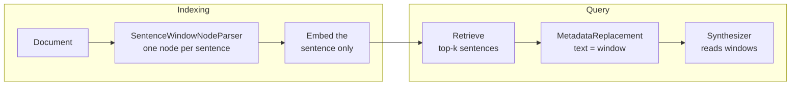

# M21.4 Theory: Sentence-window retrieval

*[M21 theory](../README.md) · Lesson 21.4 · Notebooks: [`04a_context_enrichment_window_with_llamaindex.ipynb`](../../notebook/04a_context_enrichment_window_with_llamaindex.ipynb) · [All theory pages](../../../../../THEORY.md)*
<!-- subtitle: Embed one sentence, answer from seven, and pay for the window in stored metadata -->

## Sentence window

> **What you'll learn**
>
> - **Explain** how a sentence window embeds one sentence and sends its neighbours to the model.
> - **Trace** three Larkspur questions through window sizes 0 to 3, and find each one's minimum.
> - **Diagnose** a window that cannot fix a retrieval miss, and two windows that send the same sentences.
> - **Count** what stored windows cost in metadata.

Lesson 21.3 ended with a reranker that judges single sentences. Single sentences match a question precisely and answer it badly: the 45-day question retrieves the 30-day rule, and the prorated rule that answers it is the next sentence.

Small chunks match a question precisely and large chunks answer it completely (M12). A **sentence window** does both: it embeds single sentences and, once one is retrieved, sends the model the sentences around it. LlamaIndex builds it from two pieces, a node parser at indexing time and a postprocessor at query time:

<!-- animated: diagrams/sentence-window.anim.html -->

*Figure 1: Sentence-window retrieval. The window travels as metadata until the postprocessor puts it in the text.*

The two pieces do this:

| Piece | When | What it does |
|---|---|---|
| Sentence-window node parser | Indexing | Splits each Document into sentences with NLTK's Punkt tokenizer, one node per sentence; stores the sentences from `i - window_size` to `i + window_size` as a window field, and the sentence itself as a second field (`04a` renames it original sentence); excludes both from the embedding and LLM text |
| Metadata replacement postprocessor | After retrieval | Sets each node's text to its window field; a node without one keeps its text |

*Table 1: The two pieces of a sentence window.*

The window size defaults to 3, seven sentences in all, as `04a`'s comment says, and must be greater than 0. A window never crosses into another Document. The notebook's remark that "metadata replacement" sounds off-topic comes from this design: the neighbours travel as metadata until the postprocessor puts them in the text.

On the Larkspur handbook the parser makes 17 nodes: 13 sentences in the refunds section and 4 in exports. The first sentence of each section carries the section title with it, because Punkt does not split at a blank line.

## One window per question

The [interactive sentence-window lab](interactive/sentence-window-lab.html) runs that index with `all-MiniLM-L6-v2` (the notebook uses OpenAI's `text-embedding-3-small`, which scores differently), lets you move the window size from 0 (postprocessor off) to 5 and the retrieved count between 1 and 2, and shows what the model receives. Its windows are a port of the parser's join, checked against the real LlamaIndex pipeline on all 30 settings of question, window and `k`: the same retrieved sentences, the same scores and the same window text, character for character. At one retrieved sentence:

| Question | Window 0 | Window 1 | Window 2 | Window 3 |
|---|---|---|---|---|
| *Refund on an annual plan after 45 days?* | 142 chars, answer missing | **284**, answer in | 495 | 621 |
| *How long does a refund take to appear?* | **90**, answer in | 291 | 496 | 620 |
| *Export my data after I cancel?* | 86, 1 of 2 facts | 188, 1 of 2 | **272**, both | 272 |

*Table 2: Characters the model reads, by window size (the module's lab; bold is each question's smallest sufficient window).*

<!-- lab: interactive/sentence-window-lab.html -->

Four behaviours follow:

- **The window changes what the model reads, never what is retrieved.** Every sentence scores the same at every window size, because the window is excluded from the embedding. Tuning the window size cannot fix a retrieval miss.
- **Each question needs a different window.** The 45-day question needs 1, the refund-timing sentence answers alone, and the export question needs the "Settings, then Data" sentence two places back. One global size over-sends for some questions and under-sends for others.
- **The Document boundary caps the window.** The exports section has four sentences, so every window from 2 up sends the same 272 characters. That limit helps when sections are independent and hurts when the answer spans two of them.
- **Two hits can send the same sentences twice.** At 2 retrieved, the refund-timing question gets its sentence and the 30-day rule two places before it. At window 3 their windows share 5 sentences, and the model reads 1,241 characters to cover 9 distinct sentences. We call this **window overlap**, as in lesson 18.5; merge overlapping windows before synthesis.

## What stored windows cost

The window is stored, not computed at query time. Each node holds its window and a copy of its sentence in metadata:

| Window size | Metadata on the handbook's 17 nodes | Sentence text | Ratio |
|---|---|---|---|
| 1 | 5,249 characters | 1,380 characters | 3.8 |
| 3 (default) | 9,313 characters | 1,380 characters | 6.75 |
| 5 | 12,342 characters | 1,380 characters | 8.9 |

*Table 3: Stored window metadata against sentence text (the module's lab).*

We call this the **stored window**: at the default size, the handbook's metadata is 6.75 times its text, held in the docstore or the vector store's payload for every node.

> **Key distinction:** [M18's enrichment windows](../../../../m18_reranking_post_retrieval/mandatory/theory/05_context_enrichment_windows/README.md) do the same job with character chunks and a neighbour lookup at query time. LlamaIndex moves the work to indexing time and the unit to the sentence, and pays in storage instead of lookups.

`04a` compares the sentence window against a sentence-splitter index at its 1,024-token default, both retrieving one node. Both of `04a`'s pipelines are handed the same FAISS store, which stays empty for the reason in [21.1](../01_simple_pdf_and_csv_rag_in_llamaindex/README.md#nodes); each index builds its own in-memory store.

## In practice: windows on the Larkspur handbook

1. **Window size 2** covers all three golden questions at one retrieved sentence (Table 2).
2. **Keep sections as separate Documents**, so a refunds window never pulls in export sentences.
3. **Merge overlapping windows** whenever more than one sentence is retrieved.
4. **Budget the metadata**: 6.75 times the text at the default size, for every node.

This completes M21's port: the same pipeline as M16 to M18, with its differences named.

## Key Takeaways

- A sentence window embeds single sentences and swaps in the surrounding sentences after retrieval. The window changes what the model reads, never what is retrieved.
- Each question needs a different window (1, 0 and 2 for the three Larkspur questions), a Document boundary caps how far a window reaches, and overlapping windows send the same sentences twice.
- Windows are stored in metadata on every node (the stored window): at the default size of 3, the handbook's metadata is 6.75 times its sentence text.

## Check yourself

1. The 45-day question retrieves the 30-day rule at every window size. Can a larger window fix a retrieval miss?

No. The window is excluded from the embedding, so every sentence scores the same at every window size, and the same sentence is retrieved. The window only changes what the model reads. Here a window of 1 is enough, because the prorated rule that answers the question is the next sentence.

2. For the export question, windows of 2, 3 and 5 all send 272 characters. Why?

The exports section has only four sentences and is its own Document, and a window never crosses a Document boundary. From a window of 2 up, the window already covers the whole section, so larger sizes add nothing.

3. At two retrieved sentences and window 3, the refund-timing question sends 1,241 characters covering 9 distinct sentences. What is wrong, and what is the fix?

Window overlap: the two retrieved sentences sit two places apart, so their seven-sentence windows share 5 sentences, and the model reads them twice. Merge overlapping windows from the same Document into one passage before synthesis.

---
*Previous: [21.3 Reranking with node postprocessors](../03_reranking_with_node_postprocessors/README.md). Next: [M21 interview questions](../README.md#interview-spotlight-5-questions-you-might-get-asked).*
