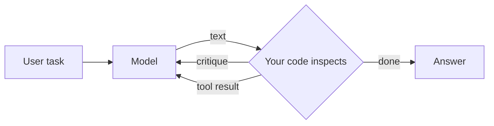
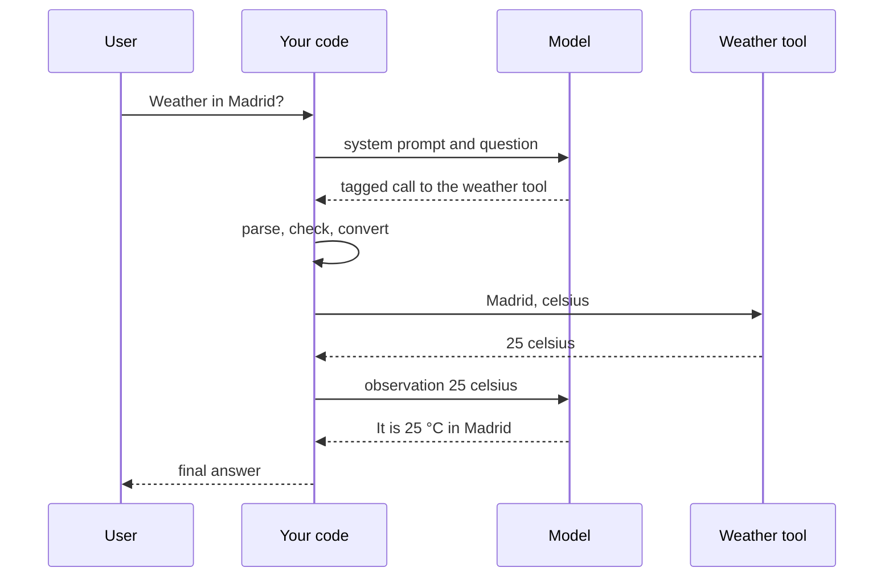
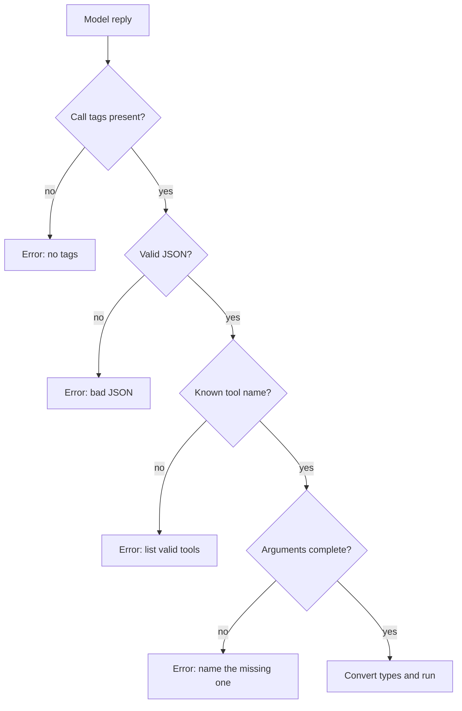
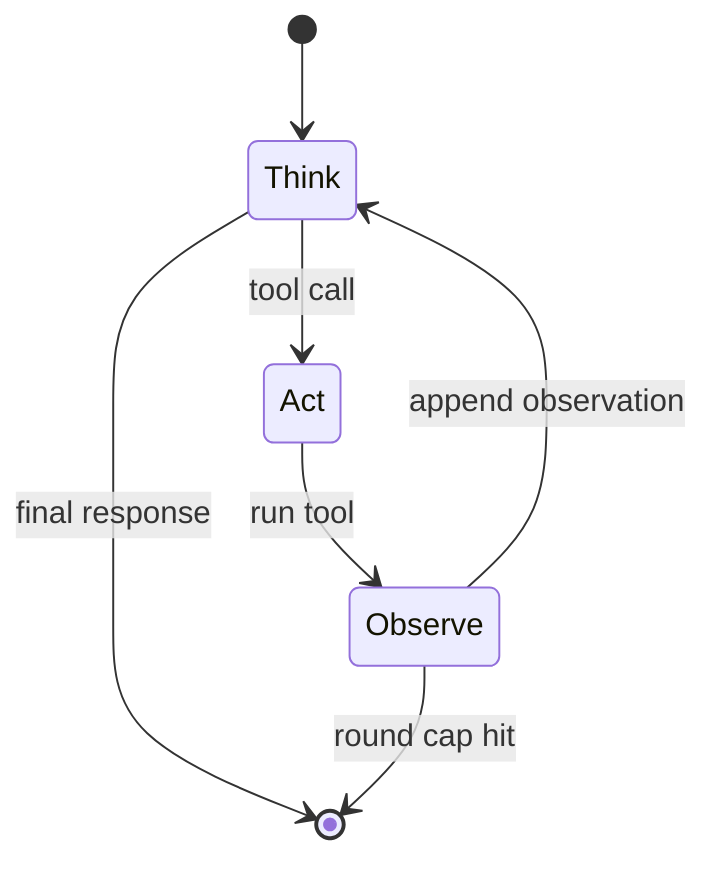
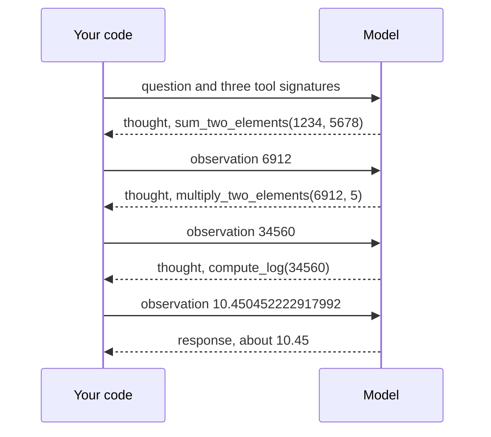
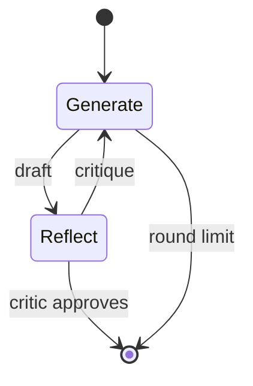
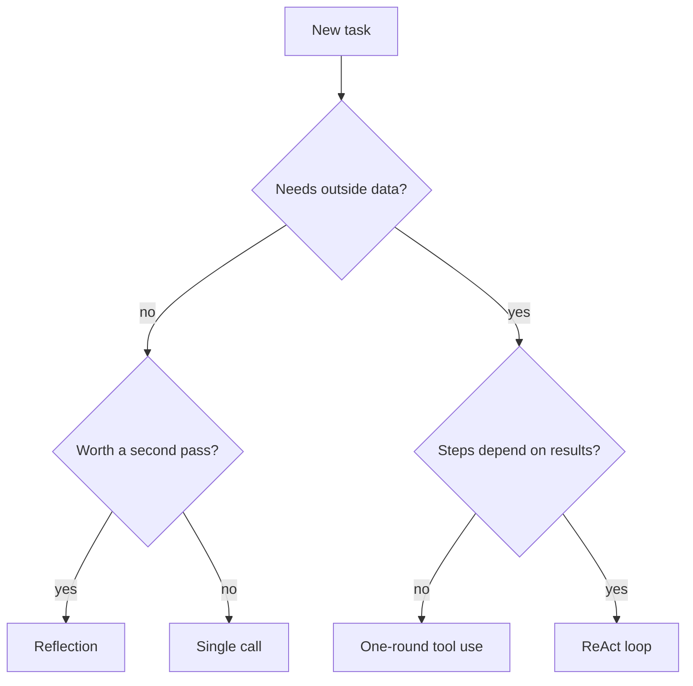

# M22.1 Theory: Agentic patterns from scratch: reflection, tool use, ReAct planning

*[M22 theory](../README.md) · Lesson 22.1 · Notebooks: [`01b_tool_use_pattern.ipynb`](../../notebook/01b_tool_use_pattern.ipynb), [`01c_planning_pattern_react.ipynb`](../../notebook/01c_planning_pattern_react.ipynb), [`01a_reflection_pattern.ipynb`](../../../optional/notebook/01a_reflection_pattern.ipynb) (optional) · [All theory pages](../../../../../THEORY.md)*
<!-- subtitle: Three loops, three stopping rules, and who actually runs the tool -->
<!-- format: approved -->

## Why the model cannot run the tool

> **What you'll learn**
>
> - **Explain** why a language model can request a tool but never run one.
> - **Trace** a text-protocol tool call from request to observation, and the four checks your code makes on the way.
> - **Compare** one-round tool use, ReAct and reflection by what repeats and what ends the loop.
> - **Diagnose** the planted failures: bad JSON, an unknown tool, a missing argument, a runaway loop, a lenient critic.

An **agent** is a model inside a loop that can act on the world. This lesson builds the loop's three classic shapes by hand.

A Larkspur customer asks support *How long does a refund take?* The model does not know Larkspur's policy; the answer sits in the support handbook. So the model replies with a request, *search the handbook for "refund timeline"*, and then nothing happens. The model only writes text.

The model decides. Your application acts.

That split leaves two jobs every agent has to do:

- **Running the tool**: your code reads the request, executes the function and returns the result as an **observation**, a message telling the model what the tool returned.
- **Stopping**: every loop needs a **stopping rule**, a condition that ends it.

All three patterns share one shape:

*Figure 1: The shared skeleton. The model only writes text; your code decides whether to stop or feed something back.*

## Agent loop

An **agentic pattern** is a fixed shape for repeating model calls until a task is done. The three patterns differ in what repeats and what ends the repetition:

| Pattern | What repeats | Stops when | Model calls in our runs |
|---|---|---|---|
| **Reflection** | Draft, critique, redraft | The critic approves, or after a set number of rounds | 2 to 6 with a three-round limit |
| **Tool use** | Nothing: one round of calls, then the answer | The model answers from the observation | 2 |
| **ReAct** | Thought, tool call, observation | The model writes its final response, or after a round cap (10 by default) | 4 for the arithmetic task |

*Table 1: The three patterns compared by loop body and stopping rule.*

The counts come from a re-implementation of the notebooks' loops with a scripted model.

> **Key distinction:** every pattern has two kinds of exit. One belongs to the model (an approval, an answer, a final-response tag). The other belongs to you (a round limit). A loop with only the model's exit is not finished.

## Pattern 1: one round of tool use

Here tools are described in the system prompt and the model writes its calls as text, which shows what native tool calling (lesson 22.4) later automates.

### The contract the model reads

A **tool** is a function plus a description the model can read: its name, its docstring, and each argument with its type. That description goes into the system prompt with one instruction: when you need a tool, reply with a call in a fixed tagged format. The model never sees the function body, and a vague docstring makes a vague tool.

### The request is only a string

Asked *What's the current temperature in Madrid, in Celsius?*, the model does not answer. It writes a tagged call naming the weather tool, with Madrid as the location and celsius as the unit. Nothing has run yet. The whole round looks like this:

*Figure 2: One round of tool use. Two model calls; the tool runs between them, inside your code.*

### The gatekeeper

Between the reply and the tool sits a **gatekeeper**, the code that decides whether a call may run. It makes four checks in a fixed order, and turns every failure into an observation the model can read instead of an exception that ends the run:

*Figure 3: Validate in this order. Each failure becomes a specific message the model can act on.*

The last step converts each argument to its declared type, so "5" becomes the number 5 when the tool wants a number. For Madrid the observation is 25 celsius, and a second model call turns it into a sentence.

The notebooks' agents make only that last check: a missing tag, bad JSON, an unknown name or a missing argument raises an exception and ends the run. The gatekeeper above is the hardened version.

### Planted failures

We planted five broken calls, each a mistake models really make, and one run with type conversion switched off:

| Planted call | What the gatekeeper returned |
|---|---|
| A reply with no call tags | Error: no call tags found |
| A sum call whose JSON is cut off | Error: the content is not valid JSON |
| A call to `calculator`, a tool that does not exist | Error naming the unknown tool and listing the four valid ones |
| A multiply call with only one of its two numbers | Error: missing argument `b` |
| A multiply call with "6912" and "5" as text | 34,560, after conversion to numbers |
| The same call with conversion switched off | "69126912691269126912…", and no error |

*Table 2: Five planted calls and one unguarded run.*

The first four never reach a tool. The last row is the dangerous one: Python repeats the text five times and returns a wrong answer with no error. We call that a **stringly-typed answer**: the failure no exception reports.

### Where one round breaks

Now a harder task: *sum 1234 and 5678, multiply the result by 5, then take the natural log.*

In one round the model must write every argument before any tool has run. It can fill in the sum, but the multiplication needs 6,912 and the log needs 34,560, and neither exists yet.

We call this **one-shot blindness**: a single round can run independent calls side by side, but it cannot chain dependent ones.

## Pattern 2: ReAct planning

**ReAct** (reason plus act) interleaves reasoning and acting: the model writes a thought, takes an action, reads the observation, and repeats. In the text protocol that is four kinds of message:

- **Thought**: what the model plans to do next and why.
- **Tool call**: one action, in the same format as before.
- **Observation**: the tool result, written by your code, never by the model.
- **Final response**: the answer, which ends the loop.

### The loop and its two exits

On each round the model gets the whole history. A final response ends the loop. Otherwise your code runs every call through the same gatekeeper and appends one observation per call. By round two, 6,912 is in the model's context.

*Figure 4: The ReAct state machine with its two exits: the model's final response and your round cap.*

### Tracing the arithmetic task

The reference task uses three tools (sum, multiply, natural log) and needs them in order:

*Figure 5: ReAct on a three-step dependent task. Each tool argument comes from the previous observation.*

Step through the scripted ReAct run. Each round is one model call.

<button type="button" data-step="1" aria-pressed="false" aria-controls="react-round-1">Round 1</button><button type="button" data-step="2" aria-pressed="false" aria-controls="react-round-2">Round 2</button><button type="button" data-step="3" aria-pressed="false" aria-controls="react-round-3">Round 3</button><button type="button" data-step="4" aria-pressed="false" aria-controls="react-round-4">Round 4</button>

<section id="react-round-1" class="step-panel"><h4>Round 1: sum</h4><dl><dt>Model writes</dt><dd>a thought and a call to sum 1234 and 5678</dd><dt>Observation</dt><dd>6912, appended to the history</dd></dl></section><section id="react-round-2" class="step-panel"><h4>Round 2: multiply</h4><dl><dt>Model reads</dt><dd>the whole history, including 6912</dd><dt>Model writes</dt><dd>a call to multiply 6912 by 5</dd><dt>Observation</dt><dd>34560</dd></dl></section><section id="react-round-3" class="step-panel"><h4>Round 3: log</h4><dl><dt>Model writes</dt><dd>a call to take the natural log of 34560</dd><dt>Observation</dt><dd>10.450452222917992</dd></dl></section><section id="react-round-4" class="step-panel"><h4>Round 4: final response</h4><dl><dt>Model writes</dt><dd>a final response: about 10.45</dd><dt>Your code</dt><dd>finds the response tag and returns; four model calls in all</dd></dl></section>

<button type="button" data-walk="previous">Previous</button>

<button type="button" data-walk="next">Next round</button>

Every argument after round one came from an observation.

### Planted failure: the runaway loop

A model that never writes a final response never stops on its own. We planted a stubborn policy that calls the handbook search every round, capped at five rounds, and reran the arithmetic task with a cap of two, below the number of dependent steps:

| Run | Model calls | How it ended |
|---|---|---|
| Arithmetic task, cap of 2 | 2 in the loop, 1 after it | Cap hit before the log step |
| Stubborn search, cap of 5 | 5 in the loop, 1 after it | Cap hit, no final response |

*Table 3: Two capped runs. The notebook's agent makes one more model call after the cap.*

Without the cap, the stubborn run never ends. We call that a **runaway loop**, and it bills for every round. Reaching the cap means the run stopped, not that the task was done. The notebook's agent then asks the model once more and returns whatever it writes, even a half-finished tool call; a fixed fallback reply is safer. The first row shows the opposite risk: a cap below the task's depth stops the agent before it can finish.

### What the loop costs

Each ReAct round resends the whole history: round *k* pays again for rounds 1 to *k* minus 1. The gap over one round of tool use widens every round. We call that **context creep**.

A weak answer from good tools needs a different loop.

## Pattern 3: reflection

**Reflection** improves an output by critiquing it and trying again. One persona writes a draft, a second persona reviews it against the task and returns either a list of fixes or an approval, and the writer revises.

*Figure 6: The reflection loop. The critique becomes the next message to the writer.*

It uses no tools but has the same two exits: the critic's approval and your round limit. We ran it with three planted critics and a three-round limit:

| Critic | Rounds | Model calls | How it ended |
|---|---|---|---|
| Approves everything | 1 | 2 | Critic approved |
| Finds two real bugs, then approves | 3 | 6 | Critic approved |
| Never approves | 3 | 6 | Round limit reached |

*Table 4: Reflection with three planted critics.*

The lenient critic ends the loop after one review: two calls, no improvement. The never-satisfied critic is the reflection version of a runaway loop, and the limit stops it at 2 × 3 = 6 calls. The agent then returns the last draft, which no critique has seen.

> **Pitfall: the lenient critic.** If the reviewer prompt is soft, reflection quietly becomes a single generation that costs double. Tell the critic exactly what good means.

One guard worth copying: each side keeps only its system prompt plus the latest exchange, and earlier drafts are not resent. M25 covers reflection in full.

## Choosing a pattern

Choosing is a short decision:

*Figure 7: Pick the smallest loop that fits the task.*

| | Reflection | Tool use | ReAct |
|---|---|---|---|
| Reaches outside data | ✗ | ✓ | ✓ |
| Chains dependent calls | ✗ | ✗ | ✓ |
| Model calls | 2 × rounds | 2 | tool rounds + 1 |
| Main risk | Lenient critic | One-shot blindness | Runaway loop, context creep |

*Table 5: Trade-offs at a glance.*

The patterns combine. A production support agent often runs ReAct to gather evidence, then a reflection pass to check the draft answer against that evidence.

## In practice: the Larkspur refund question

Back to the customer. The loop is the one traced above; only the tool changes:

1. The model writes a thought ("I need the refund policy") and a call to the handbook search with the query "refund timeline".
2. The gatekeeper checks the call, runs the search and returns the top handbook chunks as an observation.
3. The model writes its final response, quoting the chunks it was given.

That is retrieval as a tool: your code touched the handbook, and the observation carried the evidence back. Native tool calling (lesson 22.4) moves the tool description into the API request and returns structured calls with ids. Most parsing failures disappear; the loop in Figure 4 and your round cap stay.

## Limits of this evidence

- **No live model.** Every model reply in Tables 2 to 4 is scripted; the parsing, checking and looping are real. The planted failures cover the common shapes, not how often they happen.
- **Left out on purpose:** retries with backoff (add them for a real API), history trimming (once tasks need many rounds), parallel tool execution and per-round tracing (before the first production user).

## References

1. Yao et al., [ReAct: reasoning and acting together in language models](https://arxiv.org/abs/2210.03629) (arXiv 2210.03629).
2. Madaan et al., [Self-Refine: iterative refinement with self-feedback](https://arxiv.org/abs/2303.17651) (arXiv 2303.17651).
3. The Neural Maze, [agentic patterns from scratch](https://github.com/neural-maze/agentic-patterns-course), the MIT-licensed code the notebooks adapt.
4. OpenAI, [function calling guide](https://platform.openai.com/docs/guides/function-calling).

## Key Takeaways

- The model never runs a tool. It writes a call as text; your code parses, checks, converts and runs it, and the result goes back as an observation.
- One round of tool use cannot chain dependent calls. ReAct can, because every observation stays in the history for the next decision.
- Give every loop two exits, the model's own and a round cap you own. Reaching the cap is a stop with a fallback reply, not a completed task.

## Check yourself

1. Why can the ReAct agent chain three dependent tool calls when the one-round tool-use agent cannot?

One round of tool use must write every argument before any tool has run, so it cannot use one result to choose the next call. ReAct loops, and every observation stays in the history, so the model sees 6912 before it asks to multiply it by 5.

2. The gatekeeper receives a multiply call with 6912 and 5 written as text. What comes back with type conversion, and what comes back without it?

With conversion the text becomes numbers and the tool returns 34,560. Without it, the language repeats the text "6912" five times and returns a long string with no error at all. That stringly-typed answer is more dangerous than a missing argument, which at least produces an error the model can read.

3. A hand-written ReAct agent keeps calling a search tool that returns nothing useful, and the bill keeps growing. Which exit was missing?

The round cap, the exit you own (10 rounds by default). The final-response exit only fires when the model decides it is done, and a model that keeps asking for tools never decides that. With the cap the run stops and says why, and the user should get a fallback reply rather than silence.

---
*Previous: [M22 overview](../README.md). Next: [22.2 A real-world agent on raw API calls (Hacker News chatbot)](../../../optional/theory/02_a_real_world_agent_on_raw_api_calls_hacker_news_chatbot/README.md).*
