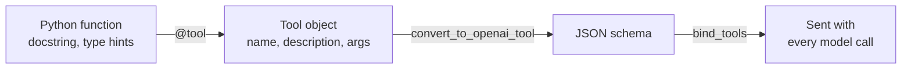

# M22.3 Theory: Defining tools and binding them to a model

*[M22 theory](../README.md) · Lesson 22.3 · Notebooks: [`03a_defining_tools.ipynb`](../../notebook/03a_defining_tools.ipynb) · [All theory pages](../../../../../THEORY.md)*
<!-- subtitle: The model reads a description, never your code, so the description decides the call -->

## Tool schema

> **What you'll learn**
>
> - **Explain** the three parts of a tool schema and which decision each one drives.
> - **Compare** an untyped, a typed and a validated definition of the same tool by what the model learns from each.
> - **Diagnose** a wrapped built-in tool whose argument name changed under you.
> - **Choose** where a bad argument should be rejected: before the function runs, never inside it.

Lesson 22.1 described tools in a hand-written prompt and parsed the model's calls out of its text. This lesson replaces that prompt with the real thing: a schema the provider understands.

Larkspur's support agent has two tools. One searches the policy handbook, the other checks a customer's server. For every question it must pick one, both or neither, and fill in the arguments, and it makes that choice without ever seeing the code behind either tool.

What it sees instead is a short description of each tool. That description decides how often the agent calls the right tool with the right arguments.

A **tool schema** is the machine-readable description of a tool that travels with every model request. **Binding** tools to a model means attaching their schemas to each call. LangChain builds the schema from the function's name, its docstring and its type hints:

*Figure 1: From function to schema. Only the right-hand box reaches the model.*

The schema has three parts, and each drives a different decision:

| Part | Comes from | What the model uses it for |
|---|---|---|
| **Name** | The function name, or one you set | The call it writes; your code looks the tool up by this name when it runs the call (lesson 22.4) |
| **Description** | The docstring, or one you set | Deciding *when* to call this tool, out of all the tools it holds |
| **Parameters** | Type hints, or a validation model | Deciding *what* to pass: each argument's type, its description, and which arguments are required |

*Table 1: The three parts of a tool schema.*

The function body is the one part the model never sees. A vague description produces wrong or missing calls however good the code behind it is. We call that a **blind tool**: correct code behind a description that does not say when to use it.

## Types do two jobs

Take a `multiply` tool with no type hints. Its schema lists two arguments, `a` and `b`, each with a title and no type at all. The model has nothing to go on, and the tool has nothing to check:

| Call | Untyped `multiply` | Validated `multiply` (both arguments declared as numbers) |
|---|---|---|
| 2 and 3 | 6 | 6 |
| 2 and "abc" | "abcabc", no error | Rejected with a validation error before the function runs |

*Table 2: The same bad call against an untyped and a validated tool.*

The untyped tool returns "abcabc" because Python repeats a string when you multiply it by a whole number. That is the stringly-typed answer from lesson 22.1 again: a wrong result that no exception reports.

The validated version declares its arguments through a **validation model**, a Pydantic class that states each field's type and description. The schema now tells the model to send numbers, and the same bad call stops at the door.

> **Key distinction:** a type in the schema does two jobs. It tells the model what to send, and it lets the framework refuse what the model sends wrongly, before your code runs.

## Three versions of the handbook search

Here is Larkspur's handbook search defined three ways, with what the parameters part of each schema tells the model about its one argument, the query:

| Definition | What the model learns about the query |
|---|---|
| A function with an untyped query argument | It exists and is required. Nothing about its type or meaning |
| The same function with the query typed as a string | It is a required string |
| A validation model with a field description | It is a required string described as "Words to look up in the handbook, for example 'refund window'" |

*Table 3: Three definitions of one tool, as the model sees them.*

The full schema of the third version also carries a tool description: "Search the Larkspur Cloud handbook and return the two best-matching chunks. Use it for policy questions: billing, refunds, exports, outages, server sizing." That sentence says what the tool returns and which questions it is for, so the model can tell it apart from the server-status tool. The argument description says what a good query looks like.

We planted one bad call against all three versions, the number 3 as the query:

| Definition | Query = 3 |
|---|---|
| Untyped | Accepted; the function runs with a number |
| Typed as a string | Rejected: "Input should be a valid string" |
| Validation model | Rejected: "Input should be a valid string" |

*Table 4: One planted call against three definitions.*

The rejection happens before the function runs, which is where it belongs. Lesson 22.5 shows how that failure can come back to the model as a message it can read and correct.

## Check a wrapped tool before you bind it

LangChain's built-in tools carry their own schemas. The Wikipedia tool is named `wikipedia` and takes one string argument, `query`. Wrapping it in a generic tool with your own name and description changes that argument's name to the generic `tool_input`:

| | Built-in Wikipedia tool | Same tool, wrapped |
|---|---|---|
| Name | `wikipedia` | Your name |
| Description | The built-in one | Yours |
| Argument | `query` | `tool_input` |

*Table 5: What wrapping changes.*

The model now sends `tool_input`, and any prompt or test that expects `query` silently stops matching. We call that **argument drift**: the right value under the wrong key, which is still an invalid call.

> **Pitfall: argument drift.** Whatever the source of a tool, inspect its final name, description and argument list before you trust it in a loop. That is exactly what the model will read.

The from-scratch tools in lesson 22.1 described their arguments with Python type names inside a prompt. A native schema uses JSON Schema types (string, number) and travels in the API request itself, so the provider can return structured calls that match it.

## In practice: Larkspur's two tools

For Larkspur's agent, the schemas should leave no overlap for the model to guess about:

1. **Handbook search**: described as the tool for policy questions (billing, refunds, exports, outages, server sizing), with a typed, described query.
2. **Server status**: described as the tool for one of the customer's own servers, with a typed, required server id.
3. **Before binding**: print each tool's name, description and arguments, and read them as the model will.

A question such as *Is my server web-1 running, and does a reboot change its IP address?* then maps cleanly onto both tools, which lesson 22.4 traces message by message.

## Key Takeaways

- The model reads only the schema: name, description and parameters, never the function body. A vague description gives wrong or missing calls however good the code is.
- Type every argument. An untyped tool accepts anything (`multiply` turns 2 and "abc" into "abcabc"), while a validated schema rejects bad input before the function runs.
- Inspect a tool's final name, description and arguments before binding it, especially a wrapped built-in, because that is exactly what the model sees.

## Check yourself

1. The model never sees a tool's function body. Which three parts of the schema does it read, and what does each one decide?

The name, the description and the parameters. The name is the call it writes and your code dispatches on. The description decides when to call the tool out of all the tools it holds. The parameters decide what to pass, with each argument's type, description and whether it is required.

2. The untyped multiply tool gets 2 and the string abc. What comes back, and what does the validated version do with the same call?

The untyped tool returns "abcabc", because its schema has no types and Python repeats a string when it is multiplied by a whole number. The validated version declares both arguments as numbers, so the same call fails validation before the function runs.

3. You wrap the built-in Wikipedia tool with your own name and description, and the agent starts passing odd arguments. What should you check before binding it?

The argument name. Wrapping changes the built-in's `query` argument to the generic `tool_input`. Inspect the tool's final name, description and arguments before you trust it in a loop, because that is exactly what the model reads.

---
*Previous: [22.1 Agentic patterns from scratch: reflection, tool use, ReAct planning](../01_agentic_patterns_from_scratch_reflection_tool_use_react_planning/README.md). Next: [22.4 The manual tool loop and the augmented LLM in LangGraph](../04_the_manual_tool_loop_and_the_augmented_llm_in_langgraph/README.md).*
