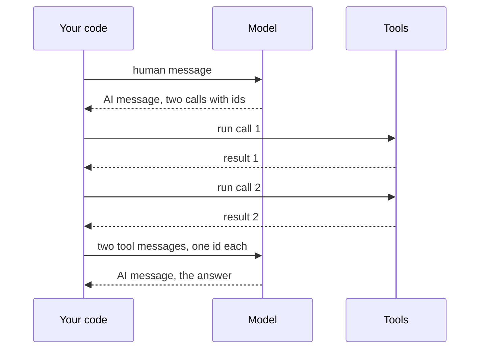
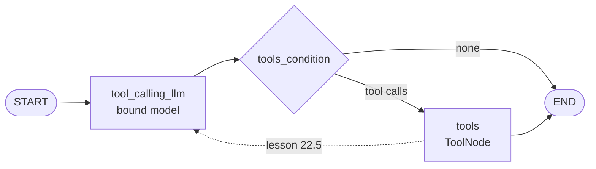
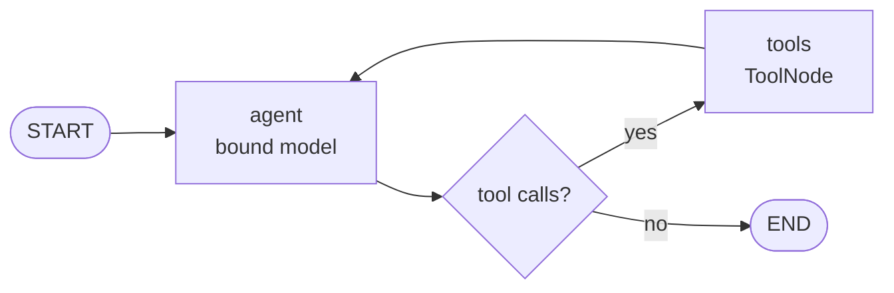

# M22.4 Theory: The manual tool loop and the augmented LLM in LangGraph

*[M22 theory](../README.md) · Lesson 22.4 · Notebooks: [`04a_tool_calling_manual_loop.ipynb`](../../notebook/04a_tool_calling_manual_loop.ipynb), [`05a_tool_loop_errors_and_evaluation.ipynb`](../../notebook/05a_tool_loop_errors_and_evaluation.ipynb) (Part 3.1) · [All theory pages](../../../../../THEORY.md)*
<!-- subtitle: Two tool calls in one reply, one id each, and the edge that turns a tool user into an agent -->
<!-- format: approved -->

## Native tool calls and the message trace

> **What you'll learn**
>
> - **Explain** how native tool calling returns structured calls with ids instead of tagged text.
> - **Trace** a two-tool question message by message and count what the history holds.
> - **Diagnose** the broken history that a dropped tool result leaves behind.
> - **Compare** an augmented LLM with an agent loop, and name the one edge between them.

Lesson 22.3 turned each tool into a schema. This lesson sends those schemas with a real request and follows what comes back.

A Larkspur customer asks *Is my server web-1 running, and does a reboot change its IP address?* Answering needs two lookups, a server status and a handbook search, and neither depends on the other. The model can ask for both in one reply, which means your code has to keep track of which result answers which request.

### A reply that requests tools

With **native tool calling**, the tool schemas travel in the API request, and the provider returns tool requests as structured data instead of tagged text. A reply that requests tools is an **AI message** whose text content is often empty and whose list of **tool calls** holds one entry per request:

| Field | Example from the recorded weather run | What it is for |
|---|---|---|
| Name | The weather tool | Which tool to run |
| Arguments | City: Munich | What to pass |
| Call id | A unique id the provider generates | Pairing the result with this request |

*Table 1: One entry in a reply's tool calls.*

Ask about the weather and outdoor seating together, and the same reply holds two calls, one per tool, with a finish reason that says the model stopped to request tools. The model asks for both at once because neither depends on the other, which saves a round trip.

### One result for each call

The model still runs nothing. The loop from lesson 22.1 becomes four moves over typed messages:

*Figure 1: The native loop. Each tool message carries the id of the call it answers.*

1. Send the user's question as a **human message**, and append the model's AI message with its tool calls.
2. For each call, look the tool up by name and run it with the given arguments.
3. Append one **tool message** per call, holding the result and the id of the call it answers.
4. Call the model again with the whole list. It answers from the results.

The call id is what pairs a result with its request. With two parallel calls, the model would otherwise receive two unlabelled strings and no way to tell which tool produced which.

> **Pitfall: the orphaned call.** OpenAI's API rejects a history in which a tool call has no matching tool message. A loop that drops the result of a failed call breaks the next request, not only that answer.

Matching ids only records which request a result belongs to. It does not prove the tool ran correctly or that the server was actually checked.

### Counting messages in a two-tool run

The tool-error lab in lesson 22.5 runs the two-tool question on Larkspur's tools. Step through the five messages the history holds:

Each stage adds messages to the history. The model's turns are scripted; the handbook scores are real.

<button type="button" data-step="0" aria-pressed="false" aria-controls="web1-msg-0">0. Human</button><button type="button" data-step="1" aria-pressed="false" aria-controls="web1-msg-1">1. AI</button><button type="button" data-step="2" aria-pressed="false" aria-controls="web1-msg-2">2 and 3. Tools</button><button type="button" data-step="4" aria-pressed="false" aria-controls="web1-msg-4">4. AI</button>

<section id="web1-msg-0" class="step-panel"><h4>Message 0: the question</h4><dl><dt>Human message</dt><dd><em>Is my server web-1 running, and does a reboot change its IP address?</em></dd></dl></section><section id="web1-msg-1" class="step-panel"><h4>Message 1: two calls in one reply</h4><dl><dt>AI message</dt><dd>empty text and two tool calls, each with its own id: server status for web-1, and a handbook search for "reboot server IP address"</dd></dl></section><section id="web1-msg-2" class="step-panel"><h4>Messages 2 and 3: one result per call</h4><dl><dt>Tool message for the status call</dt><dd>web-1: running</dd><dt>Tool message for the search call</dt><dd>the reboot chunk (score 0.747): "A reboot takes about a minute and does not change the server IP address", then the sizing chunk (0.156)</dd></dl></section><section id="web1-msg-4" class="step-panel"><h4>Message 4: the answer</h4><dl><dt>AI message</dt><dd>the answer, with no tool calls; the loop ends</dd></dl></section>

<button type="button" data-walk="previous">Previous</button>

<button type="button" data-walk="next">Next message</button>

Five messages, two of them tool results. The scores are TF-IDF scores over the lab's twelve handbook chunks; we re-ran them with scikit-learn and they match. Message count is a cheap diagnostic: a single-tool question takes four messages. Six on the same question means an extra round, which lesson 22.5 traces to a malformed first call.

A model without native tool calling needs the text protocol from lesson 22.1 instead: tool descriptions in the system prompt and your code parsing the call out of the reply. Nothing guarantees valid JSON, a real tool name or every argument, so use it only when the model leaves no choice.

## The augmented LLM

LangGraph can take over the dispatch. The graph has three pieces:

- **Model node**: calls the model with the tools bound.
- **Router**: checks the latest reply; tool calls send the run to the tool node, no tool calls end it.
- **Tool node**: runs every requested call and writes one tool message per call into the graph's state.

*Figure 2: A one-shot tool graph. The solid edges stop after the tools; the dashed edge is the loop.*

Follow the solid edges with two questions:

| Question | Path | What the user gets |
|---|---|---|
| *Explain tool calling in one sentence* | Model, router, end | A direct answer; no tool needed |
| *What's the weather in Tokyo?* | Model, router, tool node, end | The tool's raw output and no sentence |

*Table 2: Two questions through the one-shot graph.*

The second run ends on a tool message. Nobody reads the result, the user gets no sentence, and a second call that depends on the first is impossible. We call that **stopping at the tool**.

That graph is an **augmented LLM**: a model that can use tools once, but not a loop. One more edge, from the tool node back to the model node (the dashed line), makes it an agent:

*Figure 3: The agent loop in notebook 05a. The tool node returns to the model, and only a reply with no tool calls reaches the end.*

The model then reads each result and decides whether to call another tool or answer, which is the loop in the module's mental model.

> **Key distinction:** an augmented LLM ends on whatever the tools return; an agent ends when the model writes a reply with no tool calls. The difference is one edge, and it changes the final message from a tool result to an answer.

## In practice: the web-1 question

Run the web-1 question through both graphs:

Choose a graph to see where the web-1 run ends and what the customer receives.

<button type="button" data-mode="augmented" aria-pressed="false" aria-controls="graph-augmented">Augmented LLM</button><button type="button" data-mode="loop" aria-pressed="false" aria-controls="graph-loop">Agent loop</button>

<section id="graph-augmented" class="mode-panel" data-announcement="Augmented LLM selected. The run ends on a tool message."><h4>Augmented LLM (Figure 2)</h4><dl><dt>Path</dt><dd>model, router, tool node, end</dd><dt>Last message</dt><dd>the handbook chunk, a tool message</dd><dt>Customer sees</dt><dd>raw tool output, no sentence</dd></dl></section>
<section id="graph-loop" class="mode-panel" data-announcement="Agent loop selected. The run ends on an answer."><h4>Agent loop (Figure 3)</h4><dl><dt>Path</dt><dd>model, tool node, model, end</dd><dt>Last message</dt><dd>an AI message with no tool calls</dd><dt>Customer sees</dt><dd>web-1 is running, and a reboot does not change its IP address</dd></dl></section>

In both runs each tool message carries its call id, and the model can tell the status from the handbook chunk. Lesson 22.5 adds what happens when one of those calls fails.

## Limits

- **Scripted model turns.** The web-1 trace scripts the model's replies; only the tool results and scores are computed. A live model may split the two lookups across two replies.
- **One provider's rule.** The orphaned-call rejection is OpenAI's behaviour; check other providers before relying on it.

## References

1. LangChain, [tool calling](https://docs.langchain.com/oss/python/langchain/models#tool-calling).
2. LangChain, [LangGraph workflows and agents](https://docs.langchain.com/oss/python/langgraph/workflows-agents).
3. OpenAI, [function calling guide](https://platform.openai.com/docs/guides/function-calling).
4. Anthropic, [Building effective agents](https://www.anthropic.com/engineering/building-effective-agents), source of the augmented LLM term.

## Key Takeaways

- A model with tools bound returns an AI message with tool calls and runs nothing. Independent calls arrive together in one reply, saving a round trip.
- Answer every call with exactly one tool message carrying its call id. The id pairs results with requests, and OpenAI rejects a history with an unanswered call.
- A graph that goes from the tool node to the end is an augmented LLM. One edge from the tool node back to the model turns it into an agent loop.

## Check yourself

1. Why does every ToolMessage carry the id of the tool call it answers?

The call id pairs a result with its request. With two parallel calls the model would otherwise get two unlabelled strings and no way to tell which tool produced which. OpenAI's API also rejects a history in which a tool call has no matching tool message, so dropping a failed call's result breaks the next request.

2. A customer asks if web-1 is running and if a reboot changes its IP. How many messages does the trace hold, and why are both tools requested at once?

Five: the human message, one AI message with two calls (server status and handbook search), two tool messages and the final AI message. Neither call depends on the other, so the model asks for both at once and saves a round trip.

3. A graph answers a weather question with the tool's raw output and no sentence. What is missing, and which one change fixes it?

The tool node goes straight to the end, so nobody reads the result and no dependent call is possible. That graph is an augmented LLM. Adding an edge from the tool node back to the model makes it an agent loop, and the model then turns the result into an answer.

---
*Previous: [22.3 Defining tools and binding them to a model](../03_defining_tools_and_binding_them_to_a_model/README.md). Next: [22.5 Tool errors and evaluating tool calls](../05_tool_errors_and_evaluating_tool_calls/README.md).*
