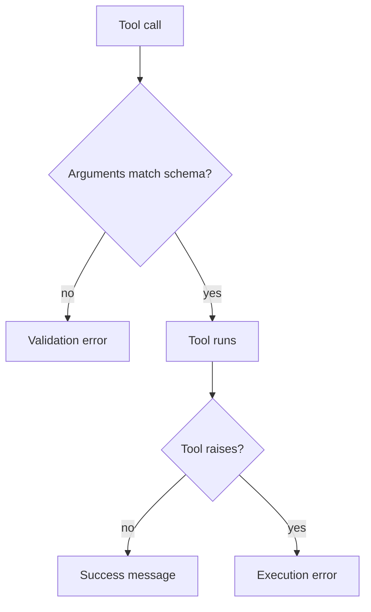

# M22.5 Theory: Tool errors and evaluating tool calls

*[M22 theory](../README.md) · Lesson 22.5 · Notebooks: [`05a_tool_loop_errors_and_evaluation.ipynb`](../../notebook/05a_tool_loop_errors_and_evaluation.ipynb) · [All theory pages](../../../../../THEORY.md)*
<!-- subtitle: Where a failed tool call goes, who gets to read it, and how to score a run that finished but was wrong -->
<!-- format: approved -->

## Where tool errors go

> **What you'll learn**
>
> - **Explain** the two places a tool call can fail, and what LangGraph's three error settings do with each.
> - **Trace** an unknown-server question from a crash to a clarifying answer.
> - **Choose** between returning an error from the tool and catching the exception in the loop.
> - **Score** tool selection, tool input and synthesis separately from the same message trace.

Lesson 22.4 closed the loop from the tool node back to the model. This lesson asks what travels along that edge when a call fails.

A Larkspur customer asks the support agent *Is my server web-9 up?* The customer has no server called web-9, and the status tool raises an error. With LangGraph's default settings, that error escapes the graph and the customer gets no answer at all.

### The loop and its trace

The agent loop has two nodes. The **agent node** calls the model. The **tool node** runs every tool call the model asked for and appends one tool message per call. An edge from the tool node back to the agent node lets the model read the results, and a router ends the run when the last model reply has no tool calls:

*Figure 1: The agent loop. Every tool result goes back to the model before the run can end.*

The message list is the run's trace: four messages for a one-tool question, five when one reply requests two tools (lesson 22.4). Message count shows extra work, not whether the answer is correct.

### Two places a call can fail

To isolate the tool node, we fed it a hand-written model reply with one call, which keeps every result deterministic. The tool checks a customer's servers, web-1 and db-1, and raises an error naming the real servers when asked about any other:

| Call | What came back |
|---|---|
| Status of web-1 | A tool message with status *success*: "web-1: running" |
| Status of web-9 | No tool message. The error escaped: "Unknown server 'web-9'; your servers: ['db-1', 'web-1']" |

*Table 1: A valid call and a controlled failure, default settings.*

In the full loop the second row means the whole run raises and the model never sees the error. Yet the error text lists the customer's real servers: a model that could read it could ask which one the customer meant.

A tool call can fail in two places:

- **Validation error**: the model sends bad arguments, which fail the schema check before the tool runs (a call naming the argument `id` instead of `server_id`).
- **Execution error**: the arguments are fine and the tool itself raises (web-9).

*Figure 2: The two failure points. The error setting decides what each one becomes.*

### The three error settings

The tool node's `handle_tool_errors` setting decides what happens at each failure point. We ran both planted failures under each of its three values, in the LangGraph version this course pins (1.2.18):

| Setting | Bad arguments from the model | Error raised inside the tool |
|---|---|---|
| Default | Error message: the missing field, then "Please fix the error and try again." | **Re-raised: the run crashes** |
| `True` | Error message ending "Please fix your mistakes." | Error message with the exception text |
| `False` | Re-raised | Re-raised |

*Table 2: Two failures under three settings.*

Of the three, only `True` turns both failures into messages the model can read. The default catches the model's mistakes but not the tool's, which is why the web-9 question crashes under it. We re-ran the table on langgraph 1.2.18 with `langgraph-prebuilt` 1.1.1; check it again after an upgrade.

### What the model does next

An error message lets the model recover, but it does not make it recover: the model still has to read the message and choose a sensible next step. Here is the web-9 run under `True`. The tool message is LangGraph's real output; the model's two turns are scripted:

| # | Message | Content |
|---|---|---|
| 0 | Human | Is my server web-9 up? |
| 1 | AI | Calls the status tool for web-9 |
| 2 | Tool, status error | The unknown-server error listing db-1 and web-1, then "Please fix your mistakes." |
| 3 | AI | I can't find a server called web-9 on your account. Your servers are db-1 and web-1. Which one did you mean? |

*Table 3: The web-9 run with errors returned to the model.*

The scripted reply asks for clarification using the server names in the error. A live model could choose another action, including an unhelpful retry. Under the default or `False`, the same run raises after message 1, before another model turn.

### Four golden questions, three settings

The [interactive lab](interactive/tool-error-routing-lab.html) runs Larkspur's four golden questions through the full loop under each setting. Its tool results and error texts match what LangGraph produces for the same calls byte for byte (12 runs, 0 mismatches); the model's turns are scripted, as in Table 3.

| Question | Default | `True` | `False` |
|---|---|---|---|
| *Can I export my data after I cancel my plan?* | Answered, 4 messages | Answered, 4 | Answered, 4 |
| *Is my server web-1 running, and does a reboot change its IP address?* | Answered, 5 | Answered, 5 | Answered, 5 |
| *Is my server web-9 up?* (the tool raises) | **Crashed** | Answered, 4 | **Crashed** |
| *How long does a refund take?* (the model passes `q`, not `query`) | Answered, 6 | Answered, 6 | **Crashed** |
| Answered | 3 of 4 | 4 of 4 | 2 of 4 |

*Table 4: The lab's golden questions under each setting.*

<!-- lab: interactive/tool-error-routing-lab.html -->

- **The unknown server is an execution error.** Only `True` catches it, and the model can then name the customer's real servers, because the error text lists them.
- **The wrong argument name is a validation error.** The default and `True` both return it as a message, the model retries with `query`, and the run costs one extra round trip (6 messages instead of 4). `False` re-raises it.
- **The two questions with no failure behave the same under every setting.** We call this the **happy-path blind spot**: a test suite of questions that never fail cannot tell the three settings apart.

### Deciding where each error is handled

There are two ways to get a failure to the model:

| Approach | How it works | Use it when | Message status |
|---|---|---|---|
| **The tool returns the error** | A divide tool checks for zero and returns "Error: Division by zero" as its result | The tool knows the failure in advance: an unknown id, an empty result, an input out of range | *success* |
| **The tool raises and the tool node catches it** | `True`, or a custom handler that catches selected exception types | Failures you cannot list in advance, such as a client library's errors | *error* |

*Table 5: Returning an error versus catching an exception.*

The setting also accepts a custom message, an exception type or a group of types (catch only those), or a function that formats the message. Either way, write error messages the model can act on, as the web-9 message lists the valid servers, and return only what the customer may see.

> **Pitfall: the successful failure.** A tool that returns an error string completes normally, so its tool message has status *success*. Only a caught exception produces status *error*. Monitoring that counts error statuses misses every failure a tool reports as text.

Letting an exception escape is also a choice, and it has a cost: your application code must then log the failed run and give the user a fallback reply.

## Tool-call evaluation

A run can finish and still be wrong. The refund question answers correctly under the default setting, yet its first call was malformed and cost an extra round trip. An agent that picks the wrong tool, passes the wrong server id or ignores what the tool returned can also produce a fluent answer. Each is a different failure: score them separately, from the same trace.

### Three dimensions

| Dimension | Question | How to score it |
|---|---|---|
| **Tool selection** | Did it pick the right tool or tools? | Compare called names with the golden set's expected calls |
| **Tool input** | Were the arguments well formed and relevant? | Check required arguments are present and pinned values match |
| **Synthesis** | Did the answer use what the tools returned, and nothing else? | An LLM judge or a reference answer |

*Table 6: The three scores and where each comes from.*

Separate scores tell you what to fix: a selection drop after a description change points at the description, an input drop at the schema. Confirm the cause from the failing calls first.

### Scoring selection and input from the trace

The first two dimensions need no model at all. Give each golden question its expected calls:

- *Is my server web-1 running, and does a reboot change its IP address?* expects the status tool with server web-1, and the handbook search with any query.
- *How long does a refund take?* expects the handbook search alone.

A small scorer reads every tool call from the model's replies, compares the set of called names with the expected set, and flags any call that is missing a required argument or has the wrong value for a pinned one. On two runs from the lab:

| Run | Selection | Calls | Flagged for input |
|---|---|---|---|
| web-1 status and reboot | Correct | 2 | None |
| Refund (first call passed `q`) | Correct | 2 | The handbook search |

*Table 7: The trace scorer on two lab runs.*

Both runs chose the right tools. The refund run's first call is flagged because it passed `q` instead of `query`; the lab's trace marks the same call "right tool, missing query".

That scorer is deliberately small. It does not check types, query relevance, call order or duplicate calls, and it assumes it knows every tool name. A production scorer validates against the real tool schemas and flags unknown names.

### Judging synthesis

**Synthesis** measures whether the final answer uses the returned facts correctly, and that needs judgement. An **LLM judge** is another model asked to grade the trace against explicit criteria: give it the question, the tool requests, the tool results and the final answer, and ask for a score from 1 to 5 on each of the three dimensions plus a short justification.

One recorded judgement shows the shape. The trace asks *Calculate 15% of 250 and check weather in Paris*; the agent calls a calculator (37.5) and a simulated weather tool (65°F, partly cloudy), and its answer includes both. The judge scored it 5, 5 and 5. That is one recorded judgement on a practice trace, not a Larkspur result, and a new judge call may disagree.

> **Pitfall: the self-grading judge.** In that recording the judge is the agent's own model, which tends to be lenient on its own work. Use a different, ideally stronger, model, and check its scores against a few human-graded runs before you trust a trend.

Two more cautions. The score fields are plain whole numbers, and nothing rejects a 7 without a range check. And one trace scored 5 out of 5 proves little: scores mean something across a fixed golden set, before and after one change, as in M10's baseline-first method.

### Counting what never finishes

Per-call scores miss the runs that never produce an answer. Log three counts per run as well:

- **Rounds per run**: the refund question's extra round shows as 6 messages instead of 4.
- **Error tool messages per tool**: which tool fails, and how often.
- **Crashed runs**: the web-9 question under the default has no answer to score at all.

Those counts are cheap and catch both of the lab's failures. A crashed web-9 run passes selection and input, because the model asked for exactly what the customer said; only the crashed-run count records it.

## Limits of this evidence

- **Scripted model turns.** Every model reply in Tables 3, 4 and 7 is scripted; only the tool messages and error texts are LangGraph's real output.
- **One version.** Table 2 is the behaviour of the pinned LangGraph version; the settings have changed between releases.
- **One judgement.** The synthesis example is a single recorded score: it shows the method, not the judge's reliability.

## References

1. LangChain, [ToolNode API reference](https://reference.langchain.com/python/langgraph.prebuilt/tool_node/ToolNode), including `handle_tool_errors`.
2. LangChain, [evaluating agent trajectories](https://docs.langchain.com/langsmith/trajectory-evals).
3. Zheng et al., [Judging LLM-as-a-judge with MT-Bench and Chatbot Arena](https://arxiv.org/abs/2306.05685) (arXiv 2306.05685).

## Key Takeaways

- Choose error routing explicitly. In the tested version, the default tool node returns the missing-argument error to the model but re-raises the tool's own error; `True` returns both.
- A tool that returns an error string produces a success-status message. Write error messages the model can act on, and remember that happy-path tests never show the difference between settings.
- Score tool selection, tool input and synthesis separately. The first two come straight from the trace; judge synthesis with a different model, across a fixed golden set, and count crashed runs too.

## Check yourself

1. With the default ToolNode settings, why does the web-9 question crash while the wrong-argument refund question still gets answered?

They fail in different places. The wrong argument name is a validation error, which the default turns into an error message the model can read and retry from. The unknown server is an exception raised inside the tool, which the default re-raises, so the run crashes before the model sees it.

2. In the lab, how many of the four golden questions does each handle_tool_errors setting answer, and which questions make the difference?

The default answers 3 of 4, `True` 4 of 4 and `False` 2 of 4. The web-9 question (the tool raises) crashes under the default and `False`, and the refund question (wrong argument name) crashes under `False`. The other two questions behave the same under every setting.

3. Your error dashboard counts tool messages with status error and shows almost none, yet customers report failed lookups. What is the likely cause?

The tools probably return their failures as strings, such as "Error: Division by zero". A returned string completes the tool normally, so its message has status success. Count those failures another way, or let the tool raise and have the tool node catch it, which produces status error.

---
*Previous: [22.4 The manual tool loop and the augmented LLM in LangGraph](../04_the_manual_tool_loop_and_the_augmented_llm_in_langgraph/README.md). Next: [22.6 Hosted vs client-side tools: code execution and image generation](../06_hosted_vs_client_side_tools_code_execution_and_image_generation/README.md).*
