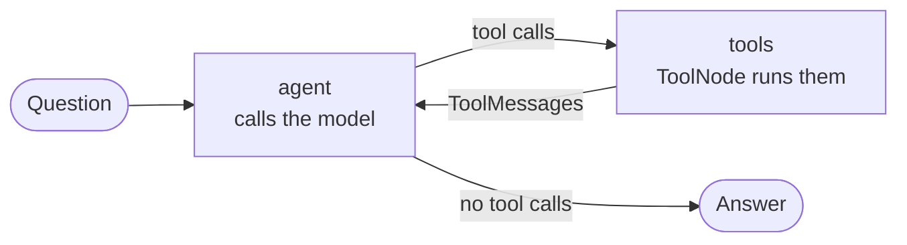

# M22.5 Theory: Tool errors and evaluating tool calls

*[M22 theory](../README.md) · Lesson 22.5 · Notebooks: [`05a_tool_loop_errors_and_evaluation.ipynb`](../../notebook/05a_tool_loop_errors_and_evaluation.ipynb) · [All theory pages](../../../../../theory/README.md)*

## Where tool errors go

A Larkspur Cloud customer asks the support agent *Is my server web-9 up?* The customer has no server called web-9, so the status tool raises `ValueError`. With LangGraph's default settings, `graph.invoke` raises that exception and the customer gets no answer at all.

You will run a tool call, trigger both an invalid argument and an unknown server, then inspect how the loop handles each failure. You will also score tool choice, arguments and the final answer separately. The deterministic examples use LangGraph 1.2.18, langgraph-prebuilt 1.1.1 and langchain-core 1.7.0. Run the Python blocks in order in the repository environment (`uv run python`), without an API key.

### Step 1: Close the loop and read the message count

The agent loop has two nodes. The `agent` node calls the model. The `tools` node (a `ToolNode`) runs every tool call the model asked for and appends one `ToolMessage` per call. An edge from `tools` back to `agent` lets the model read the results, and a router ends the run when the last `AIMessage` has no tool calls.



The message list is the run's trace. An `AIMessage` is a model reply, which can contain tool requests. A `ToolMessage` holds one tool's result and uses `tool_call_id` to match it to its request. The graph's state stores this growing list.

For the Larkspur export question, the scripted lab trace contains four messages: the question, one `AIMessage` requesting `search_handbook`, its `ToolMessage`, and the final answer. The status-and-reboot question contains five messages because one model reply requests two tools. Message count helps diagnose extra work, but it does not establish whether the answer is correct.

### Step 2: Call a tool with valid input

To see what the `ToolNode` does with a failure, take the model out of the picture. The helper below builds a one-node graph and feeds it a hand-written `AIMessage` containing one tool call. With no model in the run, every result is deterministic and needs no API key. The tool checks a customer's servers, web-1 and db-1.

```python
from typing_extensions import Annotated, TypedDict
from langchain_core.messages import AIMessage, BaseMessage
from langchain_core.tools import tool
from langgraph.graph import END, START, StateGraph
from langgraph.graph.message import add_messages
from langgraph.prebuilt import ToolNode

SERVERS = {"web-1": "running", "db-1": "running"}

@tool
def get_server_status(server_id: str) -> str:
    """Get the status of one of the customer's servers."""
    if server_id not in SERVERS:
        raise ValueError(f"Unknown server {server_id!r}; your servers: {sorted(SERVERS)}")
    return f"{server_id}: {SERVERS[server_id]}"

class State(TypedDict):
    messages: Annotated[list[BaseMessage], add_messages]

def run_tool_node(node, args):
    """Run one ToolNode on one hand-written tool call, with no model."""
    g = StateGraph(State)
    g.add_node("tools", node)
    g.add_edge(START, "tools")
    g.add_edge("tools", END)
    call = AIMessage(content="", tool_calls=[
        {"name": "get_server_status", "args": args, "id": "call_1"}])
    try:
        msg = g.compile().invoke({"messages": [call]})["messages"][-1]
        return f"ToolMessage(status={msg.status!r}): {msg.content}"
    except Exception as e:
        return f"RAISED {type(e).__name__}: {e}"

print(run_tool_node(ToolNode([get_server_status]), {"server_id": "web-1"}))
```

**Expected output**

```text
ToolMessage(status='success'): web-1: running
```

A successful call becomes a `ToolMessage` with `status='success'` whose content is the tool's return value. In the full loop, that message goes back to the model as the next input.

### Step 3: Trigger a controlled failure

Change the server to one the customer does not have.

```python
print(run_tool_node(ToolNode([get_server_status]), {"server_id": "web-9"}))
```

**Expected output**

```text
RAISED ValueError: Unknown server 'web-9'; your servers: ['db-1', 'web-1']
```

No `ToolMessage` came back. The exception escaped the graph, which in the real loop means `graph.invoke` raises and the model never sees the error. The exception text is useful, too: it lists the customer's real servers. If the model could read it, the model could ask which one the customer meant.

### Step 4: Compare the three `handle_tool_errors` settings

A tool call can fail in two places. The model can send bad arguments, which fail schema validation before the tool runs. Or the arguments are fine and the tool itself raises, as in Step 3. `ToolNode`'s `handle_tool_errors` setting decides what happens in each case. Run both failures under each setting. The bad call names the argument `id` instead of `server_id`.

```python
settings = {
    "default": ToolNode([get_server_status]),
    "True": ToolNode([get_server_status], handle_tool_errors=True),
    "False": ToolNode([get_server_status], handle_tool_errors=False),
}
for label, node in settings.items():
    print(f"handle_tool_errors={label}")
    print("  bad arguments:", run_tool_node(node, {"id": "web-1"}))
    print("  tool raises:  ", run_tool_node(node, {"server_id": "web-9"}))
```

**Expected output**

```text
handle_tool_errors=default
  bad arguments: ToolMessage(status='error'): Error invoking tool 'get_server_status' with kwargs {'id': 'web-1'} with error:
 server_id: Field required
 Please fix the error and try again.
  tool raises:   RAISED ValueError: Unknown server 'web-9'; your servers: ['db-1', 'web-1']
handle_tool_errors=True
  bad arguments: ToolMessage(status='error'): Error: ToolInvocationError("Error invoking tool 'get_server_status' with kwargs {'id': 'web-1'} with error:\n server_id: Field required\n Please fix the error and try again.")
 Please fix your mistakes.
  tool raises:   ToolMessage(status='error'): Error: ValueError("Unknown server 'web-9'; your servers: ['db-1', 'web-1']")
 Please fix your mistakes.
handle_tool_errors=False
  bad arguments: RAISED ToolInvocationError: Error invoking tool 'get_server_status' with kwargs {'id': 'web-1'} with error:
 server_id: Field required
 Please fix the error and try again.
  tool raises:   RAISED ValueError: Unknown server 'web-9'; your servers: ['db-1', 'web-1']
```

Read it as a table:

| `handle_tool_errors` | Bad arguments from the model | Exception raised inside the tool |
|---|---|---|
| default | Error `ToolMessage` (`Please fix the error and try again.`) | **Re-raised: the run crashes** |
| `True` | Error `ToolMessage` (`Please fix your mistakes.`) | Error `ToolMessage` with the exception text |
| `False` | Re-raised | Re-raised |

For these calls, the default converts the missing required argument into an error `ToolMessage` and re-raises the `ValueError` from inside the tool. Of the three settings tested, `True` converts both failures into messages the model can read. This behaviour depends on the installed version.

### Step 5: Watch what the model does next

An error `ToolMessage` gives the model a chance to recover. It does not guarantee recovery, because the model still has to read the message and choose a sensible next step. Here is the web-9 run under `handle_tool_errors=True`. The tool messages are LangGraph's real output, and the model's two turns are scripted.

| # | Message | Content |
|---|---|---|
| 0 | `HumanMessage` | Is my server web-9 up? |
| 1 | `AIMessage` | Calls `get_server_status(server_id='web-9')` |
| 2 | `ToolMessage`, status error | `Error: ValueError("Unknown server 'web-9'; your servers: ['db-1', 'web-1']")` `Please fix your mistakes.` |
| 3 | `AIMessage` | I can't find a server called web-9 on your account. Your servers are db-1 and web-1. Which one did you mean? |

The scripted next reply asks for clarification using the server names in the error. A live model could choose another action, including an unhelpful retry. Under the default or `False`, the same run raises after message 1, before another model turn.

The [interactive lab](interactive/tool-error-routing-lab.html) runs Larkspur's four golden questions through the full loop under each setting. Its tool results and error texts are byte for byte what LangGraph 1.2.18 produces for the same calls (12 runs, 0 mismatches). The model's turns are scripted, as in the trace above.

| Question | default | `True` | `False` |
|---|---|---|---|
| *Can I export my data after I cancel my plan?* | Answered, 4 messages | Answered, 4 | Answered, 4 |
| *Is my server web-1 running, and does a reboot change its IP address?* | Answered, 5 | Answered, 5 | Answered, 5 |
| *Is my server web-9 up?* (the tool raises `ValueError`) | **Crashed** | Answered, 4 | **Crashed** |
| *How long does a refund take?* (the model passes `q`, not `query`) | Answered, 6 | Answered, 6 | **Crashed** |
| Answered | 3 of 4 | 4 of 4 | 2 of 4 |

<!-- lab: interactive/tool-error-routing-lab.html -->

- **The unknown server is an execution error.** `get_server_status` raises `ValueError("Unknown server 'web-9'; your servers: ['db-1', 'web-1']")`. Only `True` catches it, and the model can then name the customer's real servers, because the exception text lists them.
- **The wrong argument name is a validation error.** The default and `True` both return it as a message, the model retries with `query`, and the run costs one extra round trip (6 messages instead of 4). `False` re-raises it as `ToolInvocationError`.
- **The two questions with no failure behave the same under every setting.** A test suite with only happy-path questions never shows the difference between the settings.

### Step 6: Decide where each error is handled

Choose how the model will receive each failure:

1. **The tool returns the error.** A `divide` tool checks for zero and returns `"Error: Division by zero"`. The model reads it like any other result and explains that division by zero is undefined. Use this when the tool knows the failure in advance: an unknown id, an empty result, an input out of range.
2. **The tool raises and the `ToolNode` catches it.** `handle_tool_errors=True` catches the ordinary exceptions demonstrated here, including unexpected failures from a client library. A custom handler can instead catch selected exception types and return a message intended for the model.

`handle_tool_errors` also accepts a custom string, an exception type or a tuple of them (catch only those), or a function that formats the message. Whichever you choose, write error messages the model can act on. Say what was wrong and what would work, as the web-9 message does by listing the valid servers. Return only information the customer is allowed to see.

Returning a string such as `"Error: Division by zero"` completes the tool normally, so its `ToolMessage.status` is `"success"`. Catching an exception in `ToolNode` produces `status="error"`. Monitoring must account for that difference if tools return failure strings. Letting an exception escape also requires application code to log the failed run and return a fallback response.

### Try it yourself

A customer asks *Is my server db-1 running?* and the model calls `get_server_status` with `{"server": "db-1"}`. Before running anything, predict the result under each of the three settings: a `ToolMessage` with which status, or which exception. Then check your answer with `run_tool_node` from Step 2. A wrong argument name is a validation error, and it should behave like the bad-arguments column in Step 4.

## Tool-call evaluation

A run can finish and still be wrong. The refund question in the lab answers correctly under the default setting, yet its first tool call was malformed and cost an extra round trip. An agent that picks the wrong tool, passes the wrong server id, or ignores what the tool returned can also produce a fluent answer. This section shows how to score each of those failures separately, from the same message trace you read in the previous section.

### Step 1: Split the score into three dimensions

| Dimension | Question | How to score it |
|---|---|---|
| Tool selection | Did it pick the right tool or tools? | Compare called names with the golden set's expected calls |
| Tool input | Were the arguments well formed and relevant? | Validate against the schema, compare key values with the expected ones |
| Synthesis | Did the answer use what the tools returned, and nothing else? | An LLM judge or a reference answer |

Scoring them separately tells you what to fix. A selection score that drops after a description change points at the description. An input score that drops suggests inspecting the schema and the generated arguments. Confirm the cause from the failing calls before changing either description or schema.

### Step 2: Write the expected calls for each golden question

The first two dimensions often need no model at all. Give each golden question its expected calls. *Is my server web-1 running, and does a reboot change its IP address?* expects `get_server_status` with `server_id='web-1'`, and `search_handbook` with any query. *How long does a refund take?* expects `search_handbook` alone.

### Step 3: Score selection and input from the trace

The scorer below reads every tool call from the `AIMessage`s, compares the set of called names with the expected set, and flags any call that is missing a required argument or has the wrong value for a pinned one. It is a small check for these two known tools: it does not validate types, query relevance, call order or duplicate calls. A production scorer should validate against the actual tool schemas and flag unknown tool names before looking up their required fields. The two traces are the model's turns from the lab's status and refund runs.

```python
from langchain_core.messages import AIMessage

# Golden set: for each question, the tools it needs and any argument values that must match
GOLDEN = {
    "Is my server web-1 running, and does a reboot change its IP address?":
        {"get_server_status": {"server_id": "web-1"}, "search_handbook": {}},
    "How long does a refund take?":
        {"search_handbook": {}},
}
REQUIRED = {"get_server_status": {"server_id"}, "search_handbook": {"query"}}

def score_calls(question, messages):
    expected = GOLDEN[question]
    calls = [c for m in messages if isinstance(m, AIMessage) for c in m.tool_calls]
    called = {c["name"] for c in calls}
    bad_input = [
        c["name"] for c in calls
        if not REQUIRED[c["name"]] <= c["args"].keys()
        or any(c["args"].get(k) != v for k, v in expected.get(c["name"], {}).items())
    ]
    return {"selection_ok": called == set(expected), "calls": len(calls), "bad_input": bad_input}

# The model's turns from two runs in the lab
status_run = [AIMessage(content="", tool_calls=[
    {"name": "get_server_status", "args": {"server_id": "web-1"}, "id": "call_1_1"},
    {"name": "search_handbook", "args": {"query": "reboot server IP address"}, "id": "call_1_2"}])]
refund_run = [
    AIMessage(content="", tool_calls=[{"name": "search_handbook", "args": {"q": "refund"}, "id": "call_1_1"}]),
    AIMessage(content="", tool_calls=[{"name": "search_handbook", "args": {"query": "how long do refunds take"}, "id": "call_2_1"}])]

print(score_calls("Is my server web-1 running, and does a reboot change its IP address?", status_run))
print(score_calls("How long does a refund take?", refund_run))
```

**Expected output**

```text
{'selection_ok': True, 'calls': 2, 'bad_input': []}
{'selection_ok': True, 'calls': 2, 'bad_input': ['search_handbook']}
```

Both runs chose the right tools. The refund run's first call is flagged for input because it passed `q` instead of `query`. The lab's trace column makes the same check and marks that call *Right tool, missing `query`*. In a real evaluation you pass `result["messages"]` from `graph.invoke` instead of hand-built messages.

### Step 4: Inspect a synthesis judgement

Synthesis measures whether the final answer uses the returned facts correctly. An LLM judge is another model asked to grade the trace against explicit criteria. Give it the question, tool requests, tool results and final answer, then compare its decisions with human grades.

The following schema names the three scores and their justification. A model supporting `with_structured_output(ToolUseEvaluation)` can return that shape. Here, inspect the saved evaluation offline rather than make a new model call:

```python
from pydantic import BaseModel, Field

class ToolUseEvaluation(BaseModel):
    """Schema for evaluating the agent's tool use and final answer."""
    tool_selection_score: int = Field(description="Score 1-5 on whether the agent chose the correct tools for the task.")
    tool_input_score: int = Field(description="Score 1-5 on how well-formed and relevant the tool inputs were.")
    synthesis_quality_score: int = Field(description="Score 1-5 on how well the final answer integrates the tool outputs.")
    justification: str = Field(description="A brief justification for the scores.")

# Scores and justification saved with the practice trace, not a fresh model judgement.
saved_evaluation = ToolUseEvaluation(
    tool_selection_score=5,
    tool_input_score=5,
    synthesis_quality_score=5,
    justification=(
        "The agent effectively selected the appropriate tools for both calculations and weather "
        "retrieval, demonstrating a clear understanding of the tasks. The inputs for both tools "
        "were well-formed and relevant, directly addressing the user's requests. The final answer "
        "synthesized the outputs from both tools seamlessly, providing a clear and concise response."
    ),
)
print({k: v for k, v in saved_evaluation.model_dump().items() if k != "justification"})
```

**Expected output**

```text
{'tool_selection_score': 5, 'tool_input_score': 5, 'synthesis_quality_score': 5}
```

The saved trace asks *Calculate 15% of 250 and check weather in Paris*. It calls `calculate(expression="0.15 * 250")`, which returns `37.5`, and `get_weather(city="Paris")`, which returns the simulated weather `65°F, Partly Cloudy`. The answer includes both results. Its saved judge scores are 5, 5 and 5, with the justification above. These are one recorded judgement, not a result from the Larkspur lab or a promise that a new judge call will agree.

The schema describes scores from 1 to 5 but uses unconstrained `int` fields. If you need validation to reject out-of-range scores, add `ge=1, le=5` to each score field. Two cautions come with the recorded result:

- **The judge is the agent's own model** (`gpt-4o-mini` judging `gpt-4o-mini`), which tends to be lenient on its own work. Use a different, ideally stronger, model, and check its scores against a few human-graded runs before you trust a trend.
- **A single trace scored 5 out of 5 proves little.** The scores mean something across a fixed golden set, compared before and after one change.

### Step 5: Add trace-level counts

Per-call scores miss the runs that never finish. Log three counts per run as well: rounds per run, error `ToolMessage`s per tool, and crashed runs. They are cheap to collect and catch the failures the lab shows. The web-9 question under the default setting has no answer to score at all, and the refund question's extra round shows up as 6 messages instead of 4.

### Try it yourself

Add the question *Is my server web-9 up?* to `GOLDEN`, expecting `get_server_status` with `server_id='web-9'`. Score the run where the model calls `get_server_status(server_id='web-9')`. Selection and input should both pass, because the model asked for exactly what the customer said. The failure belongs to the tool's error handling, which only the crashed-run count from Step 5 records.

### Practice notebook

The [tool-loop errors and evaluation notebook](../../notebook/05a_tool_loop_errors_and_evaluation.ipynb) builds the full loop with three simulated tools, adds a `divide` tool that returns its own error, runs the three `handle_tool_errors` settings on a stock-price tool, and scores a trace with the judge above.

Its saved arithmetic traces have 4 messages for `What's 25 * 17?` and 5 for *What's 100 / 4 and what's the weather in London?*, matching the one-tool and two-tool patterns above.

The notebook's `create_tool_agent` helper explicitly defaults to `handle_tool_errors=True`, which differs from omitting that argument on `ToolNode`. It configures `llm`, then builds `judge_llm = llm.with_structured_output(ToolUseEvaluation)` and invokes the judge on the flattened trace.

The deterministic examples on this page need no model call. Running the notebook's live agent and judge cells requires its OpenAI setup. Two experiments to try:

- Build `stock_agent` with `handle_tool_errors=False` and ask for the price of NVDA. Note where the run stops.
- Swap `judge_llm` for a different model and compare its scores on the same trace with the ones from `gpt-4o-mini`.

### Continue learning

- [Baseline-first optimisation](../../../../../theory/p04_rag_foundations/m11_rag_lifecycle/05_the_rag_lifecycle_and_a_measured_baseline/README.md#baseline-first-optimisation): how to compare scores across a fixed golden set before and after one change.
- [Hosted vs client-side tools](../06_hosted_vs_client_side_tools_code_execution_and_image_generation/README.md): what changes when the provider runs the tool instead of your code.

## Key Takeaways

- Choose error routing explicitly. In the tested version, default `ToolNode` handles the missing argument but re-raises the tool's `ValueError`; `True` returns both as error messages. Returning a failure string normally produces a success-status message.
- Write error messages the model can act on, saying what was wrong and what would work. Happy-path tests never show the difference between settings.
- Score tool selection, tool input and synthesis separately. The first two come straight from the trace. Judge synthesis with a different model, across a fixed golden set.

## Check yourself

<details>
<summary>1. Why does it matter whether a tool failure reaches the model as a message or escapes as an exception?</summary>

As an error `ToolMessage`, the model can explain the failure or retry with better arguments. As an exception, `graph.invoke` raises before the model can recover. Application code must handle that failure if the user is to receive a fallback response. You send it to the model either by returning the error from the tool or by letting the `ToolNode` catch it.

</details>

<details>
<summary>2. A customer asks whether web-9 is up, and the server-status tool raises ValueError. Under which error-handling setting does the run still answer, and how does the model help?</summary>

Only `handle_tool_errors=True`. The default re-raises exceptions raised inside the tool, and `False` re-raises everything, so both crash. With `True` the exception text reaches the model, and because it lists the customer's servers (`db-1` and `web-1`), the model can name them.

</details>

<details>
<summary>3. After a description edit, the tool selection score drops while the input score holds. Where do you look, and why is no model needed to score it?</summary>

Inspect the changed description and the failing calls. A selection drop suggests the model is choosing the wrong tool. An input drop suggests inspecting the schema and arguments. Both scores come from the message trace, by comparing the called names and arguments with each golden question's expected calls. Only synthesis needs an LLM judge.

</details>

---
*Previous: [22.4 The manual tool loop and the augmented LLM in LangGraph](../04_the_manual_tool_loop_and_the_augmented_llm_in_langgraph/README.md). Next: [22.6 Hosted vs client-side tools: code execution and image generation](../06_hosted_vs_client_side_tools_code_execution_and_image_generation/README.md).*
