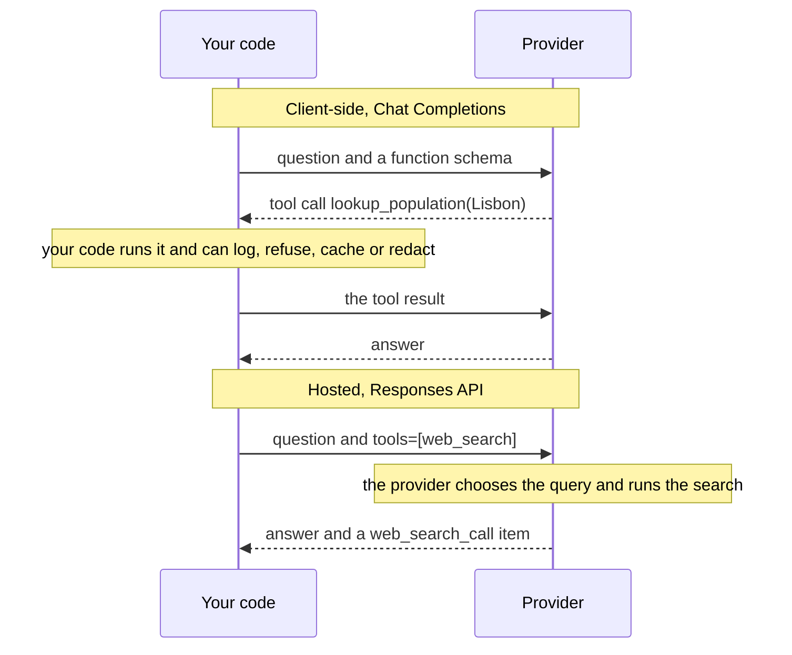
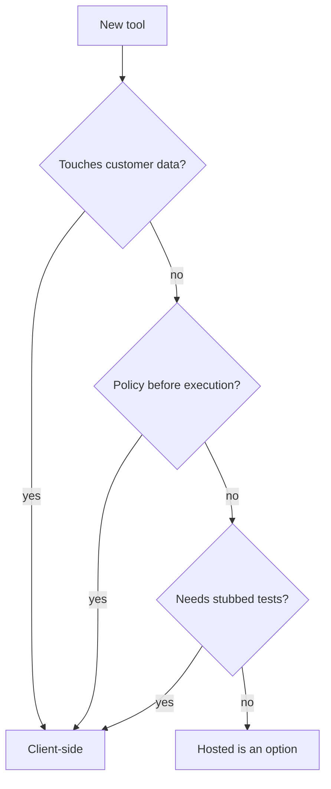

# M22.6 Theory: Hosted vs client-side tools: code execution and image generation

*[M22 theory](../README.md) · Lesson 22.6 · Notebooks: [`06a_hosted_vs_client_side_tools.ipynb`](../../notebook/06a_hosted_vs_client_side_tools.ipynb), [`06b_hosted_code_execution.ipynb`](../../../optional/notebook/06b_hosted_code_execution.ipynb) (optional), [`06c_agentic_image_generation.ipynb`](../../../optional/notebook/06c_agentic_image_generation.ipynb) (optional) · [All theory pages](../../../../../THEORY.md)*
<!-- subtitle: Where the tool runs decides what you can see, refuse, test and pay for -->
<!-- format: approved -->

## Hosted vs client-side tools

> **What you'll learn**
>
> - **Explain** the difference between a client-side tool and a hosted tool, call by call.
> - **Compare** what each path lets you see, refuse, test and pay for.
> - **Diagnose** where a policy check can sit, and why a hosted tool has no place for it.
> - **Choose** where each of Larkspur's tools should run.

Every tool in lessons 22.1 to 22.5 ran in your process. This lesson moves a tool to the provider's side and looks at what you give up.

Larkspur has to confirm that a customer owns a server before showing its status. That check has to happen before the lookup runs, in code Larkspur controls. A public web search has nothing comparable to enforce. Where a tool runs decides whether such a check is even possible.

### Two execution paths

A **client-side tool** is the kind built so far: the model returns a call, your code runs it, and you send the result back. A **hosted tool** runs on the provider's infrastructure instead, and the reply arrives with the result already folded in. The change in the request is small. The change in what you can see and control is large.

The recorded comparison answers *What is the current population of Lisbon?* both ways with the same small model:

*Figure 1: The same question on both paths. Only the client-side path passes through your code between the call and the result.*

| | Client-side | Hosted |
|---|---|---|
| Round trips | 2 | 1 |
| Time in the recorded run | 1.86 s | 3.16 s |
| Who chose the search query | Your code | The provider ("current population of Lisbon 2023") |
| Raw results visible | Yes | No |

*Table 1: One recorded run of each path.*

One run proves little about latency, but it does show that one round trip is not automatically faster. The hosted reply carries a record of the search with its status and the query the provider chose. That record is your only window into the execution: you did not choose the query, you cannot see the raw results, and nothing of yours ran between retrieval and generation.

| | Client-side | Hosted |
|---|---|---|
| Who executes | Your process | The provider's infrastructure |
| See the arguments | Yes, before execution | Sometimes, after the fact |
| Intercept or refuse a call | Yes, it is your code | No |
| Deterministic tests | Yes, replace the tool with a stub | No, it reaches the live world |
| Failure | Your exception, your retry | A status across an API boundary; you can only re-run the whole request |
| Cost | Tokens and your infrastructure | Tokens and a fee per tool call (code interpreter: per container session) |

*Table 2: What each path gives you.*

### The policy gap

The gap between "the model asked" and "the model sees the result" is where policy lives. We call it the **policy gap**. In the recorded example, a guarded version of the client-side lookup refuses any city outside an allow-list:

Choose a path to see what happens to the same two questions when an allow-list is needed.

<button type="button" data-mode="client" aria-pressed="false" aria-controls="gap-client">Guarded client-side lookup</button><button type="button" data-mode="hosted" aria-pressed="false" aria-controls="gap-hosted">Hosted search</button>

<section id="gap-client" class="mode-panel" data-announcement="Client-side selected. The allow-list refuses Pyongyang."><h4>Guarded client-side lookup</h4><dl><dt>Population of Lisbon</dt><dd>runs; the model answers</dd><dt>Population of Pyongyang</dt><dd>refused with an error by your code; the model says it cannot retrieve that population</dd><dt>Where the check sits</dt><dd>between the call and the result, in your process</dd></dl></section>
<section id="gap-hosted" class="mode-panel" data-announcement="Hosted selected. Both questions would run."><h4>Hosted search</h4><dl><dt>Population of Lisbon</dt><dd>runs; the model answers</dd><dt>Population of Pyongyang</dt><dd>would run; nothing of yours sits between the call and the result</dd><dt>Where the check sits</dt><dd>nowhere you control</dd></dl></section>

Allow-lists, tenant scoping, redaction of personal data and spend caps all sit in that gap. Choosing a hosted tool means choosing not to have it.

> **Key distinction:** a hosted tool can be well run and still impossible to govern. What decides the placement is whether anything must happen between the call and the result.

### What each hosted tool shows you

Hosted tools expose different amounts of their execution:

| Hosted tool | What comes back besides the answer |
|---|---|
| Web search | Roughly the query; no raw results |
| Code interpreter | The code it ran, its output and any files, so you can audit the method |
| Image generation | The revised prompt the model wrote for itself, and the image |

*Table 3: Visibility by hosted tool.*

Code interpreter is also configurable: notebook 06b sets a 1 GB memory ceiling and turns network access off, and the sandbox then works only on data you supplied. What you still cannot do is approve the code before it runs, veto one call, or replace it with a stub in a test.

Image generation adds a different caution. The agent describes what it *meant* to draw, and only showing the image to a vision model reveals what it actually drew. We call that **narrated output**: a description of the result that nobody checked against the result. The model also has to leave the tool alone when a turn asks for advice rather than an image, and the recorded example checks that it does.

## Choosing where each tool runs

The decision follows the data the tool touches:

*Figure 2: Three yes/no questions. Any yes keeps the tool in your process.*

For Larkspur's support agent, the split is:

1. **The handbook search and the server-status lookup stay client-side.** They read the customer's account and Larkspur's own policy, need tenant scoping and logging, and must be replaceable with stubs in tests. The M22 lab runs them deterministically for this reason.
2. **A hosted web search fits questions the handbook cannot answer**, about public software or third-party services, where there is nothing to enforce between the call and the result.
3. **Hosted code execution fits arithmetic on numbers the customer pasted into the chat.** A model that runs three lines of code computes the answer; a model that answers directly produces plausible-looking digits.

In OpenAI's API, hosted tools are offered through the Responses API, while Chat Completions carries client-side function calls. Check which API your integration and provider version support before choosing a wrapper. A third placement, a tool on a server you run that the model reaches over a protocol, is MCP (M38 to M40), and it gives back much of the control that hosted tools remove.

## Limits of this evidence

- **One run per path.** The latencies in Table 1 come from a single recorded run each; measure on your own traffic before deciding anything on speed.
- **One provider.** The visibility in Table 3 is what OpenAI's hosted tools returned in the recorded examples; other providers expose more or less.
- **Not re-run.** The notebooks ship without outputs, and the timings and the provider's query in Table 1 come from an earlier recorded run that we did not repeat.

## References

1. OpenAI, [function calling guide](https://platform.openai.com/docs/guides/function-calling).
2. OpenAI, [web search tool](https://platform.openai.com/docs/guides/tools-web-search).
3. OpenAI, [code interpreter tool](https://platform.openai.com/docs/guides/tools-code-interpreter).
4. OpenAI, [image generation tool](https://platform.openai.com/docs/guides/tools-image-generation).
5. Model Context Protocol, [introduction](https://modelcontextprotocol.io/introduction).

## Key Takeaways

- A hosted tool runs on the provider's side and returns the result folded into the reply. You lose the policy gap, where your code can log, refuse, redact or cache a call.
- Hosted tools vary in visibility: web search shows roughly the query, code interpreter shows the code and output, image generation shows its revised prompt. None can be replaced with a stub in a test.
- Keep tools that touch customer data or need tenant scoping client-side. Use hosted tools for public lookups and arithmetic on data the user supplied.

## Check yourself

1. What do you give up when you move a tool from client-side to hosted?

The gap between the model asking and the model seeing the result, which is where policy lives: allow-lists, tenant scoping, redaction and spend caps. You also lose the chance to see arguments before execution, refuse a call, or replace the tool with a stub in a deterministic test, and a failure can only be handled by re-running the whole request.

2. Larkspur's support agent needs the customer's server status and an answer about a third-party service. Which should run client-side, and which suits a hosted tool?

The server-status lookup stays client-side: it reads the customer's account, needs tenant scoping and logging, and must be stubbed in tests. A hosted web search fits the third-party question, which the handbook cannot answer and where there is nothing to enforce between the call and the result.

3. The hosted search took one round trip and 3.16 s, the client-side path two and 1.86 s. Is hosted the way to cut latency?

Not on this evidence. One round trip is not automatically faster: in that run the hosted path was the slower one. One run also proves little about latency, so measure on your own traffic, and remember that going hosted removes the gap where your code could log, refuse or redact the call.

---
*Previous: [22.5 Tool errors and evaluating tool calls](../05_tool_errors_and_evaluating_tool_calls/README.md). Next: [M22 interview questions](../README.md#interview-spotlight-5-questions-you-might-get-asked).*
