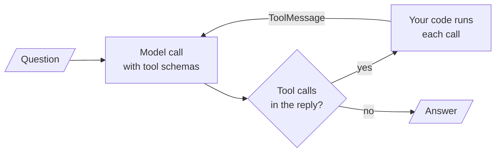

# M22 Theory: The agent loop and tool calling

*Part VI · Agent Foundations · [Module README](../../README.md) · [All theory pages](../../../../THEORY.md)*

A language model on its own can only write text. It cannot check whether a server is running or look up a policy. Tool calling closes that gap: you describe a few functions to the model, the model replies with a request to call one of them, your code runs the function, and the result goes back to the model as part of the conversation. An agent is a loop around that exchange, repeated until the model has what it needs to answer. This module covers how the loop works, how a tool is described to the model, what happens when a tool fails, how to score whether the model used its tools well, and when to let the provider run a tool for you. Each idea has a page in the folder of the lesson that teaches it, listed under [Lessons](#lessons). This page has the overview, the interview questions and the takeaways.

The running example is a support agent for Larkspur Cloud, the fictional host from M10 to M12. It has two tools that run in your own code (client-side tools). `search_handbook` ranks the twelve handbook chunks from the [M10 lab](../../../../p04_rag_foundations/m10_rag_lifecycle/mandatory/theory/README.md) with TF-IDF and returns the best two. `get_server_status` looks up one of the customer's servers. The agent is tested on a small fixed set of questions with known right answers (a golden set). One comes from M10 (*Can I export my data after I cancel my plan?*). One needs both tools (*Is my server web-1 running, and does a reboot change its IP address?*): the model has to request two calls, your code has to run them, and both results have to come back before it can answer. Two fail on purpose: one asks about a server that does not exist, and in the other the model names a tool argument wrongly.

## TL;DR

- The loop has one rule. While the model's reply contains tool calls, run them, add the results to the conversation and call the model again. A reply with no tool calls is the answer. Because a confused model can keep calling tools indefinitely, the loop also needs a cap on the number of rounds and a fallback reply for when the cap is reached. Reaching the cap means the run stopped, not that the task was done.
- The model never sees your function's code. It sees only the tool's schema: a name, a description and a list of typed parameters. If a parameter has no declared type or description, the schema says nothing about it and the model has to guess what to send.
- Each tool call gets exactly one result message, linked to the call by an id, so the model knows which result answers which request. In the lab, the two-tool question ends with 5 messages in the conversation: the question, the model's reply requesting both calls, two results and the answer. A call that fails once and is retried ends with 6.
- A tool failure has to reach the model as a message it can read and react to. If the failure escapes as an exception instead, the whole run crashes. LangGraph's `ToolNode` setting `handle_tool_errors` decides which failures become messages. Its default turns invalid arguments into messages but lets exceptions raised inside the tool through. In the lab, `True` answers 4 of the 4 questions, the default answers 3 and `False` answers 2.
- Evaluate three things separately: did the model pick the right tool, did it send valid arguments, and did it write a correct answer from the results. For execution, run a tool in your own code when it touches customer data or anything you must check before it happens. A hosted tool, which the provider runs on its own servers, suits general-purpose work where you have nothing to enforce between the request and the result.

## Mental model

<!-- animated: diagrams/agent-loop.anim.html -->

The model never runs anything itself. It writes a structured request, and your code decides whether to run it, runs it, and writes the result into the conversation as a tool result message (a `ToolMessage` in LangChain). That division is where control sits. Your code can validate the arguments, refuse a call, redact the result or log it, and the model only learns what you send back. Every later agent in this course, from `create_agent` to a multi-agent graph, is this loop with more machinery around it.

## Lessons

| Lesson | Topic | Theory |
|---|---|---|
| 22.1 | Agentic patterns from scratch: reflection, tool use, ReAct planning | [Agent loop](01_agentic_patterns_from_scratch_reflection_tool_use_react_planning/README.md#agent-loop) |
| 22.2 | A real-world agent on raw API calls (Hacker News chatbot) | *planned* |
| 22.3 | Defining tools and binding them to a model | [Tool schema](03_defining_tools_and_binding_them_to_a_model/README.md#tool-schema) |
| 22.4 | The manual tool loop and the augmented LLM in LangGraph | [Native tool calls and the message trace](04_the_manual_tool_loop_and_the_augmented_llm_in_langgraph/README.md#native-tool-calls-and-the-message-trace) [The augmented LLM](04_the_manual_tool_loop_and_the_augmented_llm_in_langgraph/README.md#the-augmented-llm) |
| 22.5 | Tool errors and evaluating tool calls | [Where tool errors go](05_tool_errors_and_evaluating_tool_calls/README.md#where-tool-errors-go) [Tool-call evaluation](05_tool_errors_and_evaluating_tool_calls/README.md#tool-call-evaluation) |
| 22.6 | Hosted vs client-side tools: code execution and image generation | [Hosted vs client-side tools](06_hosted_vs_client_side_tools_code_execution_and_image_generation/README.md#hosted-vs-client-side-tools) |

## Interactive lab

[**Where a tool error goes**](05_tool_errors_and_evaluating_tool_calls/interactive/tool-error-routing-lab.html): open the file in a browser. It replays the support agent on the four golden questions under each `handle_tool_errors` setting. Pick *Is my server web-9 up?* first. The server lookup raises a `ValueError` because web-9 does not exist, and only `True` turns that exception into a message the model can answer from. Then pick *How long does a refund take?*, where the model names the search argument `q` instead of `query`. That is an invalid-argument error, which the default setting does catch: the model reads the error, retries with the right name and answers after one extra round trip, while `False` crashes. The table under the trace counts how many of the four questions each setting answers.

## How it connects

- **Before:** [M10](../../../../p04_rag_foundations/m10_rag_lifecycle/mandatory/theory/README.md) built the handbook index that `search_handbook` wraps. M08 and M09 taught the LangGraph state, reducers and conditional edges that the 22.4 and 22.5 graphs use. M19 built the end-to-end retriever that this module's lab asks you to wrap as a tool.
- **Next:** [M23](../../../m23_react_agents/mandatory/theory/README.md) packages this loop as a ReAct agent with LangChain's `create_agent`. M24 to M27 add workflow patterns, planning and human approval around it. M28 to M31 put the retriever inside the loop (agentic RAG), and M38 to M40 reach tools over MCP, a protocol through which the model calls tools on a server you run.

## Interview Spotlight: 5 Questions You Might Get Asked

*Production questions of the kind asked in applied AI engineering interviews.*

### 1. Larkspur's support agent returns a 500 whenever a customer mistypes a server name ("Is web-9 up?"). The logs show `ValueError: Unknown server 'web-9'`. The tool works for valid names. What is wrong, and what do you change?

**What a strong answer covers:**
- The exception escapes the tool-running step. `ToolNode`'s default turns invalid arguments into messages but re-raises exceptions from inside the tool, so the whole run fails and the model never sees the error
- Two fixes: set `handle_tool_errors=True`, or have the tool catch the failure and return a descriptive error string. Either way the model receives a tool result marked as an error and can respond to it
- Makes the error text useful to the model by listing the customer's real servers, so the model can ask "did you mean web-1?" instead of apologising
- Adds the typo to the golden set and alerts on the share of error results per tool, so a new failure mode shows up before customers report it

### 2. A product manager wants to drop `search_handbook` and give the agent the provider's hosted web search, since "the handbook is public anyway". What do you weigh before agreeing?

**What a strong answer covers:**
- Where a tool runs decides how much control you have. With a client-side tool you see the arguments before anything runs, can refuse or redact, and own the raw result. With hosted web search you see a status and the query only after the search has happened
- Accuracy and scope: the handbook index returns Larkspur's own current policy with chunk ids the answer can cite, while web search can return third-party pages or an old cached copy
- Testing and cost: a client-side tool can be replaced by a stub that returns fixed results, which makes tests repeatable. A hosted call hits the live web and is billed per call on top of tokens
- A reasonable split: client-side for anything that touches customer data or policy, hosted search only for questions the handbook cannot answer, and a log of which path produced each answer

### 3. You change the description of `get_server_status` and swap in a new model in the same release. How do you know the agent still calls the right tool with the right arguments?

**What a strong answer covers:**
- A golden set of questions with the expected tool calls, run before and after. Change one thing at a time, so a regression points at its cause
- Scores tool selection and tool arguments directly from the trace (the tool names match, the arguments validate against the schema). These checks are deterministic and need no judge
- Uses an LLM judge only for the final answer, from a different and ideally stronger model than the agent, checked against a few traces graded by people, because a model grading its own run tends to be lenient
- Watches production too: how often each tool is called, the share of error results, and rounds per run, split by question type

### 4. A trace shows the agent calling `search_handbook` eight times with slightly different queries for "How long does a refund take?" before it gives up. What is going on, and how do you stop it?

**What a strong answer covers:**
- Checks the tool results first. TF-IDF matches exact tokens, so "refund" never matches "Refunds" in the `refund-timing` chunk. The tool returned the wrong chunk or nothing, and the model kept rephrasing in the hope of a better result
- Fixes the retriever (embeddings or query rewriting, M13 and M17) rather than the loop, and makes an empty result say so plainly, so the model can stop searching and say it found nothing
- Caps the loop anyway, with a round limit in a hand-written agent or LangGraph's `recursion_limit`, and returns a fallback answer when the cap is hit
- Monitors for repeated near-identical calls in traces, since each round costs a model call and adds latency

### 5. The model sometimes calls `get_server_status` with "my database server" instead of an id like `db-1`. The schema says `server_id: string`. How do you make wrong arguments rarer, and what catches the ones that remain?

**What a strong answer covers:**
- The schema is all the model reads. Describe the argument in the schema with the id format and an example, and say in the tool description when to use the tool
- Constrains the type where the values are known, for example an enum of the customer's server ids, so a free-text value fails validation instead of reaching the lookup
- Sends validation errors back as messages (the `ToolNode` default does this), so the model can retry with a valid id
- Measures the tool-argument score on the golden set before and after the description change, and keeps the version that scores better

## Key Takeaways

- Write the loop's exit conditions first: a reply with no tool calls is the answer, and reaching the round cap means stop with a fallback, not success.
- Treat the tool schema as the interface. Give every argument a type and a description, because the model reads nothing else about your function.
- Every tool failure must come back as a tool result the model can read. Set `handle_tool_errors` deliberately and test it with a tool that raises.
- Run tools that touch customer data in your own code, where you can log, refuse and stub them. Hosted tools fit general-purpose capabilities where you have nothing to enforce.

---
*Previous: [M21 Framework fluency: LlamaIndex](../../../../p05_retrieval_quality_and_rag_apps/m21_llamaindex/mandatory/theory/README.md). Next: [M23 ReAct agents and LangChain create_agent](../../../m23_react_agents/mandatory/theory/README.md).*
